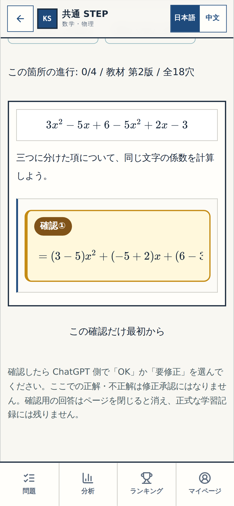
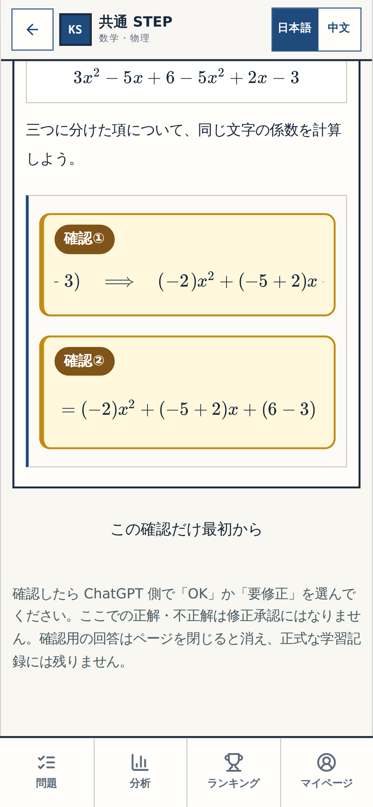
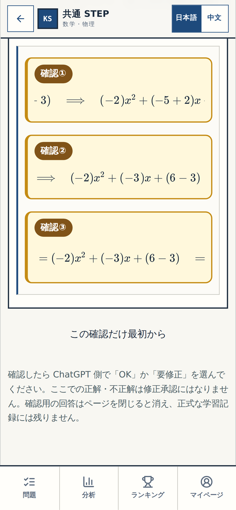

# N01 Q07｜3か所だけ見てください

> ✅ **細部OK 記録済み（2026-10-19 14:55 JST）** — 下の黄色い枠は確認時の実画面を保存した履歴です。アプリ全体のチェックや公開はまだ承認されていません。

このページは、実際の学習アプリを操作して撮った画面です。**黄色い「確認①〜③」だけ**見て、計算・見た目が意図どおりか判断してください。下の写真は正解を確定した記録ではなく、各「選択」の直前を撮ったものです。

## まず見る計算

元の問題：**3x² − 5x + 6 − 5x² + 2x − 3**。

| 黄色い番号 | ここだけ確認 | 期待する計算結果 |
| --- | --- | --- |
| **確認①** | x² の係数：3 − 5 | **−2** |
| **確認②** | x の係数：−5 + 2 | **−3** |
| **確認③** | 定数：6 − 3 | **3** |

### 確認①｜x² の係数

### 確認②｜x の係数

### 確認③｜定数

### PC の画面でも確認

[確認①（PCの実画面）](assets/n01-q07-review-1-desktop-1440.png) · [確認②（PCの実画面）](assets/n01-q07-review-2-desktop-1440.png) · [確認③（PCの実画面）](assets/n01-q07-review-3-desktop-1440.png)

> **既知の表示上の注意：** 式は横に長く、スクリーンショットでは左右の一部が画面幅で切れて見えます。黄色い確認箇所と計算は写っていますが、これが不便だと思ったら「要修正：N01の式が切れる」と返してください。勝手には直していません。

## 確認結果（履歴）

- **「細部OK N01 Q07」** を確認済みとして記録。新しい再確認は求めません。

[← 2つの確認ページの入口](README.md) · [次の N03 Q10 の4か所を見る](N03-Q10.md)

---

証拠：実アプリの逐次操作から採取した Playwright 画面。ソース／撮影 SHA `3ffe0bab97da9a509d7fe21ce7aa9dd78b52b141`、GitHub Actions [39203622766](https://github.com/rrikunagasige-dot/kyotsu-step-web/actions/runs/39203622766)、スマホ390px＋PC1440pxを検査。学習記録を変更しない確認専用画面です。細部の視覚確認は2026-10-19に承認済み。
