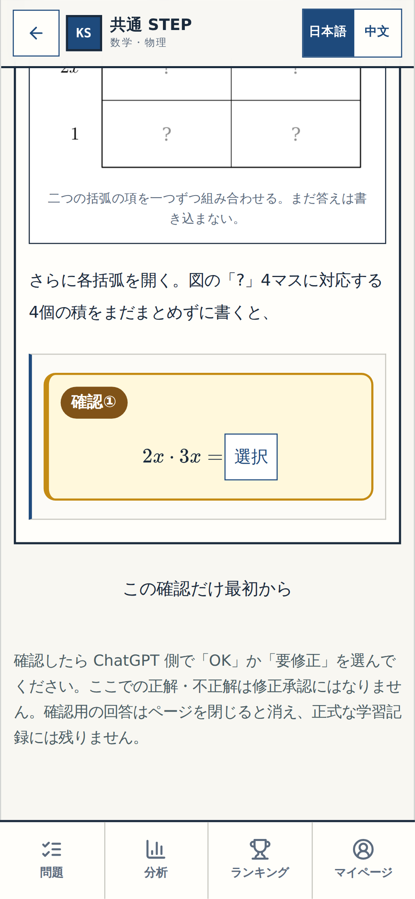
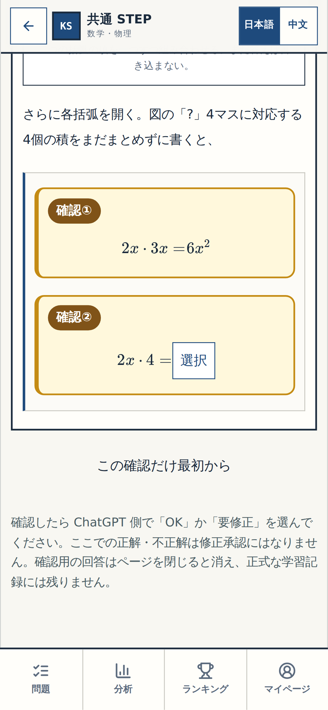
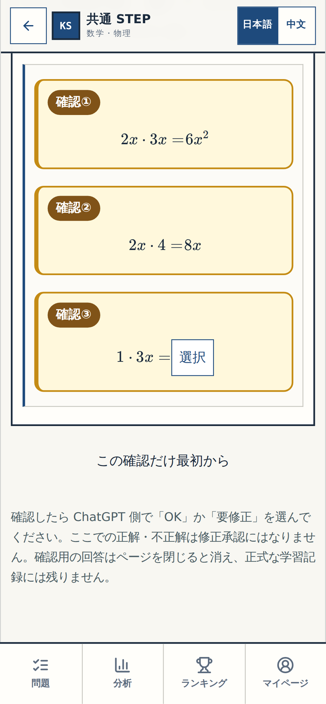

# N03 Q10｜4つの「積」だけ見てください

> 🟡 **あなたの確認待ち（細部チェック）** — 全体チェックや公開の承認ではありません。

実際の学習アプリの黄色い「確認①〜④」を順に撮影しました。**4つの掛け算と黄色い枠**が意図どおりか見てください。前の確認に答えて次を表示させた、連続した本物の画面です。

| 黄色い番号 | ここだけ確認 | 期待する積 |
| --- | --- | --- |
| **確認①** | 2x × 3x | **6x²** |
| **確認②** | 2x × 4 | **8x** |
| **確認③** | 1 × 3x | **3x** |
| **確認④** | 1 × 4 | **4** |

### 確認①｜2x × 3x

### 確認②｜2x × 4

### 確認③｜1 × 3x

### 確認④｜1 × 4

## あなたの返事（ChatGPT に一言だけ）

- 問題なければ **「細部OK N03 Q10」**
- 違っていれば **「要修正 N03 Q10：確認③のここ」** のように番号と気になる箇所だけ

[← 2つの確認ページの入口](README.md) · [前の N01 Q07 を見る](N01-Q07.md)

---

証拠：実アプリの逐次操作から採取した Playwright 画面。ソース／撮影 SHA `3ffe0bab97da9a509d7fe21ce7aa9dd78b52b141`、GitHub Actions [39203622766](https://github.com/rrikunagasige-dot/kyotsu-step-web/actions/runs/39203622766)、スマホ390px＋PC1440pxでテスト。ユーザー承認や最終総チェックはまだ未実施。
