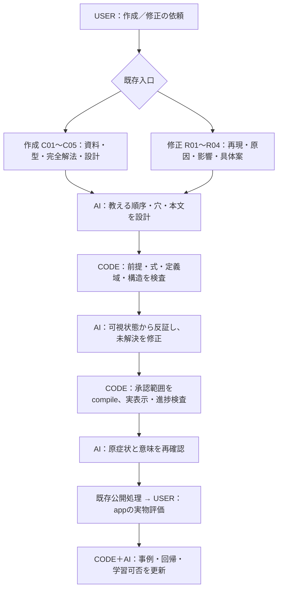

# 一問の解法を中心にした制作基盤 solution/1

Status: OPT_IN_IMPLEMENTED。教材の品質承認・公開とは別。既存production/2の作成と修正を拡張する。
承認と範囲は `work/items/W-GOV-011-solution-production/`。旧IRと旧readerは既存経路を使う。

## 責任の分担

| 入る工程 | CODEがすること | AIがすること | USERがすること |
|---|---|---|---|
| C01原資料／R01原資料変更 | 原本hash、位置付き抽出、全説明・図・条件の対応、用途許諾の宣言確認 | 抽出と原本の照合、番号のない説明・条件の意味を読む | 原資料や追加要望を与える |
| C03解法型／R02原因 | 参照型の検索、事例の版・適用範囲を固定 | 今回の問題へ使える条件と使えない条件を説明 | 原症状を伝える |
| C04完全解法／R02・R04 | 状態と変形の接続、既習、恒等性、定義域、値と指定形を別検査 | 小目標・根拠・省略箇所・原問の結論を組み立てる | — |
| C05設計／R04 | 穴の候補を前提で絞る、候補採否の全件記録、正答同値・重複選択肢、slotの結合 | 判断・式生成・導出・計算・意味のうち何を考えさせるか、文章と誤答根拠を決める | 具体案への既承認を適用する |
| C07／R06実装 | 同じIRから本文・式番号・共有空欄・可視snapshot・図を生成 | 生成前後で意味が変わっていないか読む | — |
| C08／R07検査 | 四幅の描画・操作、保護hash、進捗、再開、環境とphase付きreceipt | 可視状態だけで次へ進めるか反証する | — |
| C09／R07意味審査 | 要求hash、phase、指摘根拠、事例消化の欠落を拒否 | 説明の自然さ、考える余地、一問全体への復帰、低支援版の妥当性を審査 | 公開appで実物を評価する |
| L01／R08事例化 | 可視文脈を学習入力へ保存、family/episode/inputで分割、観点別学習可能性・棄権 | 元発言の対象版・観点を特定、不明をUNKNOWNへ残す | 肯定・否定の原評価を与える |

R01/R02/R04の原資料追加では同じresearchサービスを呼べる。新規入口は作らない。`research_extract:true` の必須接続はC01およびsource facet付きR01。
新規教材の公開は既存release処理を使い、新しい画像承認工程を作らない。



これは責任を説明する設計図。実行の合否・待機は既存台帳から生成する三階層火柴図が正本。

## 実行契約と環境

- Python 3.11以上、`python -m pip install -r tools/textbook/research/requirements-solution.txt`。SymPy 1.14.0固定。
- `KYOTSU_MATH_PYTHON` にそのPythonを指定する。依存不足はUNSUPPORTEDであり数学合格にならない。
- Node/pnpmは既存package.json/lockを使う。新規React・学習frameworkは導入しない。
- 教材planは既存 `workflow_version:"production/2"` に `solution_pipeline:"solution/1"` を加える。未指定のC/RとIR v1はそのまま。
- `research_extract:true` は取り込むsourcePath/sourceIdを宣言した場合だけ指定する。OCRや抽出の成功を原式の正しさとみなさない。
- キャッシュはコード、入力、正本、phase、規則、Python/SymPy版へ結ぶ。別phaseの監査結果を流用しない。

```bash
# 自作fixture生成と再現確認。教材データへ書き込まない。
node tools/textbook/fixtures/build-solution-examples.mjs
node tools/textbook/fixtures/build-solution-examples.mjs --check
node tools/textbook/cli.mjs production --operation verify --input tools/textbook/fixtures/solution-generated/linear-ir.json
node tools/textbook/cli.mjs production --operation compile --input tools/textbook/fixtures/solution-generated/linear-ir.json --out work/items/W-GOV-011-solution-production/compiled-example.json
# 既存runnerは工程内の全capabilityへ入力を渡し、receiptを同じStoreへ保存する。
python workflow/cli.py --help
```

| operation / capability | 入力 | 出力・次へ渡すもの |
|---|---|---|
| research.extract | sourcePath/sourceId/engine | block位置、原本hash、原式未照合状態 |
| research-manifest / research.ingest | manifest | 要求範囲・重複・許諾不足 |
| research-analysis / research.analyze | manifest/extraction、またはrequest/response | 位置付き観察と補完した説明を別保存 |
| research-patterns | patterns/query | 適用前提・除外条件付き候補。採用判断はAI |
| solution-validate / math.solve / math.verify | graph またはkind:solution＋graph | 構造と全transitionの厳密計算receipt |
| teaching.plan / step.plan | graph | 完全解法から既習順に整えた候補。AI選択が必要 |
| interaction-plan / blank.plan | graph/candidates | state時点の前提で候補を絞る。plan/decisionsで採否全件を照合 |
| verify / ir.verify / prose.compose | production-ir/2 | source逆対応、全変形、穴、図、形、選択肢の検査 |
| compile / render.solution | production-ir/2 | solution-reading/1。本文・式・番号・slot・図を一緒に生成 |
| novice.audit | ir | 回答前だけの可視状態。未開封hint・正答・未来行を渡さない |
| solution-review | visible/context またはrequest/response | phase/hash/出典/事例ID/具体的指摘を持つ意味審査 |
| solution-context | visible | 正答・評価を含まない一問の学習入力 |
| solution-observation | quote/sourceRef/artifactVersion/scope | UNKNOWN観測。承認だけでGoldを作らない |
| solution-evaluability | corpus | 観点別両クラス件数、OFFLINE_ONLY、昇格なし |

最後の三つは既存 `production_cli.py` と `cli.mjs production --operation ...` から呼ぶ。L01のcase.finalizeはsolutionContextsから入力を再構成し、既存curation→examples→ml.trainへつなぐ。
case.finalizeのcurationを使うときは既存の原評価イベント照合が必要。別チャットの曖昧な対象を推測でラベル付けしない。

## 一問と穴の契約

- graphのstateは一問全体の数学的状態。transitionはfrom/to、操作、対象、必要既習、根拠、生成事実を持つ。
- `steps`はそのtransitionを全件、根から結論まで覆う。局所補助計算には復帰先stateを付ける。
- 正答を穴にするASTのpathを指定する。同じ操作の両辺はslot二つでもinteraction一つ。attempt/進捗はinteraction ID一つへ保存する。
- 数式はASTからKaTeXへ変換する。本文中の式もmath、最初の概念定義はterm/first_definition。
- 選択肢の複数計算はchoices.rowsで一行ずつ。数値一致と指定形を分け、正答と同値の誤答を拒否する。
- readerは問題・条件・開始式を保持し、完了行を積み上げる。未来行はDOMへ入れない。式番号は本文と別の列へ置く。
- 式が長い場合は式の領域内だけスクロールする。画面全体を横へはみ出させない。
- コンパイルした正答は配信JSON内に存在する。試験の秘匿機構ではなく、教材の表示順と考える機会を守る設計。

## 現時点の対応境界

厳密検査：有理数係数・次数4以下の恒等式、数値の同一操作、不等号反転、一変数実数の解集合、数値定義域の二次関数最大最小と達成点、区間の被覆・重複。
未対応：符号未確定の文字で割る操作、文字係数による極値の場合分け、一般証明、根号式の一般変形。UNSUPPORTEDをAIの説明でPASSへ上書きしない。
最初のreaderは根から結論へ進む直線的な解法を対象とする。graphの合流や循環は拒否する。区間partition検査は用意したが、一般分岐教材の自動構成・UIとは別である。
SymPyの検算は形式証明ではない。AIの教育判断、原本の原式照合、実際の学習効果を代用しない。

Doclingは任意adapterで、モデルの取得・精度比較・採用をまだ実行していない。PDF nativeはPyMuPDFが任意依存。既定のHTML/Word取込と区別する。
低支援variantは同じgraphを共有する完成例＋穴の減少の実装fixture。自立して解ける効果を実証したという意味ではない。
学習は既存multilingual-e5-smallと観点別headを再利用する。今回の新観点に原評価付きの両クラスが足りなければheadを学習せず棄権する。新モデルの性能・学習実行は、この変更で主張しない。

## テスト

```bash
node --test tools/textbook/tests/solution-v2.test.mjs
python -m unittest discover -s workflow -p test_solution_pipeline.py -v
python -m unittest tools.textbook.tests.solution_context_test
pnpm exec playwright test --config tools/textbook/preview/playwright.config.ts
```

previewは実装検証用の自作例題のみ。320/390/430/1440幅、誤答・正答・hint・同じ穴の共有・結論保持・図の時点・再読込・横はみ出し・KaTeXエラー・式番号衝突を検査する。本番namespaceと異なる保存先を使う。
