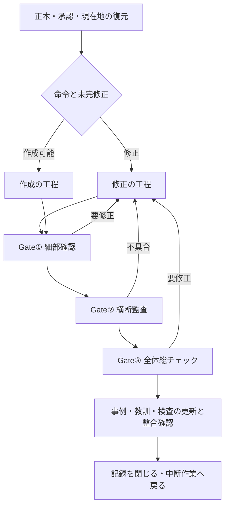

# 提案書 — 作成・修正・事例更新をつなぐ仕事フローのコード化

Work: W-GOV-010 / Proposal: P-002  
Date: 2026-10-23 JST  
Status: PROPOSED — 今回は提案書のみ。実装・正式運用への統合・教材修正は未実施。

## 1. 目的と今回の範囲

作成だけでなく修正にも、決まった工程・入力・出力・検査・停止条件を持たせる。それらを既存の仕事フローへ接続し、「次に何をするか」「どこでAIの分析が必要か」「実際に着手されたか」「何が不足して止まっているか」をコードで管理する。

毎回AIが全工程を思い出して進行を判断する方式から、コードが現在地と実行可能な次工程を決め、AIが指定された分析課題を担当する方式へ移す。憲法、指示辞書、Work承認履歴、火柴図、教訓、Gate①〜③は保持し、実行状態と食い違わないように結び付ける。

今回の作業はこの提案書まで。P-001の試作をそのまま正式フローへ昇格させない。仕組みの実装・試験・承認済みの運用への統合を終えてから、保留した教材修正へ戻る順序を提案する。

## 2. 出発点と未解決部分

既に、構成・解法・空欄・選択肢・文章と図・最終確認を接続した独立試作がある。最終検証コードは7d4e5b7c501a0502ece2e77e41506b1a57b8f801、CI #39969162480。27境界試験、追加合成計算120例、途中式破損20例の拒否、実ブラウザ12ケースを確認した。

この結果は、作成パターンの限定領域における技術試験である。一般の教材修正、工程全体の強制、AIの実行管理、独立した未使用教材の品質評価、学習効果の測定は未実装・未実施。過去36事例も、不明26件を確定正例へ変えていない。

今回の提案では、試作を部品として使い、以下を追加する。

1. 作成と修正の二つの工程定義。
2. 工程の遷移を制御する実行器。
3. AIの分析を入出力のあるノードとして扱う仕組み。
4. 承認、証拠、対象版、失効、再開の管理。
5. 修正のたびに事例・規則・パターン・検査へ戻す継続的な更新。
6. 実行状態から火柴図・現在地・Work報告を生成する仕組み。

## 3. 憲法・既存手順との関係

基準は正規リポジトリのmain e907bf5fc22025fbd74127b9b72176b90aaeb36eにある、憲法、指示辞書、WORK_SYSTEM §12A・§12B・§12Cと、モード別の承認済み資料とする。

| 既存のもの | 今後の役割 | コードとの結び付け |
|---|---|---|
| 憲法 | 最上位の運用原則 | 規則ID・条項・版・参照ハッシュを実行定義へ対応付ける |
| 指示辞書 | 「作成」「修正」等の既存命令の意味 | CMD-WORK-001/002を対応する工程へ振り分ける |
| WORK_SYSTEM | 承認、修正優先、三つのGate、再開の規則 | 遷移条件と停止条件として実装する |
| モード別仕様・教訓 | 教材の意味と設計条件 | 各小ブロックの分析課題へ必要な参照を付ける |
| 火柴図 | 現在地・依存・次にできる作業 | 実行状態から生成する。意味の依存関係はAIが設計する |
| Work記録 | 具体的な指示・承認・操作・検証の履歴 | 記録イベントと証拠から現在地を生成する |

コードは、憲法を置き換える上位の権限にはしない。自然言語の規則を全て機械が理解したとも扱わない。各規則を「機械的に強制」「AIの分析課題へ渡す」「ユーザー判断が必要」に分け、未対応の規則を一覧に残す。

規則文書と実行定義の版が変わったら差分を検出し、影響する工程を止めて対応を照合する。黙って新旧の都合のよい方を使わない。

憲法の現行原則はこの設計と整合するため、最初から本文を書き換える前提にはしない。運用上の意味変更が必要と判明した場合だけ、既存の憲法改定手順へ戻る。正式導入時にはWORK_SYSTEM・辞書の参照先・入口・生成する現在地の管理方法の差分を明示する。新しい第四のユーザー確認Gateは作らない。

教材の作成・修正に対するGateと、技術限定Workの完了を区別する。技術Workが承認範囲の検証で完了しても、アプリ全体の受入は完了しない。以下の図のGate①〜③は教材の受入経路であり、全ての文書更新や技術操作にアプリの総チェックを追加する意味ではない。Gate②では、担当名だけを変えた同じAIの再読を独立監査と称さず、既存基準を満たす審査経路と根拠を記録する。

## 4. 全体構成



不具合やユーザー評価は発見時点で記録する。事例更新を最後まで先送りする図ではない。最後の更新工程では、途中で集めた記録の統合、規則・パターン・検査への反映、未解決の確認を閉じる。

未完修正があるときの作成停止は既存§12Bを使う。今回のようにユーザーが教材修正を明示的に保留して仕組みの整備を指示した場合は、その指示と範囲を記録する。コードが勝手に修正優先を無効化する経路は作らない。

## 5. 作成の工程

| ノード | 担当 | 必要な入力 | 出すもの・次へ進む条件 |
|---|---|---|---|
| C01 正本・範囲の固定 | コード＋不明点はAI | 元資料、モード、適用規則、承認履歴 | 元資料の版・収録一覧・対象外の一覧。不明な由来は保留 |
| C02 概念と依存の設計 | AI | 元資料、必要な既習事項、関連事例 | 大見出し、概念間・問題間の依存、学習目標と理由 |
| C03 型・解法の適用判断 | コード＋AI | 登録パターン、条件、概念設計 | 適用条件の照合。未対応部分を明示 |
| C04 完全な解法 | 登録領域はコード、未登録はAI | 原問題、仮定、使う関係 | 途中式・変形理由・依存・結論。可能な検算を通す |
| C05 穴・選択肢・文・図の設計 | AI＋コード | 完全解法、学習目標、モードの型 | 構造化した設計と具体的な表示案。穴の目的、図の役割を含む |
| C06 提案と承認の照合 | ユーザー＋コード | 既存の承認と具体的な提案 | 有効な承認範囲内なら進む。新しい仕様は既存の提案承認へ |
| C07 教材の生成 | コード | 承認された設計・型・版 | 教材、原資料との対応、生成に用いた版とハッシュ |
| C08 機械検査と意味の審査 | コード＋AI | 教材、原資料、解法、表示 | 検査結果と意味の審査記録。Gate①の実画像を準備 |

既に有効な承認で覆われる工程を毎回再承認させない。新しい提案が必要なのは、既存の承認では覆われない内容・範囲・意味の変更がある場合とする。

生成器はP-001の六工程を再利用し、数学・物理、教科書・練習の適用条件を混ぜない。パターン未登録の場合は、AIが必要な解法や新パターン案を出す経路へ戻す。推測で穴を埋めて完成扱いにしない。

## 6. 修正の工程

修正は「教材を全部作り直す」処理にしない。欠陥のある範囲を特定し、受け入れられた部分・原資料・内部ID・保存履歴を守りながら、変更差分と検証を管理する。

| ノード | 担当 | 必要な入力 | 出すもの・次へ進む条件 |
|---|---|---|---|
| R01 指摘と修正前の状態を固定 | コード＋AI | ユーザーの指摘、画像、対象コード、実際の表示 | 指摘と対象の対応、修正前の証拠、再現手順、版 |
| R02 原因分析 | AI | 原資料、現在の実装、指摘、関係する教訓 | 症状・原因・学習上の欠落を分けた分析。確定と仮説を区別 |
| R03 全影響範囲の調査 | コード＋AI | 原因の識別子、関連する既存成果物 | AFFECTED／NOT-AFFECTED／UNVERIFIEDの影響表。各行に根拠 |
| R04 修正案の設計 | AI＋コード | 原因、影響表、保護範囲 | 修正前後、対象ID、途中式・穴・文・図・選択肢の具体案、検査計画 |
| R05 承認範囲の確認 | ユーザー＋コード | 提案版と既存承認 | その提案・範囲の有効な承認。条件変更なら提案改訂へ |
| R06 限定修正 | コード＋必要な設計をAI | 承認済みの差分、元の版 | 承認範囲内の変更だけを適用。必要な履歴移行案も記録 |
| R07 原因に対する検証と回帰 | コード＋AI | 修正前の再現、変更後の実装、保護対象 | 元の症状が解消した証拠、関連する同型不具合の再確認、実画像 |
| R08 事例・検査への取込 | コード＋AI | 指摘、分析、修正、検証、ユーザー評価 | 再発用事例、検査または判断課題、既存教訓との対応 |

R07の後は既存Gate①〜③へ接続する。R08は途中記録と暫定事例化が可能で、ユーザーの修正後評価が出た時点で品質ラベルを更新する。修正済みという事実だけで正例にはしない。

R03で同じ原因が他の承認済み教材に見つかっても、それだけで全てを書き換えない。既存承認の範囲を照合し、対象ごとの修正Proposalへ結び付ける。資料がない教材はNOT-AFFECTEDではなくUNVERIFIEDとする。

変更時は、ソースファイル一覧だけでなく安定した教材ID・ブロックIDでも範囲を検査する。未承認の範囲へ差分が広がったら止める。数式や穴の意味が変わる場合は、対応する進捗の扱いを明示し、関係のない履歴を初期化しない。

## 7. AIが分析するノードの仕様

各AIノードは、単に「ここで考える」というラベルではなく、課題・入力・成果物・検査条件を持つ。

```yaml
id: R02_CAUSE_ANALYSIS
actor: AI
depends_on: [R01_CAPTURE]
inputs:
  - complaint_and_target_manifest
  - before_artifact_hash
  - source_revision
  - applicable_rule_ids
required_output:
  - observed_symptoms
  - confirmed_causes
  - hypotheses_and_unknowns
  - learning_actions_missing
  - root_cause_signatures
  - evidence_references
completion:
  input_versions_match: true
  required_fields_and_references_valid: true
  unexplained_unknowns_are_not_pass: true
next: R03_IMPACT_AUDIT
```

これは実装する設定の例であり、今回実行するコードではない。必要項目が埋まっただけで分析内容が正しいとは判定しない。意味の審査が必要な項目は、その担当と未解決点を残す。

AIに渡す課題一式には、対象、目的、使うべき規則・事例、入力版、出力形式、保護範囲、今回判断してよいことを含める。完了時には成果物の参照と入力版を返す。別の教材を分析した結果や、変更前の版に対する結果は採用しない。

### AIが動いたかをどう判別するか

| 記録 | 分かること | それだけでは分からないこと |
|---|---|---|
| 課題を発行した | 分析が必要で、渡す準備ができた | AIが着手したか |
| AIが課題を受領した | その課題への着手が確認された | 分析が正しいか |
| 実行開始・途中経過がある | 実行中として報告されている | 推論の全内容や完成の保証 |
| 必要な成果物と証拠が返った | 結果を検査できる状態になった | 教育的な正しさ全般 |
| 検査と必要な受入がそろった | その範囲の工程を閉じられる | 別の教材や別の版にも有効か |

「分析した」と書いただけでは完了にしない。結果が未提出なら次へ進まない。時間切れは成功へ変換せず、最後に確認できた状態と再開点を表示する。

### 現在のチャットとの接続

コードだけで終了したチャットのAIを自動起動できるわけではない。まずは現在のチャットで、実行器が次の課題を出す→私が入力を読み分析する→結果を提出する→コードが検査する、という接続を実装する。ユーザーが続行を指示した作業範囲内では、既存の承認で進められる次ノードを連続して処理する。

将来、常駐実行器やAI APIへつなぐ場合は、この接続部分を差し替える。今回の実装案に、課金を伴うAPI利用や外部への教材データ送信を自動的に含めない。

実行器の操作名は、例えば次のようにする。既存の自然言語命令を増やすものではなく、その内部で使うコマンドの案である。

| 操作案 | 役割 |
|---|---|
| `workflow next --work W-ID` | 現在の版と承認を検査し、実行可能な次ノードか、具体的な待機理由を返す |
| `workflow claim --task TASK-ID` | 入力版を固定して、その分析課題への着手を記録する |
| `workflow submit --task TASK-ID --result result.json` | 分析結果と証拠を提出し、形式・参照・版の検査を受ける |
| `workflow status --work W-ID` | ノード、担当、未着手／実行中／結果待ち、必要な証拠を表示する |
| `workflow render --work W-ID` | 同じ状態から火柴図・現在地・Work報告を生成する |

実装時には、コマンドがAI課題を返した状態と、AIの開始イベントが返った状態を別に表示する。コマンドを発行しただけでAI実行済みとは扱わない。

## 8. 遷移・証拠・承認の管理

### 二段階の状態

Workの状態は現行のPROPOSED／APPROVED／IMPLEMENTING／VERIFYING／DONE等を保持する。以下はノード内部の状態であり、Work状態やユーザーGateを増やすものではない。

`PENDING → READY → RUNNING → PASSED`

必要に応じてWAITING、FAILED、BLOCKED、INVALIDATEDへ移る。WAITINGにはAI結果待ち、ユーザー判断待ち、CI待ちなどの理由を持たせる。AIノードの未完と、外部検査の待機を区別する。

### 遷移を認める条件

- 依存するノードの有効な結果がある。
- 正本、対象範囲、入力版が固定されている。
- 必要な提案・承認・実行権限が、その版と範囲に対応している。
- 必須の成果物と検査証拠がある。
- 未対応・不明・失敗を合格として扱っていない。
- 未完の修正優先条件やユーザーの停止指示に反していない。

承認は、提案への実装承認、Gate①の細部確認、Gate③の総チェック、統合・公開等を区別する。ある承認を別の権限へ流用しない。

同じ「いいよ」でも、直前の具体的な実装提案への返答なら承認になり得る。一方、教材の品質を強く肯定した発言とは限らない。権限と品質ラベルを別々に記録する。文脈が曖昧なら、確定した承認や正例を捏造しない。

### 承認を偽装しない

AIが書いた`approved: true`だけでは承認イベントを作れない設計にする。ユーザーの発言記録、対応する提案版・対象・時刻・解釈根拠へ結び付ける。

現在のチャットから取り込む場合は、独立した認証済みイベントか、AIが会話から転記した記録かを区別する。後者をユーザーの暗号署名のように扱わない。まずは会話記録へ追跡可能な承認台帳を実装し、認証されたUI入力との直接接続は利用可能な実行基盤に合わせる。

### 結果の失効

結果には、対象ID、入力ハッシュ、ソースSHA、規則・パターン・検査器の版、証拠参照を持たせる。変更があったら依存関係に沿って影響範囲を求め、古い結果を履歴として残したまま失効させる。

影響のない既承認ブロックまで一律に再承認させない。影響が分からない場合は、その不確実性を記録する。CIが別SHAで通っただけでは現在のノードを閉じない。

## 9. 実行記録・中断・二重実行への対策

イベント履歴を実行状態の正本とし、現在地や表示用の状態はそこから再構成する。最初の保存方式はGit上の追記イベントと、まとめて更新する状態スナップショットを想定する。高速検索用の索引を持つ場合も再生成可能にする。

イベントには、Work、ノード、試行ID、実行者、入力版、操作、結果、証拠、承認参照を記録する。Git更新は期待するHEADを照合し、別の更新を上書きしない。同じノードの同じ入力を二重に受理しないため、操作IDと実行権の期限を持たせる。

ネット切断で「呼出しは送れたが結果記録がない」場合はUNKNOWNとして残し、実際のコミット・CI・外部状態を照合する。成功の推定や、外部操作の無条件な再実行をしない。外部サービスまで含めた完全な一度限りの実行を保証したとは言わない。

再開時にはイベントと実際のリポジトリ・CI・成果物を照合し、最後に証拠がある地点から復元する。ユーザーの停止中は次の処理を発行しない。

## 10. 修正のたびに学び続ける工程

「全て学習する」は、全てを無条件に成功例・失敗例としてモデルへ投入する意味にはしない。全ての指摘・修正・結果を受け付け、根拠と状態を失わず、再利用できる形へ結ぶ。

| 層 | 毎回行う処理 | 自動で確定しないこと |
|---|---|---|
| 事例の記録 | 指摘、修正前後、版、検証、後続評価を保存 | 続行や完了宣言を品質肯定にしない |
| 原因と規則 | 同じ原因・既存教訓を探して対応付ける | 局所的な指摘を全科目へ一般化しない |
| パターン | 適用条件・非適用条件・必要段階を更新候補にする | 未確認の修正版を成功パターンにしない |
| 検査 | 機械化できる欠陥に回帰検査を追加し、実際に拒否するか確認 | テストが通ることを教育効果にしない |
| 品質ラベル | 明確な肯定・否定・不明を対象版へ結ぶ | 原発言と対象が不明な例を確定しない |

各指摘に、既存規則で覆われる／規則追加候補／パターン追加候補／機械検査対象／意味の審査対象／未解決のいずれかと、対応先を必ず持たせる。検査不能な問題も記録から落とさず、次のAI課題やレビュー項目として残す。

過去の正例が後から否定されたら、その版・範囲・観点の有効ラベルを更新する。以前の評価は履歴として保存する。修正後の評価がなければUNKNOWNを維持する。技術的な欠陥の証拠と、教材内容に対するユーザー評価も混同しない。

既存教訓と同じなら参照し、重複する部分は統合候補にする。正式な規則の意味を変える場合は、既存の承認・改定手順を使う。ユーザーに毎回事例全件を再承認させる仕組みは作らない。

機械学習による推定を追加するのは、対応の取れたデータと独立した評価がそろった後にする。それまでも、記録・検索・規則・パターン・検査の更新による改善は続ける。

## 11. 火柴図・現在地・文書の生成

意味の依存関係と実行状態を分ける。

- AI：何を前提として何を理解するか、どの教材や問題がどの結果へ依存するかを設計する。
- コード：その依存と現在の証拠から、未完・失効・待機理由・実行可能な次ノードを計算する。

実行器の状態から、Work内の火柴図、現在地、次のAI課題、承認待ち、未検証一覧、検証報告を生成する。詳細な分析本文と原発言・原画像は証拠として別に保持し、図に全てを詰め込まない。

既存の全体火柴図・CURRENT_POSITIONへは、同じ状態から必要な参照と要約を出す。個別Workのために他チャットの現在地を上書きしない。手書きの規範文書と、自動生成する状態文書の区別を明示する。

生成対象のファイルは、正本・派生物・履歴を区別する。一つの状態を複数のMarkdownで手作業更新する方式は減らすが、憲法や承認の文章を勝手に生成し直すことはしない。

## 12. 実装する構成と導入順序

想定する構成は以下。実際の配置は既存の入口・Work構造との整合を確認して確定する。

```text
workflow/
  definitions/       作成・修正・Gate・事例更新のノードと依存
  rules/             規則IDと憲法・Work OS・仕様への対応
  schemas/           課題・分析結果・承認・証拠・イベントの形式
  runtime/           状態再構成、遷移検査、次課題、失効、再開
  adapters/          現在のチャット、GitHub、CI、教材生成器との接続
  views/             火柴図・現在地・報告の生成
  tests/             正常経路、禁止遷移、中断・重複・旧版の試験
```

### 段階1 — 既存規則の対応表

憲法・辞書・Work OS・モード別規則を、強制できる条件、AI分析、ユーザー判断、未対応へ分類する。作成・修正のノード表、各入出力、承認範囲、失効の依存関係を確定する。既存の手順の意味を変えない対応表を作る。

### 段階2 — 実行器とAI課題の接続

ノード定義、形式、イベント、状態再構成、次の課題、結果の受取、参照検査、承認照合、中断復元を実装する。最初は現在のチャットと接続する。ノードや承認を飛ばした場合に止まることを先に試す。

### 段階3 — 作成の六工程と修正工程を接続

既存の作成試作を接続し、修正用に修正前証拠・原因・影響表・具体案・保護範囲・差分検査・再現検査を追加する。未登録領域は分析ノードへ戻す。

### 段階4 — 事例更新と火柴図の生成

全ての指摘に対応先を持たせ、事例・規則・パターン・検査への反映状態を追う。イベントから現在地・火柴図・報告を生成し、手書きの状態との二重管理を整理する。

### 段階5 — 独立試作での比較試験

作成の正常経路、修正の正常経路、同型不具合の横断調査、未対応、中断、再開、承認の変更、旧SHA、後続評価による失効を試す。既存の成功宣言を正解として使わず、規則ごとの期待結果を先に固定する。

### 段階6 — 正式な仕事フローへの統合

試験結果と実際の文書差分を確認し、この提案で承認された範囲に限って入口と運用を接続する。規則の意味・統合先・公開権限など承認範囲が変わる場合だけ、既存手順で提案を改訂する。憲法変更が不要なら変更しない。主リポジトリへの統合と教材の公開は、既存の権限区分を維持する。

### 段階7 — 教材修正へ戻る

仕組みの検証・必要な統合を閉じてから、W-MATH-027の保留を解除し、最新の承認状態を復元する。最初の優先課題は三つの大見出しへの統合とする。既承認が有効な部分は再承認を求めず、未承認または改訂が必要な修正案は既存手順に従う。

以後の修正では、実際の指摘をその都度工程へ戻し、事例と検査を更新する。仕組みを整えたことを理由に、元の教材不具合を完了扱いにしない。

## 13. 試験と合格条件

| 試験 | 必須の結果 |
|---|---|
| 作成・修正の正常経路 | 必要な分析・承認・証拠を経由して進む |
| AI分析が未提出 | 次工程を実行できず、未着手と結果待ちが分かる |
| 必須項目だけ埋めた無根拠の分析 | 参照欠落や未解決を残し、内容の正しさまで自動合格にしない |
| 「続けて」を品質肯定へ転用 | 正例への自動昇格を拒否する |
| 実装承認を公開承認へ転用 | 公開操作を拒否する |
| 提案の範囲・版を変更 | 影響する承認と結果を失効させる |
| 別SHAのCI成功 | 現在の検証結果へ採用しない |
| 未承認の関連教材を一括変更 | 差分範囲の検査で拒否する |
| 影響調査に資料不足がある | NOT-AFFECTEDではなくUNVERIFIEDにする |
| 切断後の再開・重複提出 | 最後の証拠から復元し、同じ結果を二重適用しない |
| 外部操作の成否が不明 | 実状態を照合するまで再実行・成功扱いをしない |
| 後から教材が否定された | 該当範囲のラベルと検証を更新し、他の承認を無差別に壊さない |
| 火柴図と実行状態 | 同じ状態から再生成でき、相違が検出される |
| 新しい修正の記録 | 原因・事例・規則／検査／判断課題の対応が残る |

機械で確定できる禁止遷移の試験と、教育的な意味の評価を分けて報告する。既知の問題を使った回帰、開発用合成試験、独立した評価例を混ぜて精度を計算しない。

「次へ進めない」という検査だけでなく、有効な既存承認で正しく進めることも試す。工程が増えて、毎回止まるだけの仕組みにしない。

## 14. この提案の承認対象と完了の定義

承認対象案は、作成・修正・AI分析・証拠と承認・事例更新・火柴図と現在地をつなぐ実行器を、段階1〜6で実装・試験し、承認された範囲で仕事フローへ統合する候補を完成させること。mainへの正式反映・公開等は既存の権限区分を維持し、具体的な差分と検証結果を用意した上で、その時点で有効な明示承認に従う。

今回の提案書作成は、その実装や正式統合への承認を意味しない。全科目・全教材の自動変換、大規模な機械学習、公開アプリへの一括適用を、この承認対象へ混ぜない。

仕組みの完了条件は、作成と修正の両経路が動き、必要なAI分析と既存の承認・Gateを飛ばせず、途中から復元でき、全ての指摘に更新先または未解決状態があり、火柴図・現在地・記録が実行状態と一致すること。教育的な正しさ全般やAIの自動起動まで保証したとは言わない。

その後、段階7として教材修正へ戻る。修正を進めながらも、指摘と結果の取込を続け、同じ欠陥に対する規則・パターン・検査を蓄積する。


## 参照した正本と既存成果

- [現行憲法](https://github.com/rrikunagasige-dot/kyotsu-step-web/blob/e907bf5fc22025fbd74127b9b72176b90aaeb36e/governance/CONSTITUTION.md)
- [現行Work OS・承認・Gate・修正優先・待機時の規則](https://github.com/rrikunagasige-dot/kyotsu-step-web/blob/e907bf5fc22025fbd74127b9b72176b90aaeb36e/governance/WORK_SYSTEM.md)
- [指示辞書](https://github.com/rrikunagasige-dot/kyotsu-step-web/blob/e907bf5fc22025fbd74127b9b72176b90aaeb36e/governance/INSTRUCTION_DICTIONARY.md)
- [作成試作の検証結果](https://github.com/rrikunagasige-dot/kyotsu-step-web/blob/209ccc603bfce52ff0045417e2f48d8384d52f51/work/items/W-GOV-010-coded-authoring/IMPLEMENTATION_RESULTS.md)
- [事例の評価基準](https://github.com/rrikunagasige-dot/kyotsu-step-web/blob/209ccc603bfce52ff0045417e2f48d8384d52f51/work/items/W-GOV-010-coded-authoring/corpus/LABEL_POLICY.md)
