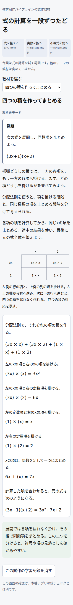
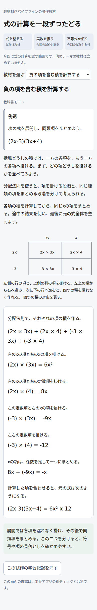
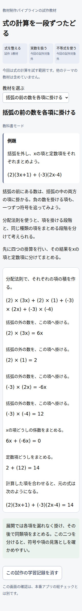
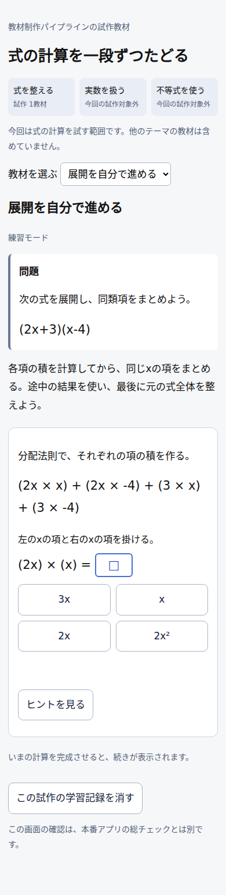
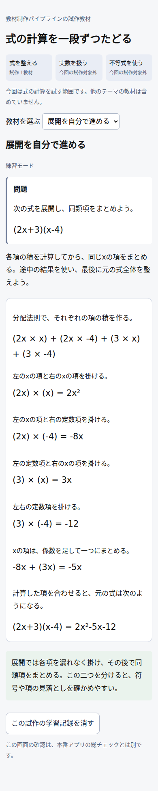

# 六工程試作 — 実画面確認票

対象コード：7d4e5b7c501a0502ece2e77e41506b1a57b8f801。CI #39969162480の実画面。生成教材のユーザー受入は未完。今回の試作確認を、本番教材のGate③総チェックと置き換えない。

操作できるファイル：[教科書3教材](evidence/textbook-preview.html)、[練習用試験1問](evidence/practice-preview.html)。HTMLをダウンロードしてブラウザで開く。外部スクリプトやサーバーは不要。

## 確認1 — 四つの積から同類項へ

図の行・列の読み方→四つの積→各計算→同類項→完成式。

## 確認2 — 負の項を含む積

符号を各積で追い、最後に8xと−9xをまとめる。

## 確認3 — 括弧の前の数を各項へ

四つの積の後、xの項と定数項を分けてまとめる。

## 確認4 — 練習用の試験1問

概念導入の本文を移植せず、元問題と解く過程を分ける。別チャットの既存練習教材は変更していない。

