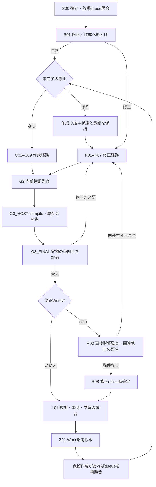
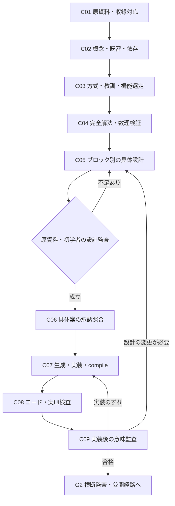
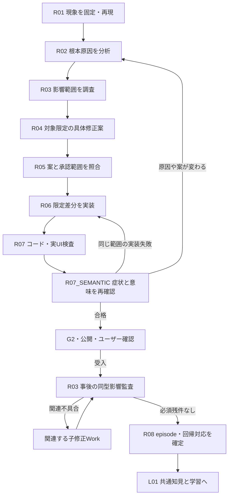
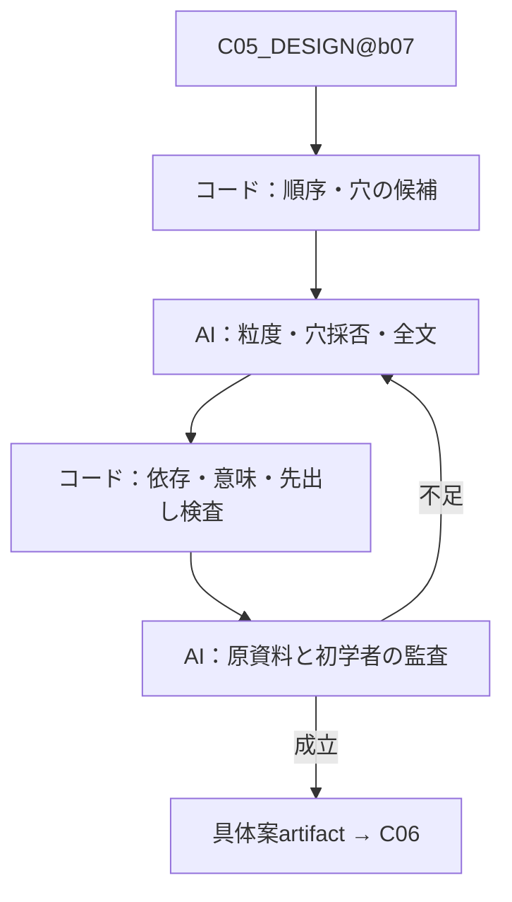

# P-004 — 「作成」「修正」へのコード・AI・学習機能の統合設計

Status: PROPOSED / 設計のみ。実装・公開・既存台帳移行は未実施。
対象: W-GOV-010 / 数学教科書モードを第一適用先とする。
基準コード: bba4df752bf4f9ad8a4972f57ca303b3f304ea45
記録基準: e0b427b6405c431eb61d46a3214accffa5d6b83e
正本main確認: f75bfe73e31d3506aa8c7358fecf9513737c730b

## 1. 今回決めること

利用者の主な依頼は、従来どおり CMD-WORK-002「作成」とCMD-WORK-001「修正」で受ける。P-003で実装した抽出・解法・意味表現・穴・組版・検査・事例・学習は、その二つの工程の内部から呼ぶ。

**主工程はC系/R系、内部の実行機能は共用、状態と証拠は既存Runtime/Storeへ集約する。** 新しい制作命令や別の台帳を増やさない。既存の憲法復元などの上位命令や、内部のtechnical profileも削除しない。

本案はP-003の設計・コードを捨てる案ではない。使える機能を残し、命令の振分け、各工程の契約、ブロック単位、修正の影響管理、公開・学習・終了への接続を補う。

### 確認できた現状の不備

`definitions.instantiate()`はworkflow_versionがあればC/R分岐の前にproduction側へ渡す。production/1はcommandやblocksを使わず同じ25ノードを作る。読み取り確認では、修正と作成のグラフが同一、全node.block=None、R系固有nodeなしだった。

その結果、原因分析・事前影響調査・各ブロックの設計・必要箇所だけの再実行が工程として十分に保証されない。旧R03等に結ばれた契約を、新しいS番号が通らずに迂回する箇所もある。P-003の78工程テスト等の成功は、二つの主フローへの正しい統合を証明していない。

## 2. 保持・組込・追加・履歴化するもの

| 区分 | 対象 | 扱い |
|---|---|---|
| そのまま使う | Runtime/Store、追記イベント、CAS、claim、元資料・規則hash、外部操作intent/outcome | 状態と証拠の正本を維持 |
| そのまま使う | Word抽出、対応領域付きsolver、typedIR、compiler、既存組版、事例/ML各module | 工程から呼ぶ機能として再利用 |
| 役割を保つ | C01–C09、R01–R08、共通復元、横断監査、公開、受入、L01、Z01 | 主工程の意味と既存の承認規則を継承 |
| 接続を直す | production/1の固定25段階、文字列IDに依存する検査、全範囲失効 | 新しい版で命令別・ブロック別・依存別へ変更 |
| 補う | 依頼/修正queueの照合、ブロック依存、適用機能の選択、事前/事後影響表、承認範囲の照合 | 主工程の必須成果物・共通機能として追加 |
| 新規実行では使わない | 旧G1スクショ票の受入待ち、旧G3の固定文言や公開再許可の要求 | 過去の定義・証拠は残す。現行policy v2に合わせる |
| 今回は変更しない | N07本文、六指摘、受入済み第一タイトル、公開版、他モード | 統合設計は教材修正の包括承認にしない |

## 3. 三つの単位を混ぜない

| 単位 | 意味 | 例 | 状態・承認との関係 |
|---|---|---|---|
| Work | 一つの依頼・目的・承認範囲 | N07の六指摘の修正 | command、proposal、原本、修正queueを持つ |
| block | 設計・原因調査・検査を区切る小単位 | N07-Q07の導出、素因数分解の概念導入 | C05/R04等の対象。各blockの直前に教訓を照合 |
| node | 教材内の一つの判断・操作・説明 | 二式を選ぶ、引く向きを決める、係数を計算する | blockの内部に保持。全nodeを独立Workにはしない |
| release unit | 完成後にアプリで確認するまとまり | N07全体、事前に合意した一つのタイトル | 複数blockを含めてcompile・公開する。小段階ごとに許可を求めない |

以前の「小ブロックの直前にも教訓確認」は維持する。例えばC05_DESIGN@b07を始める時に、そのblockの原問・目的・既習・前結果・類似失敗・保護事項をbundleで渡す。

C06/R05の承認は小ブロックごとの質問を増やす仕組みではない。一つの具体案が複数blockを明示して承認されれば、その範囲に含まれる各承認nodeをコードが照合して通す。内容が変わっていなければ聞き直さない。

## 4. 総火柴図



上図のRへの戻りは、一つのWorkを無条件に最初からやり直す意味ではない。同じ承認範囲の実装失敗なら該当工程を再開し、具体案の変更ならR04へ、新しい対象・別原因なら関連する子修正Workを開く。戻り先・親子関係を台帳で保持する。

G2/G3等のIDは既存の役割を追跡するため使用する。新定義では旧G1を生成せず、G3_FINALの受入も現行の自然な範囲付き評価に従う。「総チェックOK」という固定文字列だけを受理条件にしない。

## 5. 「作成」へ具体的に入れるもの

### 作成の火柴図



C02では概念と既習の前提を整理し、最終的な教える順は完全解法ができた後のC05で設計する。C04の前に、AIの思いつきだけで教材の順序を確定しない。

| 既存工程 | 内部へ入れるP-003機能 | コードの具体作業 | AIの具体作業 | 出力・完了条件 |
|---|---|---|---|---|
| C01_SOURCE | S01–S03 | 原本hash、位置付き抽出、無番号説明・式・図表を含むsource対応、逆coverage | 正本・条件・図注の意味、除外の妥当性を照合 | source_inventory/source_versions、全blockの採否・除外理由。未読はunknown |
| C02_CONCEPT | S05、S03の概念整理 | 記号scope、用語初出、既習fact、問題間依存を台帳化 | 初学者の既習境界、概念/性質/証明/例題の役割を判断 | learning_goal/concept_dependencies、前提と導入の根拠 |
| C03_PATTERN | S04、solver capability、既存pattern registry | 適用条件で規則・事例を検索し、solver/profileの対応領域を列挙 | 今回に使う方式と使わない方式、例外を選ぶ | pattern_id/applicability/non_applicability、選択した機能・規則・事例ID |
| C04_SOLUTION | S06–S07 | 厳密計算・操作trace・独立検算、値と答え形式の別判定 | 一般論証、操作理由、条件・場合分けを確認 | 省略のない完全解法、条件/根拠/使用先、数理receipt。計算とAI論証を区別 |
| C05_DESIGN | S08–S16 | 順序候補、穴候補・誤操作、rich text/式relation、番号、前結果、図表、可視snapshot、静的検査 | 小段階の粒度、判断する穴、全文・図の意味、原資料/初学者の反証監査 | 各block/nodeの全文・穴・選択肢・前結果・解放順。未解決を残して合格にしない |
| C06_APPROVAL | S17の承認照合部分 | proposal hash、承認されたblock集合、IR hash、保護範囲を照合 | 案の変更点・残件を説明。承認は作らない | 既存の明示承認。既承認の不変範囲は再質問しない |
| C07_BUILD | S18 | typedIR→既存schema、semantic token対応、安定ID・進捗保護、承認済み内容との差分 | compilerで新説明を勝手に追加しない | app artifact、compile receipt、内容hash、対象外差分ゼロ |
| C08_VERIFY | S14の実装側検査、S19、保護部分のS20 | 数理/選択肢/描画/操作/履歴/再開、320/390/430/1440、保護manifestを検査 | 実画面上の違和感を、対象箇所と根拠付きで記録 | exact SHAの検査結果。旧失敗と今回の退行を分ける |
| C09_SEMANTIC | S15/S16を実装後snapshotで再利用 | 設計IR↔実表示の差分と可視内容を渡す | 原問から結論までの教え方、式の前後、穴、図、前結果を確認 | reasoning/prose_figure/choice review、unknowns、設計と実装の対応 |

### C05内部の順序

C05自体を、次の内部jobに分ける。jobは同じWorkのartifactを使い、別の承認や台帳を持たない。

1. 完全解法→初回/反復等の教える順候補。
2. 小目標・入力fact・操作対象・結果・次の使用先を設定。
3. 判断/立式/関係/計算/意味の穴候補を生成し、AIが採否を決める。
4. 選択肢・誤答理由・ヒント・答え形式・先出しを検査。
5. 本文をtext/math/term/slot/refへ構造化し、等式・番号を接続。
6. 図表と、読む時点・読み取る情報を設計。
7. 完了部分の圧縮、前結果・元問・表の必要範囲、履歴を設計。
8. 原資料監査と、既習だけで解く初学者監査。
9. 修正を反映した具体案をC06へ渡す。

この順序の中でコードが先に候補・対応表・検査を作り、AIが全文と意味を判断する。欄を埋めただけで完了にしない。

## 6. 「修正」へ具体的に入れるもの

### 修正の火柴図



R03は同じnodeを上書きして結果を失わない。事前調査と事後sweepは、同じimpact ledgerの別artifact/phaseとして保存する。下記の実装節で依存nodeの持ち方を定める。

| 既存工程 | 内部へ入れる機能 | コードの具体作業 | AIの具体作業 | 出力・完了条件 |
|---|---|---|---|---|
| R01_CAPTURE | S00の対象復元、S22の評価記録、S01/S02の既存資料再利用 | 発言・画像・source SHA・route・block/node・回答前後・再現操作を固定 | 何を否定したのか、既存説明は本当にないのか、今回の対象を確認 | complaint/before_evidence/reproduction/target_versions。推測と確認済みを区別 |
| R02_CAUSE | S04、必要部分のS05–S16 | IR/DOM/source差分、数理・描画・依存・穴の検査、関連反例の検索 | 症状から原因を切り分け、成立する仮説と未確認を分ける | confirmed_causes/hypotheses/root_cause_signatures。修正場所を根拠付きで特定 |
| R03_IMPACT | S20を事前影響調査へ拡張、既存§12B | 共通compiler/renderer/template/rule/概念で対象候補を抽出し、版付きinventoryと表を作る | 同型か別原因か、どの範囲の検査が必要かを判定 | impact_rows/source_inventory。必要な対象が表から落ちず、未読を影響なしにしない |
| R04_PROPOSAL | 必要部分のS06–S17 | 変更対象とその依存先、再利用する証拠、before/after、保護manifest、差分候補を作る | 原因に対応した具体本文・式・穴・表示・検査を設計 | patch_plan、before/after、protected_scope、verification_plan、proposal hash |
| R05_APPROVAL | S17の承認照合 | 対象版・block・差分・内容hashと既存承認を照合 | 変更内容を説明。未承認の拡大をしない | 不変の既承認案は再確認しない。material変更はR04改訂 |
| R06_PATCH | S18、既存限定patch adapter | 変更前hash、path scope、安定ID、回答意味、進捗移行を確認して限定適用 | 検証しやすい差分を維持 | patch intent/applied/outcome、変更後artifact。対象外を編集しない |
| R07_VERIFY | S19、必要なS07/S14、S20の保護検査 | 元症状の失敗fixture→改善fixture、例外、関連回帰、実UIを検査 | 検査が本当に指摘を再現しているか確認 | 元症状の解消＋新規退行なし。検査の単なる数を合格理由にしない |
| R07_SEMANTIC | S15/S16の対象限定再利用 | 修正前後・実表示・前提/後続への差分を提示 | 説明のつながり・教える順・穴・条件が改善したか確認 | symptom_resolution/regression/protected_scope reviewと未解決 |
| R08_CAPTURE_LEARNING | S23、S22の最終状態 | 否定→変更→検証→再評価を同じepisodeへ結び、回帰・規則・caseを対応 | 一般化条件と例外を確定。改善案を成功例にすり替えない | case_updates/rule_links/regression_links、関連impactの未解決なし |

### 修正で使う機能の選び方

修正の種類だけを正規表現で決めない。変更の意味属性と依存関係からコードが候補範囲を出し、AIが原因と照合する。再利用可/再実行/未確認を表にする。

| 修正例 | 主にやり直す内部機能 | hash・対象が一致すれば再利用するもの |
|---|---|---|
| 選択肢の間隔・折返し | 表示profile、回答操作、狭幅/番号/履歴、共有CSS影響 | 原問題、解法、正答、教える順、穴の意図 |
| 本文中の式が未描画 | text/math境界、compiler/rendererのtoken対応、実表示 | 数式自体が不変なら数理解答。数学的内容の同一性は確認する |
| 「引く」が突然出る | 対象・向き・目的、必要な前結果、小目標、文中slot、意味監査 | 正しいことを確認済みの元問・数値。操作が変わるなら数理も再検証 |
| 計算や正答が誤り | 完全解法、独立検算、その結果を使う全後続node、選択肢・説明 | 無関係な問題、図、既習定義、受入済み範囲 |
| 初出概念の表示漏れ | term属性、導入位置、本文/前結果/履歴の描画 | 名称だけが変わる場合の無関係な計算 |
| 原資料の説明・図の脱落 | source coverage、関連する概念/問題契約、必要な設計/表示 | 影響しないsource blockと検証結果 |

全文の解法を再作成する必要がない表示修正でも、R01/R02/R03/R04/R05の意味は省かない。成果物を参照して短く済ませられることと、工程自体を飛ばすことを区別する。

## 7. 共通の後半工程への組込み

| 既存工程 | 入れるもの | 合格・継続条件 |
|---|---|---|
| G2_AUDIT | S20、原資料/既存教材/他の承認済み成果物への適用監査 | 対象SHA、影響inventory、保護範囲、監査方法・実施者を示す。同じAIなら別モデルの独立監査とは呼ばない |
| G3_HOST | S18の凍結結果、S21、既存公開adapter | 完成release unit、現行の具体設計承認、内部QA、実配信source/routeを照合。既存公開先の許可を再要求しない |
| G3_FINAL | S22 | 実際に確認した版・範囲・観点へ自然な発言を対応。称賛・修正依頼・受入・実装許可を分離 |
| R08_CAPTURE_LEARNING | 修正専用S23 | 原因と修正episodeを確定する。共通catalogをもう一つ作らない |
| L01_LEARNING | 共通S23/S24 | 事例重複・規則統合・label mask・学習採否・registry・次回消費を処理。R08の結果を参照して二重登録しない |
| Z01_CLOSE | 既存終了契約 | 必須QA/受入/関連修正/記憶更新が揃う。モデルの訓練不能自体は教材Workの未解決欠陥にしない |

### 否定評価は「完了まで待って収集」しない

発言・画像・実装失敗を受けた時点で、共通feedback.capture機能が即時に観測を保存する。R08/L01は、その記録の後続評価・採否・統合を確定する。受入前の失敗例が消えたり、教材を合格させないと学習データを保存できなかったりする構造にしない。

## 8. 25工程の全機能の行き先

| P-003段階 | 主な組込先 | 修正時の扱い |
|---|---|---|
| S00 現在地 | 共通S00_RECOVER | 依頼・未完了修正・元版・承認を復元 |
| S01 正本固定 | C01 / R01 | 修正前の実物と、既存原本の固定版を区別 |
| S02 抽出 | C01 / R01・R02 | 抽出済みartifactを照合して再利用可 |
| S03 問題契約 | C01・C02 / R02・R04 | 条件が変わる部分だけ再確認 |
| S04 事例取得 | C03＋各block直前 / R02・R03・R04 | mode/原因/観点で絞り、適用理由を残す |
| S05 既習台帳 | C02 / R02・R04 | 必要前提や記号scopeに影響する時に実行 |
| S06 完全解法 | C04 / R02・R04 | 数学が原因・変更対象の場合に再実行 |
| S07 数理検証 | C04・C08 / R02・R07 | 値・条件・答え形式・証明の変更に追従 |
| S08 教える順 | C05 / R04 | 目的・順序・接続の修正時に使用 |
| S09 小段階 | C05 / R04 | 必要範囲を分解/再構成 |
| S10 穴 | C05 / R04・R07 | 判断と計算、答え先出し、同値誤答を確認 |
| S11 表現 | C05 / R04・R06 | 意味属性・等号・用語・文中slotを保持 |
| S12 本文 | C05 / R04・R06 | 承認済み差分を反映 |
| S13 図表 | C05 / R04・R06 | 必要性・読取時点・原図保護を確認 |
| S14 静的検査 | C05・C08 / R02・R07 | 原因診断と修正後の双方で使う |
| S15 原資料監査 | C05・C09 / R04・R07_SEMANTIC | 設計時と実装後は別入力・別receipt |
| S16 初学者監査 | C05・C09 / R04・R07_SEMANTIC | 見える情報だけのsnapshotで実行 |
| S17 案確定 | C06 / R05 | 単一の曖昧なapproved flagへまとめない |
| S18 compile | C07 / R06・G3_HOST | 生成と公開対象の凍結を区別 |
| S19 実UI | C08 / R07 | 失敗症状と必要幅・状態・履歴を確認 |
| S20 影響 | R03・G2、C08/R07の保護検査 | 事前影響・事後影響・保護を別契約にする |
| S21 公開 | G3_HOST | 現行policyと実配信証拠を使う |
| S22 評価 | feedback.capture・G3_FINAL | 途中の指摘も即時に保存 |
| S23 回帰/規則 | R08・L01 | 役割を分け、同じcaseを重複登録しない |
| S24 学習 | L01 | データ不足は理由を記録してモデル使用を棄権 |

S番号は、過去記録と機能の由来をたどる参照として残す。新しいWorkの主nodeをS00–S24へ置換しない。

## 9. 火柴図は三階層で出す

### 9.1 全体図

`FIRE_DIAGRAM.md` は共通入口→C/R→監査→公開→評価→関連修正→学習→終了を表示する。現在のWork、命令、主node、保留理由、子修正Work、戻り先を表示する。工程数の割合を品質の達成率として出さない。

### 9.2 対象blockの工程図

`BLOCK_FIRE_DIAGRAM.md` は選択したblockだけのC01–C09又はR01–R08を表示する。他blockへの前提・影響の辺は参照として示す。全章の細かいnodeを一画面へ詰め込まない。

### 9.3 工程内の機能図

`CAPABILITY_FIRE_DIAGRAM.md` は、例えばC05@b07の内部jobを表示する。コード候補→AI選択→静的検査→原資料/初学者監査という関係と、各artifactの状態を示す。第三のWork状態機械を作らず、Node jobsと既存Storeの結果から生成する。

例:



各図には同じsnapshot hash、workflow definition version、source/proposal hashを載せる。図の手書き状態と台帳の実状態を別管理しない。Mermaidから内部の安全なIDへ対応し、block名や文章を無加工で構文へ埋め込まない。

## 9A. 実行グラフを生成する具体的な順序

図にある戻り矢印は、再開・失効・子Workへの移動を示す。Runtimeのdepends_onへ循環辺を入れる意味ではない。実行DAGは非循環に保ち、戻りはイベントとartifactの版で表す。

1. 共通S00_RECOVER/S01_ROUTEを置き、依頼queue・優先関係を固定する。
2. unit全体の抽出や原本hashを共有artifactとして固定する。各blockでWord全体を読み直さない。
3. commandに応じて、各blockへC系又はR系の主nodeを生成する。node.blockは必ず対象block IDとする。全体監査等だけblock=Noneを許す。
4. 各stage_kindへcapability registryとcontract_kindを割り当てる。旧S番号をユーザー向け主工程として複製しない。
5. 各approval bundleに属するC05又はR04が揃ってから、そのbundleのC06/R05を実行可能にする。**一つ目のblockのC06待ちで止まり、同じ案に必要な残りblockを設計できない構造を避ける。**
6. 一つの明示承認がbundle内の全blockを覆えば、各C06/R05を同じ承認イベントで照合する。blockごとの承認質問は作らない。
7. 実装・検証はblock単位で行い、そのrelease unitの必要blockが揃った時点でG2/G3へ進める。次のタイトルまで完成するのを待たない。
8. 実際のnode IDは `G2_AUDIT@releaseUnit`、`G3_HOST@releaseUnit`、`G3_FINAL@releaseUnit` とし、Work全体に一つだけ置く方式から分ける。既存IDの意味は役割として引き継ぎ、過去イベントは改名しない。
9. ユーザーの受入と各unitの関連修正を照合し、必要なR03 sweep/R08を処理する。L01はunitごとの入力確定を受け、case IDで重複を防ぐ。Z01はWorkの必要unit・関連修正がすべて閉じてから実行する。
10. schedulerは、現在のrelease unitの完了・公開を優先する。待機中の独立作業は既存§12Cの許可範囲に限り、待ち時間を未承認実装の許可にしない。

approval bundleとrelease unitも別に持つ。既定では同じ単位でよいが、既に複数unitをまとめて承認された場合は、その承認を保持したままunitごとに公開できる。

### 主対象の公開と、関連する修正の終了を分ける

主対象のQAが通り、関連箇所の事前からある欠陥が別Workに登録されている場合、対象限定の公開・確認を行えるようにする。一方、親修正WorkのZ01は関連する必須修正の照合が終わるまで閉じない。今回の変更が新しく起こした退行は、関連Workへ移しただけで公開可能にしない。

G2には `release_readiness` と `impact_sweep_completion` を別に持たせる。既存欠陥を黙って全体PASSにすることも、対象外の全教材が完成するまで主対象を一切確認できないことも避ける。

## 10. ブロックごとの依存と再利用

工程キーは `Work + block + stage + inputHash`。capabilityのjobキーは `capability + consumed artifacts + implementation + relevant rules/cases/model + phase`。

主node IDは既存の `C05_DESIGN@b07` 等を維持する。内部jobのためにすべてのS工程を主graphへ複製しない。例えばC05の内部receiptに `teaching.plan`、`blank.plan`、`prose.compose` 等の参照を持つ。

blockの前提は `depends_on_blocks` と教材のfact依存を分ける。前のblockの制作が完了したことだけで、生徒がその概念を既習と見なさない。

- 原資料全体の抽出は一度実行し、各C01は必要な部分を参照する。
- 既存の正しい完全解法は、数学的入力・条件・solver版が一致する場合に再利用する。
- 文の意味を変えない配置変更では、解法・穴の承認を自動失効させない。表示検査は失効する。
- 前提factを変更した場合は、そのfactを使う後続node/blockを失効させる。
- 事例・規則・モデルの更新は、実際に消費するjobへ反映する。制作中の入力を黙って入れ替えない。
- 新たな重大指摘は、そのcaseが旧jobで未消費だった場合もscopeを照合してreview_requiredを立てる。

actor一語で「AIが全部」を表さない。nodeはownerと、必要なcode receipt/AI receipt/user eventの集合を持つ。現在のcode producer hash、AI input hash、承認範囲の照合を、新しいC/R IDでも引き継ぐ。

## 11. 修正優先・横断影響・作成への復帰

### 11.1 作成前と再開前

S00で、Store内のissueだけでなく、未完了Work、版付きfeedback registry、まだWork化されていない本人の修正依頼を照合する。現状のpending_issues()は同じStoreのopened Work内issueしか見ないため、そのままではN07の外部JSONにある六指摘を取りこぼし得る。

AIが対象・未完了かを確認し、コードが重複・版・解決イベント・Work対応を照合する。歴史上の修正済みfindingを再び残件に数えない。

修正が優先される時は、作成の承認と途中artifactを保存して修正へ進む。本人が特定の優先変更を指示済みなら、その範囲のイベントを使い、同じ確認を繰り返さない。

### 11.2 事前影響と事後影響

R03の事前impactは修正案の範囲を決めるもの。R07後/G2と受入後のsweepは、実際の修正・新しく分かった原因に対する同型確認である。事前の表を根拠なく「事後も問題なし」へ流用しない。

impact rowは次を必須とする:

`originFinding / rootCauseSignature / artifact / artifactVersion / approvedCreationWork / block / evidence / status / linkedCorrection / phase`

必要なinventoryから行が消えたらコードが拒否する。AIは同じ原因か、どの検査が有効かを判定する。確認済みの別欠陥は子修正Workへ結び、各exact Proposalの承認規則を維持する。

事後sweepは `R03_IMPACT_SWEEP` というR03に属する補助nodeとして追加する。既存R03の結果を上書きせず、事前artifactと修正後SHAに依存させる。これは新しい利用者の入口ではない。

### 11.3 再帰の停止と復帰

訪問済みの `(root-cause signature, artifact, version)` を記録し、同じ対象・同じ版を何度も修正しない。新しい版や新しい原因は別に検査する。

関連する確認済み欠陥と、必須監査の未確認行が残る間は閉じない。無関係な全教材を毎回総当たりする範囲にはしない。

修正後はqueueを再照合し、更新した教訓と保留作成案を比較する。不変の承認範囲は再確認せず復帰する。新教訓が具体設計をmaterialに変える場合はその部分の改訂案へ戻す。

## 12. 承認とユーザー確認

- C06/R05は既存の具体設計承認。code/AIが自分で承認を作らない。
- 一つの承認が複数blockを含む場合、その範囲をコードで照合して各nodeへ対応させる。
- 公開後の受入は、実配信版・release unit・評価観点・発言との対応を持つ。
- 同じ範囲の実装失敗を直すだけなら、案が不変な限り再承認を挟まない。
- 原因・内容・対象範囲が変わる場合は改訂案を提示する。単なる肯定語から改訂承認を推測しない。
- 親作成の一部分が、別途承認された子修正で更新された場合は、親の不変範囲＋子の承認済み差分の対応を検査する。全範囲の承認を一から取り直す方式にしない。子の承認も及ばない追加変更は別案とする。
- 内部で画像やブラウザを使っても、旧スクショ票の受入待ちを新設しない。完成した既存アプリの直接URLで確認する。

## 13. 学習を両フローのどこで使うか

| 用途 | 作成 | 修正 | 制限 |
|---|---|---|---|
| 類似事例検索 | C03、各blockのC05直前 | R02・R03・R04 | 適用scope/版/観点を残す |
| 問題リスク分類 | C05候補比較、C09監査順 | R02の調査候補、R07_SEMANTIC | 原因確定や数学の真偽の代替にしない |
| 候補順位 | C05の有効案の比較 | R04の有効修正案の比較 | コードERRORの候補を順位で復活させない |
| 評価収集 | feedback.capture、G3_FINAL | R01、feedback.capture、G3_FINAL | 実装許可・称賛・否定・受入を分離 |
| 事例確定 | L01 | R08→L01 | 原文・版・範囲・観点、修正前後、後続評価 |
| 訓練/昇格 | L01から共通job | 同じ共通job | データ不足は棄権。個々の教材終了を訓練成功待ちにしない |

現在のOFFLINE_ONLYモデルはそのまま保留する。統合したから性能が改善したとは主張しない。学習データやモデルの版を更新した場合も、公開済み教材を自動的に書き換えない。

## 14. 実装先とデータ契約

### definitions.py

新定義 `production/2` を追加し、同版のmaterial profileではcommandを確認してC/Rを生成する。C/Rの後ろへ共通工程を接続する。production/1とlegacy定義は過去runの再生用として残す。

```text
command=CMD-WORK-002 → 共通復元/queue → C系@各block → 共通QA/公開/受入 → L01/Z01
command=CMD-WORK-001 → 共通復元/対象確認 → R系@各block → 共通QA/公開/受入 → 事後sweep/R08 → L01/Z01
```

technical profileは内部の基盤作業用に維持し、通常の教材作成/修正の代わりとして使わない。

### production.py

固定の25ノード生成を、新版ではC/Rの能力割当registryへ分離する。例えば `C05_DESIGN` はteaching.plan→blank.plan→prose.compose→figure.plan→source.audit→novice.auditを消費する。旧SxxのstageチェックをそのままID比較で使わない。

### contracts.py

`contract_kind` により検査する。`if node_id.startswith('R03')`のような文字列依存だけで重要な契約が外れないようにする。共通receipt、C系成果物、R系原因/影響/症状、承認、受入、学習確定の契約を合成する。

### runtime.py / Store

台帳は維持する。新plan/node属性、phase、block依存、適用機能、hash失効、queue/子修正、承認範囲の照合を追加する。実行中claimへの入力差替えは拒否する。Work状態は既存のPROPOSED/APPROVED/IMPLEMENTING/VERIFYING/BLOCKED等を使い、独自の第三状態機械を作らない。

### runner.py / adapters.py

node IDのS番号をoperationへ直結する方式から、nodeに記録したcapability requestを実行する方式へ変更する。既存Word/solver/IR/compiler/ML/Node jobsを呼び、code receiptを同じRuntimeへ返す。

### views.py

三階層の火柴図を同じsnapshotから生成する。現在の `production_accepted()` のS22固定参照も、G3_FINALの契約・受入イベントへ接続する。履歴版は旧参照で再生する。

### 新しいデータ属性案

```text
Plan {
 workflow_version: production/2,
 command, work_id, profile, subject, mode,
 source_manifest, rules, proposal, scope,
 blocks:[{id, sources, depends_on_blocks, node_refs, release_unit}],
 release_units:[{id, block_ids, review_route}],
 approval_bundles:[{id, block_ids, proposal_hash, content_hash}],
 impact_inventory, correction_queue_refs, paused_work_ref?
}
WorkflowNode {
 id, stage_kind, block, phase, depends_on,
 contract_kind, capability_requests,
 required_code_receipts, required_ai_receipts,
 approval_scope_ref?, source_refs, protected_refs
}
CapabilityReceipt {
 capability, implementation_hash, input_hash,
 consumed_artifacts, consumed_case_ids, model_ref?,
 outputs, checks, unresolved, disposition
}
```

人工的な承認flagは追加しない。旧approved scopeは版・原文とともに参照する。

## 15. 再開と移行

1. 定義版を識別し、legacy/production1/production2のrunを混同しない。
2. 完了済みの履歴を新しい図へ黙って書き換えない。元のイベントと定義を残す。
3. 未完了runを移行する時は、元command、block、原本、承認範囲、既存成果物、未完修正を表で対応させる。
4. 完全解法やcompile結果等、入力と意味が一致するartifactだけを参照して再利用する。
5. production1に存在しなかった原因分析・影響表・block契約を、旧S段階のPASSから推定して埋めない。必要な新工程を未完了として出す。
6. `migration_verified`イベントに、再利用・再検査・不足・元artifactを記録する。元の承認の意味や範囲を変えない。
7. 新しい定義へ切り替えるだけで、既存の実行を一括失効/全再作成させない。必要な工程単位で移行する。
8. 新規数学教材の入口ガードとmainのpointerは、新版の検証後に更新する。現段階では変更しない。

## 16. 実装順と受入試験

| 順 | 改修 | 必須の試験 |
|---|---|---|
| I01 | C/R別graph、block/release unit、contract_kind | 二命令で異なるgraph、複数blockのscope、technical/旧版の再生 |
| I02 | 能力registryとrunner接続 | 同じ抽出・IR・検算器をC/Rから共用。事例の実消費とproducer hash |
| I03 | 修正queue・原因・impact・差戻し | Store外の未完了feedbackも照合、修正優先、関連子Work、訪問済み停止 |
| I04 | 機能選択・再利用・承認範囲 | 表示修正で解法を再作成しない、数学変更で必要な後続を失効、承認の再質問なし |
| I05 | QA・公開・受入・R08/L01/Z01 | 旧G1なし、exact SHAの直接URL、品質と許可の分離、未解決の閉鎖拒否 |
| I06 | 三階層の火柴図 | 台帳との一致、現在位置・保留・子Work・次にできる工程、構文安全 |
| I07 | 版移行・canonical入口・runbook | 旧承認/履歴保護、不足契約の偽PASS防止、公開教材・進捗不変 |

### 具体的な合格シナリオ

- 作成A: 原資料から二つのblockを作り、一つの承認bundleでC06を覆い、既存公開先で一つのrelease unitを確認できる。
- 作成A2: 同じ承認bundleの複数C05が完了する前にC06で行き詰まらない。一つの受入待ちのために未承認実装へ進まない。
- 作成A3: 二つのrelease unitのうち最初が完成したら、次の完成を待たず直接URLを渡せる。
- 作成B: 後半blockが前半の結果を使う。前半のfact変更で後半の該当設計だけが失効し、無関係なblockを保つ。
- 修正A: 選択肢の間隔修正。R01/R02/R03の根拠を持ち、解法artifactを再利用し、表示/操作の検査を実行する。
- 修正B: 未描画数式。text/math/term/slotの変換・DOM対応を検査し、元の数学を変えていないことを確かめる。
- 修正C: 「引く」が突然出る。対象・向き・目的・前結果を修正案に含め、AIの意味監査とcode契約の両方を通す。
- 修正D: 共通compilerが原因。関連する承認済み教材をimpact表へ出し、各修正の承認を守って関連Workを処理する。
- 復帰A: 作成途中に修正依頼が届く。承認と途中成果を保持し、修正後にqueue再確認・必要な失効を経て復帰する。
- 学習A: layoutだけの称賛と推導への否定が同時に届く。観点を分け、R08/L01へ結び、教師例不足でも未評価を正例にしない。
- 移行A: production1の修正run。旧25工程がPASSでもR02/R03の不足を未完了として表示し、統合済みとは扱わない。

コードのfixture試験に加えて、実資料・実評価に基づく限定runを実行する。模擬一巡と実教材受入の証拠を分ける。新しいユーザー向け確認画面や旧スクショ票は作らない。

## 17. この提案の完了範囲

今回完成させるのは、二つの主フローに何をどこへ入れるか、どう動かし・検査し・再開し・図示するかの設計である。新しいコード、台帳移行、教材の修正・公開はまだ行わない。P-003の既存機能と受入済み教材を維持したまま、P-004として統合部分を実装できる状態にする。
