# 機能火柴図（GENERATED）

台帳HEAD: `797b5b357878b3ee9723f62faf0c7a5c833ac64d87cc97d4bf493932f946c0f2`

# C01_SOURCE@metadata（GENERATED）

台帳HEAD: `797b5b357878b3ee9723f62faf0c7a5c833ac64d87cc97d4bf493932f946c0f2`

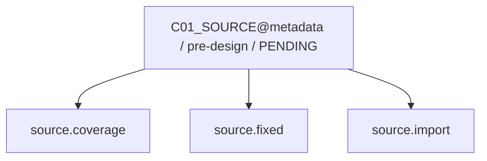

現在: — / BLOCKED

# C02_CONCEPT@metadata（GENERATED）

台帳HEAD: `797b5b357878b3ee9723f62faf0c7a5c833ac64d87cc97d4bf493932f946c0f2`

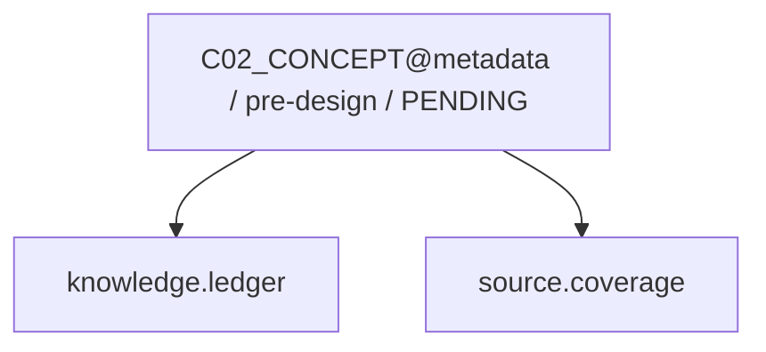

現在: — / BLOCKED

# C03_PATTERN@metadata（GENERATED）

台帳HEAD: `797b5b357878b3ee9723f62faf0c7a5c833ac64d87cc97d4bf493932f946c0f2`

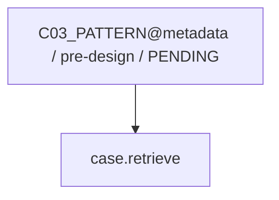

現在: — / BLOCKED

# C04_SOLUTION@metadata（GENERATED）

台帳HEAD: `797b5b357878b3ee9723f62faf0c7a5c833ac64d87cc97d4bf493932f946c0f2`

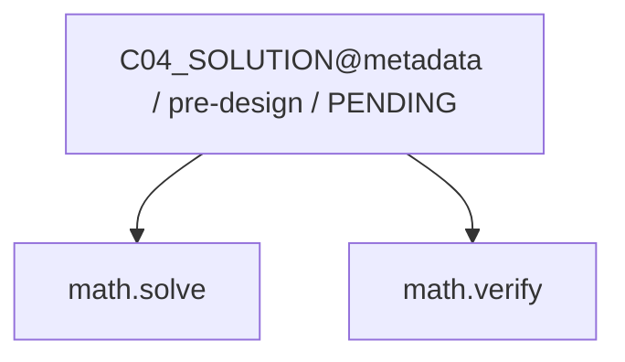

現在: — / BLOCKED

# C05_DESIGN@metadata（GENERATED）

台帳HEAD: `797b5b357878b3ee9723f62faf0c7a5c833ac64d87cc97d4bf493932f946c0f2`

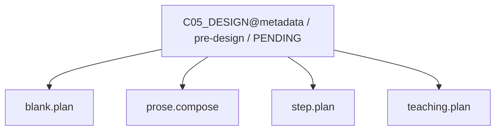

現在: — / BLOCKED

# C05_DESIGN@metadata（GENERATED）

台帳HEAD: `797b5b357878b3ee9723f62faf0c7a5c833ac64d87cc97d4bf493932f946c0f2`

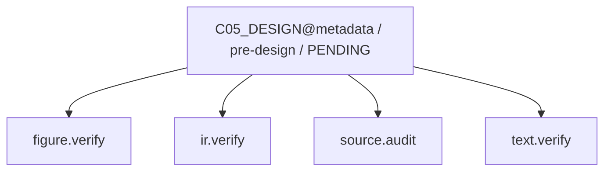

現在: — / BLOCKED

# C05_DESIGN@metadata（GENERATED）

台帳HEAD: `797b5b357878b3ee9723f62faf0c7a5c833ac64d87cc97d4bf493932f946c0f2`

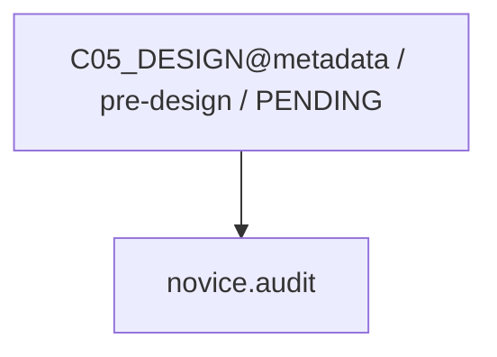

現在: — / BLOCKED

# C07_BUILD@metadata（GENERATED）

台帳HEAD: `797b5b357878b3ee9723f62faf0c7a5c833ac64d87cc97d4bf493932f946c0f2`

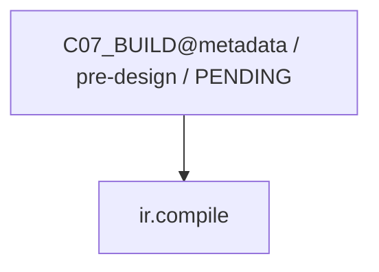

現在: — / BLOCKED

# C08_VERIFY@metadata（GENERATED）

台帳HEAD: `797b5b357878b3ee9723f62faf0c7a5c833ac64d87cc97d4bf493932f946c0f2`

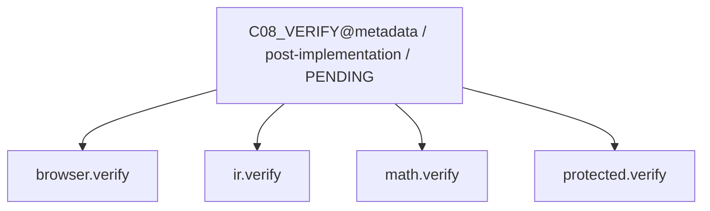

現在: — / BLOCKED

# C09_SEMANTIC@metadata（GENERATED）

台帳HEAD: `797b5b357878b3ee9723f62faf0c7a5c833ac64d87cc97d4bf493932f946c0f2`

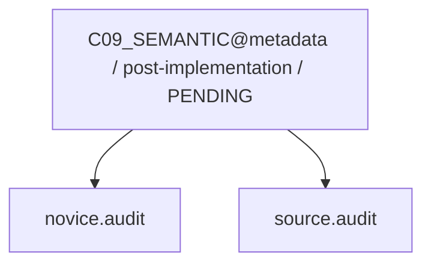

現在: — / BLOCKED

# G2_AUDIT@probe（GENERATED）

台帳HEAD: `797b5b357878b3ee9723f62faf0c7a5c833ac64d87cc97d4bf493932f946c0f2`

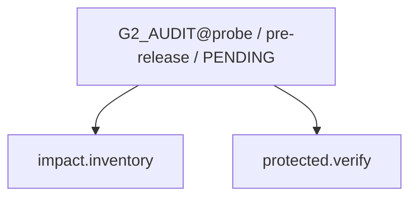

現在: — / BLOCKED

# G3_HOST@probe（GENERATED）

台帳HEAD: `797b5b357878b3ee9723f62faf0c7a5c833ac64d87cc97d4bf493932f946c0f2`

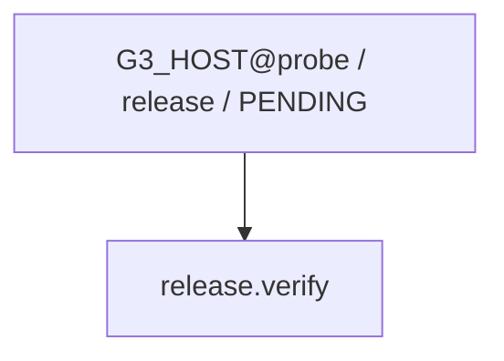

現在: — / BLOCKED

# L01_LEARNING@probe（GENERATED）

台帳HEAD: `797b5b357878b3ee9723f62faf0c7a5c833ac64d87cc97d4bf493932f946c0f2`

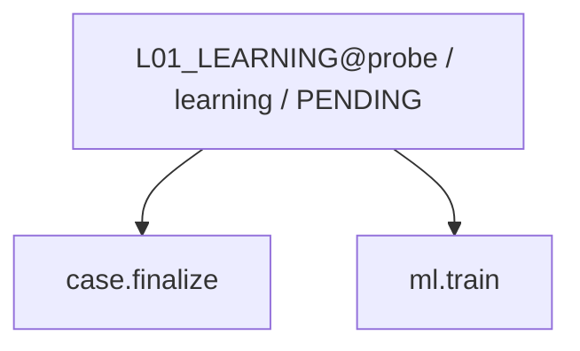

現在: — / BLOCKED

code実行receiptはsnapshot.jsonのcapability_receiptsを参照。AIの意味審査は別記録。
