# 機能火柴図（GENERATED）

台帳HEAD: `e9a3b6bcf1281e1177fb05ea4659bed0da3b433742609171eae763a5805900d1`

# R01_CAPTURE@a（GENERATED）

台帳HEAD: `e9a3b6bcf1281e1177fb05ea4659bed0da3b433742609171eae763a5805900d1`

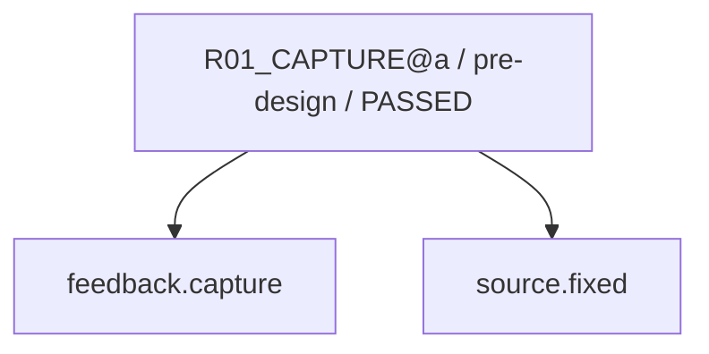

現在: — / DONE

# R02_CAUSE@a（GENERATED）

台帳HEAD: `e9a3b6bcf1281e1177fb05ea4659bed0da3b433742609171eae763a5805900d1`


現在: — / DONE

# R02_CAUSE@a（GENERATED）

台帳HEAD: `e9a3b6bcf1281e1177fb05ea4659bed0da3b433742609171eae763a5805900d1`

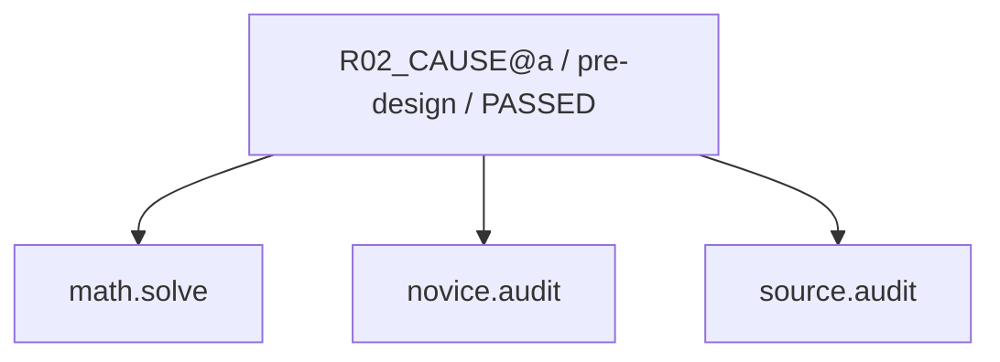

現在: — / DONE

# R03_IMPACT@a（GENERATED）

台帳HEAD: `e9a3b6bcf1281e1177fb05ea4659bed0da3b433742609171eae763a5805900d1`

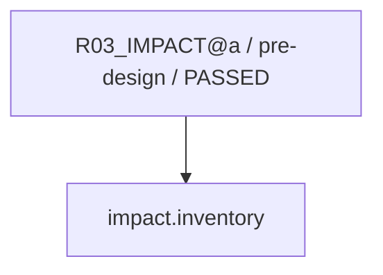

現在: — / DONE

# R04_PROPOSAL@a（GENERATED）

台帳HEAD: `e9a3b6bcf1281e1177fb05ea4659bed0da3b433742609171eae763a5805900d1`


現在: — / DONE

# R04_PROPOSAL@a（GENERATED）

台帳HEAD: `e9a3b6bcf1281e1177fb05ea4659bed0da3b433742609171eae763a5805900d1`


現在: — / DONE

# R04_PROPOSAL@a（GENERATED）

台帳HEAD: `e9a3b6bcf1281e1177fb05ea4659bed0da3b433742609171eae763a5805900d1`

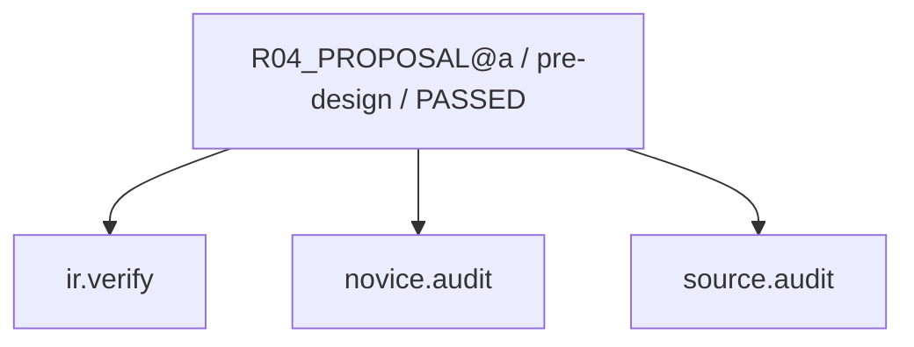

現在: — / DONE

# R06_PATCH@a（GENERATED）

台帳HEAD: `e9a3b6bcf1281e1177fb05ea4659bed0da3b433742609171eae763a5805900d1`

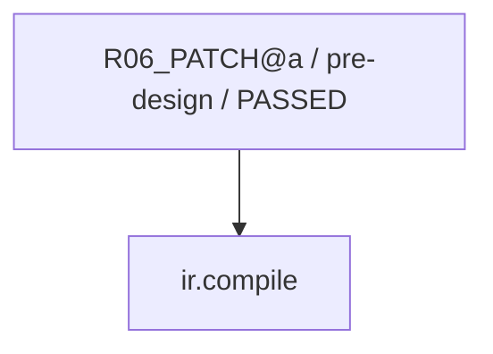

現在: — / DONE

# R07_VERIFY@a（GENERATED）

台帳HEAD: `e9a3b6bcf1281e1177fb05ea4659bed0da3b433742609171eae763a5805900d1`


現在: — / DONE

# R07_SEMANTIC@a（GENERATED）

台帳HEAD: `e9a3b6bcf1281e1177fb05ea4659bed0da3b433742609171eae763a5805900d1`

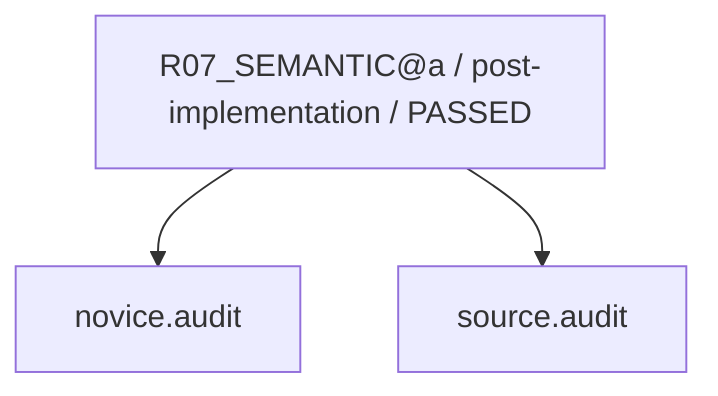

現在: — / DONE

# R01_CAPTURE@b（GENERATED）

台帳HEAD: `e9a3b6bcf1281e1177fb05ea4659bed0da3b433742609171eae763a5805900d1`

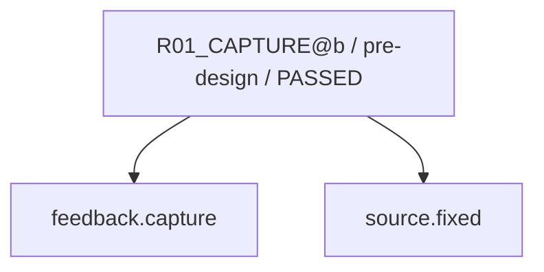

現在: — / DONE

# R02_CAUSE@b（GENERATED）

台帳HEAD: `e9a3b6bcf1281e1177fb05ea4659bed0da3b433742609171eae763a5805900d1`

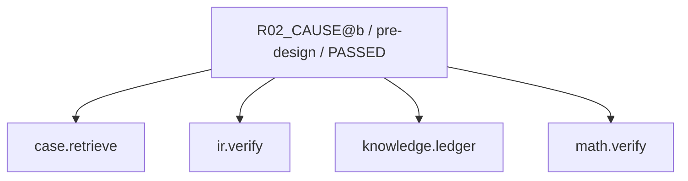

現在: — / DONE

# R02_CAUSE@b（GENERATED）

台帳HEAD: `e9a3b6bcf1281e1177fb05ea4659bed0da3b433742609171eae763a5805900d1`


現在: — / DONE

# R03_IMPACT@b（GENERATED）

台帳HEAD: `e9a3b6bcf1281e1177fb05ea4659bed0da3b433742609171eae763a5805900d1`


現在: — / DONE

# R04_PROPOSAL@b（GENERATED）

台帳HEAD: `e9a3b6bcf1281e1177fb05ea4659bed0da3b433742609171eae763a5805900d1`

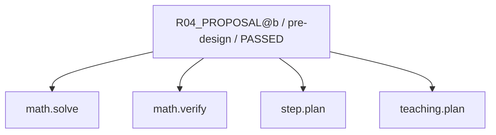

現在: — / DONE

# R04_PROPOSAL@b（GENERATED）

台帳HEAD: `e9a3b6bcf1281e1177fb05ea4659bed0da3b433742609171eae763a5805900d1`

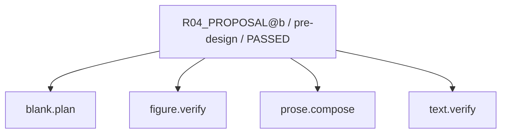

現在: — / DONE

# R04_PROPOSAL@b（GENERATED）

台帳HEAD: `e9a3b6bcf1281e1177fb05ea4659bed0da3b433742609171eae763a5805900d1`


現在: — / DONE

# R06_PATCH@b（GENERATED）

台帳HEAD: `e9a3b6bcf1281e1177fb05ea4659bed0da3b433742609171eae763a5805900d1`

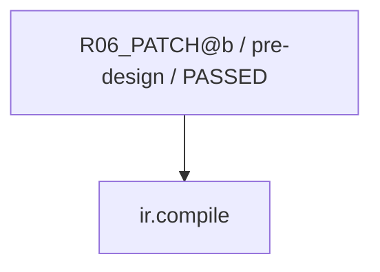

現在: — / DONE

# R07_VERIFY@b（GENERATED）

台帳HEAD: `e9a3b6bcf1281e1177fb05ea4659bed0da3b433742609171eae763a5805900d1`

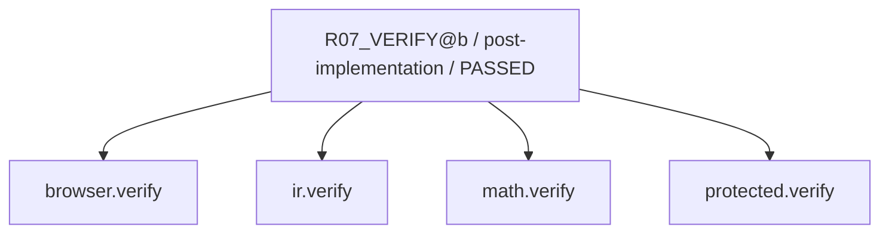

現在: — / DONE

# R07_SEMANTIC@b（GENERATED）

台帳HEAD: `e9a3b6bcf1281e1177fb05ea4659bed0da3b433742609171eae763a5805900d1`

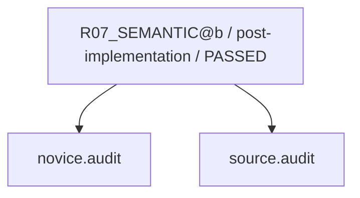

現在: — / DONE

# G2_AUDIT@u1（GENERATED）

台帳HEAD: `e9a3b6bcf1281e1177fb05ea4659bed0da3b433742609171eae763a5805900d1`

```mermaid
flowchart TD
  N0["G2_AUDIT@u1 / pre-release / PASSED"]
  N1["protected.verify"]
  N2["impact.inventory"]
  N0 --> N2
  N0 --> N1
```

現在: — / DONE

# G3_HOST@u1（GENERATED）

台帳HEAD: `e9a3b6bcf1281e1177fb05ea4659bed0da3b433742609171eae763a5805900d1`

```mermaid
flowchart TD
  N0["G3_HOST@u1 / release / PASSED"]
  N1["release.verify"]
  N0 --> N1
```

現在: — / DONE

# R03_IMPACT_SWEEP@u1（GENERATED）

台帳HEAD: `e9a3b6bcf1281e1177fb05ea4659bed0da3b433742609171eae763a5805900d1`

```mermaid
flowchart TD
  N0["R03_IMPACT_SWEEP@u1 / post-fix / PASSED"]
  N1["impact.inventory"]
  N0 --> N1
```

現在: — / DONE

# R08_CAPTURE_LEARNING@a（GENERATED）

台帳HEAD: `e9a3b6bcf1281e1177fb05ea4659bed0da3b433742609171eae763a5805900d1`

```mermaid
flowchart TD
  N0["R08_CAPTURE_LEARNING@a / repair-finalization / PASSED"]
  N1["case.finalize"]
  N0 --> N1
```

現在: — / DONE

# L01_LEARNING@u1（GENERATED）

台帳HEAD: `e9a3b6bcf1281e1177fb05ea4659bed0da3b433742609171eae763a5805900d1`

```mermaid
flowchart TD
  N0["L01_LEARNING@u1 / learning / PASSED"]
  N1["case.finalize"]
  N2["ml.train"]
  N0 --> N1
  N0 --> N2
```

現在: — / DONE

# G2_AUDIT@u2（GENERATED）

台帳HEAD: `e9a3b6bcf1281e1177fb05ea4659bed0da3b433742609171eae763a5805900d1`

```mermaid
flowchart TD
  N0["G2_AUDIT@u2 / pre-release / PASSED"]
  N1["protected.verify"]
  N2["impact.inventory"]
  N0 --> N2
  N0 --> N1
```

現在: — / DONE

# G3_HOST@u2（GENERATED）

台帳HEAD: `e9a3b6bcf1281e1177fb05ea4659bed0da3b433742609171eae763a5805900d1`

```mermaid
flowchart TD
  N0["G3_HOST@u2 / release / PASSED"]
  N1["release.verify"]
  N0 --> N1
```

現在: — / DONE

# R03_IMPACT_SWEEP@u2（GENERATED）

台帳HEAD: `e9a3b6bcf1281e1177fb05ea4659bed0da3b433742609171eae763a5805900d1`

```mermaid
flowchart TD
  N0["R03_IMPACT_SWEEP@u2 / post-fix / PASSED"]
  N1["impact.inventory"]
  N0 --> N1
```

現在: — / DONE

# R08_CAPTURE_LEARNING@b（GENERATED）

台帳HEAD: `e9a3b6bcf1281e1177fb05ea4659bed0da3b433742609171eae763a5805900d1`

```mermaid
flowchart TD
  N0["R08_CAPTURE_LEARNING@b / repair-finalization / PASSED"]
  N1["case.finalize"]
  N0 --> N1
```

現在: — / DONE

# L01_LEARNING@u2（GENERATED）

台帳HEAD: `e9a3b6bcf1281e1177fb05ea4659bed0da3b433742609171eae763a5805900d1`

```mermaid
flowchart TD
  N0["L01_LEARNING@u2 / learning / PASSED"]
  N1["case.finalize"]
  N2["ml.train"]
  N0 --> N1
  N0 --> N2
```

現在: — / DONE

code実行receiptはsnapshot.jsonのcapability_receiptsを参照。AIの意味審査は別記録。
