# 機能火柴図（GENERATED）

台帳HEAD: `0b716422fb3734bb0d9c45438c12135a5f8a3bde54afb6d91762a9997fad9ff6`

# C01_SOURCE@a（GENERATED）

台帳HEAD: `0b716422fb3734bb0d9c45438c12135a5f8a3bde54afb6d91762a9997fad9ff6`

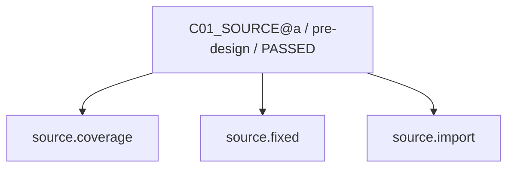

現在: — / DONE

# C02_CONCEPT@a（GENERATED）

台帳HEAD: `0b716422fb3734bb0d9c45438c12135a5f8a3bde54afb6d91762a9997fad9ff6`

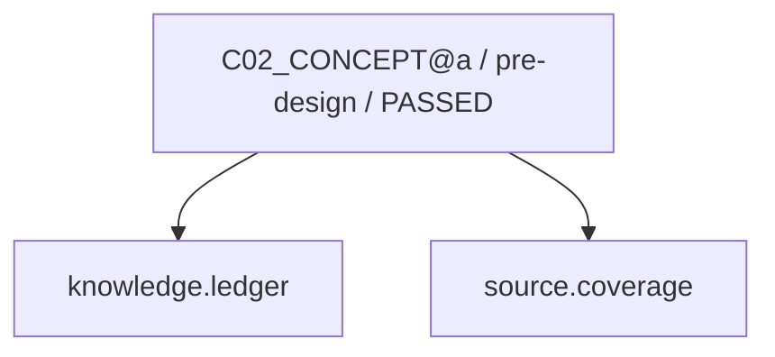

現在: — / DONE

# C03_PATTERN@a（GENERATED）

台帳HEAD: `0b716422fb3734bb0d9c45438c12135a5f8a3bde54afb6d91762a9997fad9ff6`

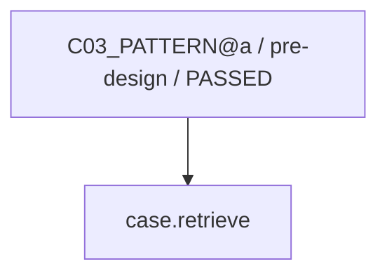

現在: — / DONE

# C04_SOLUTION@a（GENERATED）

台帳HEAD: `0b716422fb3734bb0d9c45438c12135a5f8a3bde54afb6d91762a9997fad9ff6`

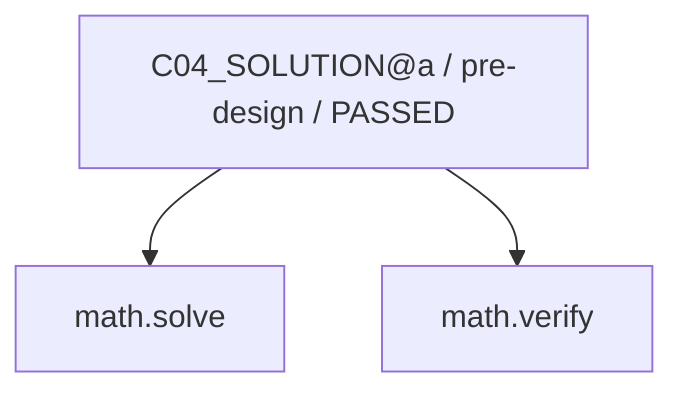

現在: — / DONE

# C05_DESIGN@a（GENERATED）

台帳HEAD: `0b716422fb3734bb0d9c45438c12135a5f8a3bde54afb6d91762a9997fad9ff6`

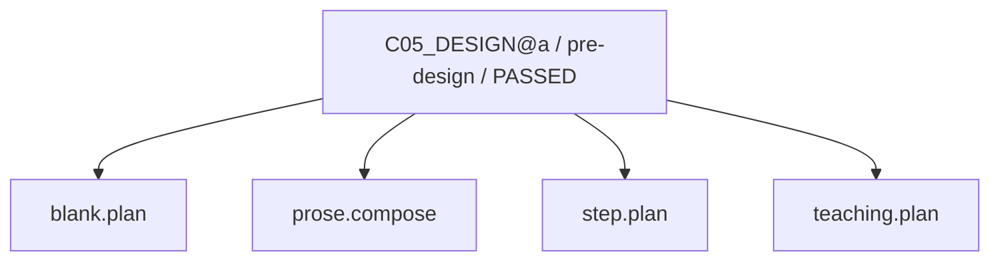

現在: — / DONE

# C05_DESIGN@a（GENERATED）

台帳HEAD: `0b716422fb3734bb0d9c45438c12135a5f8a3bde54afb6d91762a9997fad9ff6`


現在: — / DONE

# C05_DESIGN@a（GENERATED）

台帳HEAD: `0b716422fb3734bb0d9c45438c12135a5f8a3bde54afb6d91762a9997fad9ff6`

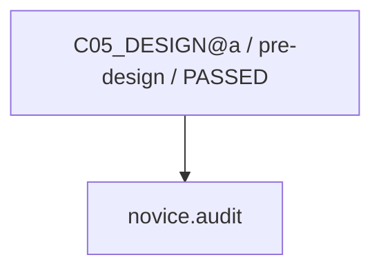

現在: — / DONE

# C07_BUILD@a（GENERATED）

台帳HEAD: `0b716422fb3734bb0d9c45438c12135a5f8a3bde54afb6d91762a9997fad9ff6`

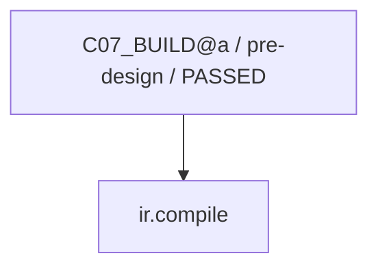

現在: — / DONE

# C08_VERIFY@a（GENERATED）

台帳HEAD: `0b716422fb3734bb0d9c45438c12135a5f8a3bde54afb6d91762a9997fad9ff6`


現在: — / DONE

# C09_SEMANTIC@a（GENERATED）

台帳HEAD: `0b716422fb3734bb0d9c45438c12135a5f8a3bde54afb6d91762a9997fad9ff6`

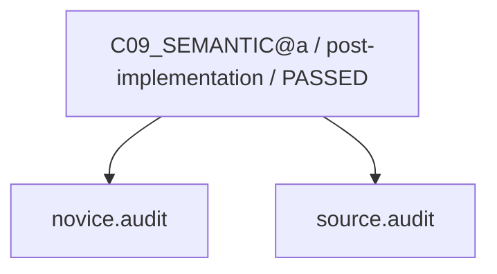

現在: — / DONE

# C01_SOURCE@b（GENERATED）

台帳HEAD: `0b716422fb3734bb0d9c45438c12135a5f8a3bde54afb6d91762a9997fad9ff6`


現在: — / DONE

# C02_CONCEPT@b（GENERATED）

台帳HEAD: `0b716422fb3734bb0d9c45438c12135a5f8a3bde54afb6d91762a9997fad9ff6`

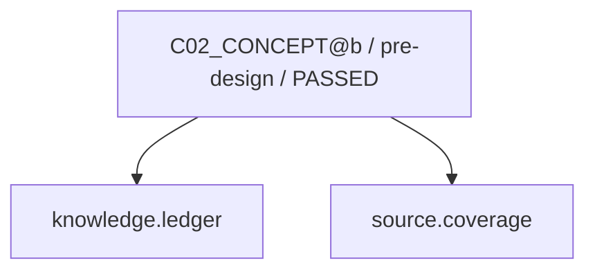

現在: — / DONE

# C03_PATTERN@b（GENERATED）

台帳HEAD: `0b716422fb3734bb0d9c45438c12135a5f8a3bde54afb6d91762a9997fad9ff6`

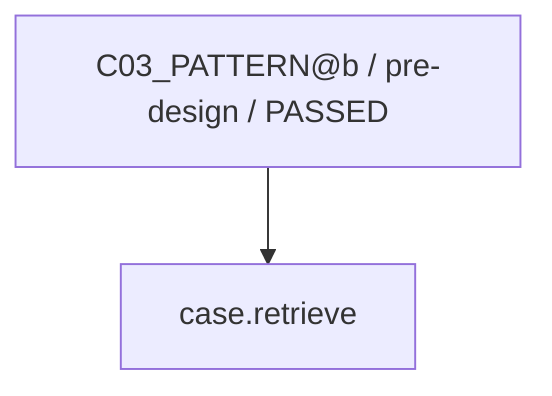

現在: — / DONE

# C04_SOLUTION@b（GENERATED）

台帳HEAD: `0b716422fb3734bb0d9c45438c12135a5f8a3bde54afb6d91762a9997fad9ff6`

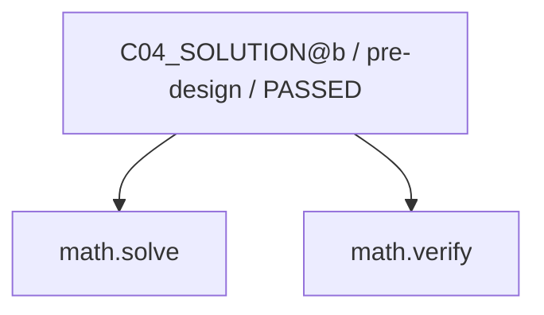

現在: — / DONE

# C05_DESIGN@b（GENERATED）

台帳HEAD: `0b716422fb3734bb0d9c45438c12135a5f8a3bde54afb6d91762a9997fad9ff6`

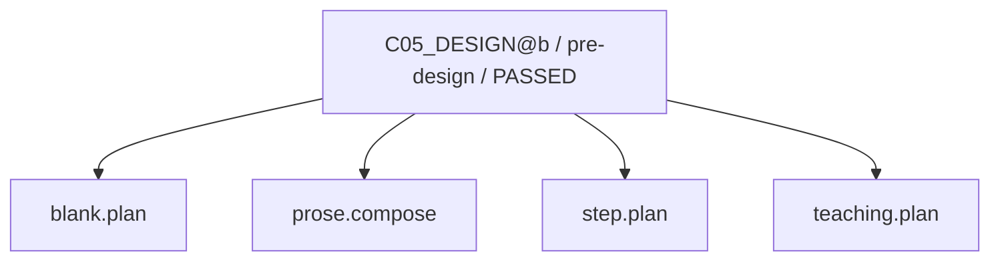

現在: — / DONE

# C05_DESIGN@b（GENERATED）

台帳HEAD: `0b716422fb3734bb0d9c45438c12135a5f8a3bde54afb6d91762a9997fad9ff6`

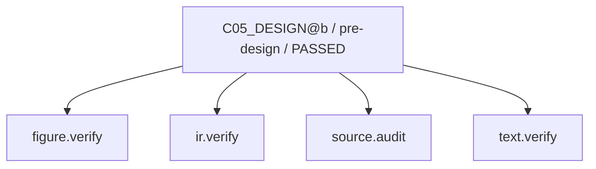

現在: — / DONE

# C05_DESIGN@b（GENERATED）

台帳HEAD: `0b716422fb3734bb0d9c45438c12135a5f8a3bde54afb6d91762a9997fad9ff6`


現在: — / DONE

# C07_BUILD@b（GENERATED）

台帳HEAD: `0b716422fb3734bb0d9c45438c12135a5f8a3bde54afb6d91762a9997fad9ff6`


現在: — / DONE

# C08_VERIFY@b（GENERATED）

台帳HEAD: `0b716422fb3734bb0d9c45438c12135a5f8a3bde54afb6d91762a9997fad9ff6`

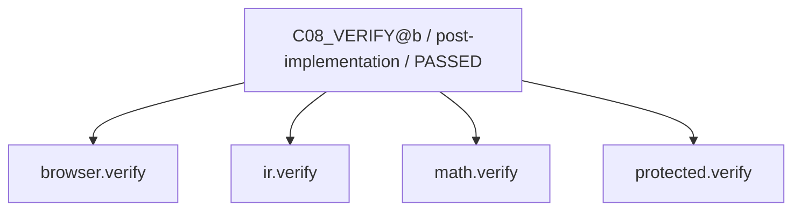

現在: — / DONE

# C09_SEMANTIC@b（GENERATED）

台帳HEAD: `0b716422fb3734bb0d9c45438c12135a5f8a3bde54afb6d91762a9997fad9ff6`

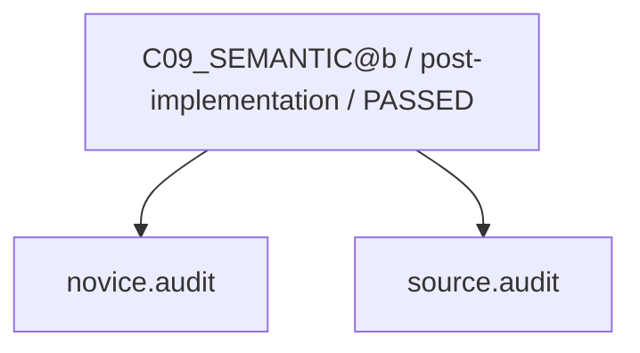

現在: — / DONE

# G2_AUDIT@u1（GENERATED）

台帳HEAD: `0b716422fb3734bb0d9c45438c12135a5f8a3bde54afb6d91762a9997fad9ff6`

```mermaid
flowchart TD
  N0["G2_AUDIT@u1 / pre-release / PASSED"]
  N1["protected.verify"]
  N2["impact.inventory"]
  N0 --> N2
  N0 --> N1
```

現在: — / DONE

# G3_HOST@u1（GENERATED）

台帳HEAD: `0b716422fb3734bb0d9c45438c12135a5f8a3bde54afb6d91762a9997fad9ff6`

```mermaid
flowchart TD
  N0["G3_HOST@u1 / release / PASSED"]
  N1["release.verify"]
  N0 --> N1
```

現在: — / DONE

# L01_LEARNING@u1（GENERATED）

台帳HEAD: `0b716422fb3734bb0d9c45438c12135a5f8a3bde54afb6d91762a9997fad9ff6`

```mermaid
flowchart TD
  N0["L01_LEARNING@u1 / learning / PASSED"]
  N1["case.finalize"]
  N2["ml.train"]
  N0 --> N1
  N0 --> N2
```

現在: — / DONE

# G2_AUDIT@u2（GENERATED）

台帳HEAD: `0b716422fb3734bb0d9c45438c12135a5f8a3bde54afb6d91762a9997fad9ff6`

```mermaid
flowchart TD
  N0["G2_AUDIT@u2 / pre-release / PASSED"]
  N1["protected.verify"]
  N2["impact.inventory"]
  N0 --> N2
  N0 --> N1
```

現在: — / DONE

# G3_HOST@u2（GENERATED）

台帳HEAD: `0b716422fb3734bb0d9c45438c12135a5f8a3bde54afb6d91762a9997fad9ff6`

```mermaid
flowchart TD
  N0["G3_HOST@u2 / release / PASSED"]
  N1["release.verify"]
  N0 --> N1
```

現在: — / DONE

# L01_LEARNING@u2（GENERATED）

台帳HEAD: `0b716422fb3734bb0d9c45438c12135a5f8a3bde54afb6d91762a9997fad9ff6`

```mermaid
flowchart TD
  N0["L01_LEARNING@u2 / learning / PASSED"]
  N1["case.finalize"]
  N2["ml.train"]
  N0 --> N1
  N0 --> N2
```

現在: — / DONE

code実行receiptはsnapshot.jsonのcapability_receiptsを参照。AIの意味審査は別記録。
