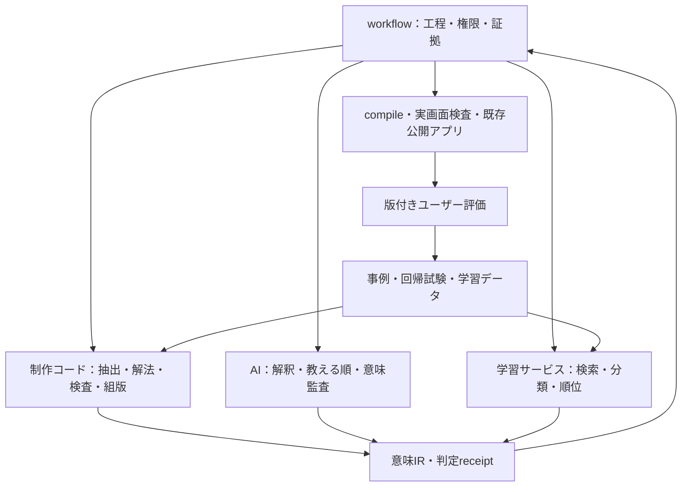

# 教材制作ワークフロー再設計書 P-003

Status: PROPOSED — 設計・調査・事例回収。実装承認や教材受入ではない。
対象: rrikunagasige-dot/kyotsu-step-web / 数学教科書を第一適用先とする制作基盤
基準: feature 1e8403d711bdc835e76a9fabdd7d1b03cd548824、main 618e2be2a0a4dab9fd853288148829a11b3b0b70

## 1. この設計で決めること

制作をAIへ丸投げして最後に検査を足す方式から、**各工程でコードが作れるものを先に作り、AIは解釈・選択・教え方を担当し、双方の結果を再照合する方式**へ改める。さらに、実際の評価から分類器・候補順位モデルを学習し、次回の生成入力と監査順へ戻す。

今回はN07を修正しない。教材本文・公開アプリ・既存進捗・受入済み第一タイトルを変更しない。既存P-002とその実装を取り消すのではなく、使える部分を残し、不足する接続・意味表現・検査・学習を追加する提案である。

本書と次の付属書で一つの設計とする。

- [IMPLEMENTATION.md](IMPLEMENTATION.md): 改修先、作業単位、依存、試験、移行、完了条件。
- [ML_AND_CORPUS.md](ML_AND_CORPUS.md): 過去事例の回収・モデル比較・実学習・評価・運用。
- [CONTRACTS.md](CONTRACTS.md): データ/API、意味属性、判定状態、具体例。
- [RESEARCH.md](RESEARCH.md): 既存実装と外部コードの調査結果、採否、一次資料。
- [RECOVERED_CASE_INDEX.json](RECOVERED_CASE_INDEX.json): 今回回収した82観測の索引。重複・未確認を含み、82教師例という意味ではない。
- [PLAN.json](PLAN.json): 工程・実装項目の機械可読対応表。

## 2. 品質目標を実装可能な形にする

| 目標 | コードが保証・検査すること | AIが判断すること | 残す証拠 |
|---|---|---|---|
| 原資料を落とさない | 原ブロック↔教材の両方向対応、除外理由、条件・図・数式の保持 | 無番号の説明・図注の重要性、読み取りの意味 | source map、未対応一覧、位置付き照合 |
| 学校の解答順で教える | 前提の存在、依存の向き、途中操作、全体式への復帰、循環の検出 | 生徒が今の知識で目的・操作を理解できるか | 既習台帳、完全解法、段階ごとの根拠 |
| 細かくしても推導を切らない | 変形の前後と関係、操作の対象、前結果参照、式グループ | どこまで細かくするか、初回と反復の差 | solution graph→teaching graph対応 |
| 生徒が考える | 解答の先出し、穴の重複、答えの形式、誤答の同値、ヒント解放 | その穴で何を判断・生成・導出させるか | 穴の採否理由、能力・既習・誤概念 |
| 文章・数式が読める | rich text保持、式の描画率、等号位置、式番号参照、幅と衝突 | 文のつながり、用語の初出、表示の違和感 | 全状態のコンパイル結果、実画面 |
| 長くても読める | 同じ導出を保つ圧縮、参照結果の再掲、履歴と再開 | 何を再掲すれば今の判断ができるか | active context、compact/history状態 |
| 同じ失敗を減らす | 再現fixture、適用規則、事例検索、学習版と入力hash | 一般化してよい条件・例外、未知の問題への監査 | feedback→rule/model→next-run receipt |

「項目が埋まっている」ことと「内容が成立している」ことを区別する。目的欄に『理解する』、根拠欄に『前の結果』と書いただけでは合格にしない。コードで参照先・操作・結果を照合し、AIは実際の文と前提を引用して判断する。評価用AIが制作AIの『十分詳しい』という自己評価を合格根拠にすることは禁止する。

## 3. 現在コードが実際にしていること

### 3.1 旧工程エンジンと旧数式エンジン

現mainにある `workflow/` は、工程定義、実行履歴、前提チェック、入力hash、claim、CAS、pause/resume、副作用のintent/outcome、監査・品質イベントを管理する。AIの出力やユーザーの権限を構造化するが、AIを自動呼出しする実装ではない。現featureにはこの系統がないため、存在確認なしに呼び出せない。

`work/items/W-GOV-010-coded-authoring/engine/` は、構造→解法→穴→選択肢→文章図→最終検査という六段階を持つ。分配・一次結合の限定問題を解き、ASTの誤操作から選択肢を作る。`math_core.py` は有理係数・一変数・次数8以下等の範囲で多項式を照合し、別経路の評価も行う。一般の高校数学を証明するものではない。

旧 `build_catalog.py` は36件の版・評価・適格性を渡すだけで、学習しない。`training_eligible` は学習済みの印ではない。確認した内訳はNEGATIVE10 / UNKNOWN26 / POSITIVE0、`training_run:false` である。旧evaluateの再現試験も、未使用問題の教育効果測定ではない。

### 3.2 現行N07制作コード

| 既存資産 | 実機能 | 限界と改修方針 |
|---|---|---|
| `source/import-word.py` | Word位置・OMMLhash・Pandoc変換、目次誤認対策 | 意味の同一性はAI照合を残す。source adapterとして再利用 |
| `rules/n07.mjs` | Fraction.jsによる厳密分数、独立筆算、周期・有限条件、9種の操作 | 対応する数値領域を明示。汎用solverへ名称だけ変えない |
| `complete-solutions.mjs` | 数値解法と証明・結論の作成 | 固定のAI記述も含む。計算済みと証明監査済みを分離 |
| `planner/candidates.mjs` | 操作traceに沿う小目標・文章・穴・誤答・ヒント候補 | 固定profile中心。複数の教え方の比較・学習順位付けは未実装 |
| `fixtures/n07-author.mjs` | N07全範囲の41nodeを固定作成 | 26 ai-authored /15 ai-refined。実行時に新AIを呼ぶ機構ではない |
| `schema.mjs` / `verify.mjs` | Zod、coverage、依存、用語順、重複・同値・漏洩等 | before/afterが主に文字列。構造が合っても意味・描画漏れが残る |
| `compile-lesson.mjs` | app用JSON・式・回答部品へ変換 | 文章をtextへ平坦化、操作回答・中間値を別表示。意味表現の共通化が必要 |
| `jobs.mjs` / `cli.mjs` | 原子書込、hashcache、履歴、inspect/resume、AI import | 旧工程の代替にしない。feedbackがhash外なら自動再評価されない |
| `TypesetFormula.tsx` / `typesetRows.ts` | 幅計測、等号group、DPによる折返し | 固定コスト関数でありMLではない。受入済み配置を基準に保護 |
| `NumberedEquation.tsx` | 式番号・衝突回避 | 全出力を番号付けすればよいわけではない。意味から番号対象を選ぶ |
| `N07ReadingFlow.tsx` | 段階解放、36操作、14stage、前結果・履歴・移行 | term/mathの意味保持と共通部品の契約試験を補う |
| 第一タイトル用author script | 凍結baselineから受入済み教材を再現 | 固定編集。ML・汎用制作器と混同しない。版・ID・進捗を保護 |

### 3.3 なくす誤認

- 外部モデルを読み込むだけ、事例を検索するだけ、カタログを更新するだけでは追加学習と呼ばない。
- DOMにKaTeX errorがないだけでは、本文内の数式を描画し忘れていないとは言えない。
- 小段階を増やすだけでは教える順にならない。局所計算から元の目標へ戻す辺が要る。
- 穴をresult末尾へ置くだけでは判断・式生成の穴にならない。
- UI試験のPASSは、教材の説明・推導へのユーザー受入を代替しない。

## 4. 全体構成 — 三つ目の工程エンジンを作らない

`workflow/` を工程・権限・履歴の唯一の正本とし、`tools/textbook/jobs.mjs` を一工程の計算jobとして接続する。旧数式エンジンとN07規則は、対応領域の違うsolver adapterとする。共通IRは教材の意味を受け渡す形式であり、第三の状態管理エンジンにはしない。

AIは当面、現行アシスタントがrequest bundleを読みresponseをCLIへimportする。これは既存方式を使用する実行経路である。将来のAPI自動呼出しは同じprovider interfaceの別実装とし、接続・モデル・費用が未確定のまま前提にしない。複数AIの自動起動も今回の設計の必須条件にしない。

MLは制作時のみ実行し、学習済み重みを静的な学習アプリへ搭載しない。学習者の回答履歴・個人情報を学習材料へ自動転用しない。現在のユーザーによる制作評価を対象にする。

## 5. 工程ごとの具体設計

以下はすべて入力hash・出力artifact・検証結果・差戻し先を持つ。AI欄がある工程でも、コードによる前処理・後処理を実施する。MLが利用不能でも、明示的なfallback receiptを残してコードとAIで進められる。

### S00–S05：再開・原資料・過去の知見

| ID | 入力→出力 | コードの仕事 | AI・MLの仕事 | 検査／失敗時 |
|---|---|---|---|---|
| S00 現在地復元 | repo/Work→run manifest | owner/main/feature/live source、policy、未解決修正、前回claimを照合 | AIが依頼範囲を解釈 | source相違は停止。N07修正より基盤設計優先という今回の指示を保持 |
| S01 正本固定 | Word/PDF/既存教材→source manifest | SHA、ページ・段落・式・図の原位置、取得経路を固定 | AIが母本と補足資料の役割・条件を確認 | 読めない箇所は欠落として列挙。推測補完で通さない |
| S02 完全抽出 | 原本→source block index | Pandoc/既存extractor、番号のない文・図注・表も採番 | AIが抽出順・数式・図との対応を照合 | 目次と本文、図中文字、条件脱落を別チェック |
| S03 問題契約 | source index→problem contracts | 問題・概念・性質・例題・証明・図の対応と逆引き | AIが何を学ぶ箇所か、元条件・答え形式を確定 | 全blockに採用先又は除外理由。除外の意味はAI監査 |
| S04 規則・事例取得 | mode/問題契約→evidence bundle | scope/versionで絞る、hash・適用条件・失効を確認 | ML類似検索＋AIが今回の適否・反例を選ぶ | 類似度だけで既習・正解・承認を移植しない |
| S05 既習と表現 | problem contracts→knowledge ledger | 記号・用語・既習結果・単位・定義のIDと順を管理 | AIが初回説明の粒度と小中高の既習境界を定める | 未定義名・未学習定理で次へ進まない。新規例題は原問と区別 |

### S06–S11：完全解法から教える設計まで

| ID | 入力→出力 | コードの仕事 | AI・MLの仕事 | 検査／失敗時 |
|---|---|---|---|---|
| S06 完全解法 | problem→solution graph | 対応solverで式変形・値・条件・分岐・trace候補を作る | AIが解法を補い、一般論証・条件・根拠を記述 | unsupportedをPASSにしない。手記述証明は別監査へ |
| S07 独立数理検証 | solution→math receipts | 正確演算、別経路検算、同値と答え形式を分離 | AIが論証の適用条件と網羅性を反証する | 計算に例が合うことを一般証明に代用しない。失敗→S06 |
| S08 教える順候補 | solution＋既習→最大3案のteaching DAG | topological順、局所→全体、再利用、初回/反復profileを列挙 | AIが目的・根拠・次の役割を言語化。MLは検証済み候補を順位付け | 最終値から逆戻りさせる漏洩・循環を拒否。候補ゼロ→S06/05 |
| S09 小段階設計 | teaching DAG→node contracts | 一操作の対象・入力・出力・使用先を対応、必要文のslotを作る | AIがスマホで自分で解ける粒度へ分ける／まとめる | operation_count=1の数値だけで十分としない。分解後の全体式が必要 |
| S10 穴・選択肢 | nodes→interaction plan | 判断/関係/式生成/計算/意味などの候補、誤操作、正解形式を生成 | AIが穴採否・負荷・初回重要性を選択。MLは過去失敗から警告 | 正解1つ、誤答非同値、表示漏洩、単なる写しを検査。全node穴必須にしない |
| S11 表現設計 | nodes＋穴→typed prose/math/figure plan | 定義黒太字、math token、relation、番号・参照・再掲仕様を検査 | AIが文章として接続し、図表の必要性・位置・何を読むかを設計 | 単語だけの操作、意味不明な数値、式列の分断を差戻し |

S08の候補は、第一に「初めて解く生徒向けの詳しい経路」、次に条件が合う場合だけ「既習計算をまとめる経路」「図表で関係を先に読む経路」。全問題に同じ三案を無意味に生成しない。候補数・AI回数・修正回数にrun budgetを設け、打切り時は未解決理由を返す。

### S12–S17：実際に読める原稿と反証監査

| ID | 入力→出力 | コードの仕事 | AI・MLの仕事 | 検査／失敗時 |
|---|---|---|---|---|
| S12 本文作成 | expression plan→完全教材IR | 文法slot、値・式・用語・参照の差込み、source mapを保持 | AIが全文の日本語、導入、理由、次への接続を整える | 本文後の自己解説だけで合格にしない。完成本文そのものを監査 |
| S13 図表作成 | figure plan→図表artifact | 既存図・SVG・表を再利用、計算値と対応、ラベル可読性 | AIが図の意味と必要十分性を点検 | 必要な図なし／不要な新図／答え先出しを検出。図不要なら理由を記録 |
| S14 静的検査 | IR→構造/意味属性/描画予定receipt | schema、条件、DAG、用語、式relation、穴、番号、token保存 | MLが疑わしいnodeを列挙。AIは曖昧な警告を解決 | ERRORは修正、WARNは根拠付き解決、UNSUPPORTEDは別経路へ |
| S15 原資料監査 | source＋IR→source audit | 対応表と差分を自動提示 | AIが無番号説明を含めて落ち・改変・不正な補足を探す | 作者のcoverage宣言ではなく原文位置から全件照合。失敗→S03/12 |
| S16 初学者監査 | 各時点の可視内容→novice audit | 学習済み情報だけのsnapshot、未解放内容の遮断 | AIが次の判断を実際に解き、足りない情報を特定 | 監査者が未来の答えを見て補わない。失敗→S05/08/09/10/12 |
| S17 案確定 | draft＋全監査→exact design bundle | node別本文・穴・式・図・状態・試験と版を出力 | AIが解決状況・残件・変更範囲を説明 | 未解決の必須項目を合格にしない。教材設計の既承認は再取得不要 |

S17で提示する具体設計はN01,N02…相当の各単元、各原問、各nodeまで展開する。本文を『後でAIが書く』と空欄にせず、表示される文・式・穴・選択肢・誤答説明・前結果・解放順を含める。今回のP-003はこの仕組みの設計であり、N07の新本文設計を兼ねない。

### S18–S24：compile・公開・評価を次回へ戻す

| ID | 入力→出力 | コードの仕事 | AI・MLの仕事 | 検査／失敗時 |
|---|---|---|---|---|
| S18 compile | exact approved design→app JSON | typedIRから既存部品へ変換、意味token対応receipt、安定ID | AIは新内容をcompile時に付け足さない | 承認hashと実内容相違は戻す。新しいN07特例を積み増さない |
| S19 実UI検査 | compiled app→browser receipts | 幅320/390/430/1440、正誤・ヒント・前結果・履歴・再開・進捗移行 | AIが実画面と本文の違和感を点検 | 描画エラー0＋意味token描画率、等号/番号/行の切れを検査 |
| S20 影響監査 | diff＋protected baseline→regression report | 受入済み第一タイトル・他mode・ID・元図・stateの差分を限定 | AIが共通修正の意図しない教育影響を確認 | 対象外の変更は別scope。既存失敗を新規PASSにしない |
| S21 既存公開先へ反映 | frozen source＋QA→release receipt | 既存release経路、intent/outcome、配信source/route/assetを照合 | AIは結果と直接URLを引渡す | 設計承認済み範囲の旧スクショ承認待ち・公開再許可を挟まない |
| S22 ユーザー評価 | app URL＋発言/画像→feedback events | source/node/state/観点に結ぶ、原文保持、権限イベントと分離 | AIが対象・評価範囲・不確実性を解釈 | 称賛がlayoutのみならsemanticを正例にしない |
| S23 失敗の定着防止 | feedback→case/regression/rule candidates | 最小fixture、旧版再現、影響先検索、negative-case消費receipt | AIが原因・一般化条件・例外を監査 | 保存だけで閉じない。回帰は未実装なら未実装と記録 |
| S24 学習と知見統合 | curated corpus→model/rules/retrieval snapshot | 重複排除、group split、実学習・比較評価、registry、次runへの注入 | AIがラベル・適用scope・矛盾を監査 | データ不足ならそのheadのみ保留。新モデルはshadowから昇格 |

## 6. 教える順をどうコード化するか

小学生・中学生・高校生の解答の書き方を、全教材に同じ文章を強制する規則へ置き換えない。対象modeと数学的操作に応じた**構造テンプレート**として持つ。

| 型 | 必要な流れ | コードで作るもの | AIが補うもの |
|---|---|---|---|
| 条件の式化 | 条件→代入位置→未計算式→整理操作→関係式→利用先 | symbol binding、substitute trace、式の差分 | なぜここへ代入するか、どの係数を残すか |
| 同類項整理 | 注目文字→次数/項の選別→係数の計算→項を戻す→全体の組立て | term partition、係数の厳密計算、reassembly | 初回の選別理由、定数扱いの別文字の説明 |
| 等式・不等式変形 | 目標→両辺への同操作→操作後の式→計算→次の操作 | relation-preserving transform、符号条件 | 消去する理由、負数で割るときの判断 |
| 公式導出 | 前提→同じ部分に注目→操作候補→関係式→整理→適用条件 | 式の対応、差を取る対象・向き、変形同値 | 何を揃えるとなぜ目的を達せるか |
| 定義・概念 | 具体例/必要性→共通特徴→意味→名称→適用/非例 | role・用語初出・例/反例の対応 | どの具体例が直感につながるか、言い換え |
| 証明 | 主張・仮定→使える定義→推論→条件/場合分け→結論 | proof dependency・条件台帳、対応可能部分の検算 | 一般性・飛躍・網羅性の論証。例の計算との区別 |

最小仕様は `inputFacts → goal → operation(targets, direction) → outputFact → useInNext`。『次に計算する』だけのoperationは禁止。局所式から全体式へ戻す `reassemble` も操作として持つ。コードが作った順もAIの監査対象であり、テンプレートに合えば教え方が正しいとはしない。

## 7. 穴の設計を結果空欄から拡張する

`blank.target` は既存の `.result` 専用からtyped pathへ拡張する。対象は関係、演算、項選別、係数、条件、式の一部、意味、計算結果等。各穴に `learningAction / whyHere / prerequisite / expectedForm / misconception / revealPolicy` を持たせる。

- 初回では代入位置、項の選別、どちらから引くか、式の形、条件判断を候補にする。
- 反復では既習の細計算を表示し、今回初めて判断する所を優先する。同じ一語を何回も選ばせない。
- 穴がない説明nodeも認め、`noBlankReason` を記録する。穴数の多さを品質指標にしない。
- 正解を選ぶ前に同じ完成式が本文・表・図・履歴・accessible nameに出ていないか検査する。
- 答えの暗記と関係判断を区別する。数学的同値でも「最小倍率」「既約分数」「式を作る」等の要求違反は別判定にする。
- 誤答の理由は実際の誤概念から作る。等価な二つの選択肢、桁や符号だけの恣意的な選択肢を排除する。

正規表現で『なぜ』という単語を含めたから推論穴と判定するのではなく、target、operation、expectedForm、前後で見える情報を確認する。AIは『この時点で学生が行う一つの判断』を実演し、単なる写しになっていないかを確かめる。

## 8. 文章・式・概念の共通表現

`text / math / term / ref / answerSlot` を独立tokenにする。本文に `p/(2^u5^v)` を文字列で埋めたままにしない。数式の自動検知は漏れの警告用とし、数値・日付・問題番号まで勝手にLaTeX化しない。

変形は `RelationChain` を持ち、`(10-1)x` と `9x` の関係が等式なら `=` で接続する。比較なら不等号、含意なら矢印、独立した二式なら別式として扱う。すべての式を等号で連結する誤修正を防ぐ。

操作の回答『引く』は文章中のslotへ戻す。倍率の答え10は用途を持つ数量として扱い、必要なら `10x=…` の操作へ接続する。10や9の単独表示そのものを禁止するのではなく、数値だけで回答が完結する課題か、次の変形に使う値かを区別する。

`term` は用語ID・定義node・初出・表示役割を持つ。定義初出の概念は受入済みの黒太字とする。文章の全出現へ一律太字を付けたり、色で概念を分類したりしない。

既存の組版を維持し、**意味グループの境界を確定してから**幅を測る。等号揃え、長い一式の折返し、独立式、筆算、番号付き変形を別profileとする。標準LaTeXのalign/split等の役割を参照しつつ、静的紙面の幅をスマホにそのまま当てはめない。

## 9. 長文・前結果・式番号の設計

学習内容を短くすることと、画面の表示量を減らすことを分離する。完全解法と教材全文は保存し、現在必要な問題・条件・前結果をactive contextに出し、完了した導出は短い見出しと結論へ圧縮できる。履歴から全文へ戻れる。

`contextNeed` は result IDだけでなく、必要な問題条件、元式、表の列/行範囲、前の結論と今回の用途を持つ。必要ないnodeに前結果を強制しない。『参照先が存在する』だけでなく、その情報だけで次の問いを解けるかをS16で試す。

式番号は固定のequation IDと表示番号を分ける。relation chainの一つの数学的単位を基準に番号を付け、単なる答え値・選択した動詞まで自動採番しない。番号を移動しても参照IDを変えない。狭幅では番号との衝突を避け、式グループ外へ意味なく浮かせない。式だけの右端合わせ・巨大な余白・過剰な上下空きを回帰fixtureへ残す。

一律『一画面N行以内』は採用しない。実測の横溢れ、番号衝突、前結果を探す操作回数、1判断の情報の分散を観察し、数値化できる部分のみ閾値化する。

## 10. 今回の六つの反例をワークフローへ入れる位置

| 反例 | 生成側の変更 | コード検査 | AI監査 | 事例・学習用途 |
|---|---|---|---|---|
| 前の例題が分からない | contextNeedに元問題・計算表・必要行を持つ | refの存在/既習/scope/表示状態 | 必要情報が揃うか | context insufficiencyの観点。未修正版はknown regression |
| 10だけが浮く | quantityの意味・用途と表示型を持つ | slot→数量→次操作、不要な独立出力 | 倍率と分かる文か | orphan outputの例。数字全般禁止へ一般化しない |
| 引くが突然出る | operation(targets,direction,purpose)と文中slot | 対象・向き・接続文と参照を確認 | なぜその操作か読めるか | unmotivated operationの例 |
| 28と29がつながらない | relation chainとして表現 | 等式/不等式/含意の型、前後式の同値 | 推導が連続しているか | broken derivationの例 |
| 素因数分解が概念表示されない | termを定義roleで出力 | semantic tokenがDOMまで保存されたか | 名称導入が適切か | 用語の初出・強調の例 |
| 本文の式がcompileされない | math tokenとして出力 | expected math IDs↔rendered math IDs | 字体と本文の読みやすさ | render omissionの例 |

これらは未修正の既知事例であり、今回の文書作成をもって『解決済み』にしない。六件すべてをMLだけへ送る必要はない。確定的に検出できる部分は規則化し、意味の曖昧な部分を分類・AI監査へ回す。

## 11. 公開と確認 — 現行方針を継承する

旧workflow graphのG1画像票待ち、G3公開再承認待ちは、`governance/REVIEW_POLICY.json` v2と矛盾するためそのまま移植しない。旧イベント・承認は保存し、新定義versionの実行では『教材具体設計確定→内部QA→compile→既存公開アプリ→直接URLで確認』へ接続する。

承認済み内容・範囲の公開について再び許可を求めない。ユーザーの受入は公開後の自然な発言と実際の対象を結び、公開完了と教材受入を別イベントにする。設計内容がmaterialに変わる場合の扱いは既存のexact proposal規則を維持する。

配信URLの `?v=` は、それだけで旧ソースを配信する機能とは見なさない。release receiptの実配信manifest・asset・routeを照合し、渡したURLとsourceが一致することを確認する。今回は設計のみなので公開先を更新しない。

## 12. 受入条件

この基盤の完成は『MLが一回動く』『JSONが生成された』ではない。次の一連の証拠が揃うこととする。

1. 旧工程・旧数式・N07制作器を、正本と対応領域を壊さず接続できる。
2. 無番号説明を含むsource coverage→完全解法→教える順→穴→本文→組版→公開の追跡ができる。
3. 六反例を旧fixtureで再現し、修正後fixtureで検出/回避し、例外ケースを誤拒否しない。
4. 学習用データに元発言・版・範囲・観点があり、未評価を負例へ変換せず、修正前後をsplitしない。
5. 少なくとも条件を満たす一つの対象headで実際にfitし、重み・データ・分割・評価・使用receiptを保存する。足りないheadは未学習のまま明示する。
6. 学習を使う実行と使わない実行を比較し、監査漏れ・再発・時間・計算費用を報告できる。効果が確認できなければfallbackできる。
7. 原本、第一タイトル、進捗、他modeを保ち、中断後に同じ版の続きから再開できる。
8. 公開許可の重複確認を復活させず、既存アプリの実source付きURLで確認できる。

効率・品質の改善率、必要な教師例数、学習時間はまだ実測していない。工程ごとの実測を入れてから判断する。工程数を増やすだけでなく、同じ数学検算・source照合・文章説明を何度も一からAIへ依頼する重複をhashとartifactで減らす。
