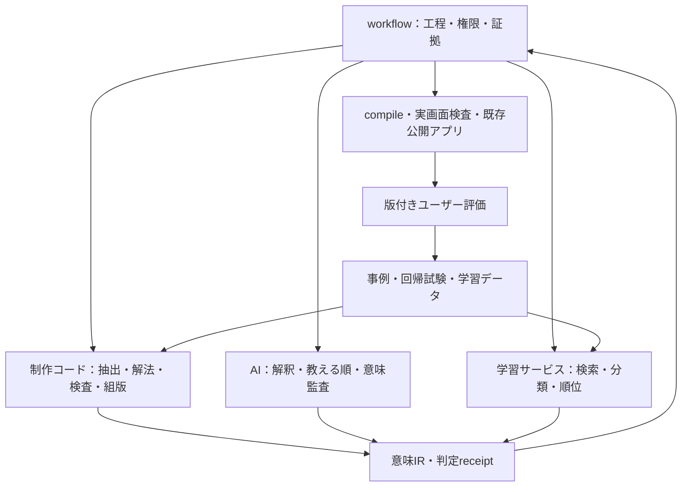

# 共通STEP — 教材制作ワークフロー詳細提案書 P-003

2026-10-24 / PROPOSED / 設計・調査のみ

本編と四付属書をまとめた全文版。新機能の実装・モデル学習・教材修正・公開はまだ実施していません。

# 教材制作ワークフロー再設計書 P-003

Status: PROPOSED — 設計・調査・事例回収。実装承認や教材受入ではない。
対象: rrikunagasige-dot/kyotsu-step-web / 数学教科書を第一適用先とする制作基盤
基準: feature 1e8403d711bdc835e76a9fabdd7d1b03cd548824、main 618e2be2a0a4dab9fd853288148829a11b3b0b70

## 1. この設計で決めること

制作をAIへ丸投げして最後に検査を足す方式から、**各工程でコードが作れるものを先に作り、AIは解釈・選択・教え方を担当し、双方の結果を再照合する方式**へ改める。さらに、実際の評価から分類器・候補順位モデルを学習し、次回の生成入力と監査順へ戻す。

今回はN07を修正しない。教材本文・公開アプリ・既存進捗・受入済み第一タイトルを変更しない。既存P-002とその実装を取り消すのではなく、使える部分を残し、不足する接続・意味表現・検査・学習を追加する提案である。

本書と次の付属書で一つの設計とする。

- [IMPLEMENTATION.md](IMPLEMENTATION.md): 改修先、作業単位、依存、試験、移行、完了条件。
- [ML_AND_CORPUS.md](ML_AND_CORPUS.md): 過去事例の回収・モデル比較・実学習・評価・運用。
- [CONTRACTS.md](CONTRACTS.md): データ/API、意味属性、判定状態、具体例。
- [RESEARCH.md](RESEARCH.md): 既存実装と外部コードの調査結果、採否、一次資料。
- [RECOVERED_CASE_INDEX.json](RECOVERED_CASE_INDEX.json): 今回回収した82観測の索引。重複・未確認を含み、82教師例という意味ではない。
- [PLAN.json](PLAN.json): 工程・実装項目の機械可読対応表。

## 2. 品質目標を実装可能な形にする

| 目標 | コードが保証・検査すること | AIが判断すること | 残す証拠 |
|---|---|---|---|
| 原資料を落とさない | 原ブロック↔教材の両方向対応、除外理由、条件・図・数式の保持 | 無番号の説明・図注の重要性、読み取りの意味 | source map、未対応一覧、位置付き照合 |
| 学校の解答順で教える | 前提の存在、依存の向き、途中操作、全体式への復帰、循環の検出 | 生徒が今の知識で目的・操作を理解できるか | 既習台帳、完全解法、段階ごとの根拠 |
| 細かくしても推導を切らない | 変形の前後と関係、操作の対象、前結果参照、式グループ | どこまで細かくするか、初回と反復の差 | solution graph→teaching graph対応 |
| 生徒が考える | 解答の先出し、穴の重複、答えの形式、誤答の同値、ヒント解放 | その穴で何を判断・生成・導出させるか | 穴の採否理由、能力・既習・誤概念 |
| 文章・数式が読める | rich text保持、式の描画率、等号位置、式番号参照、幅と衝突 | 文のつながり、用語の初出、表示の違和感 | 全状態のコンパイル結果、実画面 |
| 長くても読める | 同じ導出を保つ圧縮、参照結果の再掲、履歴と再開 | 何を再掲すれば今の判断ができるか | active context、compact/history状態 |
| 同じ失敗を減らす | 再現fixture、適用規則、事例検索、学習版と入力hash | 一般化してよい条件・例外、未知の問題への監査 | feedback→rule/model→next-run receipt |

「項目が埋まっている」ことと「内容が成立している」ことを区別する。目的欄に『理解する』、根拠欄に『前の結果』と書いただけでは合格にしない。コードで参照先・操作・結果を照合し、AIは実際の文と前提を引用して判断する。評価用AIが制作AIの『十分詳しい』という自己評価を合格根拠にすることは禁止する。

## 3. 現在コードが実際にしていること

### 3.1 旧工程エンジンと旧数式エンジン

現mainにある `workflow/` は、工程定義、実行履歴、前提チェック、入力hash、claim、CAS、pause/resume、副作用のintent/outcome、監査・品質イベントを管理する。AIの出力やユーザーの権限を構造化するが、AIを自動呼出しする実装ではない。現featureにはこの系統がないため、存在確認なしに呼び出せない。

`work/items/W-GOV-010-coded-authoring/engine/` は、構造→解法→穴→選択肢→文章図→最終検査という六段階を持つ。分配・一次結合の限定問題を解き、ASTの誤操作から選択肢を作る。`math_core.py` は有理係数・一変数・次数8以下等の範囲で多項式を照合し、別経路の評価も行う。一般の高校数学を証明するものではない。

旧 `build_catalog.py` は36件の版・評価・適格性を渡すだけで、学習しない。`training_eligible` は学習済みの印ではない。確認した内訳はNEGATIVE10 / UNKNOWN26 / POSITIVE0、`training_run:false` である。旧evaluateの再現試験も、未使用問題の教育効果測定ではない。

### 3.2 現行N07制作コード

| 既存資産 | 実機能 | 限界と改修方針 |
|---|---|---|
| `source/import-word.py` | Word位置・OMMLhash・Pandoc変換、目次誤認対策 | 意味の同一性はAI照合を残す。source adapterとして再利用 |
| `rules/n07.mjs` | Fraction.jsによる厳密分数、独立筆算、周期・有限条件、9種の操作 | 対応する数値領域を明示。汎用solverへ名称だけ変えない |
| `complete-solutions.mjs` | 数値解法と証明・結論の作成 | 固定のAI記述も含む。計算済みと証明監査済みを分離 |
| `planner/candidates.mjs` | 操作traceに沿う小目標・文章・穴・誤答・ヒント候補 | 固定profile中心。複数の教え方の比較・学習順位付けは未実装 |
| `fixtures/n07-author.mjs` | N07全範囲の41nodeを固定作成 | 26 ai-authored /15 ai-refined。実行時に新AIを呼ぶ機構ではない |
| `schema.mjs` / `verify.mjs` | Zod、coverage、依存、用語順、重複・同値・漏洩等 | before/afterが主に文字列。構造が合っても意味・描画漏れが残る |
| `compile-lesson.mjs` | app用JSON・式・回答部品へ変換 | 文章をtextへ平坦化、操作回答・中間値を別表示。意味表現の共通化が必要 |
| `jobs.mjs` / `cli.mjs` | 原子書込、hashcache、履歴、inspect/resume、AI import | 旧工程の代替にしない。feedbackがhash外なら自動再評価されない |
| `TypesetFormula.tsx` / `typesetRows.ts` | 幅計測、等号group、DPによる折返し | 固定コスト関数でありMLではない。受入済み配置を基準に保護 |
| `NumberedEquation.tsx` | 式番号・衝突回避 | 全出力を番号付けすればよいわけではない。意味から番号対象を選ぶ |
| `N07ReadingFlow.tsx` | 段階解放、36操作、14stage、前結果・履歴・移行 | term/mathの意味保持と共通部品の契約試験を補う |
| 第一タイトル用author script | 凍結baselineから受入済み教材を再現 | 固定編集。ML・汎用制作器と混同しない。版・ID・進捗を保護 |

### 3.3 なくす誤認

- 外部モデルを読み込むだけ、事例を検索するだけ、カタログを更新するだけでは追加学習と呼ばない。
- DOMにKaTeX errorがないだけでは、本文内の数式を描画し忘れていないとは言えない。
- 小段階を増やすだけでは教える順にならない。局所計算から元の目標へ戻す辺が要る。
- 穴をresult末尾へ置くだけでは判断・式生成の穴にならない。
- UI試験のPASSは、教材の説明・推導へのユーザー受入を代替しない。

## 4. 全体構成 — 三つ目の工程エンジンを作らない

`workflow/` を工程・権限・履歴の唯一の正本とし、`tools/textbook/jobs.mjs` を一工程の計算jobとして接続する。旧数式エンジンとN07規則は、対応領域の違うsolver adapterとする。共通IRは教材の意味を受け渡す形式であり、第三の状態管理エンジンにはしない。



AIは当面、現行アシスタントがrequest bundleを読みresponseをCLIへimportする。これは既存方式を使用する実行経路である。将来のAPI自動呼出しは同じprovider interfaceの別実装とし、接続・モデル・費用が未確定のまま前提にしない。複数AIの自動起動も今回の設計の必須条件にしない。

MLは制作時のみ実行し、学習済み重みを静的な学習アプリへ搭載しない。学習者の回答履歴・個人情報を学習材料へ自動転用しない。現在のユーザーによる制作評価を対象にする。

## 5. 工程ごとの具体設計

以下はすべて入力hash・出力artifact・検証結果・差戻し先を持つ。AI欄がある工程でも、コードによる前処理・後処理を実施する。MLが利用不能でも、明示的なfallback receiptを残してコードとAIで進められる。

### S00–S05：再開・原資料・過去の知見

| ID | 入力→出力 | コードの仕事 | AI・MLの仕事 | 検査／失敗時 |
|---|---|---|---|---|
| S00 現在地復元 | repo/Work→run manifest | owner/main/feature/live source、policy、未解決修正、前回claimを照合 | AIが依頼範囲を解釈 | source相違は停止。N07修正より基盤設計優先という今回の指示を保持 |
| S01 正本固定 | Word/PDF/既存教材→source manifest | SHA、ページ・段落・式・図の原位置、取得経路を固定 | AIが母本と補足資料の役割・条件を確認 | 読めない箇所は欠落として列挙。推測補完で通さない |
| S02 完全抽出 | 原本→source block index | Pandoc/既存extractor、番号のない文・図注・表も採番 | AIが抽出順・数式・図との対応を照合 | 目次と本文、図中文字、条件脱落を別チェック |
| S03 問題契約 | source index→problem contracts | 問題・概念・性質・例題・証明・図の対応と逆引き | AIが何を学ぶ箇所か、元条件・答え形式を確定 | 全blockに採用先又は除外理由。除外の意味はAI監査 |
| S04 規則・事例取得 | mode/問題契約→evidence bundle | scope/versionで絞る、hash・適用条件・失効を確認 | ML類似検索＋AIが今回の適否・反例を選ぶ | 類似度だけで既習・正解・承認を移植しない |
| S05 既習と表現 | problem contracts→knowledge ledger | 記号・用語・既習結果・単位・定義のIDと順を管理 | AIが初回説明の粒度と小中高の既習境界を定める | 未定義名・未学習定理で次へ進まない。新規例題は原問と区別 |

### S06–S11：完全解法から教える設計まで

| ID | 入力→出力 | コードの仕事 | AI・MLの仕事 | 検査／失敗時 |
|---|---|---|---|---|
| S06 完全解法 | problem→solution graph | 対応solverで式変形・値・条件・分岐・trace候補を作る | AIが解法を補い、一般論証・条件・根拠を記述 | unsupportedをPASSにしない。手記述証明は別監査へ |
| S07 独立数理検証 | solution→math receipts | 正確演算、別経路検算、同値と答え形式を分離 | AIが論証の適用条件と網羅性を反証する | 計算に例が合うことを一般証明に代用しない。失敗→S06 |
| S08 教える順候補 | solution＋既習→最大3案のteaching DAG | topological順、局所→全体、再利用、初回/反復profileを列挙 | AIが目的・根拠・次の役割を言語化。MLは検証済み候補を順位付け | 最終値から逆戻りさせる漏洩・循環を拒否。候補ゼロ→S06/05 |
| S09 小段階設計 | teaching DAG→node contracts | 一操作の対象・入力・出力・使用先を対応、必要文のslotを作る | AIがスマホで自分で解ける粒度へ分ける／まとめる | operation_count=1の数値だけで十分としない。分解後の全体式が必要 |
| S10 穴・選択肢 | nodes→interaction plan | 判断/関係/式生成/計算/意味などの候補、誤操作、正解形式を生成 | AIが穴採否・負荷・初回重要性を選択。MLは過去失敗から警告 | 正解1つ、誤答非同値、表示漏洩、単なる写しを検査。全node穴必須にしない |
| S11 表現設計 | nodes＋穴→typed prose/math/figure plan | 定義黒太字、math token、relation、番号・参照・再掲仕様を検査 | AIが文章として接続し、図表の必要性・位置・何を読むかを設計 | 単語だけの操作、意味不明な数値、式列の分断を差戻し |

S08の候補は、第一に「初めて解く生徒向けの詳しい経路」、次に条件が合う場合だけ「既習計算をまとめる経路」「図表で関係を先に読む経路」。全問題に同じ三案を無意味に生成しない。候補数・AI回数・修正回数にrun budgetを設け、打切り時は未解決理由を返す。

### S12–S17：実際に読める原稿と反証監査

| ID | 入力→出力 | コードの仕事 | AI・MLの仕事 | 検査／失敗時 |
|---|---|---|---|---|
| S12 本文作成 | expression plan→完全教材IR | 文法slot、値・式・用語・参照の差込み、source mapを保持 | AIが全文の日本語、導入、理由、次への接続を整える | 本文後の自己解説だけで合格にしない。完成本文そのものを監査 |
| S13 図表作成 | figure plan→図表artifact | 既存図・SVG・表を再利用、計算値と対応、ラベル可読性 | AIが図の意味と必要十分性を点検 | 必要な図なし／不要な新図／答え先出しを検出。図不要なら理由を記録 |
| S14 静的検査 | IR→構造/意味属性/描画予定receipt | schema、条件、DAG、用語、式relation、穴、番号、token保存 | MLが疑わしいnodeを列挙。AIは曖昧な警告を解決 | ERRORは修正、WARNは根拠付き解決、UNSUPPORTEDは別経路へ |
| S15 原資料監査 | source＋IR→source audit | 対応表と差分を自動提示 | AIが無番号説明を含めて落ち・改変・不正な補足を探す | 作者のcoverage宣言ではなく原文位置から全件照合。失敗→S03/12 |
| S16 初学者監査 | 各時点の可視内容→novice audit | 学習済み情報だけのsnapshot、未解放内容の遮断 | AIが次の判断を実際に解き、足りない情報を特定 | 監査者が未来の答えを見て補わない。失敗→S05/08/09/10/12 |
| S17 案確定 | draft＋全監査→exact design bundle | node別本文・穴・式・図・状態・試験と版を出力 | AIが解決状況・残件・変更範囲を説明 | 未解決の必須項目を合格にしない。教材設計の既承認は再取得不要 |

S17で提示する具体設計はN01,N02…相当の各単元、各原問、各nodeまで展開する。本文を『後でAIが書く』と空欄にせず、表示される文・式・穴・選択肢・誤答説明・前結果・解放順を含める。今回のP-003はこの仕組みの設計であり、N07の新本文設計を兼ねない。

### S18–S24：compile・公開・評価を次回へ戻す

| ID | 入力→出力 | コードの仕事 | AI・MLの仕事 | 検査／失敗時 |
|---|---|---|---|---|
| S18 compile | exact approved design→app JSON | typedIRから既存部品へ変換、意味token対応receipt、安定ID | AIは新内容をcompile時に付け足さない | 承認hashと実内容相違は戻す。新しいN07特例を積み増さない |
| S19 実UI検査 | compiled app→browser receipts | 幅320/390/430/1440、正誤・ヒント・前結果・履歴・再開・進捗移行 | AIが実画面と本文の違和感を点検 | 描画エラー0＋意味token描画率、等号/番号/行の切れを検査 |
| S20 影響監査 | diff＋protected baseline→regression report | 受入済み第一タイトル・他mode・ID・元図・stateの差分を限定 | AIが共通修正の意図しない教育影響を確認 | 対象外の変更は別scope。既存失敗を新規PASSにしない |
| S21 既存公開先へ反映 | frozen source＋QA→release receipt | 既存release経路、intent/outcome、配信source/route/assetを照合 | AIは結果と直接URLを引渡す | 設計承認済み範囲の旧スクショ承認待ち・公開再許可を挟まない |
| S22 ユーザー評価 | app URL＋発言/画像→feedback events | source/node/state/観点に結ぶ、原文保持、権限イベントと分離 | AIが対象・評価範囲・不確実性を解釈 | 称賛がlayoutのみならsemanticを正例にしない |
| S23 失敗の定着防止 | feedback→case/regression/rule candidates | 最小fixture、旧版再現、影響先検索、negative-case消費receipt | AIが原因・一般化条件・例外を監査 | 保存だけで閉じない。回帰は未実装なら未実装と記録 |
| S24 学習と知見統合 | curated corpus→model/rules/retrieval snapshot | 重複排除、group split、実学習・比較評価、registry、次runへの注入 | AIがラベル・適用scope・矛盾を監査 | データ不足ならそのheadのみ保留。新モデルはshadowから昇格 |

## 6. 教える順をどうコード化するか

小学生・中学生・高校生の解答の書き方を、全教材に同じ文章を強制する規則へ置き換えない。対象modeと数学的操作に応じた**構造テンプレート**として持つ。

| 型 | 必要な流れ | コードで作るもの | AIが補うもの |
|---|---|---|---|
| 条件の式化 | 条件→代入位置→未計算式→整理操作→関係式→利用先 | symbol binding、substitute trace、式の差分 | なぜここへ代入するか、どの係数を残すか |
| 同類項整理 | 注目文字→次数/項の選別→係数の計算→項を戻す→全体の組立て | term partition、係数の厳密計算、reassembly | 初回の選別理由、定数扱いの別文字の説明 |
| 等式・不等式変形 | 目標→両辺への同操作→操作後の式→計算→次の操作 | relation-preserving transform、符号条件 | 消去する理由、負数で割るときの判断 |
| 公式導出 | 前提→同じ部分に注目→操作候補→関係式→整理→適用条件 | 式の対応、差を取る対象・向き、変形同値 | 何を揃えるとなぜ目的を達せるか |
| 定義・概念 | 具体例/必要性→共通特徴→意味→名称→適用/非例 | role・用語初出・例/反例の対応 | どの具体例が直感につながるか、言い換え |
| 証明 | 主張・仮定→使える定義→推論→条件/場合分け→結論 | proof dependency・条件台帳、対応可能部分の検算 | 一般性・飛躍・網羅性の論証。例の計算との区別 |

最小仕様は `inputFacts → goal → operation(targets, direction) → outputFact → useInNext`。『次に計算する』だけのoperationは禁止。局所式から全体式へ戻す `reassemble` も操作として持つ。コードが作った順もAIの監査対象であり、テンプレートに合えば教え方が正しいとはしない。

## 7. 穴の設計を結果空欄から拡張する

`blank.target` は既存の `.result` 専用からtyped pathへ拡張する。対象は関係、演算、項選別、係数、条件、式の一部、意味、計算結果等。各穴に `learningAction / whyHere / prerequisite / expectedForm / misconception / revealPolicy` を持たせる。

- 初回では代入位置、項の選別、どちらから引くか、式の形、条件判断を候補にする。
- 反復では既習の細計算を表示し、今回初めて判断する所を優先する。同じ一語を何回も選ばせない。
- 穴がない説明nodeも認め、`noBlankReason` を記録する。穴数の多さを品質指標にしない。
- 正解を選ぶ前に同じ完成式が本文・表・図・履歴・accessible nameに出ていないか検査する。
- 答えの暗記と関係判断を区別する。数学的同値でも「最小倍率」「既約分数」「式を作る」等の要求違反は別判定にする。
- 誤答の理由は実際の誤概念から作る。等価な二つの選択肢、桁や符号だけの恣意的な選択肢を排除する。

正規表現で『なぜ』という単語を含めたから推論穴と判定するのではなく、target、operation、expectedForm、前後で見える情報を確認する。AIは『この時点で学生が行う一つの判断』を実演し、単なる写しになっていないかを確かめる。

## 8. 文章・式・概念の共通表現

`text / math / term / ref / answerSlot` を独立tokenにする。本文に `p/(2^u5^v)` を文字列で埋めたままにしない。数式の自動検知は漏れの警告用とし、数値・日付・問題番号まで勝手にLaTeX化しない。

変形は `RelationChain` を持ち、`(10-1)x` と `9x` の関係が等式なら `=` で接続する。比較なら不等号、含意なら矢印、独立した二式なら別式として扱う。すべての式を等号で連結する誤修正を防ぐ。

操作の回答『引く』は文章中のslotへ戻す。倍率の答え10は用途を持つ数量として扱い、必要なら `10x=…` の操作へ接続する。10や9の単独表示そのものを禁止するのではなく、数値だけで回答が完結する課題か、次の変形に使う値かを区別する。

`term` は用語ID・定義node・初出・表示役割を持つ。定義初出の概念は受入済みの黒太字とする。文章の全出現へ一律太字を付けたり、色で概念を分類したりしない。

既存の組版を維持し、**意味グループの境界を確定してから**幅を測る。等号揃え、長い一式の折返し、独立式、筆算、番号付き変形を別profileとする。標準LaTeXのalign/split等の役割を参照しつつ、静的紙面の幅をスマホにそのまま当てはめない。

## 9. 長文・前結果・式番号の設計

学習内容を短くすることと、画面の表示量を減らすことを分離する。完全解法と教材全文は保存し、現在必要な問題・条件・前結果をactive contextに出し、完了した導出は短い見出しと結論へ圧縮できる。履歴から全文へ戻れる。

`contextNeed` は result IDだけでなく、必要な問題条件、元式、表の列/行範囲、前の結論と今回の用途を持つ。必要ないnodeに前結果を強制しない。『参照先が存在する』だけでなく、その情報だけで次の問いを解けるかをS16で試す。

式番号は固定のequation IDと表示番号を分ける。relation chainの一つの数学的単位を基準に番号を付け、単なる答え値・選択した動詞まで自動採番しない。番号を移動しても参照IDを変えない。狭幅では番号との衝突を避け、式グループ外へ意味なく浮かせない。式だけの右端合わせ・巨大な余白・過剰な上下空きを回帰fixtureへ残す。

一律『一画面N行以内』は採用しない。実測の横溢れ、番号衝突、前結果を探す操作回数、1判断の情報の分散を観察し、数値化できる部分のみ閾値化する。

## 10. 今回の六つの反例をワークフローへ入れる位置

| 反例 | 生成側の変更 | コード検査 | AI監査 | 事例・学習用途 |
|---|---|---|---|---|
| 前の例題が分からない | contextNeedに元問題・計算表・必要行を持つ | refの存在/既習/scope/表示状態 | 必要情報が揃うか | context insufficiencyの観点。未修正版はknown regression |
| 10だけが浮く | quantityの意味・用途と表示型を持つ | slot→数量→次操作、不要な独立出力 | 倍率と分かる文か | orphan outputの例。数字全般禁止へ一般化しない |
| 引くが突然出る | operation(targets,direction,purpose)と文中slot | 対象・向き・接続文と参照を確認 | なぜその操作か読めるか | unmotivated operationの例 |
| 28と29がつながらない | relation chainとして表現 | 等式/不等式/含意の型、前後式の同値 | 推導が連続しているか | broken derivationの例 |
| 素因数分解が概念表示されない | termを定義roleで出力 | semantic tokenがDOMまで保存されたか | 名称導入が適切か | 用語の初出・強調の例 |
| 本文の式がcompileされない | math tokenとして出力 | expected math IDs↔rendered math IDs | 字体と本文の読みやすさ | render omissionの例 |

これらは未修正の既知事例であり、今回の文書作成をもって『解決済み』にしない。六件すべてをMLだけへ送る必要はない。確定的に検出できる部分は規則化し、意味の曖昧な部分を分類・AI監査へ回す。

## 11. 公開と確認 — 現行方針を継承する

旧workflow graphのG1画像票待ち、G3公開再承認待ちは、`governance/REVIEW_POLICY.json` v2と矛盾するためそのまま移植しない。旧イベント・承認は保存し、新定義versionの実行では『教材具体設計確定→内部QA→compile→既存公開アプリ→直接URLで確認』へ接続する。

承認済み内容・範囲の公開について再び許可を求めない。ユーザーの受入は公開後の自然な発言と実際の対象を結び、公開完了と教材受入を別イベントにする。設計内容がmaterialに変わる場合の扱いは既存のexact proposal規則を維持する。

配信URLの `?v=` は、それだけで旧ソースを配信する機能とは見なさない。release receiptの実配信manifest・asset・routeを照合し、渡したURLとsourceが一致することを確認する。今回は設計のみなので公開先を更新しない。

## 12. 受入条件

この基盤の完成は『MLが一回動く』『JSONが生成された』ではない。次の一連の証拠が揃うこととする。

1. 旧工程・旧数式・N07制作器を、正本と対応領域を壊さず接続できる。
2. 無番号説明を含むsource coverage→完全解法→教える順→穴→本文→組版→公開の追跡ができる。
3. 六反例を旧fixtureで再現し、修正後fixtureで検出/回避し、例外ケースを誤拒否しない。
4. 学習用データに元発言・版・範囲・観点があり、未評価を負例へ変換せず、修正前後をsplitしない。
5. 少なくとも条件を満たす一つの対象headで実際にfitし、重み・データ・分割・評価・使用receiptを保存する。足りないheadは未学習のまま明示する。
6. 学習を使う実行と使わない実行を比較し、監査漏れ・再発・時間・計算費用を報告できる。効果が確認できなければfallbackできる。
7. 原本、第一タイトル、進捗、他modeを保ち、中断後に同じ版の続きから再開できる。
8. 公開許可の重複確認を復活させず、既存アプリの実source付きURLで確認できる。

効率・品質の改善率、必要な教師例数、学習時間はまだ実測していない。工程ごとの実測を入れてから判断する。工程数を増やすだけでなく、同じ数学検算・source照合・文章説明を何度も一からAIへ依頼する重複をhashとartifactで減らす。


---

# P-003付属書 — 実装計画・移行・試験

Status: PROPOSED。以下の新規module/CLI/testはまだ作成・実行していない。

## 1. 着手順と移行の原則

先に基盤・意味IR・事例接続を作り、次に学習を接続し、最後に教材制作の一巡で検証する。N07の六件をその場で修正して『基盤が完成』としない。六件はまず凍結した回帰fixtureとして使う。

現mainは旧workflow/旧engineを持ち、現featureはN07実装を持つ。**repo全体をmergeして揃えない。** 最初にlive sourceを再照合し、manifestに指定した旧工程ファイルだけをreviewして独立featureへ取り込む。mainのhosting pointerと教材sourceを混同しない。旧ファイルのhash・適用policy・テスト結果を記録し、移植後の実装hashを新規に付ける。

現在の公開source4fb7a98e、第一タイトル受入source22bc43baをbaselineとして保持する。今回の設計文書作成ではreleaseも教材修正もしない。

## 2. 作業項目と具体的な改修先

新規のファイル名は実装予定。既存ファイルはその機能を維持して変更する。

| ID | 作業・改修先 | 入力→成果物 | 主な検査・完了条件 | 依存 |
|---|---|---|---|---|
| T01 | `research/SOURCE_MANIFEST.json`を起点にsource reconciliation | main/feature/live→取り込み差分manifest | owner/ID/HEAD、旧ファイルblob、公開sourceと別であること | なし |
| T02 | `workflow/`を限定移植、`definitions.py`等のpolicy v2 adapter | 旧graph＋review policy→新definition version | 旧イベントreplay、旧G1/G3再許可待ちを復活させない、ユーザー承認を偽造しない | T01 |
| T03 | `workflow/adapters.py`へtextbook job adapter、`jobs.mjs`へ親run参照 | workflow task→既存CLI job＋receipt | 中断・二重claim・hash変更・同一job再利用、工程正本が一つ | T02 |
| T04 | `tools/textbook/ir/`、`schema.mjs`、app schema adapter | 既存plan→共通typedIR | rich token round-trip、relation/term/slot/source保存 | T01 |
| T05 | `source/import-word.py`拡張、`source/coverage.mjs`新設 | 原本→全block対応＋未対応一覧 | 無番号・図注・表・目次・OMML例、逆coverage | T04 |
| T06 | `solver/legacy-polynomial.py`と`solver/n07.mjs`adapter | problem contract→solution graph | capability/domain、旧数式の独立検算、N07の既存39試験を保持 | T03,T04 |
| T07 | `complete-solutions.mjs`を計算/論証receiptへ分離 | solution→検証済/監査待ちの根拠 | 固定証明文を機械証明済みにしない、条件・一般性の反例 | T06 |
| T08 | `planner/candidates.mjs`をprofileと候補比較へ拡張 | graph＋既習→最大3候補 | DAG、局所→全体、次数順の適否、初回/反復の使い分け | T07 |
| T09 | `interaction/`新設、旧bind_blanksのtarget contract改修 | 候補→判断/関係/式生成/計算等の穴 | `.result`以外、typed path、形式・誤答・ヒント・漏洩、4→3ヒント対応 | T08 |
| T10 | `prose/`・`context/`新設 | candidate→全文token＋必要な前結果 | 複数記号scope、元問・表の必要範囲、操作の文接続 | T09 |
| T11 | `compile-lesson.mjs`、`integrate-n07.mjs`汎用adapter化 | approved IR→既存app schema | exact content hash、semantic receipt、非対象差分ゼロ | T04,T10 |
| T12 | 共通inline renderer adapter、`N07ReadingFlow.tsx` opt-in | app tokens→本文/前結果/履歴 | term黒太字・本文math・slot挿入・旧表示保持、共有部分の影響 | T11 |
| T13 | `TypesetFormula.tsx`等にsemantic group adapter | relation group→既存組版 | 等号・番号・折返し・幅、独立式の非連結、受入済みlayout回帰 | T11 |
| T14 | `verify.mjs`分割拡張、`ai/CONTRACTS.md`更新 | IR/visible state→指摘・AIbundle | 事実と自己評価を分離、原資料/初学者監査、根拠と差戻し先 | T08–T13 |
| T15 | `corpus/collect.py`、`normalize.py`、`episodes.py`新設 | 旧36/Work/chat/画像→observation/episode/case | 取得範囲、原文vs要約、版、重複、旧/新Workキー衝突 | T01,T04 |
| T16 | `corpus/labels.py`、`split.py`、export schema | case→curated dataset＋group split | unknown mask、partial praise、修正前後分離禁止、撤回履歴 | T15 |
| T17 | `ml/prefetch.py`、`encode.py`、環境lock | model candidate→hash固定済encoder＋特徴cache | license・safetensors・prefix・長文・CPU実測、model取得失敗fallback | T16 |
| T18 | `ml/train.py`、`evaluate.py`、`registry.py` | dataset→固定head/SetFit候補＋評価 | 実fit、単一class保留、group評価、既知例をholdout扱いしない | T17 |
| T19 | `ml/rank.py`、`predict.py`、`retrieve.py` | 有効候補/文脈→順位/リスク/関連例 | 有効性gate、ABSTAIN、モデル失効・version、pair不足fallback | T18 |
| T20 | S04/08/12/14/16のCLI入力とAI exportを接続 | corpus/model/rules→生成・監査bundle | consumed case IDs、hash、未使用理由。保存だけで終わらない | T14,T19 |
| T21 | authoring/browser CI、旧runtimeテストの統合 | 一巡のrun→source/数学/意味/描画/進捗証拠 | 六反例＋例外、全表示状態、320/390/430/1440、第一タイトル保護 | T03,T12,T13,T20 |
| T22 | 既存release adapter＋hand-off receipt | approved source＋QA→実配信照合・直接URL | screenshot承認待ちなし、URL queryと実source混同なし、中断再公開防止 | T21 |
| T23 | feedback→regression→curation→retrain接続 | 実評価→次run入力 | 一件の評価が次回生成/監査で実消費された証拠、rollback | T20,T22 |
| T24 | 既存memory/Workへの統合、運用ガイド | 実測・残件→正式runbook | mode混同なし、旧記録を消さず現行入口を一本化、未実装を明示 | T23 |

`corpus/`と`ml/`は `tools/textbook/` 配下を第一案とする。旧Work内engineはadapterで利用し、汎用コードを新しいWorkフォルダへ際限なく複製しない。旧engineを共通パッケージへ移す場合はT06内でimport互換とsnapshotを用意する。

## 3. 小さな完成単位に分ける

| Milestone | 対応項目 | 完成時に実際に見せられるもの |
|---|---|---|
| M0 正本・工程接続 | T01–T03 | 旧runを復元でき、新policyでcompile/public reviewへ進めるdry-run |
| M1 意味と検証 | T04–T07,T11のadapter骨格 | 原資料→計算/論証→意味token→app schemaのround-trip |
| M2 教え方・穴・本文 | T08–T14 | 設計案の全文と可視状態、六反例の再現/修正fixture/例外fixture |
| M3 事例回収 | T15–T16 | 重複を除いた実例、正負/未確認、観点mask、版・groupの一覧 |
| M4 実学習 | T17–T19 | 少なくとも成立するheadの学習artifactと比較評価、成立しないものの理由 |
| M5 実消費・一巡 | T20–T23 | 事例・学習結果を使った設計/監査のreceipt、実UI/公開までの接続 |
| M6 運用固定 | T24 | 再開・再学習・rollback・次単元制作のrunbookと実測 |

M3が完了する前に教師例数や学習効果を断言しない。M4の一部headがデータ不足でも、M2の意味検査とM3の検索を先に使用できる。M5の教材適用対象は基盤確認後にその具体設計・範囲で定め、今回の文書承認だけをN07本文修正の包括許可へ変えない。

## 4. 提案するCLIとartifact配置

現在存在するCLIはauthor/verify/compile/export/import-ai/inspect/resume等。以下のworkflow/corpus/mlサブコマンドは新設案で、現在実行できるとの主張ではない。

```text
production workflow inspect --work <path>
production workflow run --manifest <run.json> --until S17
production ai export --run <id> --stage S16
production ai import --request <hash> --response <file>
production corpus collect --sources <sources.json>
production corpus curate --observations <snapshot> --decisions <file>
production ml prepare --dataset <hash> --split <hash>
production ml train --experiment <experiment.json>
production ml evaluate --model <candidate> --split <hash>
production ml shadow --run <id> --model <candidate>
production workflow resume --run <id>
```

全コマンドに `--dry-run`、JSON結果、終了コード、input manifestを用意する。実装時のentrypointは既存CLIから呼ぶ薄いadapterとし、状態はworkflowへ集約する。

```text
Work/redesign                     今回の設計・調査・回収索引
work/<work>/runs/<run>/            工程入力、参照、出力manifest、監査receipt
corpus/snapshots/<hash>/           curated records、labelmask、split manifest
models/<version>/manifest.json    encoder/head/data/split/featureのhash、評価、status
artifacts/<content-hash>          大きい画像・原本・model weights（参照で接続）
```

公開Gitへ必要のない原会話全量・個人情報を大量に転載しない。教材関連の必要抜粋と参照を収録し、取得元と利用範囲を保持する。既存のユーザー添付原本を勝手に外部訓練サービスへ送る前提にはしない。

## 5. 実装する試験

| 試験群 | 必須ケースと期待 |
|---|---|
| source | 無番号定義、図注、表、数式、目次、同じ番号の別章、未読ブロックが見える |
| solution | 対応範囲の厳密正誤、符号・条件、分母0、unsupported、別検算、一般証明の未監査 |
| teaching | 未学習前提、未来結果、A→B→途中A、局所計算後の全体復帰、初回と反復の差 |
| holes | 判断/関係/式生成/計算のtarget、正解先出し、同値誤答、答え形式、文/式内の挿入 |
| semantics | 10の意味、引く対象・向き、relation chain、term初出、math描画予定↔実描画 |
| exceptions | 数字単独が正しい課題、独立式を等号で結ばない、既習参照は漏洩扱いしない、穴なし説明 |
| corpus | 部分称賛、続行のみ、同じ評価の複数観測、後続否定、要約のみ、版不明、Work ID衝突 |
| ML | unknown除外、片側class、group重複、feedback文の入力混入、長文欠落、未取得/未学習ABSTAIN |
| runtime | cache失効、同時claim、AI古入力、途中失敗、resume、公開intent後の中断、モデル昇格の原子性 |
| UI | 未解答/全誤答/全ヒント/正解/compact/history、各幅、長い式・番号、本文math・term・選択肢 |
| progress | 既存解答保持、semantic変更だけ限定移行、reload、旧版保存、未解答の正解化なし |
| release | frozen source、配信manifest、route、asset、第一タイトル、旧スクショgateが新規に挟まらない |

固定fixtureは六指摘の失敗版と想定改善版、例外版を揃える。UI向けの改善fixtureを作ることと、N07本番データを修正することを区別する。新規テストは意味のある失敗・例外・境界を検証し、実装の値をそのまま写したassertだけを増やさない。

## 6. 現在の試験結果との区別

既存N07の適用範囲619 learner tests・39 authoring tests、既存公開/ブラウザ検査は、以前のsourceに対する証拠である。このP-003の新機能が動いた証拠には使わない。全体テストには既存のphysicsTaxonomy/questionSchemaの失敗、governanceには旧4 error/2 warningがある。改修時はbaseとcandidateを比較し、新規退行と既存問題を分ける。

今回の設計作業で確認するのは、文書リンク、JSON構造、sourceの版、工程と作業の対応、事例件数・重複注意、app/runtime未変更である。新しいモデルの学習や新workflowの試験はまだ行っていない。

## 7. 失敗時の戻り方

- 読めない原本: S01/S02へ。未読箇所を推測で生成しない。
- solver未対応: capability=UNSUPPORTED、AI解法＋対応した独立検査/監査へ。機械検証済みと表示しない。
- 教え方の監査不合格: 原因が前提・順序・穴・文章のどれかをfindingで示して当該stageへ戻す。
- AI importが古い: inputHash相違で拒否。旧出力を新入力への合格に流用しない。
- 画像/ブラウザ取得失敗: 実表示未確認を明示し、CI artifact等の既存経路を使う。DOM成功だけで視覚合格にしない。
- データ不足: その学習headを保留、検索/規則/AIへ。架空の正例で埋めない。
- モデル改善なし: 旧版又はcode＋AIへ。学習実施と採用判断を分離する。
- 公開失敗/切断: intentと実配信sourceを照合して再開。二重公開・誤った完了報告を避ける。

## 8. 効率を測る場所

runで `extract_time / math_time / ai_edit_time / audit_time / render_time / release_time / retrain_time / reused_artifacts / invalidated_nodes / feedback_recurrence` を保存する。AI回数だけでなく、人が同じ指摘を繰り返した回数を測る。

最初は小さい候補集合・必要scopeの事例・hash再利用を使う。モデルを大きくした分だけ遅くなる可能性も比較し、設計品質が同じなら費用・確認負担の小さい構成を採る。工期と改善率はT01/M3/M4の実測前に数字を確約しない。


---

# P-003付属書 — 過去事例、機械学習、モデルの実運用

Status: PROPOSED / training_run=false

## 1. 学習を何に使うか

| 用途 | 入力→学習/推論出力 | 制作への戻し先 | 使わない判断 |
|---|---|---|---|
| 類似事例検索 | 今回の問題/設計＋適用scope→似た成功・失敗例 | S04でAIと生成器へ、適用条件・例外付きで渡す | 検索だけを追加学習と呼ばない |
| 観点別の問題検出 | 問題・既習・可視本文・意味IR→各観点の問題リスク | S08候補比較、S14警告、S16監査順 | 数学の真偽・利用権限・ユーザー受入 |
| 候補順位付け | 同じ問題の有効候補A/B＋文脈→好まれる候補の順 | S08/10/11でAIの比較順へ反映 | 高得点だからコードERRORを無視すること |
| 監査の重点選定 | リスク、不確実性、過去再発→優先node | S15/16で深く確認する箇所を提案 | 低得点のnodeの必須監査を省略すること |
| 任意の組版候補比較 | コード制約を満たす複数レイアウト＋実測特徴→順位 | 将来の組版profile比較 | 現在受入済みの組版を初期から学習モデルで置換 |

最初に実装する学習は観点別の分類である。候補順位は同一課題の比較データが回復できた観点から追加する。組版の学習は後段に置く。現段階でコードの等号揃え・幅計測・DPをやめる理由はない。

## 2. 今回回収できたものと、まだできていないこと

[RECOVERED_CASE_INDEX.json](RECOVERED_CASE_INDEX.json) は82の**観測索引**である。

| 出所 | 観測数 | 現在の扱い |
|---|---:|---|
| 旧catalogの原レコード | 36 | NEGATIVE10、UNKNOWN26をそのまま保持 |
| N07の版・node・画像付き否定記録 | 6 | 既知の回帰事例。修正成功・未使用評価ではない |
| 今回の会話文脈にある本人の発言抜粋 | 20 | 正式受入、layout称賛、具体指摘、scope指示を分離 |
| 実ファイルを読んだ過去Work記録 | 8 | 受入対象版・範囲、修正原因、旧承認の解釈を回復 |
| 過去チャット検索の候補 | 12 | 要約のみ。原発言・対象版を回復するまでUNKNOWN |

これは「独立した82事例」「32負例・3正例で直ちに学習できる」という意味ではない。例えば、今回の会話の『10が唐突』とN07-F02は同じ評価の二観測である。第一タイトルの正式受入は会話とWorkの双方にある。重複を統合し、評価された版から学習入力を抽出する工程が残る。82件を36件へ上書きして数を増やすだけの処理はしない。

旧36件のスナップショットは `research/legacy-cases.json`、既存の慎重なラベル方針は `research/legacy-policy.md` に保存した。旧記録が「初回は学習しない」と定めていたことは保持する。P-003では、適格データを回復し、評価条件を満たした対象から**実際のfitを行う新工程を追加する**。

今回、全チャットの完全エクスポートや全Work本文を取得したわけではない。検索で出なかったものを不存在にしない。既に見つけた候補から原文・当時の提示物をたどり、収集可能範囲と取得失敗をmanifestへ残す。無関係な過去会話を教材学習へ混ぜない。

## 3. 回収を実行する手順

### 3.1 収集源と取り出し方

1. **repo**: 対象repoのmain/feature/既知の修正枝から、USER_ACCEPTANCE、FINDINGS、ACTION_LOG、VERIFICATION、各review sheet、既存corpusをpath inventory化する。文書SHAと、その文書が論じる教材SHAを別々に記録する。
2. **チャット**: 個人文脈検索で「集合・前結果」「N01・順序」「N11・式中の穴」「組版・式番号」等の問題群を絞る。返った原文と要約を区別し、原文を取得できない候補は保留する。検索結果が全チャットそのものだと扱わない。
3. **画像**: 元発言に添付された画像をそのまま保存しhashを持つ。OCRは補助とし、画面の対象node/stateを実データ又は当時の証拠で照合する。
4. **版の復元**: 関連する教材JSON・図・rendererと評価画面を取得し、問題、本文、穴、選択肢、前結果の可視snapshotを作る。当時の進捗条件が不明なら可視状態を推測しない。
5. **エピソードの接続**: 『提示→否定→提案→実装→再提示→評価』をevent IDで結ぶ。同じ案が承認されたから修正版への品質評価まであったとはしない。
6. **追加調査**: UNKNOWN26と検索候補12を優先して元記録へ戻る。取得済みのhashを使い、同じ検索・読み込みを繰り返さない。

### 3.2 一件の定義

一件は「ある版のある範囲に対する、ある観点の評価」である。主キーは `repository + artifactVersion + scope + dimension + feedbackEvent`。Work IDだけでは旧/新W-GOV-010が衝突するので、repo/pathも必須とする。

`observation` は出所ごとの記録、`episode` は修正の経緯、`case` は版・範囲・観点の教師候補、`example` は実際のモデル入力とlabel、`pair` は同一条件下の比較であり、別テーブルに分ける。観測数を教師例数へそのまま数え替えない。

### 3.3 ラベルの決め方

| 状態 | 意味 | 学習への扱い |
|---|---|---|
| USER_GOLD | 本人の具体評価と対象版・観点が直接対応 | 対応観点のみ教師候補。artifact抽出と重複確認後に採用 |
| REPO_ATTESTED | repoに原発言引用と対象版があるが、原会話を直接回復していない | 出所を明示。高確度候補だがgoldと混ぜず比較を分ける |
| AI_SILVER | AIが本文とrubricから付けた観点ラベル | 実験用の別dataset。本人の好み・受入の代替にしない |
| RULE_CERTIFIED | 数理・構造検査が成立した技術ラベル | 技術検出器の教師には使える。教育的に良い例とはしない |
| UNKNOWN | 対象不明、要約のみ、続行・許可だけ、評価なし | 教師損失から除外。検索・回収候補として保持 |

本人の肯定が少ない場合、無評価の文を『問題なし』へ変えない。監査AIがrubricに照らして作るsilverの実験は可能だが、gold評価での改善が確認できるまで本採用しない。ユーザーへ大量の再承認作業を投げることを前提にしない。

## 4. 観点と欠損ラベル

初期観点は以下。`present / absent / unknown` を別々に持つ。

- prerequisite_missing：必要な条件・前結果・用語が足りない。
- unmotivated_operation：操作目的・対象・向きが読めない。
- broken_derivation：局所式の前後関係又は全体への復帰が欠ける。
- shallow_blank：新たな判断を要求せず写しになっている。
- answer_leakage：同じ完成答えが未解答時に見えている。
- orphan_output：値・動詞が役割なしで孤立している。
- term_semantics_missing：概念の意味・名称・初出の扱いが抜ける。
- math_render_omission：数式意味tokenが描画へ届いていない。
- layout_discomfort：受入済みprofileから外れる空白・行・番号・選択肢配置。

単に『layoutが良い』ならlayout観点のabsent候補であり、broken_derivationや漏洩のabsentにはしない。指摘されなかった八観点を0に埋めることは禁止する。

この欠損があるため、初期は**観点ごとの二値headを、当該観点の明示ラベルがある行だけで学習**する。完全に注釈済みのpanelが揃った実験だけSetFitのmulti-outputを使う。SetFit標準の多ラベルAPIにunknown maskが自動で適切に扱われるとは仮定しない。

## 5. 転用するモデルとコードの選定

### 5.1 選ぶ構成

**第一実験: intfloat/multilingual-e5-small の固定埋め込み＋観点別LogisticRegression。第二実験: 同じ基盤をSetFitでfine-tuneし、分類headも学習。比較対象: Qwen3-Embedding-0.6Bの固定埋め込み。**

大きいモデルを選ぶことを目標にせず、私たちの日本語本文・中国語評価・数式入り文脈で漏れと誤警告を実測する。e5は12層・384次元、入力は最大512token。Qwen候補は0.6B、最大32k、最大1024次元で、長文入力を比較する候補となる。ただし公開ベンチマークでの能力が、私たちの『教え方が良い』の分類精度を保証するわけではない。

| 候補 | 転用する実装 | 採用理由 | 検証が必要な点 |
|---|---|---|---|
| multilingual-e5-small / MIT | SentenceTransformer、平均pool、正規化、公式prefix | 多言語、軽い埋め込みheadの基準を作れる | 数式混在、512制限、今回の観点の分離 |
| SetFit v1.1.3 / Apache-2.0 | embedding微調整＋classifier学習、学習/保存/load、評価用構造 | 既存の少量データ分類訓練を転用し、独自trainerを作らない | 欠損ラベル、観点別データ不足、過適合、e5prefixの一貫性 |
| Qwen3-Embedding-0.6B / Apache-2.0 | 公式SentenceTransformers使用例、instruction/pooling | より長い文脈を扱う比較候補 | CPU/GPU費用、速度、安定性、実際の優位性 |
| scikit-learn | LogisticRegression、group分割、指標・校正 | 凍結埋め込みの学習と評価を再実装しない | 使う版のAPI互換、少数class、校正データ不足 |

SetFitの `modeling.py` と `trainer.py` の実コードを読んだ。`model_body.encode` による埋め込みからheadをfitし、LogisticRegressionやmulti-outputを利用する。概念説明だけを参考にしているのではない。今回sourceを丸ごとコピーせず、ライセンス・版を固定したライブラリとして利用する案である。

### 5.2 版と環境を固定する

- SetFit v1.1.3: commit `fc2ff4df0eb409724b7caef2126e628a23a5e5ba` を確認。
- e5候補revision: `fd1525a9fd15316a2d503bf26ab031a61d056e98` の実在をHF commitページで確認。ただし今回固定revisionのconfig/modules取得は失敗し、重みを取得していない。実装時のprefetchでtokenizer/config/pooling/weightsを取得してSHA256を確定するまでLOCKEDにしない。
- Qwen比較候補: HF model APIのrevision `97b0c614be4d77ee51c0cef4e5f07c00f9eb65b3` を確認。これも重み未取得。
- Python専用環境を制作ツール用に用意する。SetFit、sentence-transformers、torch、transformers、scikit-learnは、最初の互換probeで解決した版をlockし、CPU実行を基準にする。古いmodel cardのpip例を現在のlockへ無検証で転記しない。
- safetensors、取得hash、license/NOTICEを保存する。モデルの独自remote code実行を必要条件にしない。
- weightsはGitの本文やapp bundleに入れず、artifact registryへ置く。Gitにはmanifest、checksum、評価、選択版を残す。

## 6. 学習入力をどう作るか

予測時のモデルは、評価発言をまだ知らない。したがって学習入力に『これは突然引くので悪い』等のユーザーコメントや採点結果を入れない。コメントはlabelと根拠にのみ使う。

入力は当該nodeの `problem/context/knownFacts/purpose/before/interaction/mathRelation/after/visibleRefs` と必要な直前node。afterの良否を予測する課題では正解後snapshotを使い、未解答時の漏洩検査はbefore snapshotを別exampleにする。DOM class名やWork番号が品質の近道にならないよう、IDは参照一貫性だけ保って匿名化する。

数式はAST構造を保持したcanonical表現と表示LaTeXの双方を残す。ASTを捨てて数式を自然文へ自由翻訳しない。構造特徴は `reference_depth / unresolved_refs / relation_kind / local_to_global / token_counts / first_use / state / scope` 等。コードで確定したERRORはそのまま規則で扱い、分類器の高得点で消さない。

e5の分類入力には公式仕様どおり `query: `、非対称検索では検索側queryと事例側passageを使用する。学習・推論・cacheで同じprefixを使う。最大長はtokenizerで測り、原問・条件・当前nodeを優先し、長い文は段落・数式group境界でchunkする。切り落とした範囲をreceiptに残す。答えに関わる前提が入らなければABSTAINへ回す。全教材を先頭512tokenだけで判定しない。

## 7. 実際の学習処理

### 7.1 凍結埋め込みの基準学習

1. curated snapshotを固定し、case→exampleを生成する。
2. splitを先に確定する。特徴の標準化・特徴選択・重み・閾値を評価側から学ばない。
3. pretrained encoderで入力を埋め込み、cacheする。
4. 観点ごとに明示ラベルだけを取り出し、`LogisticRegression.fit(X_train,y_train)` を実行する。必要なclassが片側しかないheadは `NOT_TRAINABLE_SINGLE_CLASS` とする。
5. validationで正則化、class weight、警告閾値、棄権条件を比較する。少数データで自動探索を大量に回さない。
6. 観点別の係数・切片・encoder manifest・入力schema・評価を保存する。

これにより、基盤モデルを転用しつつ私たちの事例から新しい分類パラメータを学習する。『学習』の実体はこのfitと保存されたパラメータである。

### 7.2 SetFitによる転移学習

1. 観点別の明示ラベルがあるtrainだけから対照ペアを作る。修正版や同じ原問をvalidation側からペアへ入れない。
2. encoderの微調整を行い、次にheadを学習する。初期budgetは1候補encoder、seed3通り、最大3epochの小規模比較とし、実測で調整する。
3. 欠損ラベルがある行はその観点の訓練から外す。異なる観点を一つの良い/悪いへ潰さない。
4. 同じsplit上で、固定埋め込みheadと比較する。fine-tuneが悪化した場合は固定headを採る。
5. データを少し増やしたときのlearning curveを作り、追加回収先を決める。『一class8件で十分』という他datasetの宣伝値は採用条件にしない。

### 7.3 候補順位モデル

同一問題・同一学習目標・同じ既習条件で比較可能な候補A/Bを作る。本人がAを否定し、修正版Bを対応観点で明確に肯定した場合のみgold pairとする。単にBの実装を許可した場合はgold pairではない。

初期は候補ごとの埋め込み・構造特徴を `φ` とし、`φ(A)-φ(B)` に対するLogisticRegressionでpair preferenceを学習する。逆向きpairは同一groupに入れ、独立教師例として件数を倍に見せない。順位逆転率、同点・不確実時の棄権、既存AI選択との比較を行う。pair不足では学習せず、AIの根拠付き比較と既存規則へ戻す。

LLMの大規模追加訓練を初手にしない。必要な分類と順位を小さい学習器で実装し、問題が具体化してから別案を検討する。

## 8. 評価分割と昇格

同じ原問、修正前後、同じ会話episode、共通テンプレート由来の類題をgroupで結ぶ。union-findで連結成分を作り、分割をまたがないようにする。Workが違っても同じ式・画像・近似文なら同じgroup候補へ入れる。GroupKFoldの仕組みを再利用し、group数が足りなければfold数を減らし、それでも成立しない観点は評価不能と記録する。

既知の旧10否定＋N07六反例は、すでに規則設計へ見せた回帰集合である。これを後から未使用testと呼ばない。今回回収済みのデータはdevelopment側として明記し、最終holdoutはその後の未使用episodeを固定する。時系列の将来データでも確認する。

| 比較 | 調べること |
|---|---|
| code＋AIのみ | 必須の基準。同じ問題・同じ予算・同じ監査範囲 |
| ＋未学習検索 | 類似事例を渡す効果 |
| ＋学習分類 | 追加でどの問題を見つけたか、誤警告・見落とし |
| ＋fine-tune | 固定head以上の効果と費用 |
| ＋学習順位 | 有効候補の選択が改善したか、悪化したか |

指標は観点別precision/recall、重大な見逃し、誤警告、棄権率、group単位の信頼区間、候補pair正解率、再発件数、AI確認時間、推論/学習時間、実メモリ、費用。全体accuracyだけでは判定しない。

初期の運用条件は次の**提案上の基準**とする。達成済みの数値ではない。

- class両側が存在し、train/validation/testのgroupが分離していること。ごく少数ならoffline実験に限り、運用性能を主張しない。
- 各使用headはvalidationで基準以上の有用性を示し、未知groupでの見逃し・誤警告・棄権を開示できること。
- 最初の2制作単位はshadow動作とし、AIの確認順も変えずに予測を記録する。
- その後も**助言用途のみ**。数理ERROR、必須監査、原本、受入・承認を自動合格させない。
- 品質headが不十分でも、取得できた事例の検索・規則・回帰試験は使用できる。全基盤の完成を無期限に止めない。

少数例で確率を精密な信頼度と呼ばない。校正用groupが足りなければuncalibrated scoreとして出し、未知mode・入力欠落・入力schema違い・モデル未取得はABSTAINにする。

## 9. 本番で実際に使う接続

S04では `retrieve(context,scope,corpusVersion)` を呼び、関連例の出所・版・観点・適用条件をgenerator bundleへ入れる。S08/S14では `predict(candidate,snapshot,modelVersion)` が `dimensionScores, abstentions, retrievedEvidence, manifestHash` を返す。AIは得点だけでなく対象本文と根拠例を見て選ぶ。

CLI receiptに次を必須とする。

- 参照したcase IDs、規則IDs、corpus hash。
- 学習したdataset hash、encoder/head hash、feature schema、split manifest。
- モデルを使った工程と候補、使わなかった理由。
- 生成・監査に渡した実bundle hash。
- 使用結果が再発や見逃しに結びついたかを追跡するrun ID。

`feedback registered` だけでcloseしない。S23でregression/ruleの状態、S24でdatasetへの採否、次runで消費されたreceiptまで追う。学習がまだなら `trainingRun:false` を維持し、fit後のartifactがある対象のみtrueにする。

## 10. 再学習・運用・撤回

新評価ごとに即モデルを書き換えず、curated data snapshot単位で候補版を作る。初期は新たに判定可能なepisodeが10件増えた場合、または重大な見逃しが見つかった場合に再評価jobを起こす案とする。件数は運用開始後に調整する。重大指摘は学習完了を待たず、対応する既知回帰・規則候補へ先に入れる。

registryの `active` は検証済みmanifestへのポインタとし、旧版を保存する。昇格はモデル・データ・評価のhashを一緒に切り替える。入力schema変更でcacheを破棄し、実行途中のrunは旧model snapshotを固定する。性能低下・復元不能・破損時は前版かcode＋AIへ戻す。教材の公開版をモデル学習だけで書き換えない。

運用環境は制作側のCPUを基準にprobeする。GPUは使用可能な環境が実際に確認できた場合の比較手段とし、ユーザーの別プロジェクトの機材を暗黙に使う前提にしない。学習時間・必要VRAM・費用は初回probe結果を記録してから決める。


---

# P-003付属書 — 意味IR・API・検査契約

以下は実装時にschema/testへ落とす仕様例。新API・schemaはまだ実装されていない。例の数式は設計説明用であり、N07教材の修正成果ではない。

## 1. 全工程の共通envelope

```json
{
  "schemaVersion": "production/1",
  "runId": "run-...",
  "workKey": "rrikunagasige-dot/kyotsu-step-web:work/items/...",
  "stageId": "S11",
  "inputHash": "sha256:...",
  "sourceRefs": [{"artifact": "source-...", "blockId": "b-..."}],
  "versions": {
    "workflow": "...", "rules": "...", "compiler": "...",
    "corpus": "...", "model": null, "policy": "..."
  },
  "dependencies": ["artifact:..."],
  "status": "NEEDS_REVIEW",
  "payloadRef": "artifact:...",
  "findings": [],
  "producer": {"kind": "code", "implementationHash": "..."}
}
```

`status` は PASS / FAIL / UNSUPPORTED / NEEDS_REVIEW / ABSTAIN / BLOCKED に限定する。PASSには適用領域・検査種別・根拠が必要。数理PASS、描画PASS、AI監査PASS、ユーザー受入は独立receipt。AIがユーザー承認イベントを書ける字段を作らない。

## 2. 問題契約・完全解法

```text
ProblemContract {
 id, subject, mode, sourceBlocks[], role,
 givens[], domain[], symbols[], requestedResult,
 expectedForm, dependencies[], originalFigureRefs[],
 originalOrAuthored, coverageDisposition
}
SolutionNode {
 id, problemId, inputFactIds[], assumptionIds[], goal,
 operation:{kind, targets[], direction?, parameters},
 outputFacts[], basisRefs[], nextUseIds[],
 verifier:{adapter, supportedDomain, receipt},
 proofStatus, sourceRefs[]
}
```

`proofStatus` は COMPUTED / SYMBOLIC_VERIFIED / AI_ARGUMENT_REVIEWED / UNVERIFIED 等を区別する。AI_ARGUMENT_REVIEWEDは機械証明済みではない。異なる方法の数値検算も、その適用領域を超える一般証明にはならない。

一操作は「両辺から3aを引く」「xを含む一次項を選ぶ」等、対象と意図を持つ。`operation_count=1` の自己申告だけで分解を確認した扱いにしない。利用するsolver adapterは同じoperation kindを実際の式差分と照合する。

## 3. 教材nodeと小目標

```text
TeachingNode {
 id, problemId, sourceRefs[], solutionNodeRefs[],
 role: definition|property|proof|example|substep|check|summary,
 goal, purpose, knownFactIds[], requiredConceptIds[],
 operationRef, outputFactIds[], nextUseIds[],
 granularityProfile: first_application|practice|recap,
 before: RichBlock[], interaction?, after: RichBlock[],
 contextNeed[], figureRefs[], equationRefs[],
 noBlankReason?, auditRequirements[]
}
```

role=exampleは元例題の単位に付け、小段階すべてに同じ例題見出しを付けない。purposeとnextUseは参照先が存在するだけでなく、対応する出力が次の操作の入力として使われることを検査する。

## 4. rich textと描画保証

```text
InlinePart =
 Text{id,text} |
 Math{id,latex,mathRole,semanticRef} |
 Term{id,termId,text,usage:first_definition|recall|ordinary} |
 Ref{id,targetId,label,visibleWhen} |
 AnswerSlot{id,interactionId,renderAs,semanticRef}
RichBlock = Paragraph{id,parts[]} | EquationGroup{...} |
 Figure{...} | Table{...} | Callout{...}
```

- Textに式らしい文字列がある場合は `TEXT_MAY_CONTAIN_MATH` 警告を出す。自動修正で境界を決めず、原本とAIでmath tokenか判断する。
- termは定義位置の黒太字を表す。強調の有無と概念が定義されているかは別検査にする。
- paragraph/前結果/historyを同じinline rendererへ接続し、片方だけtextへ戻る実装を防ぐ。
- compile receiptに全semantic math/term/slot IDの写像を持つ。DOM側に `data-semantic-id` を付け、**表示されるべきID集合**と描画済みID集合を比較する。未解放tokenが存在しないことも別に検査する。
- MathはKaTeX描画、termは指定style、slotは文又は式内の位置を確認する。全tokenを強制的にKaTeXにする方式ではない。

## 5. 等式の接続と式番号

```json
{
  "kind": "relationChain",
  "id": "derive-coefficient",
  "relation": "equality",
  "expressions": [
    {"id":"e-input", "latex":"(10-1)x", "factRef":"f-input"},
    {"id":"e-output", "parts":[
      {"kind":"answerSlot", "id":"slot-coef", "interactionId":"coef"},
      {"kind":"math", "id":"mx", "latex":"x", "mathRole":"factor"}
    ], "factRef":"f-output"}
  ],
  "transformRef": "subtract-coefficients",
  "layoutProfile": "aligned-transform",
  "numbering": {"stableId":"eq-coef", "mode":"group-end"}
}
```

未解答では `(10-1)x=□x`、正答後は `(10-1)x=9x` という同じ関係の表現になる。穴は既存の集合方式の回答部品に接続し、独立した別問題枠へ変えない。実際の表示番号は章内の参照順に決めるが、stableIdで参照を保つ。

`relation` は equality / inequality / implication / equivalence / independent を識別する。compilerはindependentを等号で繋がない。数理adapterはequalityの前後が同値か確認する。式を折り返す場合もrelationと操作の境界を保持し、数字一個ごとに自動採番しない。

## 6. 操作の穴と意味のある値

```text
OperationAnswer {
 kind:"subtract", targetEquationIds:["eq-upper","eq-lower"],
 direction:"upper-minus-lower", purposeFactId:"cancel-repeating-part"
}
QuantityAnswer {
 value:10, semanticRole:"scale-factor", unit:"times",
 appliesTo:"x", nextOperationRef:"scale-equation"
}
```

『上の式から下の式を［引く］と、同じ小数部分が消える。』のように、操作は文中のslotへ戻す。次に表示する式はその操作の出力であり、slotの答えだけを独立paragraphにしない。数値回答は意味・単位・適用先を持つ。単独表示が適切な問題では許し、重複・孤立の検査対象を回答契約から判断する。

## 7. 穴・選択肢・ヒント

```text
Interaction {
 id, targetPath, learningAction, whyHere, prerequisiteIds[],
 expected:{valueOrAST, form, semanticType, domain},
 choices:[{id,content,misconception,feedback,basis}],
 hints:[{level,content,revealsFactIds[]}],
 revealPolicy, visibleBefore[], visibleAfter[],
 answerInsertion:{paragraphOrEquationId,slotId}
}
```

コードはtargetPathの存在/型、正答数、値と形式、選択肢の同値、ヒントと後続の漏洩、回答挿入位置を検査する。原選択肢がある問題と、補助的に新規作成した選択肢を区別する。旧engineの4ヒントと現appの上限3の差はadapterで明示する。黙って切り落とさず、教育的内容が落ちるならAIが再構成し再検査する。

## 8. 前結果と状態機械

```text
ContextNeed {
 id, problemId, factIds[], sourceQuestionRef?,
 tableSelection?:{tableId,rows[],columns[]},
 reason, availableAfter, display:inline|summary|expandable
}
```

状態は `locked → question → hint1/2/3 → retry → solved → compact/history`。誤答で後続を解放しない。hint順序は現appの受入仕様に合わせる。前結果は解放済みのfactのみ表示し、同名の別例のx/T/rを混ぜない。`problemId + symbolScope` によって記号を分離する。

進捗は既存namespaceとstable item IDsを保持する。UIラベル変更と問題の意味変更を区別し、semantic fingerprintが一致する回答は保持、意味が変わるものだけscoped migrationへ送る。移行では未解答を正解化せず、完了済み第一タイトルをリセットしない。

## 9. コード・AI・学習サービスの境界

提案する制作側API:

```text
source.import(inputManifest) -> SourceIndex
solver.capabilities(problem) -> supported|unsupported + domain
solver.solve(problem) -> SolutionGraph
solver.verify(problem, solution) -> MathReceipts
planner.enumerate(solution, knowledge, rules, budget) -> Candidate[]
validator.check(candidate, state, policy) -> Finding[]
ai.export(stage, contextRefs, evidenceRefs) -> RequestBundle
ai.import(response, expectedInputHash) -> ValidatedArtifact
corpus.curate(observations, decisions) -> CuratedSnapshot
ml.retrieve(context, scope, corpusVersion) -> EvidenceHits
ml.predict(candidate, state, modelVersion) -> RiskReceipt
ml.rank(validCandidates, context, modelVersion) -> RankReceipt
compiler.compile(approvedDesign, targetSchemaVersion) -> AppArtifact
release.verify(sourceSHA, route, receipt) -> LiveReceipt
```

API呼出しの実装はNode/PythonのJSONファイル又は標準入出力でよい。初期からHTTPサーバー・ベクトルDB・専用GPUサービスを増やさない。小さい事例集合では正規化埋め込み行列とscope filterで検索し、必要性を測ってからDBを検討する。

AI bundleは原本・既習・候補・必須規則・関連例・可視状態を含む。responseは本文と根拠箇所、反例探索、未解決を返す。作成時の長い自己評価・非公開の思考過程を収集する設計にはしない。必要なのはレビューできる解法と根拠である。

ML receiptは `modelVersion, inputHash, featureSchema, dimensionScores, abstentions, usedCaseIds, decisionUse`。model未学習なら `modelVersion:null, abstentions:[NOT_TRAINED]` を返す。空の予測を『問題なし』へ変換しない。

## 10. 指摘の共通形式

```text
Finding {
 id, ruleId, severity, stageId, nodeId, state,
 observed:{artifactRef,partId,quoteOrLatex},
 expected, basisRefs[], counterexample?,
 causeStage, impactedRefs[], disposition,
 resolvedByArtifact?, verificationRef?
}
```

文章警告は単語の禁止辞書だけでERRORにしない。例えば『同様に』を使ったから失格ではなく、その先に未学習の操作が隠れているかを検証する。規則は適用条件と例外fixtureを持つ。AIの判断にも根拠となる箇所・不足情報・差戻し先を必須とする。

## 11. cache・失効・再開

stage keyは入力artifact hashes、source、schema、実装、規則、policy、AI契約/response、corpus selection、model version、依存stageを含む。全repoの無関係な変更で全jobを再実行するのではなく、消費した集合とそのhashを使う。

- 原条件変更: S03以降の依存部分を失効。
- 完全解法変更: 対応するS07以降を失効。
- 本文のみ変更: S12以降の対象node監査・compile・表示検査を失効。
- 生成に使う事例変更: 当該事例を消費するS04/08/12/16を再評価。
- モデル変更: 推論/候補選択以降を再評価。公開教材を自動変更しない。
- 組版変更: 内容hashを維持しつつ関連layoutと履歴の実画面を再検査。

新規の重大反例が追加された場合は既存runで未消費だったとしても、scopeを照合して `review_required` を立てる。activeモデル変更や新評価の到着を、進行中runの入力へ黙って混ぜない。

副作用は旧workflowのintent/outcomeを使い、公開直前の中断では先に配信状態を照会する。model fitはstaging artifactへ書き、完了・検証後にmanifestを原子的に確定する。失敗jobをactive modelへ昇格しない。


---

# P-003付属書 — 既存実装・参考コード・モデルの調査

調査日: 2026-10-24 UTC。一次資料を優先。採用案と実装済みを分ける。

## 1. 既存コードは二系統とも確認した

旧workflowとcoded-authoringはmain `618e2be2a0a4dab9fd853288148829a11b3b0b70` のtreeで存在を確認。前回確認した旧基準 `c4a7aca0e72f15896a54d6753197fca196702aa4` とengine/math_coreが同一内容であることも確認している。mainのファイルが現featureにもあると推測せず、限定移植を実装計画へ入れた。

今回追加で読んだもの:

| ファイル | 確認した内容 | 設計への反映 |
|---|---|---|
| 旧corpus/cases.json | 36件、出所・版・label・family/episode・split・除外理由 | observation/case/exampleを分離、旧labelを保存して回復 |
| 旧corpus/LABEL_POLICY.md | 承認≠品質、UNKNOWN、版/観点、修正前後のsplit禁止 | ML付属書のラベル・分割契約を継承 |
| 旧engine/evaluate.py | 既知拒否の構造再現、合成試験、training false/heldout false | 回帰検出と未知の教育効果を区別 |
| workflow/store.py | 追記イベント、CAS、破損検出 | 工程の正本として再利用 |
| workflow/adapters.py | patch intent/backup、外部操作、authoring、capture、app probe | 既存job/公開接続を拡張し二重オーケストレーションを防ぐ |
| 現行tools/textbook/ai/CONTRACTS.md | 現アシスタントによるexport/import、原資料/初学者監査 | 新規API契約なしでも実行可能なAI providerを維持 |
| N07六反例/analysis | feedbackが生成入力にもcache keyにも入っていない | T20で消費receiptとcache接続を必須化 |
| W028/029/030 findings | recursive insertionの順序失敗、先出し、symbol scope、前結果 | graph/visibility/reassembly/記号scopeに反映 |
| W031と過去acceptance記録 | 強い正式受入と、小範囲のvisual許可の違い | 82観測索引、部分評価と品質ラベルの分離 |

ファイルblobは [SOURCE_MANIFEST.json](research/SOURCE_MANIFEST.json) へ保存した。旧corpusのコピーは調査スナップショットであり、新catalogへの昇格や学習実行ではない。

## 2. 前回の10repo調査を、今回どこへ使うか

元の固定commit・読んだファイル・licenseは [既存調査manifest](../REFERENCE_CODE_SOURCES.json) にある。今回すべてを最新版として調べ直したという意味ではない。採用時は固定版と互換性を再確認する。

| 資産 | 今回の具体的な使用先 | 採用方法／減らす自作 |
|---|---|---|
| Pandoc＋texmath | S02/T05、Word→位置付き数式抽出 | 既に導入した制作時CLIを再利用。OMML変換器を再自作しない |
| Fraction.js | S06/07/T06、分数・循環小数 | 既存N07実装を継続。独立筆算検証は残す |
| Mathsteps | S06/08、operation/substep/全体式復帰 | trace設計と試験の参考。archive済み旧依存一式は導入しない |
| Numbas | S10、穴の位置・補助段階・回答後説明 | gap/partの責務分離をtyped targetへ反映。採点・保存runtimeは交換しない |
| STACK | S07/10、同値・形式・課題要求の別判定 | 既約/式形式などの契約設計・fixture分類。Moodle/Maximaの全面導入はしない |
| PreTeXt | S03/11/12、definition/property/proof/example/task | roleと本文・hint・solutionの境界を参考に既存schemaへ対応 |
| DoenetML | S14/19、条件表示とhint/reveal | state依存・未解放内容の検査を参考。worker/renderer一式は移植しない |
| mathjs | solver拡張の比較対象 | N07はFraction.jsで足りるため新規全面依存を増やさない |
| fast-check | S07/19/T21、境界/状態遷移/失敗最小化 | dev-time property/model test。学習アプリbundleに含めない |

GPL/AGPL等のsourceは、今回そのままコードを持ち込む案ではない。構造を参考にする場合と、ライブラリを組み込む場合を分け、組込みを選ぶ作業で個別license/NOTICEを確認する。参考先の一覧だけ作り、どの工程にも使わない状態を避ける。

## 3. 今回の機械学習の一次資料と実コード

### SetFit — trainerを自作しない

- [公式v1.1.3の解説](https://huggingface.co/docs/setfit/v1.1.3/en/conceptual_guides/setfit)
- [公式multi-label](https://huggingface.co/docs/setfit/v1.1.3/en/how_to/multilabel)
- [公式quickstart](https://huggingface.co/docs/setfit/v1.1.3/en/quickstart)
- [modeling.py](https://github.com/huggingface/setfit/blob/fc2ff4df0eb409724b7caef2126e628a23a5e5ba/src/setfit/modeling.py)
- [trainer.py](https://github.com/huggingface/setfit/blob/fc2ff4df0eb409724b7caef2126e628a23a5e5ba/src/setfit/trainer.py)
- [LICENSE](https://github.com/huggingface/setfit/blob/fc2ff4df0eb409724b7caef2126e628a23a5e5ba/LICENSE)

GitHub connectorでtag v1.1.3→commit fc2ff4dを確認し、modeling.py 40,383文字、trainer.py 39,632文字、LICENSEを取得して読んだ。modelingはLogisticRegression、OneVsRestClassifier、MultiOutputClassifier等を使い、body.encodeからheadへ学習する実装を持つ。公式解説の二段階学習と対応する。

この実装をT17–19へ接続する。標準multi-outputが欠損ラベルを解決してくれるとは考えず、初期は観点別の明示ラベル行のみを使う。SetFitは枠組みであり、日本語教材の良否を学習済みの専用モデルではない。

### multilingual-e5-small — 固定headと転移学習の基盤候補

- [公式model card原文](https://huggingface.co/intfloat/multilingual-e5-small/raw/main/README.md)
- [MicrosoftのE5実装説明](https://github.com/microsoft/unilm/blob/master/e5/README.md)
- [候補revisionのcommit](https://huggingface.co/intfloat/multilingual-e5-small/commit/fd1525a9fd15316a2d503bf26ab031a61d056e98)

公式仕様の12層・384次元、512token、prefix、pooling・正規化を確認した。分類と検索でprefixを変える箇所をadapter仕様へ入れ、長文を黙って切り捨てない条件を追加した。重み取得・当環境での推論・学習は未実施。

### Qwen3-Embedding-0.6B — 長文・強い基盤との比較

- [公式model card](https://huggingface.co/Qwen/Qwen3-Embedding-0.6B)
- [公式モデルmetadata](https://huggingface.co/api/models/Qwen/Qwen3-Embedding-0.6B)
- [著者の技術報告](https://arxiv.org/abs/2506.05176)

公式cardで0.6B・最大32k・最大1024次元・多言語・Apache-2.0を確認した。metadataはrevision 97b0c614…を返した。強い比較候補として残すが、長い文脈が入ることだけで今回の分類に優れると決めない。まず固定埋め込みで比較し、初手から大きいモデルを全fine-tuneしない。

### scikit-learn — 学習・分割・漏洩対策

- [GroupKFold](https://scikit-learn.org/stable/modules/generated/sklearn.model_selection.GroupKFold.html)
- [common pitfalls](https://scikit-learn.org/stable/common_pitfalls.html)

修正前後・同じ原問・同じepisodeをgroupで分ける設計に利用する。特徴抽出のfit、閾値選択、モデル選択がtestへ漏れない順序にする。今回閲覧したstable docsの版表記を、未検証のPython依存lockと同一視しない。

## 4. 数式の排版研究を意味表現へ反映する

- [amsmath公式guide](https://www.latex-project.org/help/documentation/amsldoc.pdf): 単一式、split、align、独立式groupの役割を区別する。T13はこの区別をrelationとlayout profileに持つ。全出力を同じ独立式にする現在の問題を避ける。
- [KaTeX公式auto-render](https://katex.org/docs/autorender): delimiterを持つtext nodeを探索する仕組みであり、何が数式かを意味で自動判定する機能ではない。T04/11/12でmath tokenを明示し、token→描画の照合を行う。本文全体を後から正規表現で変換することを本命にしない。

これらは紙面をスマホにそのまま持ち込む根拠ではない。受入済みの幅計測・DP・番号衝突処理を維持し、意味グループと実画面を合わせて検証する。

## 5. 取得の限界と未実施

e5のcard通常ページは大きすぎて取得失敗し、raw READMEを読んだ。固定revisionのconfig/modulesも今回の検索経路では取得できなかった。モデルrevisionページの実在確認と、重み一式の完全固定は別である。T17はprefetch・SHA256・pooling・tokenizerの確認まで完了条件に含める。

外部モデルの実力・速度・必要メモリ、学習の改善率は測っていない。今回の提案は調査した実装に基づく実験設計である。取得・訓練・評価を済ませたかのように報告しない。
