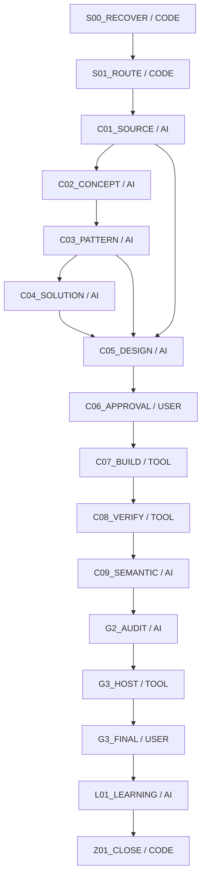
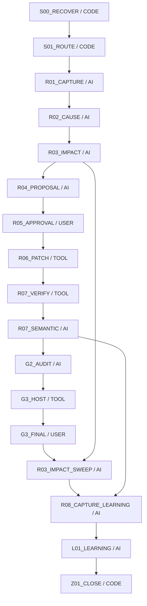

# 作成・修正の配置図（実装定義から生成）

これは工程配置の投影であり、教材Workの実行済み証拠ではない。技術Workの実行はgenerated/snapshot.json。

## 作成

| 工程 | 主担当 | 工程内のCODE機能 |
|---|---|---|
| S00_RECOVER | CODE | — |
| S01_ROUTE | CODE | — |
| C01_SOURCE | AI | source.fixed, source.import, source.coverage, research.ingest, research.analyze |
| C02_CONCEPT | AI | source.coverage, knowledge.ledger |
| C03_PATTERN | AI | case.retrieve, research.patterns |
| C04_SOLUTION | AI | math.solve, math.verify, solution.validate |
| C05_DESIGN | AI | teaching.plan, step.plan, blank.plan, prose.compose, text.verify, figure.verify, ir.verify, source.audit, novice.audit, interaction.plan, solution.review |
| C06_APPROVAL | USER | — |
| C07_BUILD | TOOL | ir.compile, render.solution |
| C08_VERIFY | TOOL | math.verify, ir.verify, browser.verify, protected.verify, solution.validate |
| C09_SEMANTIC | AI | source.audit, novice.audit, solution.review |
| G2_AUDIT | AI | protected.verify, impact.inventory |
| G3_HOST | TOOL | release.verify |
| G3_FINAL | USER | — |
| L01_LEARNING | AI | case.finalize, ml.train |
| Z01_CLOSE | CODE | — |

AIが主担当の工程でもCODE receiptを先に取り込み、意味の判断は根拠付きで別提出する。USERは依頼・既承認・実物評価。TOOLは既存実装/公開操作で、CODEによる意味の自動合格ではない。

## 修正

| 工程 | 主担当 | 工程内のCODE機能 |
|---|---|---|
| S00_RECOVER | CODE | — |
| S01_ROUTE | CODE | — |
| R01_CAPTURE | AI | source.fixed, feedback.capture |
| R02_CAUSE | AI | case.retrieve, knowledge.ledger, math.verify, ir.verify, source.audit, novice.audit, math.solve, solution.validate |
| R03_IMPACT | AI | impact.inventory |
| R04_PROPOSAL | AI | math.solve, math.verify, teaching.plan, step.plan, blank.plan, prose.compose, text.verify, figure.verify, ir.verify, source.audit, novice.audit, solution.validate, interaction.plan, solution.review |
| R05_APPROVAL | USER | — |
| R06_PATCH | TOOL | ir.compile, render.solution |
| R07_VERIFY | TOOL | math.verify, ir.verify, browser.verify, protected.verify, solution.validate |
| R07_SEMANTIC | AI | source.audit, novice.audit, solution.review |
| G2_AUDIT | AI | protected.verify, impact.inventory |
| G3_HOST | TOOL | release.verify |
| G3_FINAL | USER | — |
| R03_IMPACT_SWEEP | AI | impact.inventory |
| R08_CAPTURE_LEARNING | AI | case.finalize |
| L01_LEARNING | AI | case.finalize, ml.train |
| Z01_CLOSE | CODE | — |

AIが主担当の工程でもCODE receiptを先に取り込み、意味の判断は根拠付きで別提出する。USERは依頼・既承認・実物評価。TOOLは既存実装/公開操作で、CODEによる意味の自動合格ではない。
