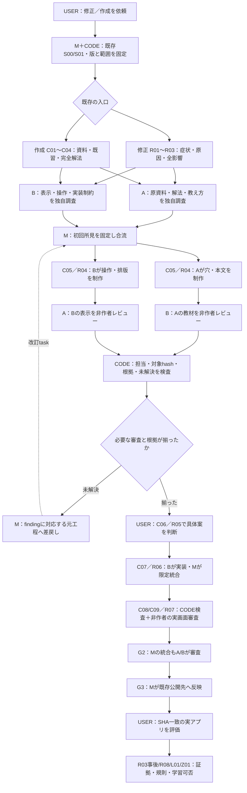
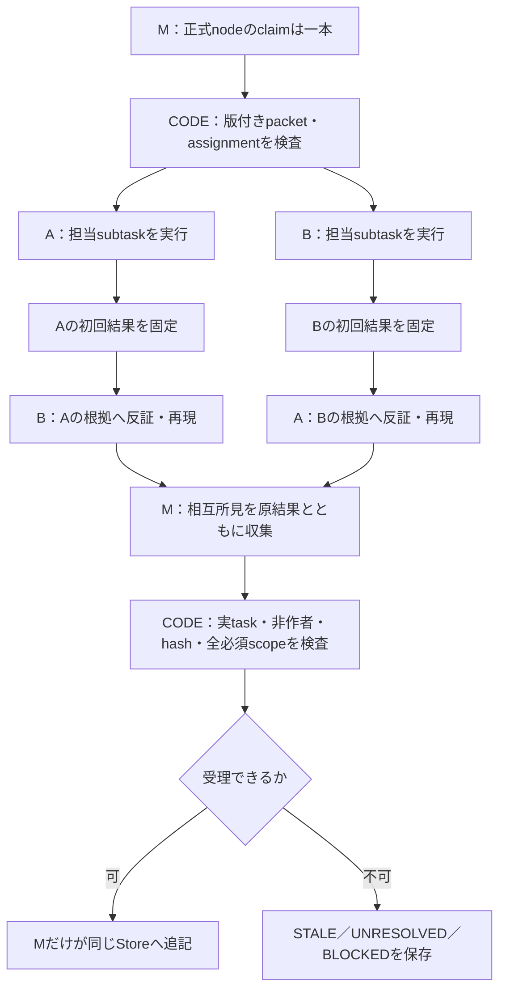

# 3agentを既存の修正／作成へ配置する火柴図

PROPOSED。これは設計図であり、実行台帳から生成した現在地や工程PASSではない。実装後はworkflow/views.pyの同じsnapshotから、既存の工程／block／capabilityの三階層へ担当を表示する。

点線は再作業の説明で、正式実行DAGへ循環依存を追加しない。reopen／issue／改訂taskの追記で表す。承認段階の修正要求も対象の元工程へ戻す。

## node内部の受渡しと監査

初回の独自調査と、設計制作後の別作者レビューは別のtask。CODEが意味の正しさを自動決定する図ではない。

## 役割交代の読み方

| 仕事 | 主作者 | 非作者の審査担当 | 主担当Mの責任 |
|---|---|---|---|
| 教材・穴・説明 | A | B | 範囲と統合の照合 |
| 三状態の表示・操作契約 | B | A | 全体の衝突確認 |
| 実装patch | B | Aが設計適合、Mが自作でない完成画面 | 限定適用と検査版固定 |
| Mが書いた統合仕様／コード | M | 関与していないA/B | 指摘を自分で免除しない |
| 全3者が寄与した同じclaim | 全員 | 有資格の非作者なし | 必須なら停止、制約を報告 |

A/Bは恒久的な専門人格ではなく役割の標準配置。roleEpochと対象claimを固定して交代する。版変更・役割変更だけでは作者履歴は消えない。
