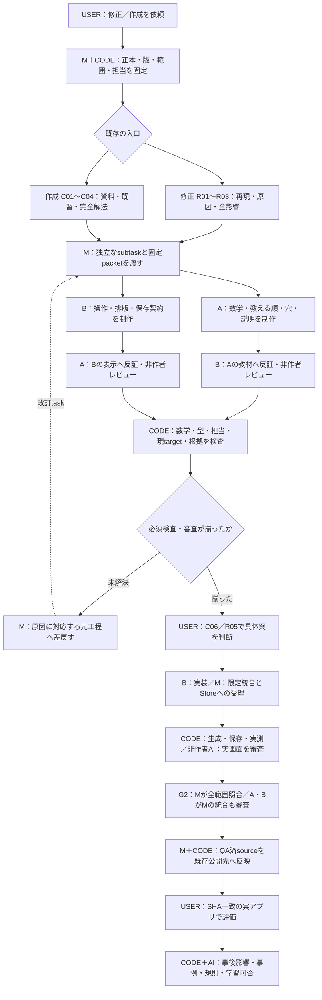

# 実装した共通工作フロー — CODE・3agent・USER

これは実装した役割配置の説明図。実Workの現在地・PASSは同じStoreから生成するFIRE_DIAGRAM/BLOCK_FIRE_DIAGRAM/CAPABILITY_FIRE_DIAGRAMで確認する。破線は改訂taskへの差戻しで、実行DAGへ循環を追加しない。

| 区分 | 確定する仕事 |
|---|---|
| CODE | 数学・型・有限候補、三状態と実測、担当・作者・版・根拠・未解決、保存と公開sourceの一致 |
| AI | 中間目標の必要性、教える順、穴で考える内容、文章・式・図のつながり、学習者の可視情報からの反証 |
| 主担当M | 要求と範囲、役割割当・交代、証拠の統合、同じStoreの唯一の書込、外部反映、ユーザーへの報告 |
| USER | 具体案への判断と実アプリの品質評価 |

A/Bは工程ごとに役割を交代できるが、作者履歴は消さない。自作の設計との一致確認と、教育設計の非作者審査を分ける。3人全員が同じclaimへ実質寄与した場合、独立審査を実施したことにはしない。Mが変更した部分も自分だけで独立合格にしない。

新しい画像票承認や第三の制作入口は追加しない。agentの合意をUSER評価やGold labelへ変換しない。harnessの記録は追跡可能な転記であり、OS分離・暗号学的実行証明・モデル独立性を保証しない。
