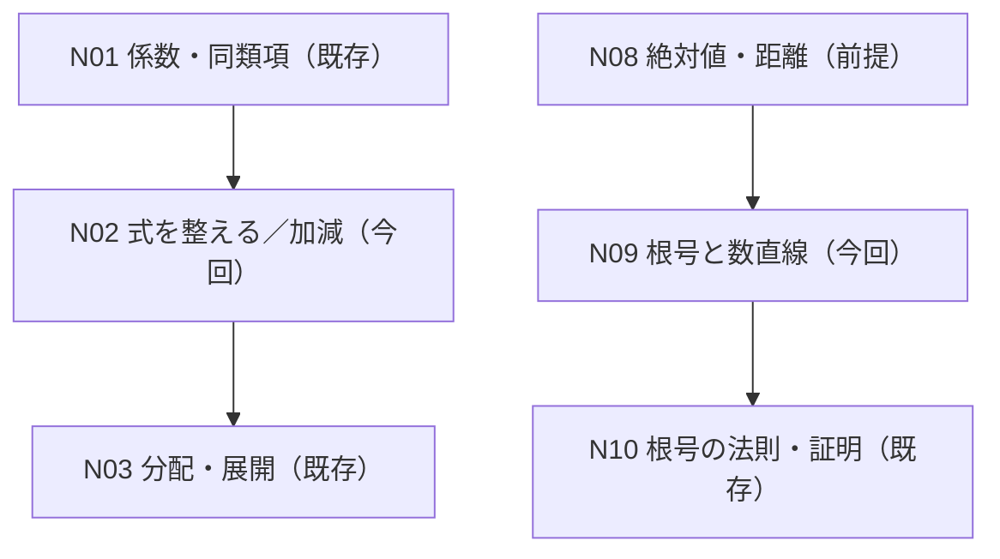

# N02・N09 二単元バッチ設計・レビュー入口

Status: **26/26 SOURCE AND MATH AUDITED; TWO FULL LEARNER DRAFTS READY FOR REVIEW; NO APP IMPLEMENTATION**
Date: 2026-10-17
Work: W-MATH-003 / approved P-001
User request: 「次はN02・N09の原資料監査と詳細設計から始める。かなりいいから、今は少し大胆に多くつくろう」
Scope: **明示された2単元**を濃く仕上げる。残り全単元の自動制作・レビュー専用アプリ実装・公開の前倒しはしない。

## 成果物・推奨レビュー順

1. **N02_N09_SOURCE_SOLUTION_AUDIT.md** — 元Word SHA、26原問のすべての数式・解法・数値、元図1枚の現物監査、誤答ポイント。
2. **N02_LEARNER_REVIEW_V1.md** — N02学習本文（導入から次単元への橋）、12問の本文中の穴、正誤選択肢、フィードバック、表示・依存条件。
3. **N09_LEARNER_REVIEW_V1.md** — N09学習本文、14問の本文中の穴、負の床関数、原図表示ゲート、選択肢・フィードバック。
4. このファイル — 横断ルール・検証規格・判断待ち項目。

## 原資料からの定量カバー

| 対象 | 元問 | Word内OMML | Word内原図 | 本文進捗設計 | 状態 |
| --- | ---: | ---: | ---: | ---: | --- |
| N02 注目文字・降べき・多項式加減 | 12 | 34 | 0 | 12 | 原資料・数理PASS / 本文レビュー待ち |
| N09 根号・符号・整数部分/小数部分 | 14 | 37 | 1 (N09-F01) | 14 | 原資料・数理PASS / 図順序レビュー待ち |
| **合計** | **26** | **71** | **1** | **26** | **レビュー用ドラフト** |

章全体の元問233のうち、既存の監査済みN01/N03/N10/N12=59に本バッチ26を追加すると、**監査済み計85 / 233、未監査148**。この加算は**元Word原問の数理監査進捗**に限り、アプリ教材が6単元公開されたという意味ではない。

## 教科書・学習モードへの接続

原問ラベルは内部トレース用。生徒には教科書の節である **多項式**／**実数** 内で、例題→性質→導出→確認の流れとして見せる。

## 基本のリリース・データ契約

- 認知目的のある穴を、その時点の数式・本文の中へ埋め込む。正答で同一行へ確定値を挿入。誤答なら理由のあるヒントを示してその位置に留まる。
- 完成形の式、先の節の要約、代替テキストや画像サムネイルなどで答えを先出ししない。
- N02-Q03/Q09、N09-Q02/Q04/Q08/Q14 は二値/複数の比較を**一問のセット回答**として扱い、元問を水増ししない。表示時に選択肢の折り返し・読解性を確認。
- **原図の再作画はしない。** N09-F01原図がQ10の整数$n=-3$を図示しているため、提案ゲートは **Q10正答→N09-F01表示→Q11**。原Wordからの表示時点変更はユーザーレビューを求める。
- N02は「次数順の整理」と「全項への符号」を式の横位置で見せ、図を増やさない。
- N09の床関数定義 $n\le x<n+1$ および $0\le x-n<1$ を単元を通して保持。特に $-\sqrt{10}$ の整数部分 $-4$ と小数部分 $4-\sqrt{10}$ の正負。
- 元図や元Wordのバイナリは公開リポジトリに加えない。解説文と原問の必要な数学データのみ追加・整理する。

## 実装した場合に必要となる最小検証シナリオ

| ケース | 操作/入力 | 期待される挙動 |
| --- | --- | --- |
| N02-A | Q01未回答 | Q02の整理済み式を表示しない。$3bx$を図・フィードバックから漏らさない |
| N02-B | Q05で「$x$」誤答 | 欠項は0の係数だと説明。Q06進捗は増やさない |
| N02-C | Q07で「$x^3-2x^2+2$」誤答 | $B$の定数$+2$にも$-1$を掛けると説明 |
| N02-D | Q09両式を正答→Q10 | 2Aと−3Bはその行に残り、結果はQ10回答まで未表示 |
| N02-E | Q11で「$2A-5B$」誤答 | $-(A-B)=-A+B$を示し、Q12を解放しない |
| N02-F | Q11正答→Q12 | Q10の結果を見返せるが、Q12の穴へ先に転記しない |
| N09-A | Q01で「$4$のみ」誤答 | $(-4)^2=16$ を確かめるヒント |
| N09-B | Q03で「$-4$」誤答 | $\sqrt{\phantom a}$の非負性を再確認 |
| N09-C | Q06「$>0$」誤答 | $5>4$と正の平方根の大小の根拠を提示。Q07はロック |
| N09-D | Q08で小数平方の候補を選ぶ | $1.9881<2<2.0164$、正の比較からQ09へ |
| N09-E | Q10未回答 | **元図も alt/サムネイルもDOMに出さない** |
| N09-F | Q10「$-2$」誤答 | $-2\le-2.1$は偽と説明。元図をまだ見せない |
| N09-G | Q10「$-3$」正答 | $-3\le-2.1<-2$完成後に元図表示。$-2.1$の点を拡大して確認 |
| N09-H | Q11で「$-2-0.1$」誤答 | 残りが負で $0\le r<1$ ではないと説明 |
| N09-I | Q13で不等号を逆にしない | $-4<-\sqrt{10}<-3$ に至る符号変化だけを復習 |
| N09-J | Q14で負側の整数部分「$-3$」 | $-3\le-\sqrt{10}$は偽、$4-\sqrt{10}\in(0,1)$を検算 |
| 共通 | PC/スマホ、リセット、戻る/再開、回答連打 | 26進捗の重複なし、式の崩れ・選択肢漏洩なし、他数学/物理モードのデータに非干渉 |

## 現在の停止位置と次の権限

1. **ここまで**: 元資料・独立数学解法監査、原図の現物確認、2単元の学習本文・選択肢・誤答説明・表示依存の詳細設計。
2. **ユーザーが確認すること**: 2本の生徒向け全文、26問の穴、各誤答の教え方、N09元図をQ10の後に出す変更。本文を広く作った分、承認対象を正確にする。
3. **次の別工程**: 具体の本文が承認されたら、P-001の範囲でreview-onlyアプリを別ブランチ・別PRに実装し、実ブラウザとテストを検証する。main統合/Pages公開はそのPRについて改めて明示承認を得る。通常の教材一覧への昇格も別判断。
4. WorkはVERIFYINGを維持。残り148問を未監査のまま「16単元完成」と記さない。

## 既知の留保

- 別冊公式解答・出版社の原書の直接照合は未実施。数学解は元の教員草稿を独立計算したもの。
- 図の実物/内容は監査済み。ただし将来の実アプリ上での視認性と表示時点は未テスト。
- 生徒向け本文の最終承認、選択肢の実装互換性、KaTeXモバイル描画、進捗保持、回帰試験は未実施。
- 承認前の学習者向け公開画面・配信リンクはない。設計PR内のMarkdownが現段階のレビュー実物。