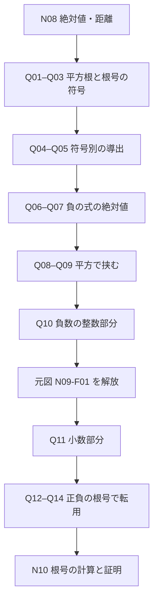

# N09 学習本文・対話穴・原図レビュー v1 — 根号の符号、整数部分と小数部分

Status: **DESIGN FOR USER REVIEW / NOT APP IMPLEMENTED**
Date: 2026-10-17
Work: W-MATH-003 / approved P-001
Scope: 原資料 N09 Q01–Q14＝14問、元図 N09-F01 1枚（SOURCE/figures/image6.png）。
Source and math: N02_N09_SOURCE_SOLUTION_AUDIT.md / 元DOCX SHA-256 93827322a877313d4d39957dd6196c01de31f2e994baa1aac0a64b96be88eeaa。
Principle: 「二乗するとaになる数」と「根号が選ぶ非負の値」を分け、負の実数でも $0\le$ 小数部分 $<1$ を保つ。

## A. 生徒が読む一続きの本文（表示案）

【選ぶ】はその位置に入る正答を選ぶ操作。正答すると式が完成し、続きが開く。候補と正答はこの下の教師表に置き、生徒の未回答時には見せない。内部N09番号を学習者の見出しにしない。

### 平方根は二つあることがある。でも $\sqrt{\phantom{x}}$ は一つを表す

**例題**　2乗すると16になる実数を、**すべて**挙げよう。

$4$ を2回掛けると16になる。では負の数ではどうだろう。負の数どうしを掛けると正の数になることを使い、二つとも平方を確かめると、

\[
x^2=16\quad\Longrightarrow\quad x=\boxed{\text{【選ぶ】}} .
\]

2乗して $a$ になる数を $a$ の**平方根**という。正の数 $a$ には正負二つの平方根があり、正の方を $\sqrt a$、負の方を $-\sqrt a$ と書く。**$\sqrt a$ という記号は非負の一つの数**を表すので、「二つまとめて」という意味ではない。

**確認**　次の二つの式は同じ問い方ではない。$\sqrt{16}$ は正の平方根を選ぶ記号だが、$(-\sqrt5)^2$ は負の平方根を2乗する計算である。この二つの**値を一組で**答えよう。

\[
\bigl(\sqrt{16},\ (-\sqrt5)^2\bigr)
=\boxed{\text{【選ぶ：二つの値を組で答える】}}
\]

この一度の操作で、二つの値を同時に完成する。

0を2乗して0になる数は0だけで、$\sqrt0=0$。負の数を2乗して正の数になることはあっても、実数の2乗が負になることはない。負の $a$ の平方根は、ここで扱う実数の範囲にはない。

### 根号を外すときに、負の値をそのまま出さない

**例題**　$\sqrt{(-4)^2}$ を計算しよう。

「外側の根号と内側の2乗は消える」と考えて、$-4$ に戻してよいだろうか。まず内側を計算し、根号の表す値が非負だと確かめる。

\[
\sqrt{(-4)^2}=\sqrt{16}
=\boxed{\text{【選ぶ】}} .
\]

今の数だけでなく、実数 $a$ を使って確かめよう。$a^2=(-a)^2$ で、どちらも同じ平方になる。しかし、そのうち根号が表すのは非負の方だ。

**導出**　$a$ の符号で場合を分ける。

\[
\begin{array}{ll}
a\ge0\ \text{のとき}: & \text{非負の方は }\boxed{\text{【選ぶ】}},\\
a<0\ \text{のとき}: & \text{非負の方は }\boxed{\text{【選ぶ】}}.
\end{array}
\]

この二行は**原問Q04の一つの判断**としてセットで答える（2段階へ水増ししない）。N08で、数直線上の0からの距離を表す **絶対値** を考えた。正でも負でも距離は非負だという意味を使えば、今の二つの場合を一つにまとめられる。

\[
\boxed{\displaystyle\sqrt{a^2}=\text{【選ぶ】}}\qquad(a\text{ は実数}) .
\]

これはすべての実数に成り立つ性質で、「平方と根号を機械的に打ち消す」という規則ではない。

**確認**　では $\sqrt{(2-\sqrt5)^2}$ はどうなるだろう。根号を外す**前**に、内側の数の符号を判断する。

$\sqrt5$ と $2$ はどちらも非負。2乗するとそれぞれ5と4であり、$5>4$ だから、両者の大小関係が分かる。したがって、

\[
2-\sqrt5\ \boxed{\text{【選ぶ】}}\ 0 .
\]

この結果を絶対値の性質に適用すると、

\[
\sqrt{(2-\sqrt5)^2}
=|2-\sqrt5|
=\boxed{\text{【選ぶ】}} .
\]

### 近似は記憶だけでなく、平方で両側から挟む

**例題**　$1.41<\sqrt2<1.42$ を確かめよう。

「$\sqrt2$ は約1.414」と覚えていなくても、二つの小数をそれぞれ2乗すれば分かる。計算して「二つの平方の値」と「2がその間にあること」を一続きの式で書くと、

\[
\boxed{\text{【選ぶ：二つの平方と挟む不等式】}}
\]

1.41 と1.42 はどちらも正なので、非負の範囲では「2乗の大小」と「元の数の大小」の順序が一致する。よって、

\[
\boxed{\text{【選ぶ】}} .
\]

ただ近似値を信じるだけでなく、平方の計算と非負性を組にしたので、不等式を確かめられた。

### 負の数も「整数＋0以上1未満」に分ける

**例題**　$-2.1$ を「整数＋0以上1未満の数」の形へ分けよう。

正の $2.1=2+0.1$ と同じように、$-2.1=-2-0.1$ と書くだけでは、残りが負になる。今回は残りを**0以上1未満**にそろえたい。

実数 $x$ をはさむ「隣り合う整数」$n,n+1$ を見つけるとき、

\[
n\le x<n+1
\]

の左側に入る整数 $n$ を探す。$x=-2.1$ について条件に合う $n$ を選ぶと、

\[
\boxed{\text{【選ぶ】}}\le-2.1<n+1
\]

となる。ここでは左の選択穴に入る値が $n$ である。**右側の $n+1$ は同じ回答から自動完成**し、正答後に不等式全体を数値で示す。内部的には原問Q10の操作一つ。

**ここで初めて元図 N09-F01 を表示。** 図には $-4,-3,-2,-1$ の目盛りと $-2.1$ の点がある。直前に決めた二つの整数の間に点があることを確かめよう。元図の時点は原Wordより後ろに移す（理由は後述）。元図の点・ラベル自体は変更しない。

左側の整数を使って「整数＋残り」の形にすると、

\[
-2.1=\boxed{\text{【選ぶ】}} .
\]

実数 $x$ に対し、$n\le x<n+1$ を満たす整数 $n$ を $x$ の**整数部分**、残りの $x-n$ を **小数部分** という。これなら小数部分は必ず $0\le x-n<1$ になる。ここでいう「小数部分」は、負号を含んだ表示の小数桁をただ抜き出すことではない。

### $\sqrt{10}$ と $-\sqrt{10}$ の整数部分は対称ではない

**確認**　$\sqrt{10}$ と $-\sqrt{10}$ の整数部分・小数部分をそれぞれ求めよう。

$3^2=9$、$4^2=16$。$9<10<16$ を使って $\sqrt{10}$ を隣接する整数で挟むと、

\[
\boxed{\text{【選ぶ】}} .
\]

次に、その不等式全体に $-1$ を掛ける。**負の数を掛けると不等号の向きが逆になる**ことと、左から小さい順に並べ直すことを忘れない。

\[
\boxed{\text{【選ぶ】}} .
\]

さきほどの「整数＋0以上1未満」に戻す。二つの数について、それぞれ整数部分と小数部分を一組で選ぼう。

\[
\begin{array}{c|cc}
 & \text{整数部分} & \text{小数部分}\\
\sqrt{10}&\multicolumn{2}{c}{\boxed{\text{【選ぶ】}}}\\
-\sqrt{10}&\multicolumn{2}{c}{\boxed{\text{【選ぶ】}}}
\end{array}
\]

**この二行をまとめて原問Q14の一つの回答操作にする**。正答後、上の表は「$3,\sqrt{10}-3$」「$-4,4-\sqrt{10}$」で完成する。どちらの小数部分も0より大きく1より小さいと確認できる。

平方根では、**2乗して何になるか**に加えて**根号が選ぶ非負の値**を確かめた。整数部分・小数部分でも、数の位置を正しく挟むことが出発点になる。次はこの二つの見方を使って、根号を含む計算の性質を確かめよう。

## B. 原問14/14の回答仕様・選択肢・フィードバック（教師・実装者のみ）

以下の「正答」は原Wordから独立に数学的に導出したもの。別冊公式解答はない。原問Q02/Q04/Q08/Q14には複数の値や大小比較があるが、**それぞれ一つの選択操作**で両欄を完成する。生徒への進捗は14ステージ。

| 原問/候補ID | 思考目的 | 正答/完成内容 | ほかの選択肢例（誤答） | 誤答時の学習フィードバック |
| --- | --- | --- | --- | --- |
| Q01/n09-01 | 二つの平方根をすべて挙げる | $x=4,-4$ | $x=4$ / $x=-4$ / $x=16,-16$ | 正の数と負の数の**両方**を実際に2乗して16になるか確かめよう |
| Q02/n09-02 | 記号が選ぶ値と2乗の区別 | $(4,5)$ | $(\pm4,5)$ / $(-4,5)$ / $(4,-5)$ | $\sqrt{16}$ 自体は非負の4。$(-\sqrt5)^2$ は非負の5 |
| Q03/n09-03 | 内側の平方→主平方根 | $4$ | $-4$ / $\pm4$ / $16$ | 最後の根号は**非負**。内側が$-4$でも結果は4 |
| Q04/n09-04 | 非負の枝をaの符号別に選ぶ | $(a\ge0:a,\ a<0:-a)$ | 両方$a$ / 両方$-a$ / 逆順$(-a,a)$ | $a<0$のときだけ$-a>0$。$a=0$は前半に含める |
| Q05/n09-05 | 平方と絶対値の関係 | $|a|$ | $a$ / $-a$ / $a^2$ | $a=-4$の場合も成り立つ形か、Q03・Q04で確認 |
| Q06/n09-06 | 根号内の符号を先に判定 | $2-\sqrt5<0$ | $=0$ / $>0$ / 判定不能 | $2,\sqrt5$ は非負。2乗した4と5を比べよう |
| Q07/n09-07 | 負の値の絶対値 | $\sqrt5-2$ | $2-\sqrt5$ / $\sqrt5+2$ / $-(2+\sqrt5)$ | Q06で中身は負。絶対値は符号を反対にして非負へ |
| Q08/n09-08 | 二つの小数平方を厳密に計算し2を挟む | $1.41^2=1.9881<2<2.0164=1.42^2$ | $1.41^2=1.9981<2<2.0164=1.42^2$ / $1.41^2=1.9881<2<2.0104=1.42^2$ / $1.41^2=1.9881<2>2.0164=1.42^2$ | $141^2=19881,\ 142^2=20164$。分母は10000 |
| Q09/n09-09 | 非負域の平方の単調性を用いる | $1.41<\sqrt2<1.42$ | $1.42<\sqrt2<1.41$ / $1.41>\sqrt2>1.42$ / $1.41=\sqrt2$ | 両端は正なので、平方の大小を元の数へ戻せる |
| Q10/n09-10 | 負数の床関数を整数として選ぶ | $n=-3$（右端は $-2$） | $n=-2$ / $n=-1$ / $n=-4$ | $n\le-2.1<n+1$ の**左右両方**を満たす整数かを調べよう |
| Q11/n09-11 | 整数＋非負小数に分解 | $-3+0.9$ | $-2-0.1$ / $-2+0.1$ / $-3-0.9$ | 残りは必ず$0$以上$1$未満。$-3$との差を引き算で求めよう |
| Q12/n09-12 | $9<10<16$から隣り合う整数で挟む | $3<\sqrt{10}<4$ | $2<\sqrt{10}<3$ / $3<\sqrt{10}<3$ / $4<\sqrt{10}<5$ | $3^2=9$ と $4^2=16$、10はどちらとも等しくない |
| Q13/n09-13 | 負を掛けると不等号逆転 | $-4<-\sqrt{10}<-3$ | $-3<-\sqrt{10}<-4$ / $-5<-\sqrt{10}<-4$ / $-3<-\sqrt{10}<-2$ | Q12の三つの値へ一斉に$-1$。小さい順に並べ替えよう |
| Q14/n09-14 | 正負それぞれの整数/小数部分 | $\sqrt{10}:(3,\sqrt{10}-3)$、$-\sqrt{10}:(-4,4-\sqrt{10})$ | 負側$(-3,3-\sqrt{10})$ / 負側$(-3,\sqrt{10}-3)$ / 正側$(4,\sqrt{10}-4)$ | **どちらの残りも$0\le r<1$か**を検算。負の方は$-4$から始める |

補足: 学習者には「組としての正答」を可読な改行付き数式として出す。Q14の選択肢は正側・負側の両行を1タップで選ぶ4案で、片側だけ正しい候補を混ぜる。候補の正答位置を固定しない。上表の「候補誤答」は設計例で、最終実装時にKaTeX/モバイル表示と選択肢の数学的非同値性を確認する。

## C. 原図の厳密な表示時点

- **原図 N09-F01 = image6.png**。図の実体には $-4,-3,-2,-1$ の等間隔目盛りがあり、$-2.1$ の点が$-2$の左側に描かれている。画像の数字・点・幅・元の内容は改変しない。
- 原Wordの配置はQ10の前だが、この図自体が「$-3$と$-2$の間にある」と示すため、Q10の選択肢$n=-3$に対する視覚的なヒントになり過ぎる。**学習アプリではQ10を解いた直後、Q11の前に初表示**する設計差を提案する。
- 未回答時は画像だけでなくalt・サムネイル・キャプションも隠す。Q10後のalt例:「数直線の$-3$と$-2$の間に$-2.1$の点がある」。このaltは表示解除後のみ。
- Q11の$0.9$、Q12–Q14の根号結果は図に存在しない。図を拡大・再生成して原回答を追記しない。
- 画面が狭い場合、図を閲覧可能なサイズでスクロール/タップ拡大する設計をQAで検証。$-2.1$黒点と$-2$目盛りの位置関係がつぶれたら不可。

## D. 依存と学習火柴図

生徒側では巨大なフローチャートや見出しを増やさず、元の例題・導出・確認を一続きの本文にする。火柴図はレビュー・実装時の依存確認用。

## E. 検証・レビュー条件

1. **14/14原問が各1進捗**。Q02/Q04/Q08/Q14の複数の値・比較を独立設問に水増ししない。Q10の「右端＝左端＋1」は正答連動の表示であり別問ではない。
2. $\sqrt{a}$は$a\ge0$のとき非負、$\sqrt{a^2}=|a|$、負の平方根の「値」と「数の個数」を混同しない。
3. Q06→Q07で符号を先に決める。Q08→Q09で小数平方と2の挟みを先に確定。Q10→原図→Q11。Q12→Q13→Q14で正負を独立に読む。
4. Q11/Q14とも**小数部分$0\le r<1$**を自動QA。負の整数部分は0方向への丸めではない。
5. QA例: N09-Q10で$n=-2$は $-2\le-2.1$が偽、Q14で$-3$は $-3\le-\sqrt{10}$が偽。誤答feedbackでこの判定を示す。
6. 概念名は黒い太字。正答前の本文、例題、図のalt、一覧カードやプレビューに先の正答を漏らさない。
7. PC/スマホ/KaTeX: $\sqrt{(2-\sqrt5)^2}$ の入れ子、$\begin{cases}$、比較符号、長い二段のQ14候補、元図の黒点と目盛り、色弱時の回答状態を確認。
8. 本文・14穴・全選択肢・フィードバック・元図タイミングがレビュー対象。承認後に別PRでreview-onlyアプリに実装し、実ブラウザQA、独立したmain/Pages公開承認、ユーザー実機受入を要する。**本書面はアプリ実装・公開の証拠ではない**。