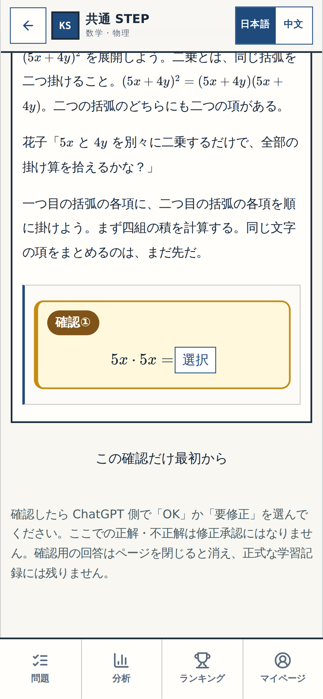
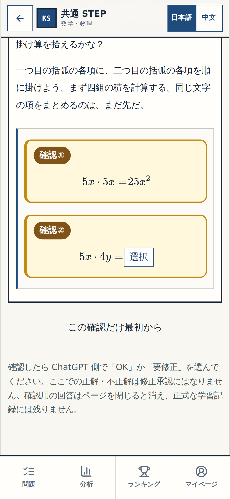
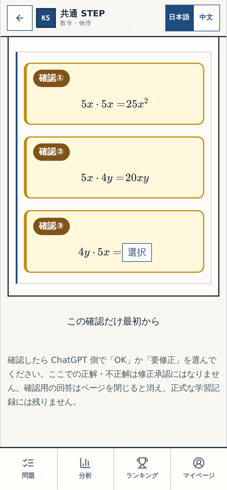
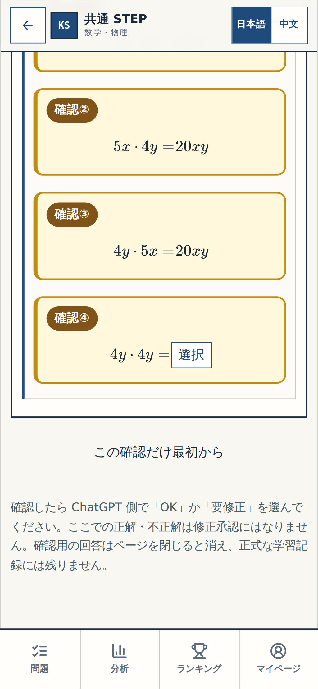
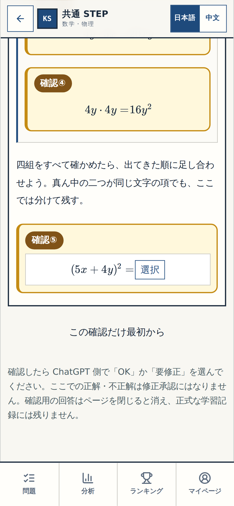

# N04-Q01 — 実画面・確認①〜⑤

描画・操作した教材コードの完全SHA: ed178ca6dfd4cdcbb0ef1eed9ca33a917a3adef8

画像は上のSHAから実際に起動したアプリの各穴の選択直前を撮影。図面・モックではありません。

## 確認1

[PC画面](confirm-1-desktop.png)

## 確認2

[PC画面](confirm-2-desktop.png)

## 確認3

[PC画面](confirm-3-desktop.png)

## 確認4

[PC画面](confirm-4-desktop.png)

## 確認5

[PC画面](confirm-5-desktop.png)

細部の視覚確認のみ。main統合・本番公開・新規公開環境・課金は未承認。
