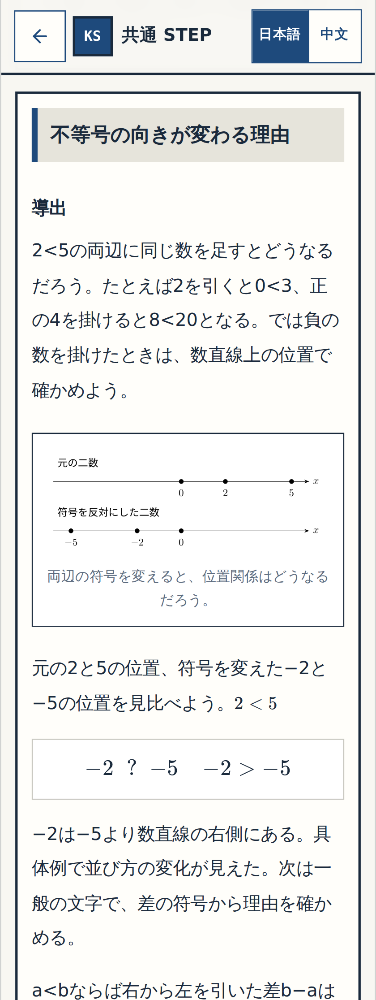
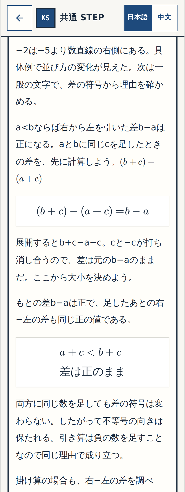
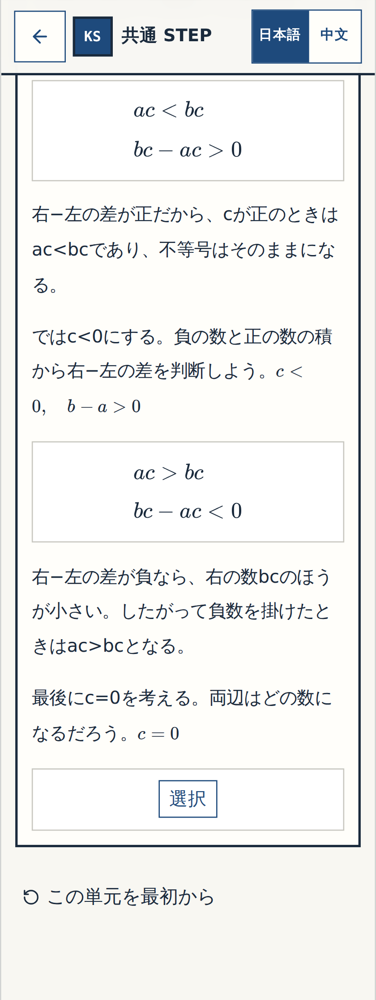
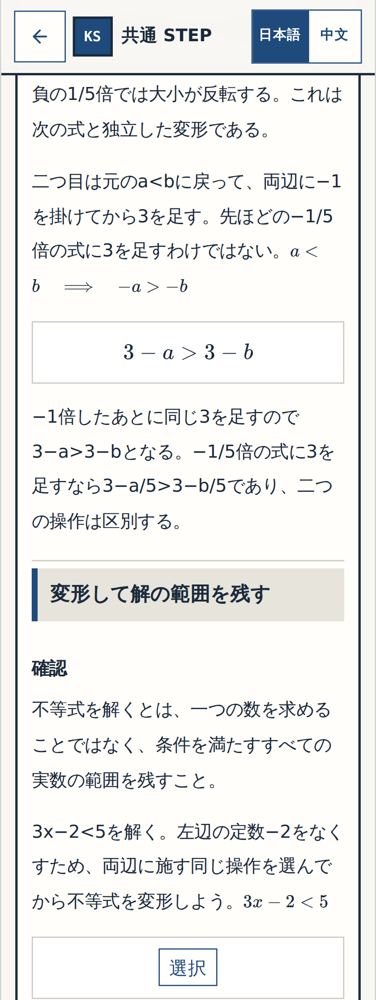

# W-MATH-011 / Gate① — N11「不等式」Q01〜Q04 実画面細部確認

**Status: REVIEW READY (images captured, user review PENDING).** Source code SHA `2ebdf7fbb0c7387ae05753c286b3c457da74e17c`, screenshot save commit `3e94827402bb0a1f53101c84fd3d1c8fae907f4c`. Original source **4 questions→9 learner stages**, 5 newly authored stable IDs; all nine preserved original PNGs unmodified; N11-F01 before Q01 and N11-F02 after Q10. Image run [#39440719673](https://github.com/rrikunagasige-dot/kyotsu-step-web/actions/runs/39440719673) **SUCCESS**; full Math CI [#39440728483](https://github.com/rrikunagasige-dot/kyotsu-step-web/actions/runs/39440728483) status must be checked fresh before claiming final PASS.

9 item IDs × 320px/390px × before/wrong/resolved = **54 actual screen PNGs** from a real app controlled browser, not mockups. All original figure bytes stay unchanged. User must inspect **four source question groups**; do not automatically call `細部OK` from CI.

## 確認01｜Q01 数直線から比較

- 元Wordの数直線を回答前に表示し、「逆転」を先に断言しない
- −2と−5の順序を判断してから一般化への説明が出る
- Q01の正答・誤答・再挑戦と図の読みやすさを確認

[320px回答前](../W-MATH-003-numbers-expressions-creation/evidence/n04-n14-gallery/wmath011-n11-01-320-before.png) · [320px誤答・ヒント](../W-MATH-003-numbers-expressions-creation/evidence/n04-n14-gallery/wmath011-n11-01-320-wrong.png) · [390px回答前](../W-MATH-003-numbers-expressions-creation/evidence/n04-n14-gallery/wmath011-n11-01-390-before.png) · [390px正答後](../W-MATH-003-numbers-expressions-creation/evidence/n04-n14-gallery/wmath011-n11-01-390-resolved.png)

## 確認02｜Q02 差の符号から加法の性質

- 先にQ02の差 (b+c)−(a+c) を計算する
- 「差が正のまま」から a+c<b+c を判断する追加の穴がある
- 理由を答えた後に加法・減法の性質が表示される

[320px回答前](../W-MATH-003-numbers-expressions-creation/evidence/n04-n14-gallery/wmath011-n11-wm011-q02-compare-320-before.png) · [320px誤答・ヒント](../W-MATH-003-numbers-expressions-creation/evidence/n04-n14-gallery/wmath011-n11-wm011-q02-compare-320-wrong.png) · [390px回答前](../W-MATH-003-numbers-expressions-creation/evidence/n04-n14-gallery/wmath011-n11-wm011-q02-compare-390-before.png) · [390px正答後](../W-MATH-003-numbers-expressions-creation/evidence/n04-n14-gallery/wmath011-n11-wm011-q02-compare-390-resolved.png)

## 確認03｜Q03 分配法則と正・負・0の証明

- bc−ac を自分で因数分解し、完成式を先出ししない
- c>0、c<0、c=0 の場合を独立して判断できる
- 全ケース回答後に性質のまとめが表示される

[320px回答前](../W-MATH-003-numbers-expressions-creation/evidence/n04-n14-gallery/wmath011-n11-03-320-before.png) · [320px誤答・ヒント](../W-MATH-003-numbers-expressions-creation/evidence/n04-n14-gallery/wmath011-n11-03-320-wrong.png) · [390px回答前](../W-MATH-003-numbers-expressions-creation/evidence/n04-n14-gallery/wmath011-n11-03-390-before.png) · [390px正答後](../W-MATH-003-numbers-expressions-creation/evidence/n04-n14-gallery/wmath011-n11-03-390-resolved.png)

## 確認04｜Q04 二つの独立した操作

- −1/5倍と「−1倍→+3」を別の変形として明記している
- 各変形をそれぞれ回答し、数式の右端が隠れない
- 直後のQ05以降の本文・解答を変更していない

[320px回答前](../W-MATH-003-numbers-expressions-creation/evidence/n04-n14-gallery/wmath011-n11-04-320-before.png) · [320px誤答・ヒント](../W-MATH-003-numbers-expressions-creation/evidence/n04-n14-gallery/wmath011-n11-04-320-wrong.png) · [390px回答前](../W-MATH-003-numbers-expressions-creation/evidence/n04-n14-gallery/wmath011-n11-04-390-before.png) · [390px正答後](../W-MATH-003-numbers-expressions-creation/evidence/n04-n14-gallery/wmath011-n11-04-390-resolved.png)

## 原問と5つの追加操作の対応（保存済みの全54枚）

| 原問 | 操作ID（各IDに320/390 before/wrong/resolvedの6枚） |
| --- | --- |
| Q01 | `n11-01` |
| Q02 | `n11-02`, `n11-wm011-q02-compare` |
| Q03 | `n11-wm011-q03-factor`, `n11-wm011-q03-positive`, `n11-03`, `n11-wm011-q03-zero` |
| Q04 | `n11-wm011-q04-fraction`, `n11-04` |

Full screenshot file prefix: `../W-MATH-003-numbers-expressions-creation/evidence/n04-n14-gallery/wmath011-{itemId}-{320|390}-{before|wrong|resolved}.png`. Both figure placement and full 132-step math walkthrough need independent CI acceptance before Gate② formal closure. Gate③ whole-app playable URL + user end-to-end acceptance remains on hold; no main merge, Pages/Vercel preview deployment or billing authorized.

**User acceptance gate:** reply `確認01〜04 細部OK` if all four source groups are acceptable, otherwise `要修正` with source question ID and observable issue. This is small-block visual approval, not full application final acceptance.
