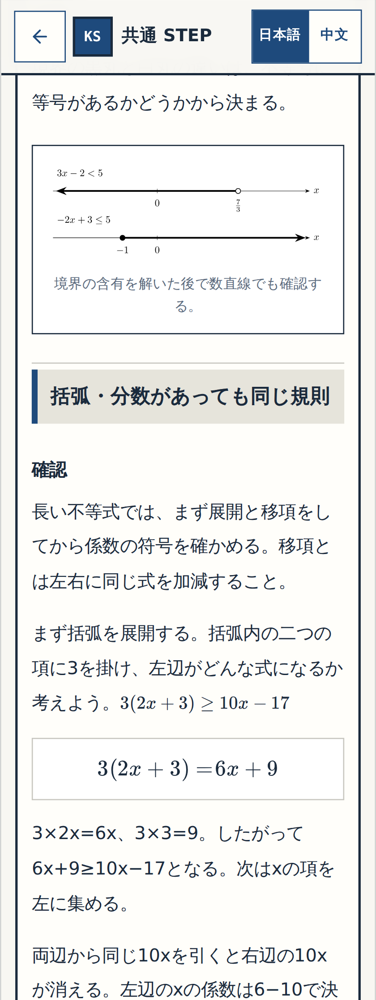
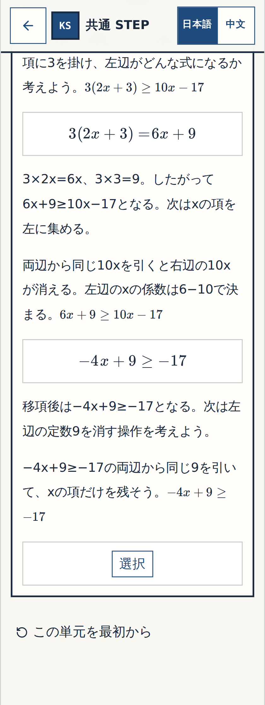
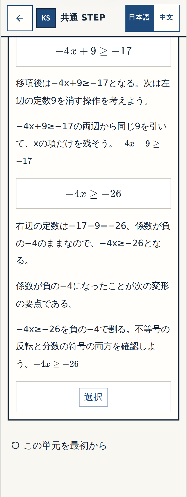

# W-MATH-012 / Gate① — N11-Q11 3段階導出の実画面細部確認
Status: **REVIEW READY / HUMAN GATE① Q11 PENDING — not approved by automated tests alone.**

## 確認対象と検証系統
- **原Word N11-Q11のみ**：元の1問を「展開 → 文字項の移項 → 定数整理」の3つの学習操作にした。最初の2操作が今回の新しい式中穴、最後の `n11-11` は元の正答・誤答を保持。
- **最終教材コードSHA**：`74b73ad275b8aced7ccf99c3ef0ffc943f02d208`。実画像保存コミット `d44ddcca3ae6bbe20cb11fb369d4ccec3764cda4` はこのコードからの撮影であり、教材コードを変更しない。
- [**最終 Math textbook CI #39519336157**](https://github.com/rrikunagasige-dot/kyotsu-step-web/actions/runs/39519336157)：**SUCCESS**。数学教科書モード全134操作のスマホ/PC、Q11の3段階で誤答→ヒント→再回答→再読込、過去の修正24問・N12・物理・数学練習回帰PASS。
- [**実アプリ画像の撮影 #39519331072**](https://github.com/rrikunagasige-dot/kyotsu-step-web/actions/runs/39519331072)：**SUCCESS**。対象3段階×320px/390px×回答前・誤答・正答後＝**18枚**。モック画像ではない。以前の表示欠けの残る `d1708e688...` の撮影は**不採用**。
- **N11-Q01〜Q04の以前のGate①は既にユーザー承認済み**。再確認は不要。今回はQ11の**1原問**だけ。Gate②・Gate③を済ませたという意味ではない。

## Q11の確認ポイント

| 段階 | 見てほしいこと | 320px | 390px |
| --- | --- | --- | --- |
| **Step 1：括弧の展開** | `3(2x+3)=6x+9`。3が2xにも3にも掛かることを判断させる | [回答前](../W-MATH-003-numbers-expressions-creation/evidence/n04-n14-gallery/wmath012-n11-wm012-q11-expand-320-before.png) · [誤答・ヒント](../W-MATH-003-numbers-expressions-creation/evidence/n04-n14-gallery/wmath012-n11-wm012-q11-expand-320-wrong.png) · [正答後](../W-MATH-003-numbers-expressions-creation/evidence/n04-n14-gallery/wmath012-n11-wm012-q11-expand-320-resolved.png) | [回答前](../W-MATH-003-numbers-expressions-creation/evidence/n04-n14-gallery/wmath012-n11-wm012-q11-expand-390-before.png) · [誤答・ヒント](../W-MATH-003-numbers-expressions-creation/evidence/n04-n14-gallery/wmath012-n11-wm012-q11-expand-390-wrong.png) · [正答後](../W-MATH-003-numbers-expressions-creation/evidence/n04-n14-gallery/wmath012-n11-wm012-q11-expand-390-resolved.png) |
| **Step 2：文字項の移項** | `6x-10x=-4x`。両辺から10xを引いた後、左辺の係数を判断させる | [回答前](../W-MATH-003-numbers-expressions-creation/evidence/n04-n14-gallery/wmath012-n11-wm012-q11-xcoef-320-before.png) · [誤答・ヒント](../W-MATH-003-numbers-expressions-creation/evidence/n04-n14-gallery/wmath012-n11-wm012-q11-xcoef-320-wrong.png) · [正答後](../W-MATH-003-numbers-expressions-creation/evidence/n04-n14-gallery/wmath012-n11-wm012-q11-xcoef-320-resolved.png) | [回答前](../W-MATH-003-numbers-expressions-creation/evidence/n04-n14-gallery/wmath012-n11-wm012-q11-xcoef-390-before.png) · [誤答・ヒント](../W-MATH-003-numbers-expressions-creation/evidence/n04-n14-gallery/wmath012-n11-wm012-q11-xcoef-390-wrong.png) · [正答後](../W-MATH-003-numbers-expressions-creation/evidence/n04-n14-gallery/wmath012-n11-wm012-q11-xcoef-390-resolved.png) |
| **Step 3：定数項の整理** | `-4x\ge -26`。既存の正答・誤答3件は変更していない。長い式の二重表示を避けて320px表示を修正 | [回答前](../W-MATH-003-numbers-expressions-creation/evidence/n04-n14-gallery/wmath012-n11-11-320-before.png) · [誤答・ヒント](../W-MATH-003-numbers-expressions-creation/evidence/n04-n14-gallery/wmath012-n11-11-320-wrong.png) · [正答後](../W-MATH-003-numbers-expressions-creation/evidence/n04-n14-gallery/wmath012-n11-11-320-resolved.png) | [回答前](../W-MATH-003-numbers-expressions-creation/evidence/n04-n14-gallery/wmath012-n11-11-390-before.png) · [誤答・ヒント](../W-MATH-003-numbers-expressions-creation/evidence/n04-n14-gallery/wmath012-n11-11-390-wrong.png) · [正答後](../W-MATH-003-numbers-expressions-creation/evidence/n04-n14-gallery/wmath012-n11-11-390-resolved.png) |

### Step 1：括弧の展開（320px・正答後の実画面）

### Step 2：文字項の移項（320px・正答後の実画面）

### Step 3：定数項の整理（320px・正答後の実画面）

## Gate①への判定要求
Q11の3段階について、式中穴のタイミング、説明と証明のつながり、320px/390pxの数式が欠けないこと、元のQ11の学習行為が損なわれないことを確認してください。**問題なければ「Q11 細部OK」**、問題があればQ11のどの段階で何が読みにくいかを教えてください。

**保留**：Gate②ではさらにQ12/Q14やN14に以前から指摘された導出上のリスクを原典・既存教訓と照らして検査する必要があり、確認前にそれらを自動的に修正しない。Gate③全体アプリの実URL・ユーザーの最初から最後までのプレイは未実施。main統合・Vercel公開・費用の発生を許可したことにはならない。
