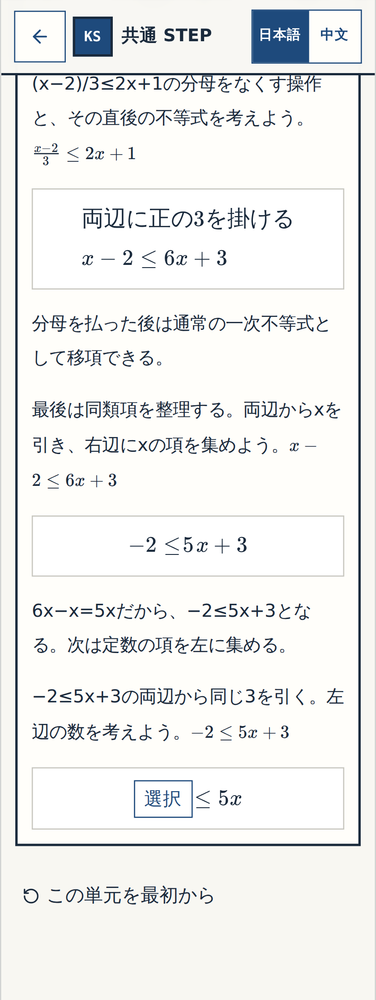
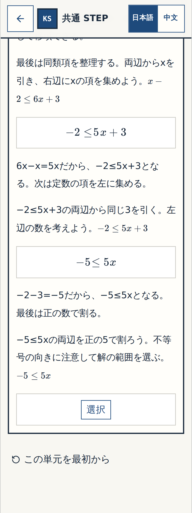
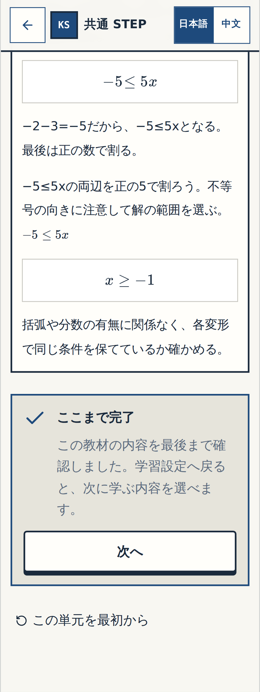

# W-MATH-013 / P-001 — N11 Q14 実画面Gate① 細部確認
Status: BLOCK-VISUAL-OK

## 対象と検証証拠
- 対象は元Word N11-Q14「同類項を整理して解こう」**1原問だけ**。既存の最終問題 `n11-14` の前に式中の穴を2つ追加し、合計3段階にした。N11 Q01–04とQ11のGate①は以前に承認済みで再確認しない。
- 実画面を撮影した**アプリコードの完全SHA**：`91a7c7ee74ceab747079b27089271b1c65e5f65f`。修正専用PR #103で先に [Math textbook CI #39532210400](https://github.com/rrikunagasige-dot/kyotsu-step-web/actions/runs/39532210400) がSUCCESS。レビュー用ブランチへの統合後も [Math textbook CI #39533384786](https://github.com/rrikunagasige-dot/kyotsu-step-web/actions/runs/39533384786) が**SUCCESS**（同じアプリコード）。
- **実アプリの撮影**：[N04–N14 real app image gallery #39533380704](https://github.com/rrikunagasige-dot/kyotsu-step-web/actions/runs/39533380704) **SUCCESS**。画像を保存したGitコミット `f44a8a0017429370194e048fb16cf56902a947eb` はコードSH A `91a7c7ee74ceab747079b27089271b1c65e5f65f` から撮影した画像だけを追加・更新し、学習コードは変更していない。
- 3学習段階 × 2画面幅（320/390px）× 3状態（回答前／誤答・ヒント／正答後）＝**実画像18枚**。全ファイルのGitHub存在確認済み。ユーザー受入前の偽画像・合成画像は用いない。
- 承認対象の画面は非公開のレビュー用GitHub記録のみ。`main`への統合・Pages/Vercel公開・全体総チェック（Gate③）は**未実施**。

## Gate① 画像一覧

| 1原問内の段階 | 生徒が考えること | 320px の実アプリ | 390px の実アプリ |
| --- | --- | --- | --- |
| **確認① — 文字項の係数** | 両辺から x を引き、右辺の係数 **5** を選ぶ | [回答前](../W-MATH-003-numbers-expressions-creation/evidence/n04-n14-gallery/wmath013-n11-wm013-q14-xcoef-320-before.png) · [誤答・ヒント](../W-MATH-003-numbers-expressions-creation/evidence/n04-n14-gallery/wmath013-n11-wm013-q14-xcoef-320-wrong.png) · [正答後](../W-MATH-003-numbers-expressions-creation/evidence/n04-n14-gallery/wmath013-n11-wm013-q14-xcoef-320-resolved.png) | [回答前](../W-MATH-003-numbers-expressions-creation/evidence/n04-n14-gallery/wmath013-n11-wm013-q14-xcoef-390-before.png) · [誤答・ヒント](../W-MATH-003-numbers-expressions-creation/evidence/n04-n14-gallery/wmath013-n11-wm013-q14-xcoef-390-wrong.png) · [正答後](../W-MATH-003-numbers-expressions-creation/evidence/n04-n14-gallery/wmath013-n11-wm013-q14-xcoef-390-resolved.png) |
| **確認② — 定数項** | 両辺から 3 を引き、左辺の数 **−5** を選ぶ | [回答前](../W-MATH-003-numbers-expressions-creation/evidence/n04-n14-gallery/wmath013-n11-wm013-q14-const-320-before.png) · [誤答・ヒント](../W-MATH-003-numbers-expressions-creation/evidence/n04-n14-gallery/wmath013-n11-wm013-q14-const-320-wrong.png) · [正答後](../W-MATH-003-numbers-expressions-creation/evidence/n04-n14-gallery/wmath013-n11-wm013-q14-const-320-resolved.png) | [回答前](../W-MATH-003-numbers-expressions-creation/evidence/n04-n14-gallery/wmath013-n11-wm013-q14-const-390-before.png) · [誤答・ヒント](../W-MATH-003-numbers-expressions-creation/evidence/n04-n14-gallery/wmath013-n11-wm013-q14-const-390-wrong.png) · [正答後](../W-MATH-003-numbers-expressions-creation/evidence/n04-n14-gallery/wmath013-n11-wm013-q14-const-390-resolved.png) |
| **確認③ — 元の最終問題** | 正の 5 で割り、不等号の向きを保って **x ≥ −1** を選ぶ（旧4択は不変） | [回答前](../W-MATH-003-numbers-expressions-creation/evidence/n04-n14-gallery/wmath013-n11-14-320-before.png) · [誤答・ヒント](../W-MATH-003-numbers-expressions-creation/evidence/n04-n14-gallery/wmath013-n11-14-320-wrong.png) · [正答後](../W-MATH-003-numbers-expressions-creation/evidence/n04-n14-gallery/wmath013-n11-14-320-resolved.png) | [回答前](../W-MATH-003-numbers-expressions-creation/evidence/n04-n14-gallery/wmath013-n11-14-390-before.png) · [誤答・ヒント](../W-MATH-003-numbers-expressions-creation/evidence/n04-n14-gallery/wmath013-n11-14-390-wrong.png) · [正答後](../W-MATH-003-numbers-expressions-creation/evidence/n04-n14-gallery/wmath013-n11-14-390-resolved.png) |

## 320px・正答後の実画面

### 確認① — 文字項の係数

### 確認② — 定数項

### 確認③ — 元の最終問題

## 確認してほしいこと
各段階で回答前に**完成した正解が先に見えないか**、穴の位置、誤答時のヒント、不等式の連結、選択肢や式が320/390pxで切れないかを確認してください。
問題なければ **「Q14 細部OK」**、気になる点があれば **「Q14 要修正：確認②の…」** のように指摘してください。
**ここでの細部OKはQ14のGate①だけです。** N14 Q07/Q08/Q12の別件修正と数学全体のGate②が残り、Gate③は同じ公開候補SHAの実働URLでユーザーが全範囲を操作する別工程です。

## Agent evidence / acceptance ledger
- [x] 原典WordとQ13からの式・Q14従来4択を固定した
- [x] 対象コードの全SHA・2本の数学CI・実撮影Workflow成功を記録した
- [x] Q14の18本のPNGがGitHubに存在（画像保存コミット f44a8a00）
- [x] 320/390pxで誤答→ヒント→再挑戦→正答→再読込の実ブラウザテストPASS
- [x] 以前のN11 Q01〜04/Q11のGate①承認を保持した
- [ ] ユーザーによるQ14細部確認
- [ ] 別件N14を含むGate②横断監査完了
- [ ] Gate③ユーザー全アプリ総チェック完了

## 2026-10-21 — user Q14 visual acceptance, supersedes historical pending state
The user replied exactly **「おけ続けて」** immediately following presentation of the authentic 18-image Q14 Gate① review sheet and the explicit request for Q14 detailed acceptance. Interpret as **BLOCK-VISUAL-OK for N11 Q14 only**. The screenshots come from checked-out app code `91a7c7ee74ceab747079b27089271b1c65e5f65f`, screenshots saved by `f44a8a0017429370194e048fb16cf56902a947eb` and recorded at `8f99d7cf471c8a18ab7e5da1ac7f194abfe0404e`. Preserve the earlier PENDING text as pre-approval history, not current status. Previously accepted N11 Q01–Q04 and Q11 remain accepted; no full Gate②/③/main/deployment approval. Proceed to independent correction **N14 Q07 proposal design**, do not implement it before distinct user approval.
