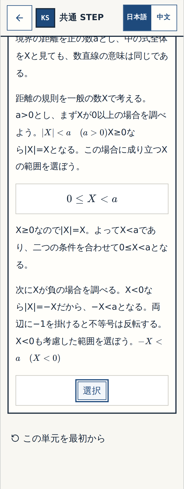
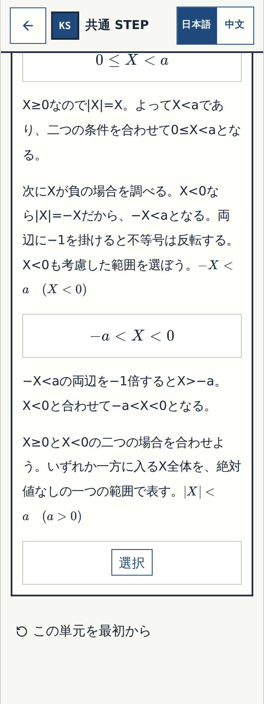
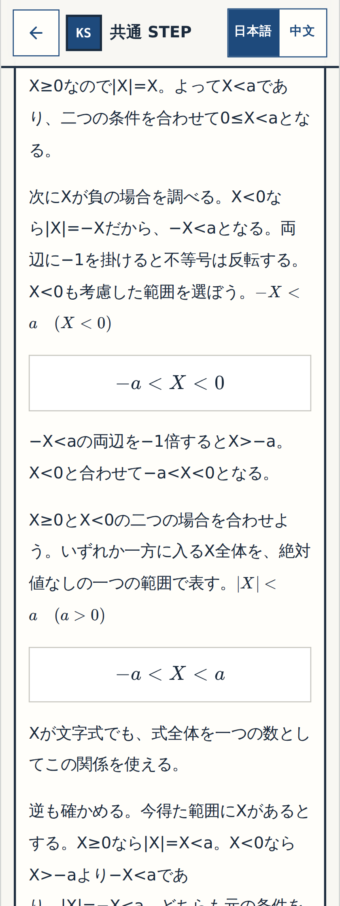

# W-MATH-014/P-001 — N14 Q07 実画面 Gate① 細部確認票
Status: BLOCK-CHECK-PENDING

## 証拠と承認対象
- N14 Q07原問1問だけ：非負の場合・負の場合の2つの新しい式中穴、そのあとに元の n14-07 最終4択。元Word N14 Q08/Q12は別修正待ち。
- 本当のアプリコード（撮影したreview-only mergeの全SHA）：`e42356de0b01a314e3e39779de1ab98a57f4f85b`。これに対応する[撮影ジョブ #39538301948](https://github.com/rrikunagasige-dot/kyotsu-step-web/actions/runs/39538301948) は SUCCESS、画像保存コミット `50465039632687ab1891687678a85b10904c9276`。
- N14の修正単独SHA `e2bd800e72c488fe9e51c98a4a01ec4b56086ff7` に対する[数学CI #39536925762](https://github.com/rrikunagasige-dot/kyotsu-step-web/actions/runs/39536925762) は SUCCESS。review merge SHAの[数学CI #39538308020](https://github.com/rrikunagasige-dot/kyotsu-step-web/actions/runs/39538308020) は独立した最終結果の照合対象であり、この確認票の初版では未判定として記録。
- 3段階 × 320/390px × 回答前・誤答とヒント・正答後＝18枚。GitHubギャラリーで全18ファイル実在確認済み（PNGサイズ非ゼロ）。合成ではない。
- Q07 Gate①のみを対象とし、N11 Q01〜Q04・Q11・Q14の既承認を維持。Gate②全体はQ08/Q12等が未完。Gate③とmain/publicationの許可ではない。

## 320px と390px：18枚すべてへのリンク
| 段階 | 考える操作 | 320px | 390px |
|---|---|---|---|
| **確認① — X≥0 の場合** | |X|=X から 0≤X<a を選択。穴の位置、答えの先出しなし、誤答とヒントを確認。 | [回答前](../W-MATH-003-numbers-expressions-creation/evidence/n04-n14-gallery/wmath014-n14-wm014-q07-nonnegative-320-before.png)・[誤答・ヒント](../W-MATH-003-numbers-expressions-creation/evidence/n04-n14-gallery/wmath014-n14-wm014-q07-nonnegative-320-wrong.png)・[正答後](../W-MATH-003-numbers-expressions-creation/evidence/n04-n14-gallery/wmath014-n14-wm014-q07-nonnegative-320-resolved.png) | [回答前](../W-MATH-003-numbers-expressions-creation/evidence/n04-n14-gallery/wmath014-n14-wm014-q07-nonnegative-390-before.png)・[誤答・ヒント](../W-MATH-003-numbers-expressions-creation/evidence/n04-n14-gallery/wmath014-n14-wm014-q07-nonnegative-390-wrong.png)・[正答後](../W-MATH-003-numbers-expressions-creation/evidence/n04-n14-gallery/wmath014-n14-wm014-q07-nonnegative-390-resolved.png) |
| **確認② — X<0 の場合** | |X|=−X, −X<a から −a<X<0 を選択。不等号の反転を考えさせる。 | [回答前](../W-MATH-003-numbers-expressions-creation/evidence/n04-n14-gallery/wmath014-n14-wm014-q07-negative-320-before.png)・[誤答・ヒント](../W-MATH-003-numbers-expressions-creation/evidence/n04-n14-gallery/wmath014-n14-wm014-q07-negative-320-wrong.png)・[正答後](../W-MATH-003-numbers-expressions-creation/evidence/n04-n14-gallery/wmath014-n14-wm014-q07-negative-320-resolved.png) | [回答前](../W-MATH-003-numbers-expressions-creation/evidence/n04-n14-gallery/wmath014-n14-wm014-q07-negative-390-before.png)・[誤答・ヒント](../W-MATH-003-numbers-expressions-creation/evidence/n04-n14-gallery/wmath014-n14-wm014-q07-negative-390-wrong.png)・[正答後](../W-MATH-003-numbers-expressions-creation/evidence/n04-n14-gallery/wmath014-n14-wm014-q07-negative-390-resolved.png) |
| **確認③ — 元の最終Q07** | 二つの区間を合成して −a<X<a。従来の正答と誤答3件は保持し、逆向きの証明は解答後。 | [回答前](../W-MATH-003-numbers-expressions-creation/evidence/n04-n14-gallery/wmath014-n14-07-320-before.png)・[誤答・ヒント](../W-MATH-003-numbers-expressions-creation/evidence/n04-n14-gallery/wmath014-n14-07-320-wrong.png)・[正答後](../W-MATH-003-numbers-expressions-creation/evidence/n04-n14-gallery/wmath014-n14-07-320-resolved.png) | [回答前](../W-MATH-003-numbers-expressions-creation/evidence/n04-n14-gallery/wmath014-n14-07-390-before.png)・[誤答・ヒント](../W-MATH-003-numbers-expressions-creation/evidence/n04-n14-gallery/wmath014-n14-07-390-wrong.png)・[正答後](../W-MATH-003-numbers-expressions-creation/evidence/n04-n14-gallery/wmath014-n14-07-390-resolved.png) |

## 320pxの実画面（正答後）

### 確認① — X≥0 の場合

### 確認② — X<0 の場合

### 確認③ — 元の最終Q07

## 細部確認依頼
式中穴の自然さ、回答前に完成答えが漏れていないか、誤答後のヒントの適切さ、スマホ320px/390pxでの式の収まり、逆向きの証明が正答後のみ提示されるかをご確認ください。**Q07だけ**問題なければ「Q07 細部OK」、修正が必要なら確認①〜③を指定してお知らせください。

## 検査状態
- [x] 原典Q07と現在の最終4択の数学的同値
- [x] 2つの新規選択穴と証明の回答順を検査
- [x] N14専用revision3→4の移行を単独CIで検査
- [x] 18枚の実アプリPNG存在・元コードSHAと撮影ジョブ照合
- [x] 承認済みN11ブロックの保護
- [ ] ユーザーによるQ07 Gate①細部承認
- [ ] Gate②横断監査完了（別件Q08/Q12未完）
- [ ] Gate③実URL総チェック
