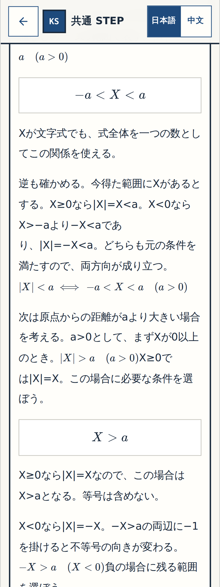
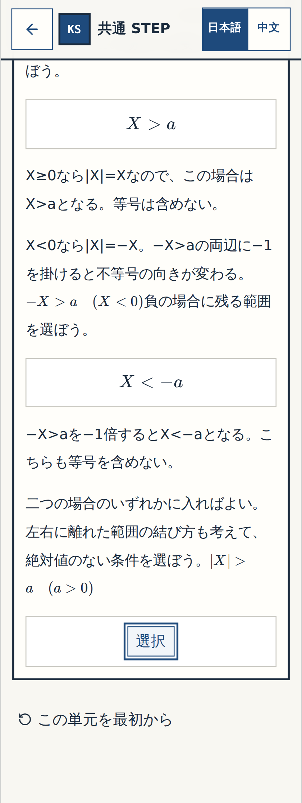
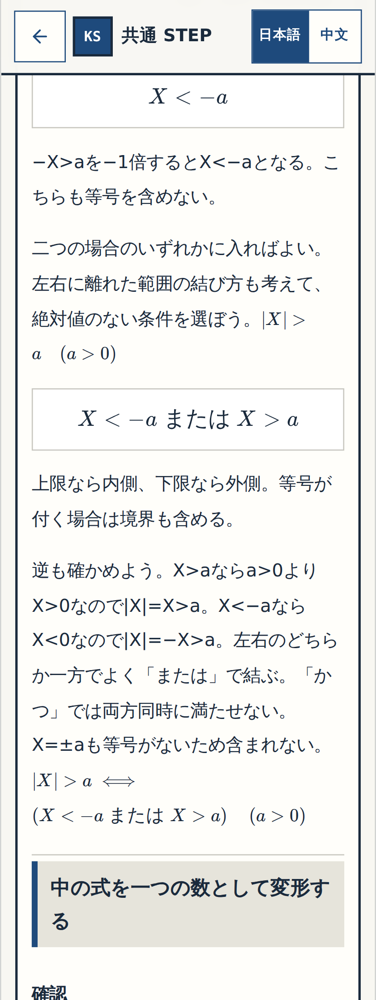

# W-MATH-015/P-001 — N14 Q08 実画面 Gate① 細部確認
Status: BLOCK-VISUAL-OK

## 実コード・実画像・CIの証拠
- レビュー対象は原Word N14 Q08の**1問だけ**。2つの新規式中穴と元のn14-08最終4択、回答後の逆向き証明。N14 Q07とN11のユーザー既承認部分は再承認不要。
- 既承認P-001の修正ブランチ完全SHA `9bd7b347f9e9fd1a9a53fd6c0e5928fcdfda3beb`、[数学CI #39541910451](https://github.com/rrikunagasige-dot/kyotsu-step-web/actions/runs/39541910451) **SUCCESS**。型/単体/全140操作/320・390px/既存数学/物理/数学練習回帰がPASS。
- 実画像の元アプリはレビュー専用Merge SHA `1983966b718bbdd38ac13f8de5eb3a0709d4445b`。4つのコード・テストblobを上記単独CIのソースと照合し**すべて一致**。公開mainとは別。
- [実画像撮影 #39543275894](https://github.com/rrikunagasige-dot/kyotsu-step-web/actions/runs/39543275894) **SUCCESS**。保存コミット `b94fe90710aafef37e04d8200ceffb1bbd4cc3fb` は48個のPNG差分のみで**教材コード変更ゼロ**。このうちQ08の3段階×320/390px×回答前/誤答後/正答後の**18 PNG全件・実サイズ非ゼロ**を確認済み。
- 元のQ08の正答「X<−a または X>a」と従来の誤答3件は不変。N14 Q07コード、Q12原文、N11承認済み箇所、元Wordと図も変更なし。
- 画像保存後のHEADのActions `action_required` はスクリーンショット保存用Botコミットによる状態であり、実行済みソースCIの失敗と混同しない。レビュー用Merge SHAの数学CI #39543280746はその後のブランチ更新により **CANCELLED**（SUCCESSではない）。一方、同一4コードblobの単独実装CI #39541910451 はSUCCESSであり、撮影 #39543275894 もSUCCESS。
- ユーザーQ08細部OKは**まだ受領していない**。Gate②（Q12の別R1修正）とGate③（全実働アプリのユーザープレイ）は未完了。main統合/公開も未許可。

## 18枚の本物のアプリ画面
| 1原問の段階 | 生徒の思考操作 | 320px | 390px |
|---|---|---|---|
| **確認① 非負の枝** | X≥0のとき、|X|=XからX>aを判断する | [回答前](../W-MATH-003-numbers-expressions-creation/evidence/n04-n14-gallery/wmath015-n14-wm015-q08-nonnegative-320-before.png) · [誤答・ヒント](../W-MATH-003-numbers-expressions-creation/evidence/n04-n14-gallery/wmath015-n14-wm015-q08-nonnegative-320-wrong.png) · [正答後](../W-MATH-003-numbers-expressions-creation/evidence/n04-n14-gallery/wmath015-n14-wm015-q08-nonnegative-320-resolved.png) | [回答前](../W-MATH-003-numbers-expressions-creation/evidence/n04-n14-gallery/wmath015-n14-wm015-q08-nonnegative-390-before.png) · [誤答・ヒント](../W-MATH-003-numbers-expressions-creation/evidence/n04-n14-gallery/wmath015-n14-wm015-q08-nonnegative-390-wrong.png) · [正答後](../W-MATH-003-numbers-expressions-creation/evidence/n04-n14-gallery/wmath015-n14-wm015-q08-nonnegative-390-resolved.png) |
| **確認② 負の枝** | X<0のとき、−X>aの両辺に−1を掛けてX<−aを判断する | [回答前](../W-MATH-003-numbers-expressions-creation/evidence/n04-n14-gallery/wmath015-n14-wm015-q08-negative-320-before.png) · [誤答・ヒント](../W-MATH-003-numbers-expressions-creation/evidence/n04-n14-gallery/wmath015-n14-wm015-q08-negative-320-wrong.png) · [正答後](../W-MATH-003-numbers-expressions-creation/evidence/n04-n14-gallery/wmath015-n14-wm015-q08-negative-320-resolved.png) | [回答前](../W-MATH-003-numbers-expressions-creation/evidence/n04-n14-gallery/wmath015-n14-wm015-q08-negative-390-before.png) · [誤答・ヒント](../W-MATH-003-numbers-expressions-creation/evidence/n04-n14-gallery/wmath015-n14-wm015-q08-negative-390-wrong.png) · [正答後](../W-MATH-003-numbers-expressions-creation/evidence/n04-n14-gallery/wmath015-n14-wm015-q08-negative-390-resolved.png) |
| **確認③ 元のQ08** | 二つの範囲を「または」で結合し、元の4択を選ぶ。正答後に逆向きの証明 | [回答前](../W-MATH-003-numbers-expressions-creation/evidence/n04-n14-gallery/wmath015-n14-08-320-before.png) · [誤答・ヒント](../W-MATH-003-numbers-expressions-creation/evidence/n04-n14-gallery/wmath015-n14-08-320-wrong.png) · [正答後](../W-MATH-003-numbers-expressions-creation/evidence/n04-n14-gallery/wmath015-n14-08-320-resolved.png) | [回答前](../W-MATH-003-numbers-expressions-creation/evidence/n04-n14-gallery/wmath015-n14-08-390-before.png) · [誤答・ヒント](../W-MATH-003-numbers-expressions-creation/evidence/n04-n14-gallery/wmath015-n14-08-390-wrong.png) · [正答後](../W-MATH-003-numbers-expressions-creation/evidence/n04-n14-gallery/wmath015-n14-08-390-resolved.png) |

## 320px・正答後の実画面

### 確認① 非負の枝

### 確認② 負の枝

### 確認③ 元のQ08

## Gate①に確認してほしいこと
回答前に次の穴の正解が漏れていないか、ヒントの自然さ、不等号の反転と「または」の因果関係、正答後だけに出る逆証明、320px/390pxの式・文章の折返しと見やすさをご確認ください。
問題なければ **「Q08 細部OK」**、問題があれば **「Q08 要修正：確認②の……」** と教えてください。

## 確認台帳
- [x] Q08 original source/key/3 distractors preserved and 2 new decisions only
- [x] Approved Q07 source/answer history preserved
- [x] Exact code SHA / initial CI SUCCESS / real capture workflow SUCCESS
- [x] 18 native images present, no screenshot-only branch code drift
- [x] Mobile 320px/390px wrong→hint→retry→correct→reload tested in Math CI
- [ ] User Q08 Gate① visual acceptance
- [ ] W-MATH-016/P-001 Q12 separate correction, independent whole Gate② PASS
- [ ] Entire app Gate③ complete user play on SHA-matched real URL

## 2026-10-21 contextual user visual acceptance — current state
The user responded exactly **「続けて」** directly after the Q08 actual-image Gate① review invitation, with next step stated as Q12 proposal approval stage. In this existing small-block acceptance workflow this is interpreted as **Q08 BLOCK-VISUAL-OK, permission to move to the next decision**, not authorization to implement Q12. The utterance was not literally 「Q08 細部OK」; preserve that distinction. 18 genuine Q08 screenshot images from tested review source SHA `1983966b718bbdd38ac13f8de5eb3a0709d4445b`, screenshot job #39543275894 SUCCESS, saved image commit `b94fe90710aafef37e04d8200ceffb1bbd4cc3fb`. Initial exact code source CI #39541910451 SUCCESS and matching source blobs confirmed; a separate review-merge CI #39543280746 was CANCELLED, not SUCCESS. Historical unchecked checkbox above predates this user decision. No Q12 learner-code, global Gate②/③, main merge, hosting/publication approval implied.
