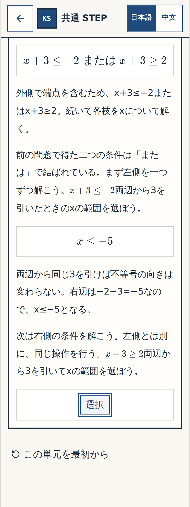
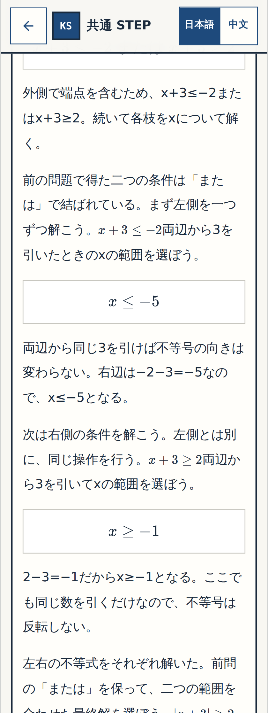
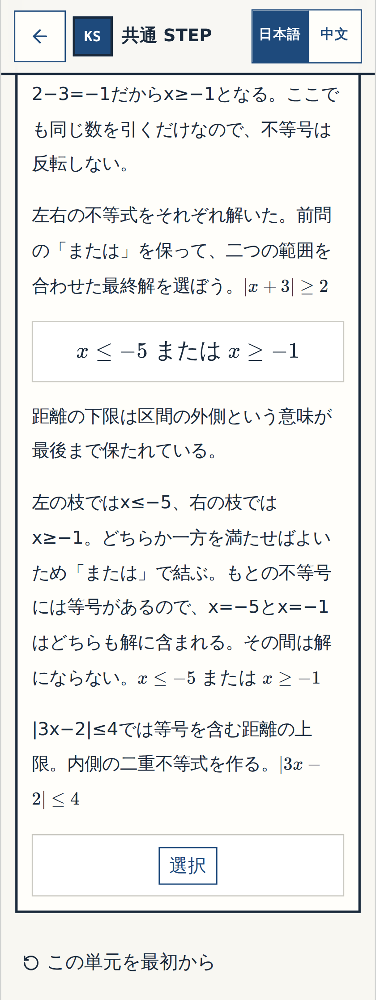

# W-MATH-016/P-001 N14 Q12 — 実アプリ Gate① 細部確認票
Status: BLOCK-CHECK-PENDING

## 実アプリ画像・変更範囲・テストの正本
- 対象：教師編集Word N14-Q12 **1原問だけ**。Q11で得た二枝のそれぞれの引き算を新しい式中穴で解かせた後、元の n14-12 の最終4択からORの結合を選ぶ。新しい原問番号や図は追加しない。
- ユーザーの実装承認：**「承認」**。これとは別にQ12実画像のGate①受入はまだ確認していない。以前のN11 Q01〜Q04/Q11/Q14、およびN14 Q07/Q08の細部OKは維持し、再承認を求めない。
- 全数学CIを通した独立実装の完全SHA：`cd79fa26ff0cd17163c05d9dceab383ce289224f`。[Math textbook mode CI #39548305543](https://github.com/rrikunagasige-dot/kyotsu-step-web/actions/runs/39548305543) **SUCCESS**（N14 revision6、全142数学操作、v1〜5進捗移行、N11/Q07/Q08/物理/数学練習モード回帰）。Governance #39548305571とReview Preview Code Check #39548305562もSUCCESS。
- **画像を撮ったアプリコードの完全SHA**：`43ef4fae17b8ce9d0d9eb62358e392c47146cac1`。上記CIを通った4つの教材/移行/数学テスト/E2E Git blobと**4ファイルすべてバイト一致**。PR #106はPR #101のレビュー専用ブランチへ内部統合しただけ。`main`・公開アプリは未変更。
- [実アプリ撮影ジョブ #39549614892](https://github.com/rrikunagasige-dot/kyotsu-step-web/actions/runs/39549614892) **SUCCESS**。画像保存コミットは `6bfac2e58a20fbe80db3148c713200ed433f5e9b`。差分はPNGのみ38ファイルでコード改変ゼロ。このうちQ12は**3段階×320px/390px×回答前/誤答・ヒント/正答後＝18枚**。18ファイル全件GitHubに実在し、サイズ219013〜299792バイト。モック・生成画像ではない。
- レビュー統合SHAの追加[Math textbook mode CI #39549620273](https://github.com/rrikunagasige-dot/kyotsu-step-web/actions/runs/39549620273)は**SUCCESS**（撮影ソース`43ef4fae17b8ce9d0d9eb62358e392c47146cac1`で確認）。元の独立実装CI #39548305543もSUCCESS。
- 元の `n14-12` 4択・Q07/Q08承認済み導出・旧進捗・図・教師Wordは維持。Gate②全体の独立監査、Gate③実URL全範囲ユーザープレイ、main統合・公開の承認とは別。

## 実画面18枚へのリンク
| Q12内の学習段階 | 生徒が判断する内容 | 320px | 390px |
|---|---|---|---|
| **確認① 左側** | x+3≤−2 から両辺−3で x≤−5。元の答えを先に見せない | [回答前](../W-MATH-003-numbers-expressions-creation/evidence/n04-n14-gallery/wmath016-n14-wm016-q12-left-320-before.png) · [誤答・ヒント](../W-MATH-003-numbers-expressions-creation/evidence/n04-n14-gallery/wmath016-n14-wm016-q12-left-320-wrong.png) · [正答後](../W-MATH-003-numbers-expressions-creation/evidence/n04-n14-gallery/wmath016-n14-wm016-q12-left-320-resolved.png) | [回答前](../W-MATH-003-numbers-expressions-creation/evidence/n04-n14-gallery/wmath016-n14-wm016-q12-left-390-before.png) · [誤答・ヒント](../W-MATH-003-numbers-expressions-creation/evidence/n04-n14-gallery/wmath016-n14-wm016-q12-left-390-wrong.png) · [正答後](../W-MATH-003-numbers-expressions-creation/evidence/n04-n14-gallery/wmath016-n14-wm016-q12-left-390-resolved.png) |
| **確認② 右側** | x+3≥2 から両辺−3で x≥−1。向きと等号を保持 | [回答前](../W-MATH-003-numbers-expressions-creation/evidence/n04-n14-gallery/wmath016-n14-wm016-q12-right-320-before.png) · [誤答・ヒント](../W-MATH-003-numbers-expressions-creation/evidence/n04-n14-gallery/wmath016-n14-wm016-q12-right-320-wrong.png) · [正答後](../W-MATH-003-numbers-expressions-creation/evidence/n04-n14-gallery/wmath016-n14-wm016-q12-right-320-resolved.png) | [回答前](../W-MATH-003-numbers-expressions-creation/evidence/n04-n14-gallery/wmath016-n14-wm016-q12-right-390-before.png) · [誤答・ヒント](../W-MATH-003-numbers-expressions-creation/evidence/n04-n14-gallery/wmath016-n14-wm016-q12-right-390-wrong.png) · [正答後](../W-MATH-003-numbers-expressions-creation/evidence/n04-n14-gallery/wmath016-n14-wm016-q12-right-390-resolved.png) |
| **確認③ 元の最終Q12** | 2枝を「または」で結ぶ。旧4択・正答と誤答3件は維持 | [回答前](../W-MATH-003-numbers-expressions-creation/evidence/n04-n14-gallery/wmath016-n14-12-320-before.png) · [誤答・ヒント](../W-MATH-003-numbers-expressions-creation/evidence/n04-n14-gallery/wmath016-n14-12-320-wrong.png) · [正答後](../W-MATH-003-numbers-expressions-creation/evidence/n04-n14-gallery/wmath016-n14-12-320-resolved.png) | [回答前](../W-MATH-003-numbers-expressions-creation/evidence/n04-n14-gallery/wmath016-n14-12-390-before.png) · [誤答・ヒント](../W-MATH-003-numbers-expressions-creation/evidence/n04-n14-gallery/wmath016-n14-12-390-wrong.png) · [正答後](../W-MATH-003-numbers-expressions-creation/evidence/n04-n14-gallery/wmath016-n14-12-390-resolved.png) |

## 320px・正答後の実画面

### 確認① 左側

### 確認② 右側

### 確認③ 元の最終Q12

## 今回のGate①確認ポイント
① 最初の計算で答えを表示せず、x+3≤−2 から x≤−5 を自分で選べるか。② 次の計算でもx+3≥2からx≥−1を選び、不等号の向きと等号がわかるか。③ 二つの結果から「または」を選ぶ旧最終問題へ自然につながるか。④ ヒント・誤答表示、文章量、320px・390pxでの式/選択肢の見やすさを確かめてください。**現物確認で、式と直後の説明が密着する箇所（例：`x+3≤−2両辺から`）、縦に長く続く文章、元の最終ヒント「枝どうしは結合しない」という言い回しは要確認項目として発見しました。** 独断で修正せず、Gate①で判断してください。
問題なければ **「Q12 細部OK」**、修正箇所があれば **「Q12 要修正：確認①の…」** と教えてください。

## 受入・独立確認台帳
- [x] 元Q12の最終正答・旧誤答3件を保持
- [x] Q07/Q08/N11の以前の承認済み部分を保護
- [x] 2つの新しい計算穴の式・答え・端点・誤答モデルを数学監査
- [x] コードの全SHAと独立実装数学CI、撮影ジョブを照合
- [x] 18枚のネイティブPNGすべてGitHubで非ゼロ存在を確認
- [x] Playwright 320/390px wrong→hint→retry→resolved→reload と全142数学操作のCI PASS
- [ ] ユーザーが**Q12だけ**Gate①の細部OKを明示する
- [ ] 123原問と既存修正の独立横断監査 Gate② 総PASS
- [ ] exact-SHA実働アプリでユーザーが全範囲を通しプレイしてGate③ 総チェック
