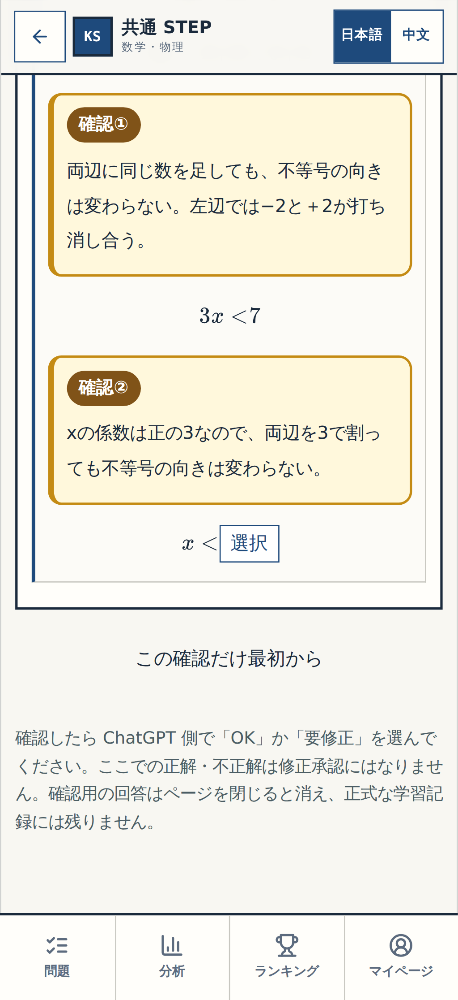

# W-MATH-017 / P-006 — Gate① 小ブロック視覚受入記録
Review: W-MATH-017 / P-006
Status: BLOCK-VISUAL-OK (user, exact response below)
Approved learner scope: N11 Q05–Q06 **new explanatory paragraphs only**
Learner source revision: N11 revision 8
Exact rendered full commit SHA: `2c568703cb3e56b5ef4ab119b411bdb89e674cc6`
Rendered route: ordinary `/#/learning/textbook/math-numbers-expressions-n11` and review-only `/#/review/n11-q05` (CI Chromium, not live-public candidate)
Screenshot production: [GitHub Actions #39593071069](https://github.com/rrikunagasige-dot/kyotsu-step-web/actions/runs/39593071069), PASS, 320px/390px mobile, 1440px PC.
Evidence commit: `540e2eee7671fe6b540dd6c68b0273eca1d04780` (screenshot-only follow-up)
Visual sheet: [P-006 actual user-viewed normal+marked images](./evidence/p003-gate1/README.md)
Original unchanged content: N11 Q01, P-005 four formula rows and item/answer IDs, Q07–Q14, N14 and all other modes.
Review decision time: 2026-10-21 JST (conversation order; exact clock time not asserted).

## User-visible acceptance target
- 確認① `n11-p006-q05-cancel-explain`: the one short reason **between formula row2 and row3**.
- 確認② `n11-p006-q06-positive-explain`: the one short reason **between formula row3 and row4**.

The full learner-screen images without review-only labels are in the original visual sheet, including `n11-normal-q05-result-before-390.png` and `n11-normal-q06-fraction-before-390.png`.

## Exact user response / permitted interpretation
User replied **「可以这样就行了继续」** directly to the assistant's P-006 actual screenshot review, after being asked to inspect only these two new paragraphs and reply `細部OK` / `要修正`.

Interpretation: **BLOCK-VISUAL-OK for the two visible explanation paragraphs** on the full rendered SHA above. User did not literally type `細部OK`; the acceptance comes from equivalent immediate affirmative review, not from a blank system default. This is **NOT** proposal approval for new P-007 content, GitHub main merge, live whole-app play, or `総チェックOK`.

## Follow-on gate
- [x] Source SHA, review-only numbered markers, and both real app screenshots verified.
- [x] P-006 source/answers/progress revision 8 preserved; original test failure and later recovery logged.
- [x] Exact user visual acceptance recorded.
- [ ] In the *next* review output, suppress these **accepted** yellow markers; preserve screenshots/acceptance history; do not re-request P-005 or P-006.
- [ ] Gate② still blocked by confirmed similar source questions and unavailable fresh original Word review.
- [ ] Gate③ FINAL-REVIEW-NOT-READY: whole-app SHA-matched live URL and `総チェックOK` not yet obtained.
