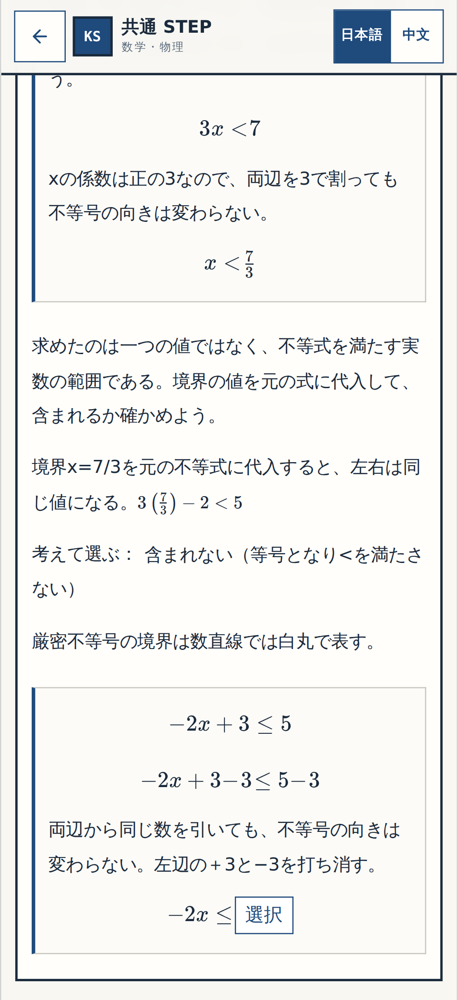
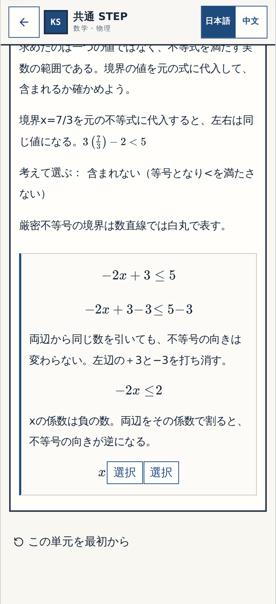
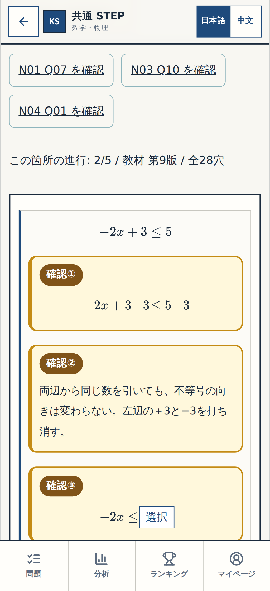

# W-MATH-017/P-007 — N11 Q08〜Q09 小ブロック GitHub確認票
Status: BLOCK-VISUAL-OK — User accepted on 2026-10-21 JST; literal reply 「いいよ」 directly to numbered P-007 screenshot review
Work: W-MATH-017; Proposal: P-007 (user approved via 「いいね承認」)
Exact tested/captured full SHA: `76ab0e708f0706fbbfa7df1109f19d5263c7db19`
Lesson version: N11 revision9, original teacher Word Q08 and Q09, 2 source markers (not 5 new source questions)
Real visual capture: [GitHub Actions #39598038524](https://github.com/rrikunagasige-dot/kyotsu-step-web/actions/runs/39598038524), result **SUCCESS**, mobile 320/390, desktop 1440, wrong/hint/retry/resolved.
Screenshot-only commit: `55cb9fdfe06a819eb230789de7d797fe74daa084` — **not** substitute for source SHA.
Real screenshot album: [P-007 README and all 63 image references](./evidence/p007-gate1/README.md)
Affected blocks: `n11-formula-08`, `n11-p007-q08-explain`, `n11-after-08`, `n11-p007-q09-explain`, `n11-formula-09`. Q07 and Q10 are context only.
Protected accepted blocks: N11 Q05/Q06 P-006 `BLOCK-VISUAL-OK` (no new review markers), existing Q01/Q11/Q14; original teacher figures/other subjects unchanged.

## 今回ここだけ確認

**N11 Q08〜Q09：引き算と負数除算**。4行の式と2箇所の短い理由が、一つの導出枠の中にあるかを確認してください。

- **確認①・②** 両辺の引き算が、一つの連続した式内の穴となり、その後に同じ操作の理由が入っているか。
- **確認③** `-2x≤□` は、左右の3の消去後にだけ出てくるか。
- **確認④** 負の係数で割る理由が、数値結果を先に言わず、式と式の間にあるか。
- **確認⑤** 不等号 `≥` と `-1` は別の穴となり、最後に `x≥-1` となるか。

**返信:** `細部OK` または `要修正`（対象番号）。Gate①は画像・設計の受入のみ。Gate②の独立横断監査とGate③の実働アプリを最初から最後までプレイする `総チェックOK` は別です。

## Technical readiness / acceptance ledger
- [x] Original source Q08/Q09 IDs remain stable; 5 independent cognitive decisions, 14 original N11 Q labels.
- [x] Capture exact SHA, source displayed, Chromium success 320/390/1440.
- [x] 5 numbered marks only for the new Q08/Q09 blocks, previously accepted P-006 unmarked.
- [x] Normal math lesson screenshots without reviewer yellow frames.
- [x] User affirmative reply 「いいよ」 to exact P-007 Gate① sheet accepted as equivalent `細部OK`, with no changes/conditions. User did not literally type `細部OK`. This approves only visible new Q08/Q09 blocks, not whole-app `総チェックOK`.
- [ ] Cross-block independent Gate②. Original DOCX fresh line-level check UNVERIFIED.
- [ ] Gate③ full-app exact-SHA live link and user `総チェックOK`. Do not merge main.

## 受入記録（新しい修正案の許可ではない）
User's direct response to the immediately preceding P-007 Gate① review and `細部OK / 要修正` question: **「いいよ」** (2026-10-21 JST; no invented clock time). Record as `BLOCK-VISUAL-OK` for 5 newly marked Q08/Q09 blocks only, on frozen screenshot source SHA `76ab0e708f0706fbbfa7df1109f19d5263c7db19`. Previously approved P-006 remains accepted; no new user acceptance of Q13, N14, Gate② or Gate③. In the *next* Gate① image/review output, hide P-007 markers using `reviewState:'accepted'`; preserve these images and the original text of response. Do not change review code now while awaiting separate exact P-008 approval.
