# W-MATH-017/P-003 — N11 Q01 / Q05 実アプリ Gate① 確認票

描画・操作した教材コード SHA: \`0bb59e4e9fa6314dcdda7b8d5dd5559f7fd92944\`

GitHub Actions の実 Chromium による操作とスクリーンショット。図面・モックではありません。学習履歴は保存されません。

## 普段の学習画面（黄色い確認枠なし）

これらは独立の教材ページでなく、N11 を最初から9操作解いて Q05 に到達した通常の教材画面です。

### q01-before

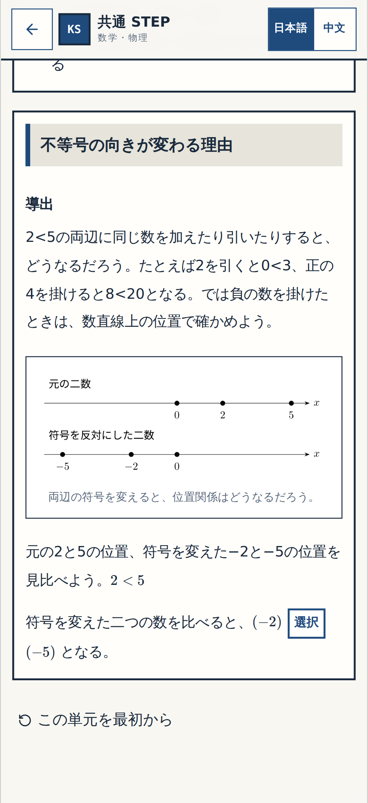

[320px](n11-normal-q01-before-320.png) ・ [PC 1440px](n11-normal-q01-before-1440.png)

### q01-after

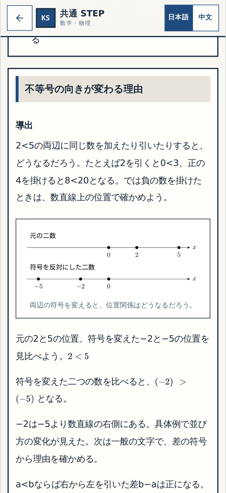

[320px](n11-normal-q01-after-320.png) ・ [PC 1440px](n11-normal-q01-after-1440.png)

### q05-operation-before

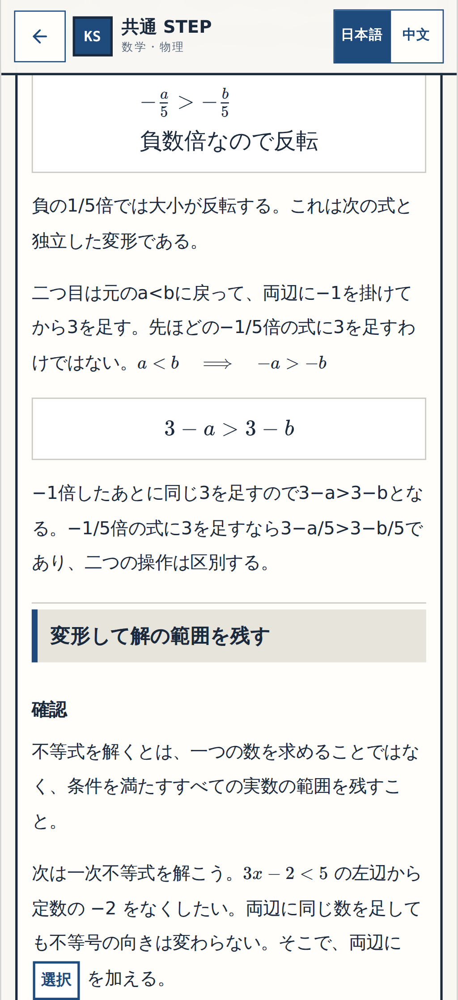

[320px](n11-normal-q05-operation-before-320.png) ・ [PC 1440px](n11-normal-q05-operation-before-1440.png)

### q05-balance-before

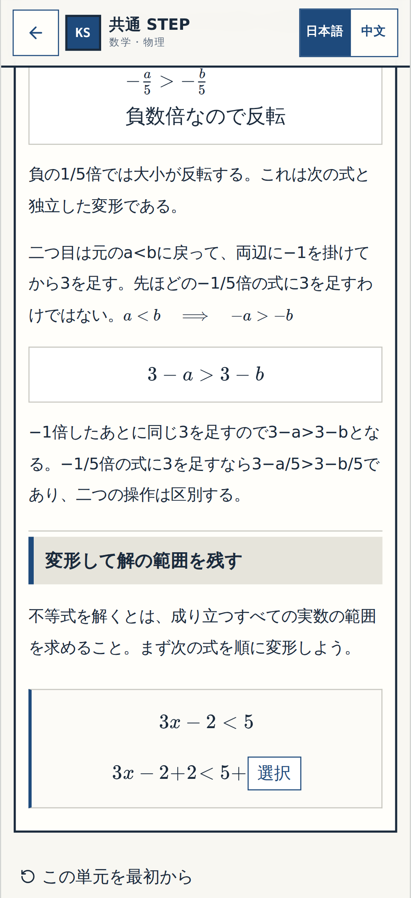

[320px](n11-normal-q05-balance-before-320.png) ・ [PC 1440px](n11-normal-q05-balance-before-1440.png)

### q05-result-before

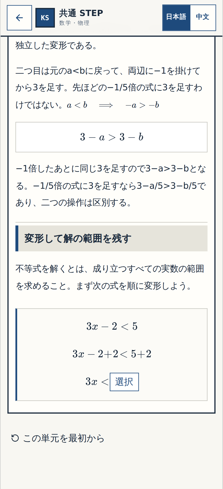

[320px](n11-normal-q05-result-before-320.png) ・ [PC 1440px](n11-normal-q05-result-before-1440.png)

### q06-fraction-before

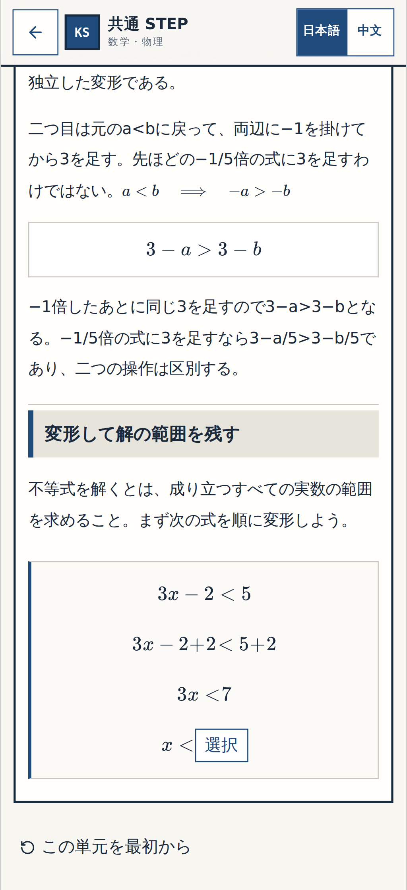

[320px](n11-normal-q06-fraction-before-320.png) ・ [PC 1440px](n11-normal-q06-fraction-before-1440.png)

### q06-after

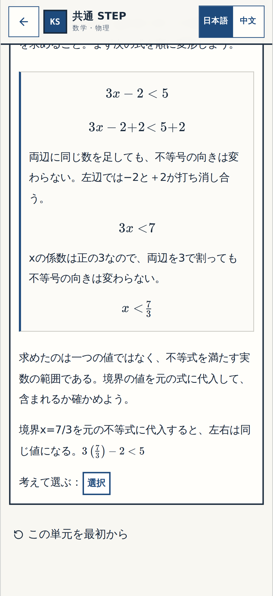

[320px](n11-normal-q06-after-320.png) ・ [PC 1440px](n11-normal-q06-after-1440.png)

## 既存Gate①の番号付き確認枠

## n11-q01

### 確認1

**before**

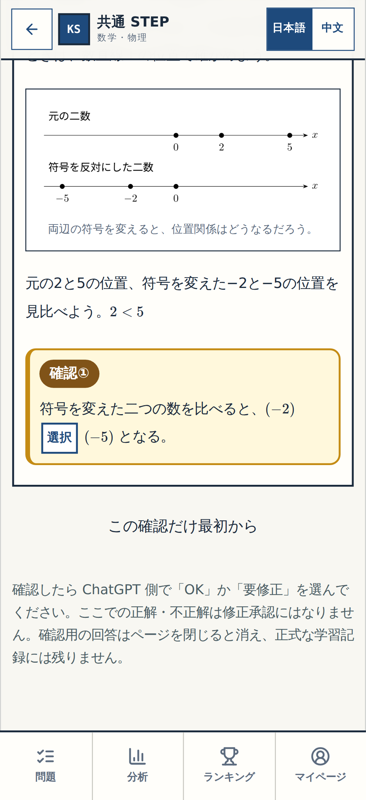

[320px](n11-q01-step-1-before-320.png) ・ [PC 1440px](n11-q01-step-1-before-1440.png)

**wrong**

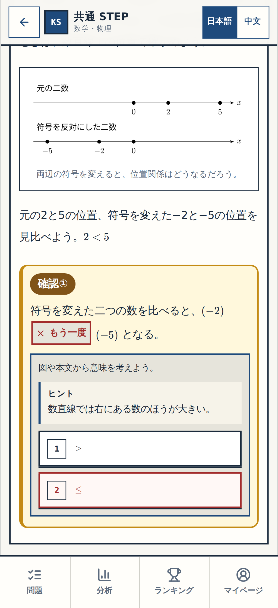

[320px](n11-q01-step-1-wrong-320.png) ・ [PC 1440px](n11-q01-step-1-wrong-1440.png)

**resolved**

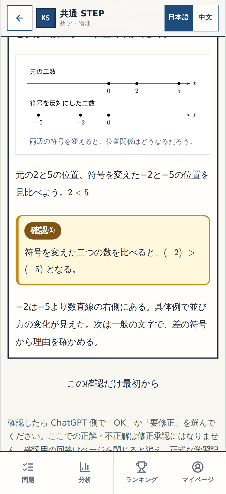

[320px](n11-q01-step-1-resolved-320.png) ・ [PC 1440px](n11-q01-step-1-resolved-1440.png)

## n11-q05

### 確認1

**before**

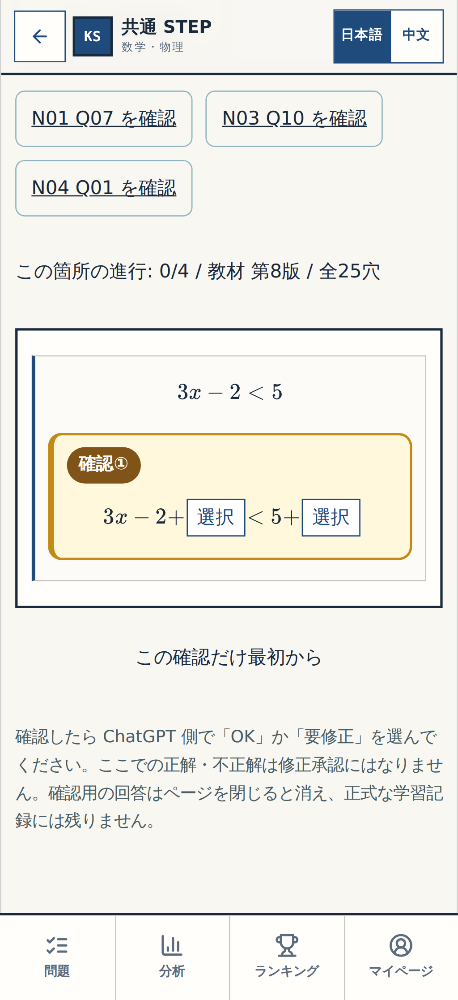

[320px](n11-q05-step-1-before-320.png) ・ [PC 1440px](n11-q05-step-1-before-1440.png)

**wrong**

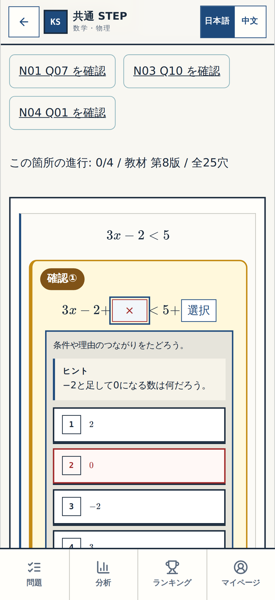

[320px](n11-q05-step-1-wrong-320.png) ・ [PC 1440px](n11-q05-step-1-wrong-1440.png)

**resolved**

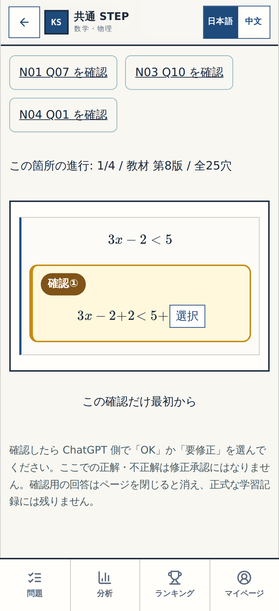

[320px](n11-q05-step-1-resolved-320.png) ・ [PC 1440px](n11-q05-step-1-resolved-1440.png)

### 確認2

**before**

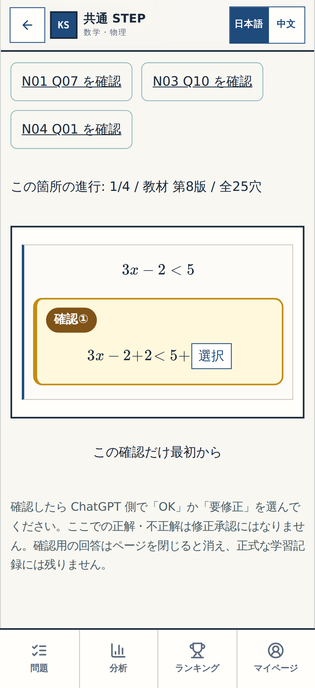

[320px](n11-q05-step-2-before-320.png) ・ [PC 1440px](n11-q05-step-2-before-1440.png)

**wrong**

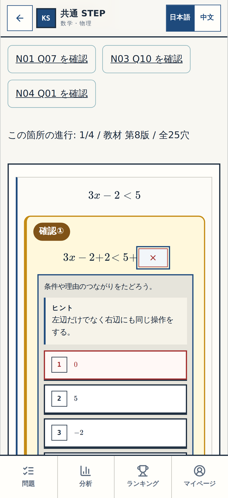

[320px](n11-q05-step-2-wrong-320.png) ・ [PC 1440px](n11-q05-step-2-wrong-1440.png)

**resolved**

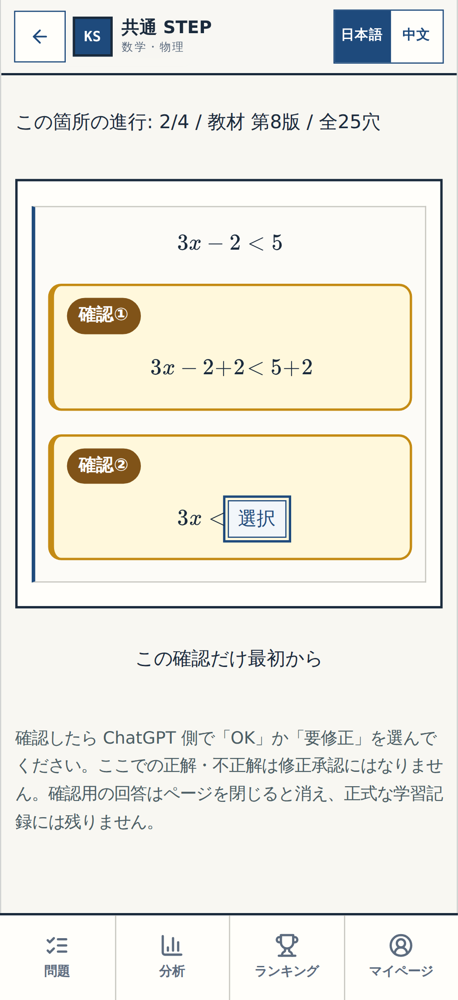

[320px](n11-q05-step-2-resolved-320.png) ・ [PC 1440px](n11-q05-step-2-resolved-1440.png)

### 確認3

**before**

[320px](n11-q05-step-3-before-320.png) ・ [PC 1440px](n11-q05-step-3-before-1440.png)

**wrong**

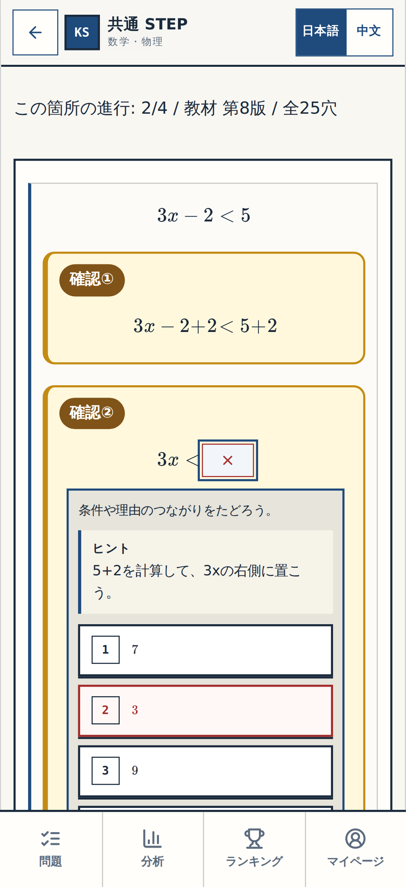

[320px](n11-q05-step-3-wrong-320.png) ・ [PC 1440px](n11-q05-step-3-wrong-1440.png)

**resolved**

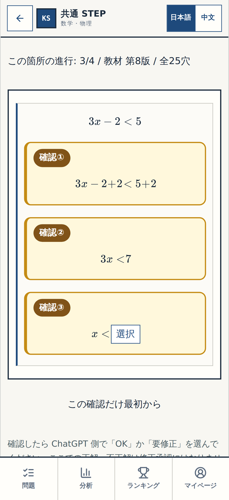

[320px](n11-q05-step-3-resolved-320.png) ・ [PC 1440px](n11-q05-step-3-resolved-1440.png)

### 確認4

**before**

[320px](n11-q05-step-4-before-320.png) ・ [PC 1440px](n11-q05-step-4-before-1440.png)

**wrong**

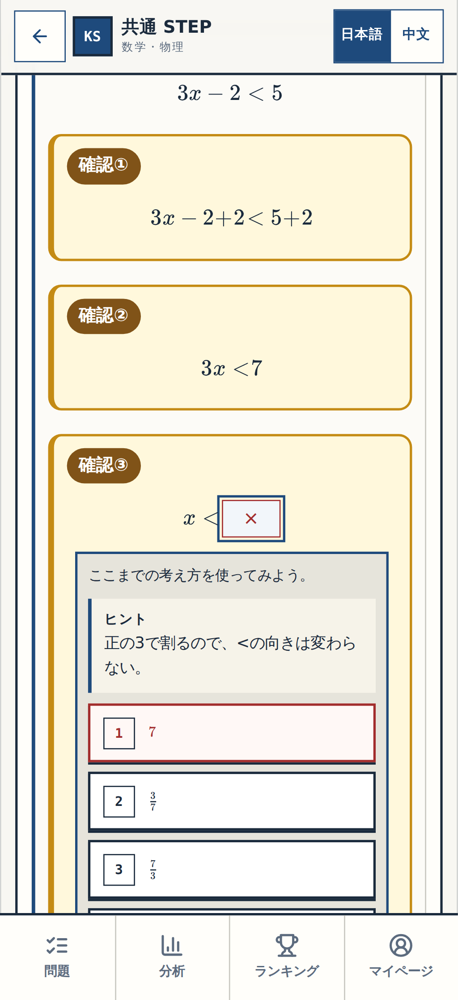

[320px](n11-q05-step-4-wrong-320.png) ・ [PC 1440px](n11-q05-step-4-wrong-1440.png)

**resolved**

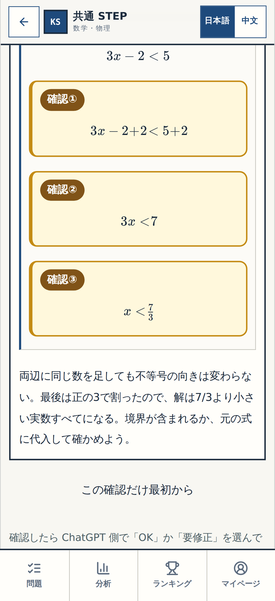

[320px](n11-q05-step-4-resolved-320.png) ・ [PC 1440px](n11-q05-step-4-resolved-1440.png)

確認対象は新規修正された N11 Q01 と Q05 だけ。他の承認済みブロックは再承認対象外。Gate②とGate③は別。
