# W-MATH-017/P-007 — N11 Q08〜Q09 実アプリ Gate①

対象教材コード SHA: \`76ab0e708f0706fbbfa7df1109f19d5263c7db19\`

実Chromiumで通常のN11をQ01から順に解いた画像と、新しいQ08/Q09だけの番号付き確認画像。320・390・1440px。図面・モックではありません。

## 通常の学習画面（黄色い確認枠なし）

### q08-left-before

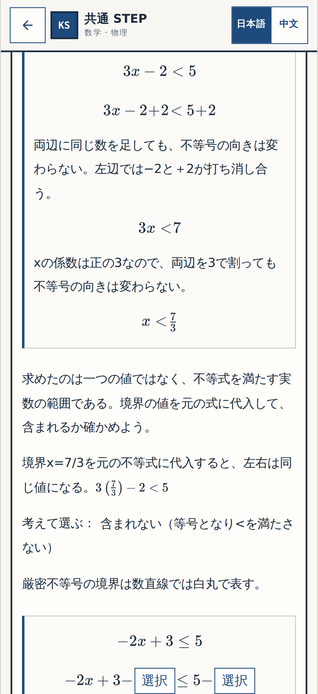

[320px](p007-normal-q08-left-before-320.png) ・ [PC1440px](p007-normal-q08-left-before-1440.png)

### q08-right-before

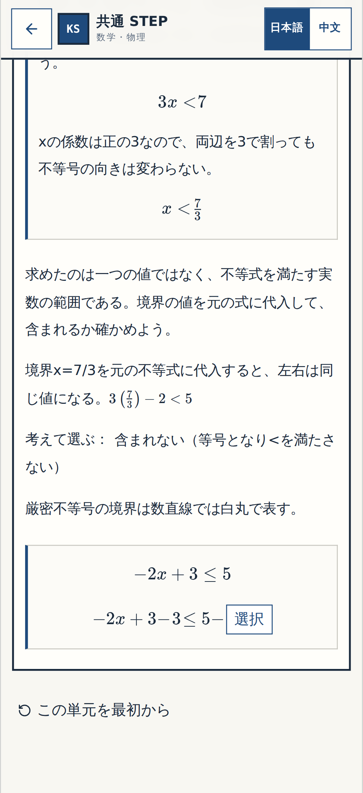

[320px](p007-normal-q08-right-before-320.png) ・ [PC1440px](p007-normal-q08-right-before-1440.png)

### q08-arithmetic-before

[320px](p007-normal-q08-arithmetic-before-320.png) ・ [PC1440px](p007-normal-q08-arithmetic-before-1440.png)

### q09-direction-before

[320px](p007-normal-q09-direction-before-320.png) ・ [PC1440px](p007-normal-q09-direction-before-1440.png)

### q09-quotient-before

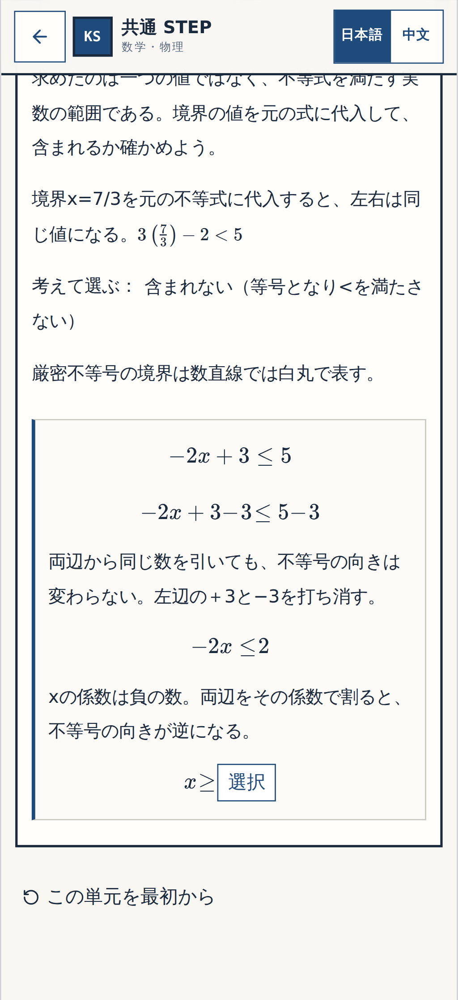

[320px](p007-normal-q09-quotient-before-320.png) ・ [PC1440px](p007-normal-q09-quotient-before-1440.png)

### q09-finished

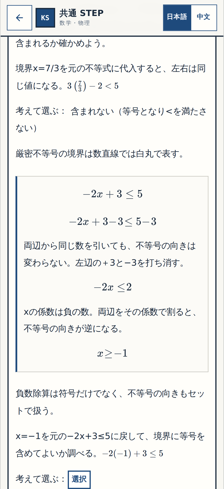

[320px](p007-normal-q09-finished-320.png) ・ [PC1440px](p007-normal-q09-finished-1440.png)

## 今回だけの番号付き確認（Q08・Q09）

**確認①** 左右の引き算を同じ式の中で選べる。**確認②** 左右で同じ数を引く理由。**確認③** 右辺の計算。**確認④** 負の数で割る理由。**確認⑤** 不等号の向きと商の計算。

### Q08〜Q09 小操作 1

**before**

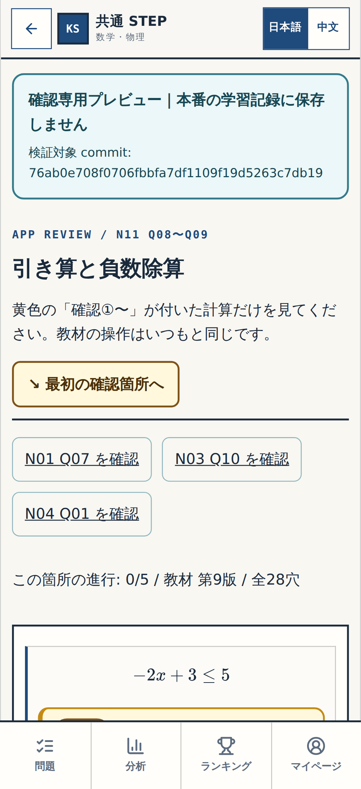

[320px](p007-review-step-1-before-320.png) ・ [PC1440px](p007-review-step-1-before-1440.png)

**wrong**

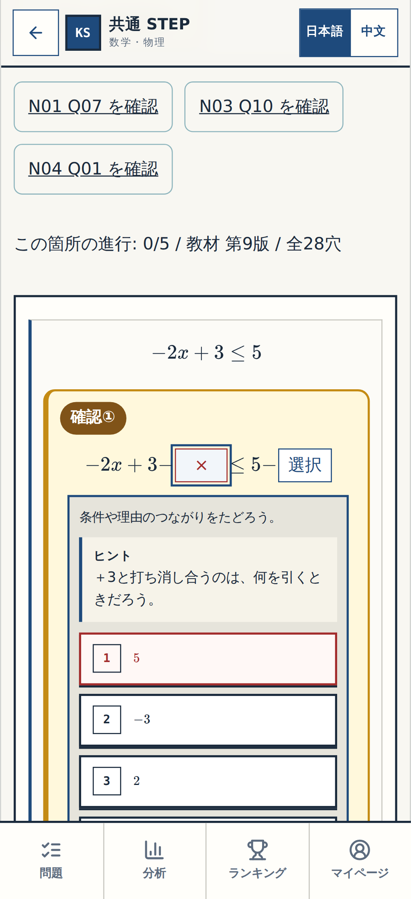

[320px](p007-review-step-1-wrong-320.png) ・ [PC1440px](p007-review-step-1-wrong-1440.png)

**resolved**

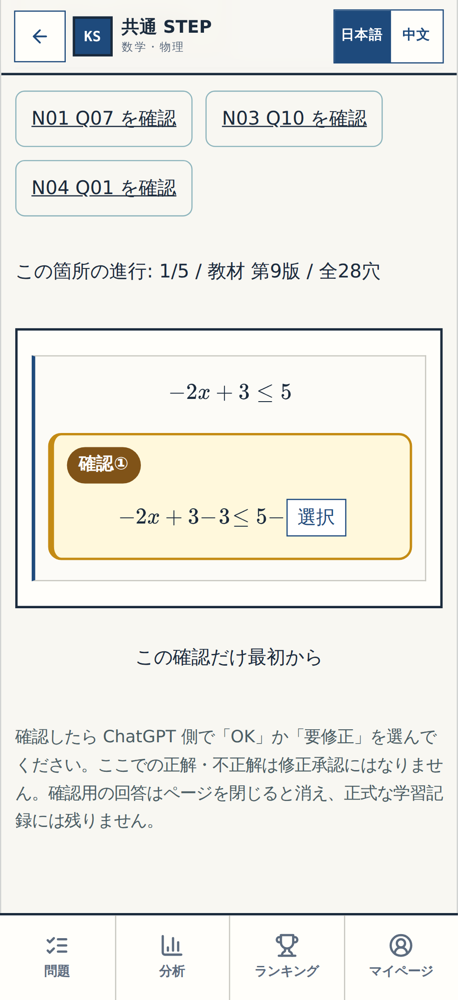

[320px](p007-review-step-1-resolved-320.png) ・ [PC1440px](p007-review-step-1-resolved-1440.png)

### Q08〜Q09 小操作 2

**before**

[320px](p007-review-step-2-before-320.png) ・ [PC1440px](p007-review-step-2-before-1440.png)

**wrong**

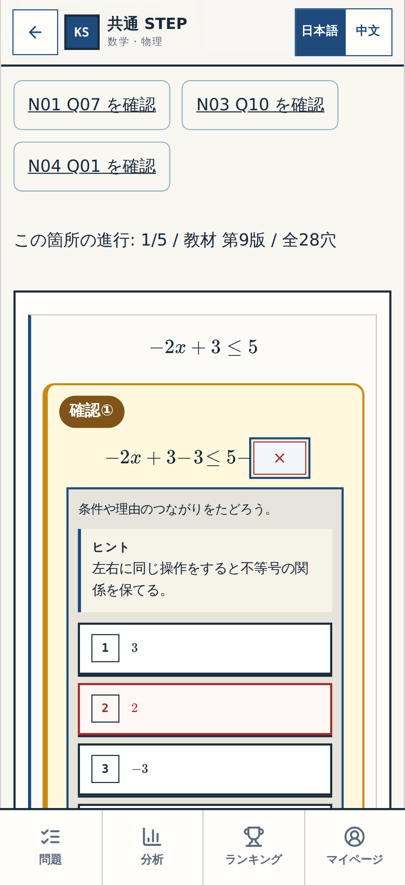

[320px](p007-review-step-2-wrong-320.png) ・ [PC1440px](p007-review-step-2-wrong-1440.png)

**resolved**

[320px](p007-review-step-2-resolved-320.png) ・ [PC1440px](p007-review-step-2-resolved-1440.png)

### Q08〜Q09 小操作 3

**before**

[320px](p007-review-step-3-before-320.png) ・ [PC1440px](p007-review-step-3-before-1440.png)

**wrong**

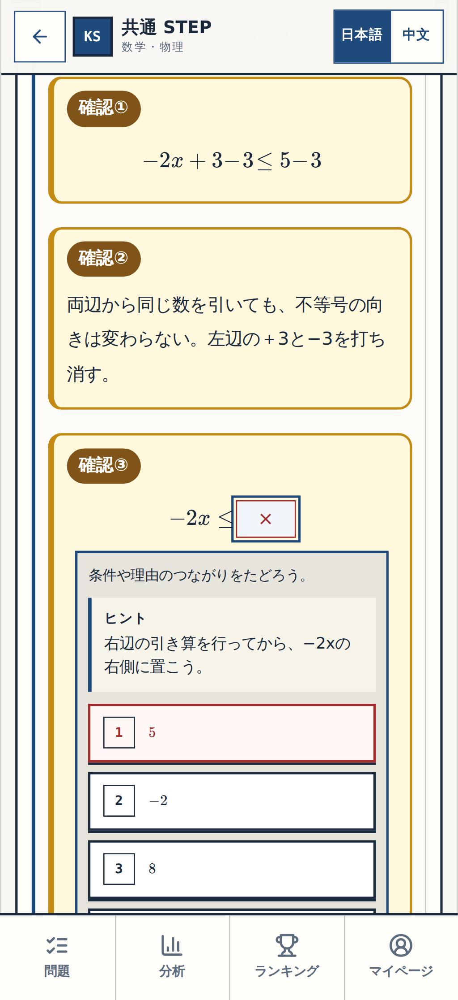

[320px](p007-review-step-3-wrong-320.png) ・ [PC1440px](p007-review-step-3-wrong-1440.png)

**resolved**

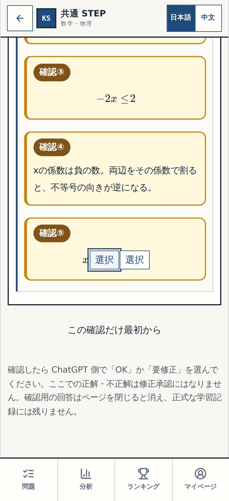

[320px](p007-review-step-3-resolved-320.png) ・ [PC1440px](p007-review-step-3-resolved-1440.png)

### Q08〜Q09 小操作 4

**before**

[320px](p007-review-step-4-before-320.png) ・ [PC1440px](p007-review-step-4-before-1440.png)

**wrong**

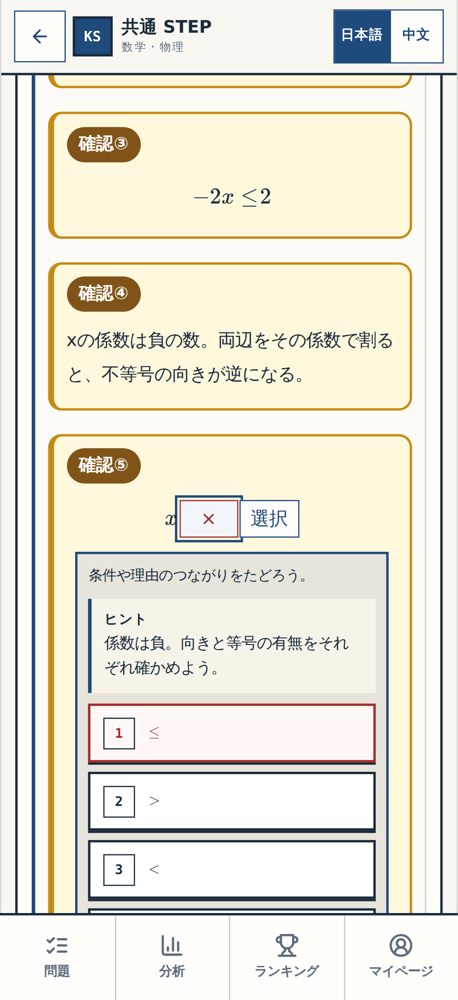

[320px](p007-review-step-4-wrong-320.png) ・ [PC1440px](p007-review-step-4-wrong-1440.png)

**resolved**

[320px](p007-review-step-4-resolved-320.png) ・ [PC1440px](p007-review-step-4-resolved-1440.png)

### Q08〜Q09 小操作 5

**before**

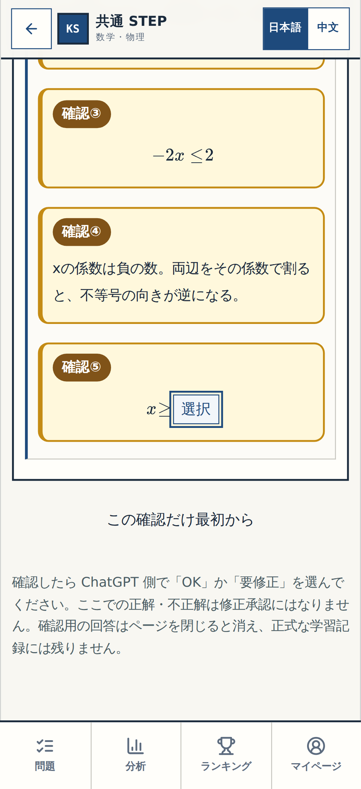

[320px](p007-review-step-5-before-320.png) ・ [PC1440px](p007-review-step-5-before-1440.png)

**wrong**

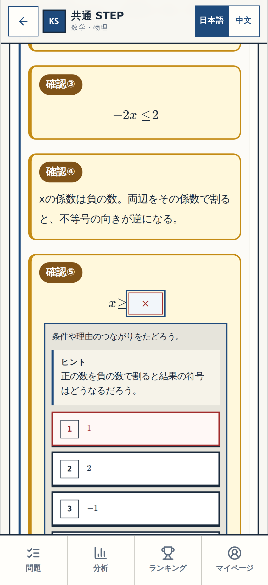

[320px](p007-review-step-5-wrong-320.png) ・ [PC1440px](p007-review-step-5-wrong-1440.png)

**resolved**

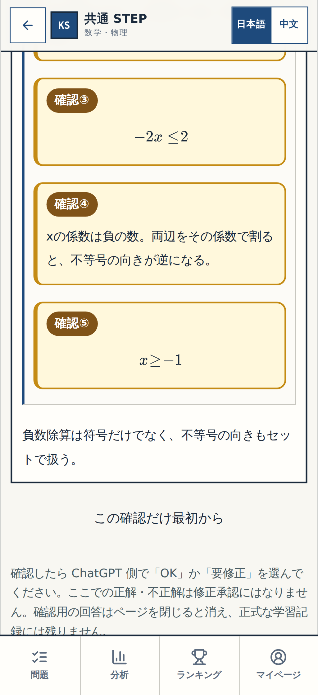

[320px](p007-review-step-5-resolved-320.png) ・ [PC1440px](p007-review-step-5-resolved-1440.png)

P-006 Q05〜Q06は既にBLOCK-VISUAL-OKであり再承認対象外。今回新たな対象はQ08・Q09のみ。Gate②・Gate③は別です。
