# W-MATH-017/P-008 — N11 Q13 実アプリ Gate①確認票

描画・操作した教材コードの完全SHA: \`62c1702fa41175bec3bb5dfa7b468e61dc5e80b4\`

実Chromiumで通常のN11をQ01から順に解いた画像と、Q13の新規4操作だけの確認画像（320/390/1440px）。モックではありません。

## 通常の学習画面：4行と2つの理由

### q13-mul-left-before

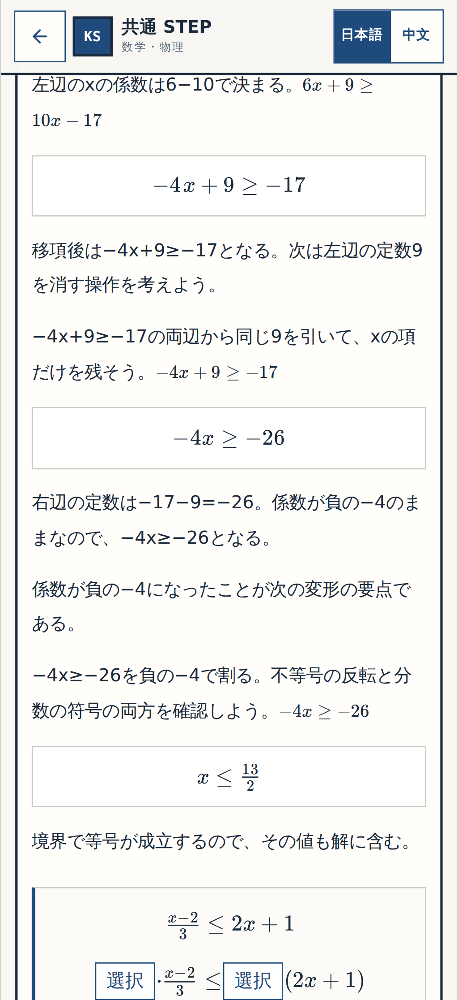

[320px](p008-normal-q13-mul-left-before-320.png) ・ [PC1440px](p008-normal-q13-mul-left-before-1440.png)

### q13-mul-right-before

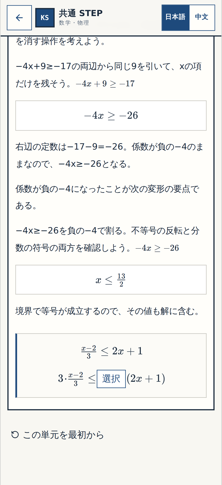

[320px](p008-normal-q13-mul-right-before-320.png) ・ [PC1440px](p008-normal-q13-mul-right-before-1440.png)

### q13-xcoef-before

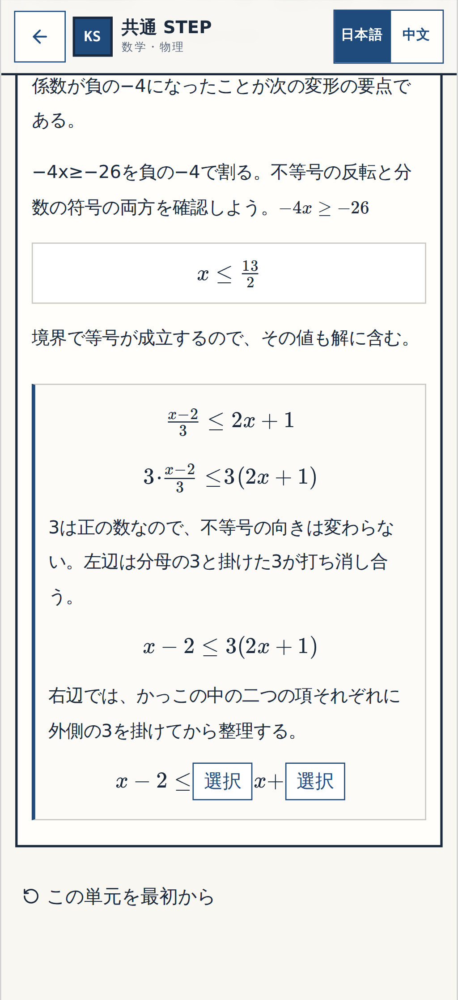

[320px](p008-normal-q13-xcoef-before-320.png) ・ [PC1440px](p008-normal-q13-xcoef-before-1440.png)

### q13-constant-before

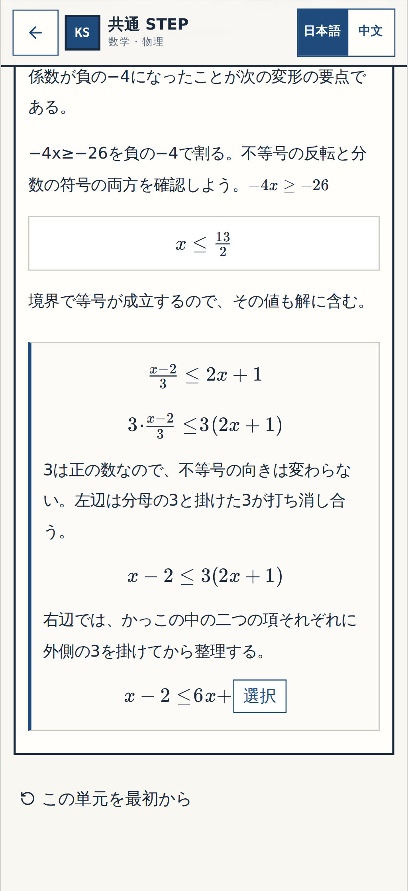

[320px](p008-normal-q13-constant-before-320.png) ・ [PC1440px](p008-normal-q13-constant-before-1440.png)

### q13-resolved

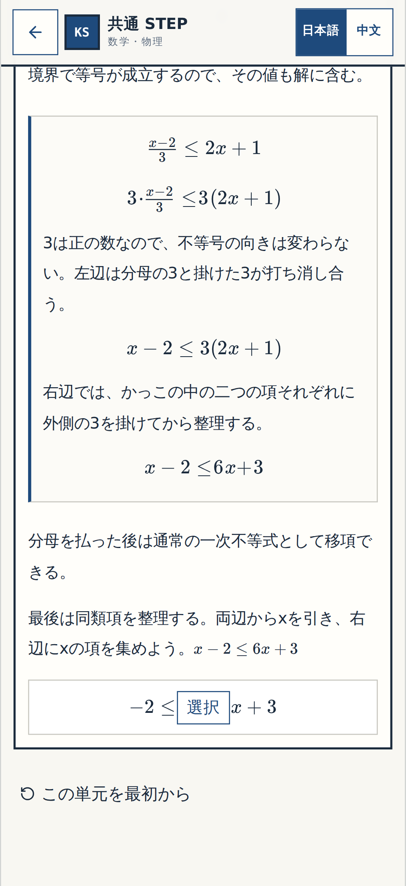

[320px](p008-normal-q13-resolved-320.png) ・ [PC1440px](p008-normal-q13-resolved-1440.png)

## 今回変更した箇所だけの番号付き確認

**確認①** 式の2行目に左右の倍率を選ぶ2つの穴（正解は3と3）。**確認②** 正の3倍と左辺の分母の消去を説明する文章。**確認③** 右辺の括弧を分配する理由を示す文章。**確認④** 最終行のxの係数6と定数3を求める2つの穴。

### 確認1

**before**

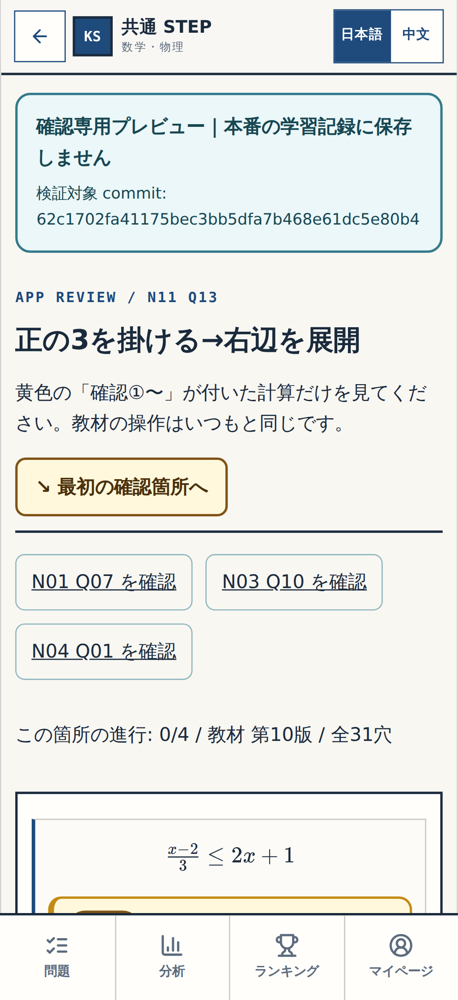

[320px](p008-review-step-1-before-320.png) ・ [PC1440px](p008-review-step-1-before-1440.png)

**wrong**

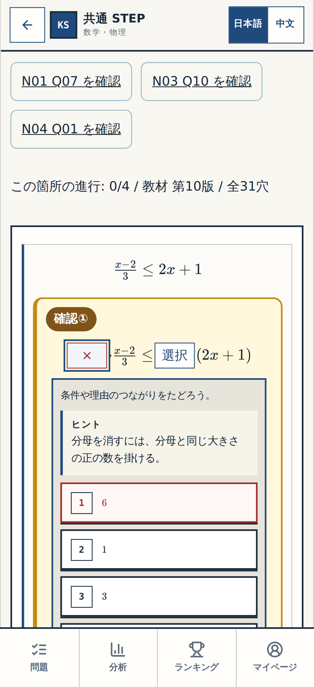

[320px](p008-review-step-1-wrong-320.png) ・ [PC1440px](p008-review-step-1-wrong-1440.png)

**resolved**

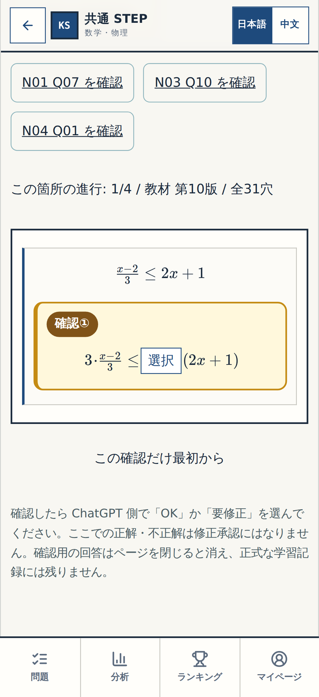

[320px](p008-review-step-1-resolved-320.png) ・ [PC1440px](p008-review-step-1-resolved-1440.png)

### 確認2

**before**

[320px](p008-review-step-2-before-320.png) ・ [PC1440px](p008-review-step-2-before-1440.png)

**wrong**

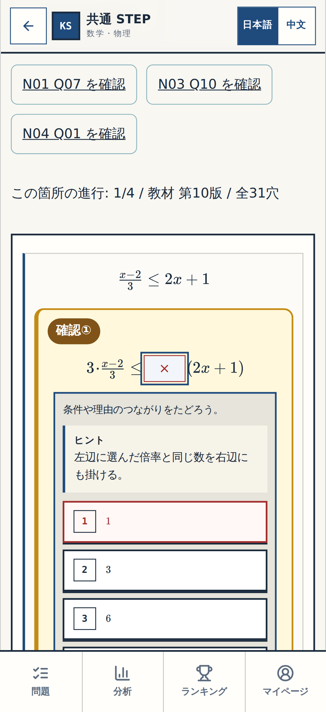

[320px](p008-review-step-2-wrong-320.png) ・ [PC1440px](p008-review-step-2-wrong-1440.png)

**resolved**

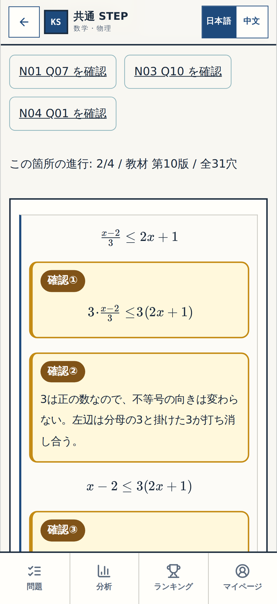

[320px](p008-review-step-2-resolved-320.png) ・ [PC1440px](p008-review-step-2-resolved-1440.png)

### 確認3

**before**

[320px](p008-review-step-3-before-320.png) ・ [PC1440px](p008-review-step-3-before-1440.png)

**wrong**

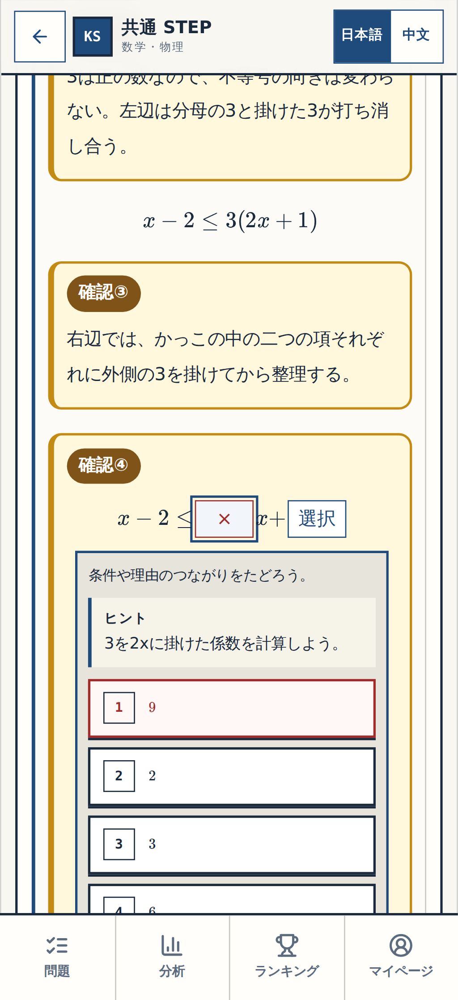

[320px](p008-review-step-3-wrong-320.png) ・ [PC1440px](p008-review-step-3-wrong-1440.png)

**resolved**

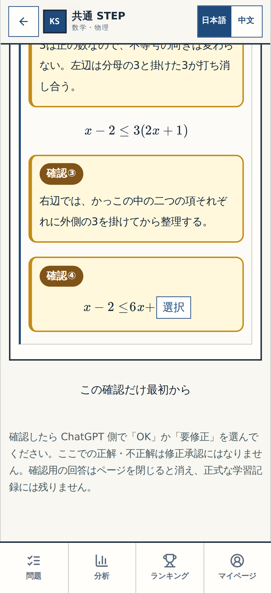

[320px](p008-review-step-3-resolved-320.png) ・ [PC1440px](p008-review-step-3-resolved-1440.png)

### 確認4

**before**

[320px](p008-review-step-4-before-320.png) ・ [PC1440px](p008-review-step-4-before-1440.png)

**wrong**

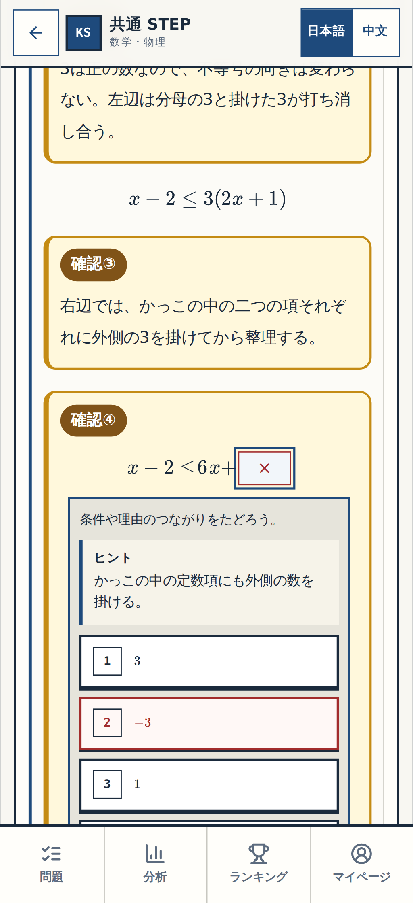

[320px](p008-review-step-4-wrong-320.png) ・ [PC1440px](p008-review-step-4-wrong-1440.png)

**resolved**

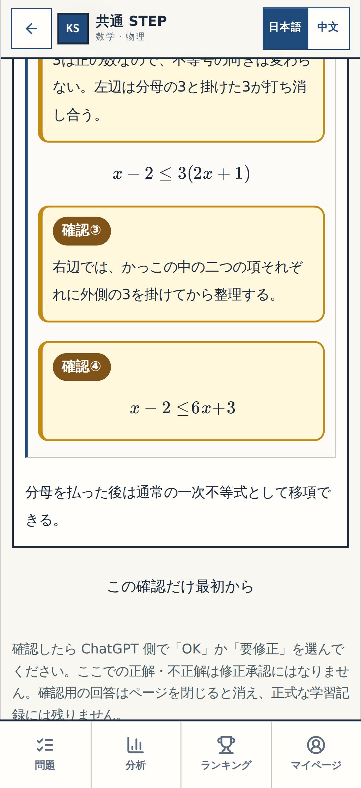

[320px](p008-review-step-4-resolved-320.png) ・ [PC1440px](p008-review-step-4-resolved-1440.png)

P-005/P-006 Q05〜Q06とP-007 Q08〜Q09は承認済み・非表示。今回の再承認対象外。今回対象はN11 Q13のみ。Gate②・Gate③は別。
