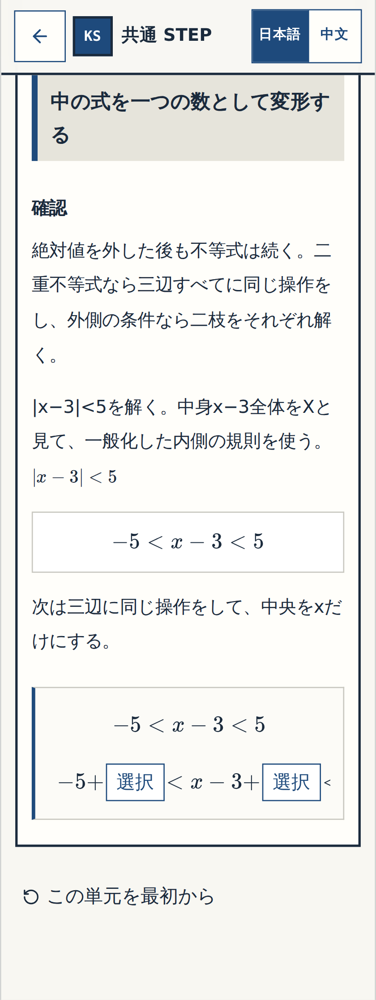
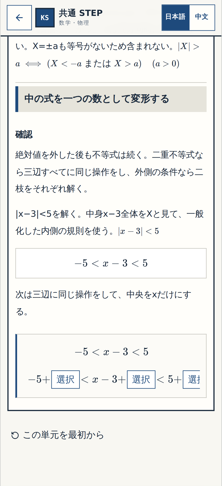
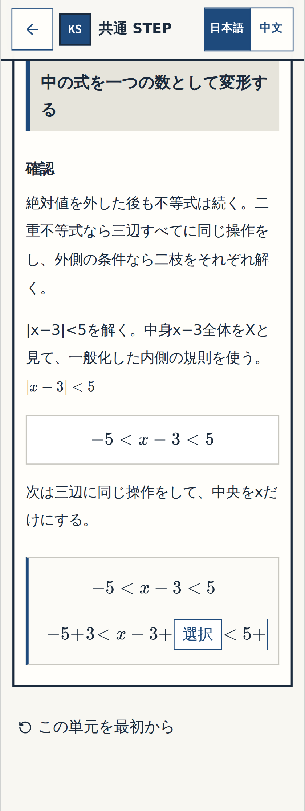
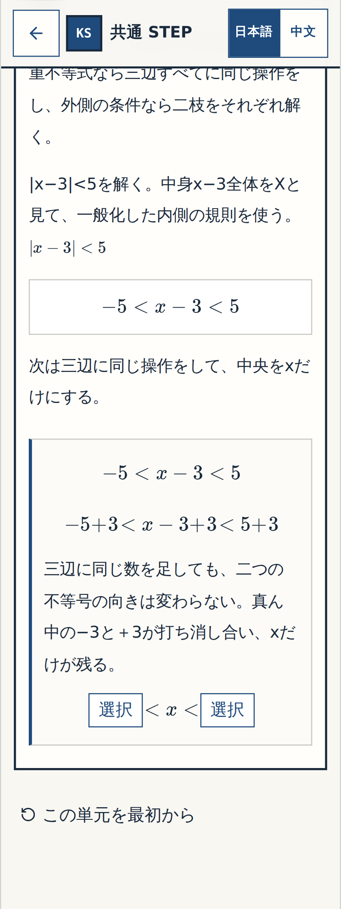

# W-MATH-018 / P-001 — 本物の320/390px教材画面で見つかった横方向の欠け
Status: NEEDS-FIX / Gate① NOT READY
Screenshot source exact SHA: `e1e913f2230c42175bc5e67a53e726d030752634`
Real Chromium capture [GitHub Actions #39629959612](https://github.com/rrikunagasige-dot/kyotsu-step-web/actions/runs/39629959612): SUCCESS for script execution / WRONG as pedagogical visual check
Screenshot-only bot commit: `06643939685a06f6d3c23046b3b85730a5cc4244`; full [real image album](evidence/p001-gate1/README.md)
Date observed: 2026-10-22 JST

## Confirmed real learner defect — do not seek user `細部OK` yet

320px **Q10 before the first answer**: the third operand `5+□` of
`-5+□ < x-3+□ < 5+□` is wholly outside the visible mathematical row.

390px before: final third “選択” is partly cut off at the right-hand edge.

320px after resolving left only: the third operand also remains hidden.

After all three operands are resolved, the compact numerals fit and the final equation with two holes is visible.

## Root cause and test blind spot
`src/styles/global.css`: `.reading-formula-line { overflow-x:auto; white-space:nowrap }`; `.reading-formula-expression { min-width:max-content; display:flex }`. Unanswered inline choice buttons display “選択” and occupy far more width than the mathematical answer numerals. The browser test checked **documentElement.scrollWidth vs clientWidth** but not the **formula row's own scrollWidth/clientWidth**, so it reported success even when inner overflow clipped part of a source step.

Not a mathematical error. The three equations and five graded values `3,3,3,-2,8`, original N14 16 Q markers, Q07/Q08/Q12, progress revision7 archive all remain valid. This is a local UI presentation defect in Q10, **not** an acceptance-worthy image.

## Consequences
- Gate① N14 Q10: NEEDS-FIX; no user acceptance request; evidence retained to test the repair.
- Gate②: NOT CROSS-VERIFIED; full Word OMML not yet verified; N14 Q14/Q15 still separately open.
- Gate③: FINAL-REVIEW-NOT-READY; no main merge or public candidate app.
- New [P-002 exact responsive-display proposal](./PROPOSAL_P002_MOBILE_INLINE_HOLES.md) requires explicit approval before modifying CSS, given P-001's explicit “reapprove material layout change” boundary.
- Full Math CI 39629959584 also failed for **three already-approved Q07/Q08/Q12 E2E scripts on both widths** due obsolete revision6 assertion; reviewed and corrected only their revision and Q12 item offsets in commit `0b63f8a1fc9b6d70d8ce6c0f90732345d431e8a9`. Preserve all old learner content and tests for previous progress migrations.
