# W-MATH-018/P-002 — N14 Q10 スマホ横切れ修正・実アプリ細部確認

描画した実教材コードの完全SHA: 857127cba2351054a1070b65b10cda2a56d64209

GitHub Actions Chromiumで実画面操作。320/390pxでは第2式の内側scrollWidth、全ての未回答穴の表示領域、幅と高さ、誤答後の↻も検査。1440pxは従来表示を保つ。図面やモックではありません。

## 通常の学習画面（確認用の黄色い枠なし）

### left-before

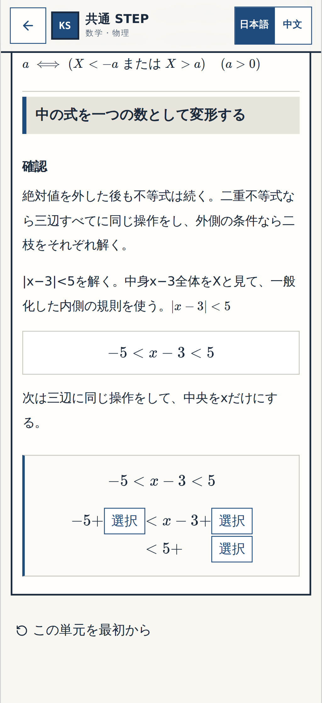

[320px](p002-normal-left-before-320.png) ・ [PC1440px](p002-normal-left-before-1440.png)

### addition-2-before

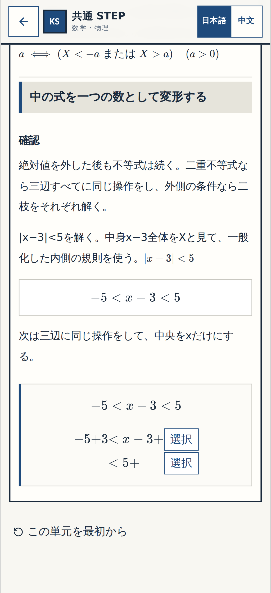

[320px](p002-normal-addition-2-before-320.png) ・ [PC1440px](p002-normal-addition-2-before-1440.png)

### addition-3-before

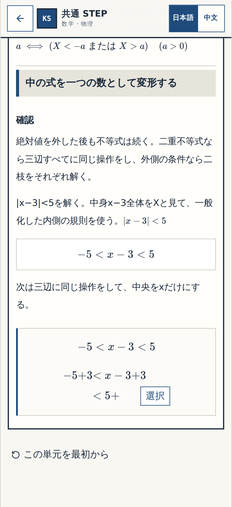

[320px](p002-normal-addition-3-before-320.png) ・ [PC1440px](p002-normal-addition-3-before-1440.png)

### left-bound-before

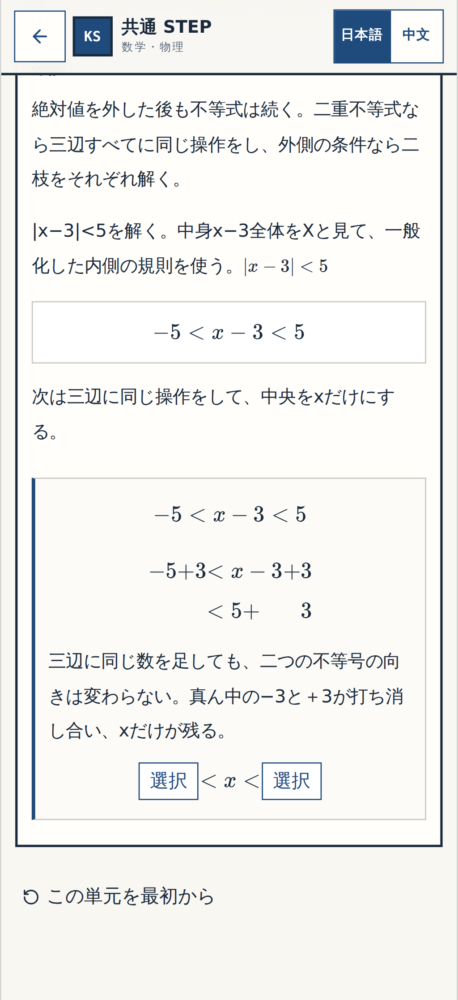

[320px](p002-normal-left-bound-before-320.png) ・ [PC1440px](p002-normal-left-bound-before-1440.png)

### right-bound-before

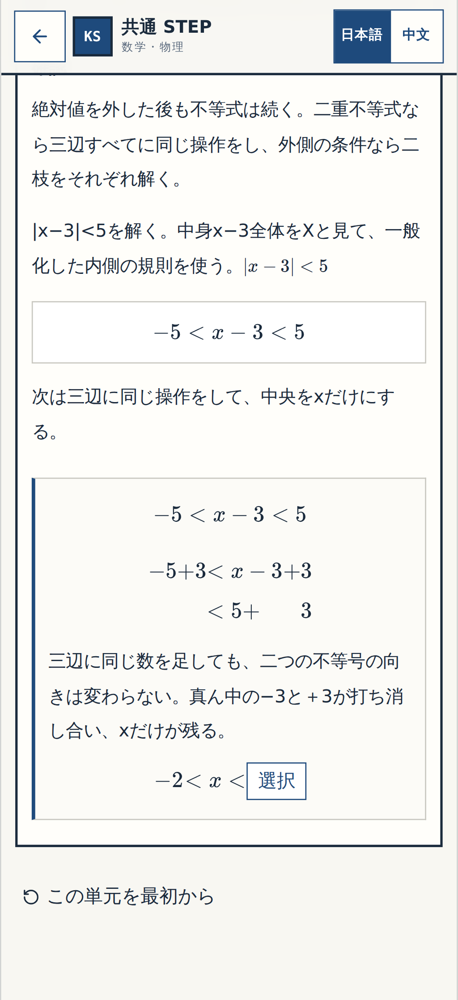

[320px](p002-normal-right-bound-before-320.png) ・ [PC1440px](p002-normal-right-bound-before-1440.png)

### final

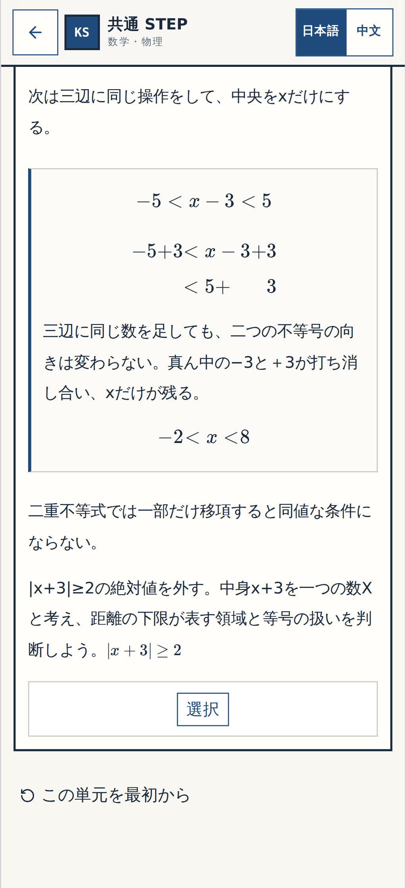

[320px](p002-normal-final-320.png) ・ [PC1440px](p002-normal-final-1440.png)

## 今回だけの変更箇所・確認①〜③

**確認①：** 三辺に同じ数を足す第2式の中に3つの穴が並ぶ。

**確認②：** 三辺に同じ数を足す理由は第2式を解いた後、第3式の前に出る。

**確認③：** 最終行の左端と右端は、それぞれ独立した数値穴になる。

### 解答小操作 1

**before**

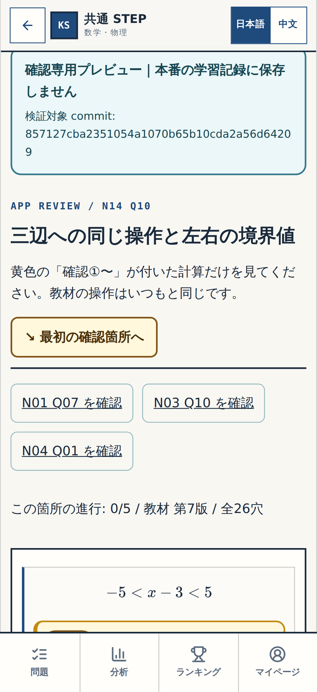

[320px](p002-review-1-before-320.png) ・ [PC1440px](p002-review-1-before-1440.png)

**wrong**

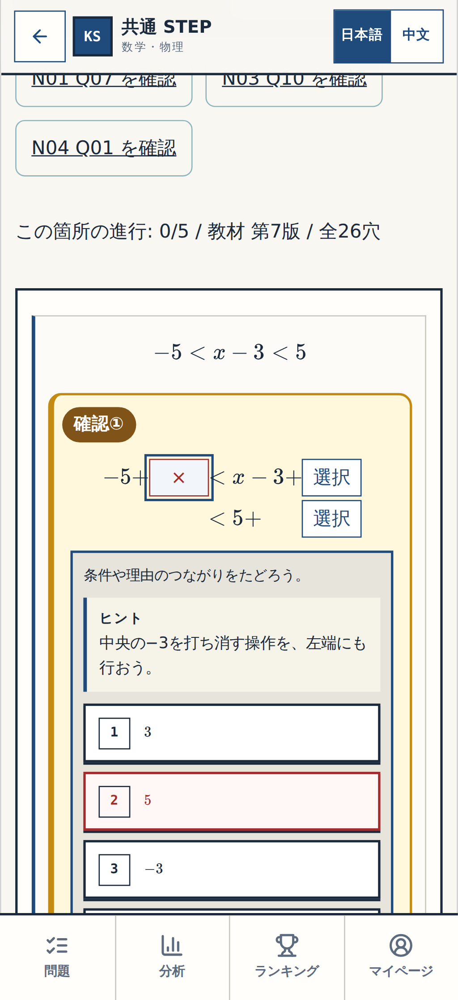

[320px](p002-review-1-wrong-320.png) ・ [PC1440px](p002-review-1-wrong-1440.png)

**resolved**

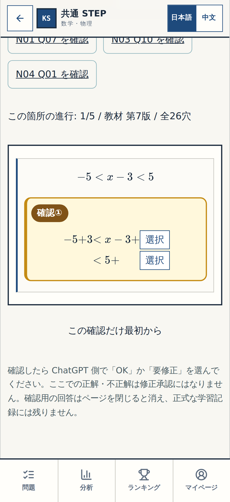

[320px](p002-review-1-resolved-320.png) ・ [PC1440px](p002-review-1-resolved-1440.png)

### 解答小操作 2

**before**

[320px](p002-review-2-before-320.png) ・ [PC1440px](p002-review-2-before-1440.png)

**wrong**

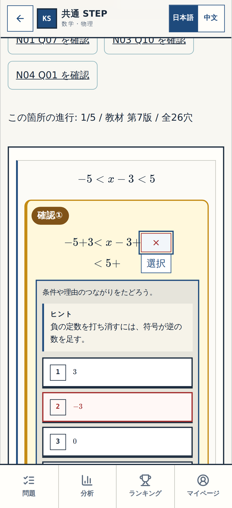

[320px](p002-review-2-wrong-320.png) ・ [PC1440px](p002-review-2-wrong-1440.png)

**resolved**

[320px](p002-review-2-resolved-320.png) ・ [PC1440px](p002-review-2-resolved-1440.png)

### 解答小操作 3

**before**

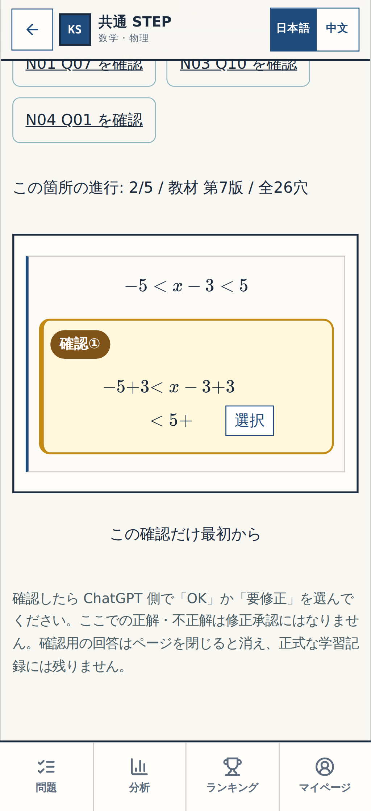

[320px](p002-review-3-before-320.png) ・ [PC1440px](p002-review-3-before-1440.png)

**wrong**

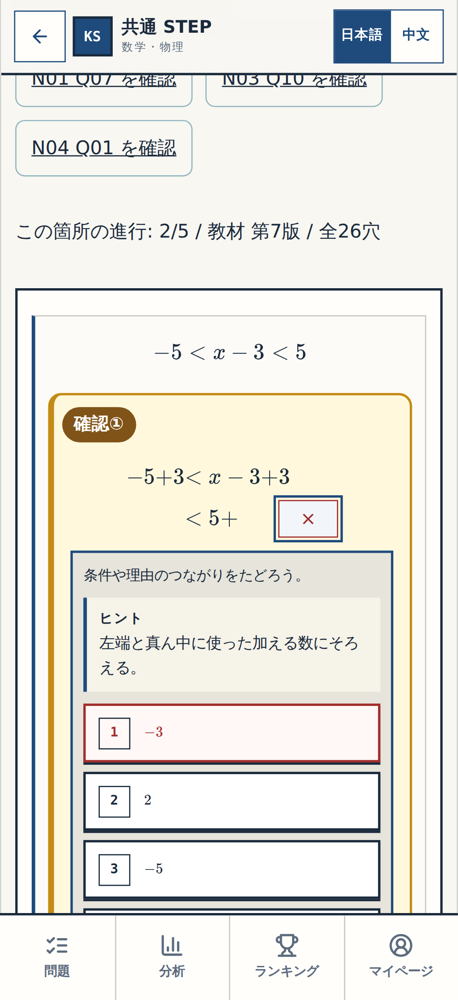

[320px](p002-review-3-wrong-320.png) ・ [PC1440px](p002-review-3-wrong-1440.png)

**resolved**

[320px](p002-review-3-resolved-320.png) ・ [PC1440px](p002-review-3-resolved-1440.png)

### 解答小操作 4

**before**

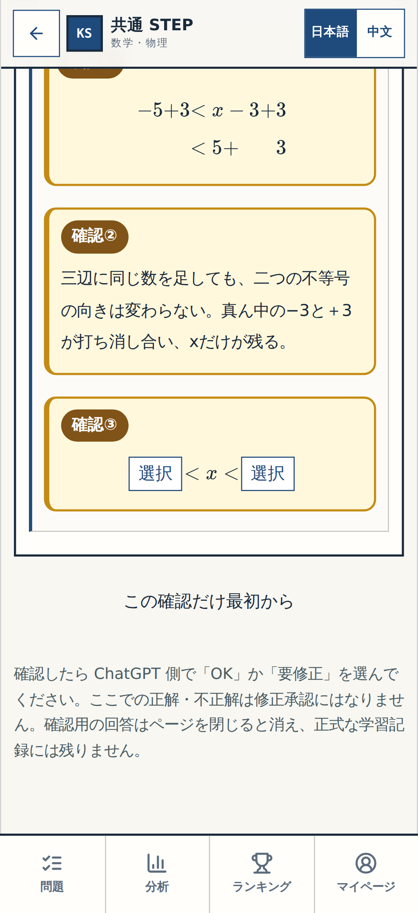

[320px](p002-review-4-before-320.png) ・ [PC1440px](p002-review-4-before-1440.png)

**wrong**

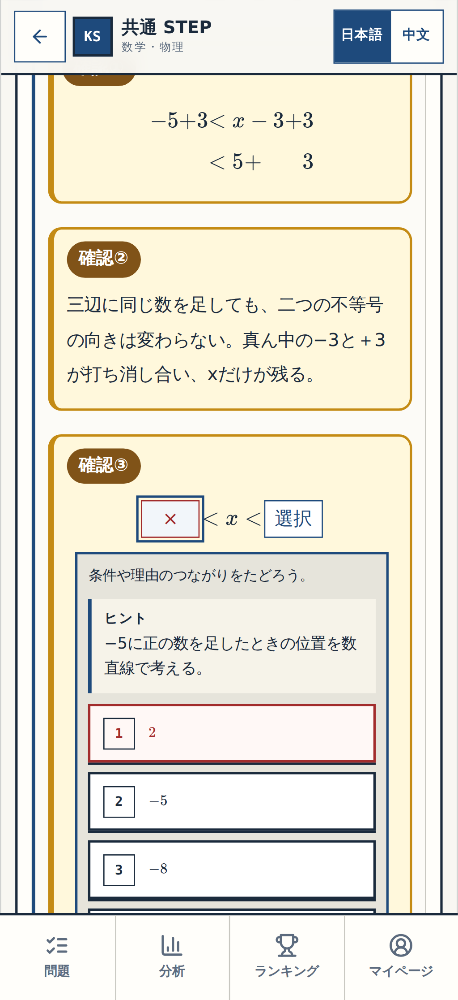

[320px](p002-review-4-wrong-320.png) ・ [PC1440px](p002-review-4-wrong-1440.png)

**resolved**

[320px](p002-review-4-resolved-320.png) ・ [PC1440px](p002-review-4-resolved-1440.png)

### 解答小操作 5

**before**

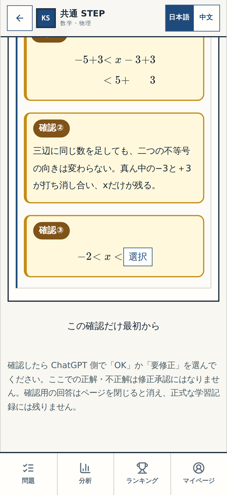

[320px](p002-review-5-before-320.png) ・ [PC1440px](p002-review-5-before-1440.png)

**wrong**

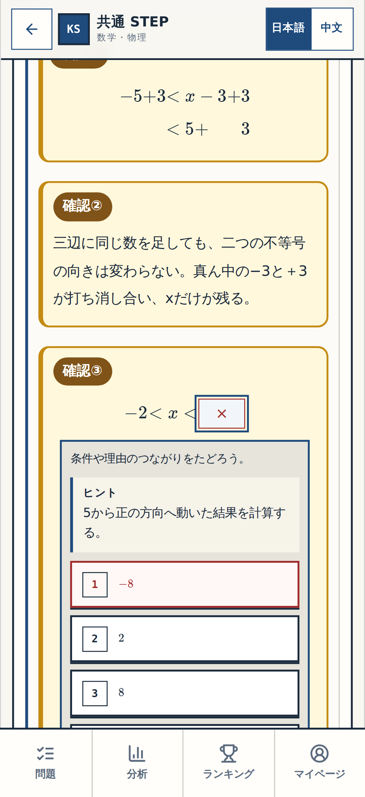

[320px](p002-review-5-wrong-320.png) ・ [PC1440px](p002-review-5-wrong-1440.png)

**resolved**

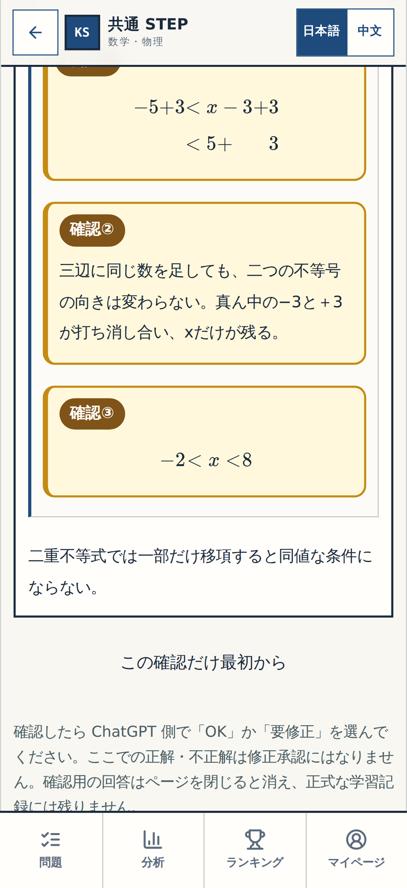

[320px](p002-review-5-resolved-320.png) ・ [PC1440px](p002-review-5-resolved-1440.png)

N14 Q07/Q08/Q12とN11 P006/P007/P008は既に細部承認済み。今回の確認はN14 Q10のみであり、Gate②横断監査とGate③全体総チェックとは別です。
