# N14 Q14 genuine Chromium images; not synthetic

Operated source code SHA: ba6eeb32c94be79230a414ce6aa8688ce05d5fcd

320px, 390px, 1440px real normal + numbered review screens. Gate1 visual user acceptance PENDING; Gate2 and Gate3 not approved.

## 320px

**review-before**

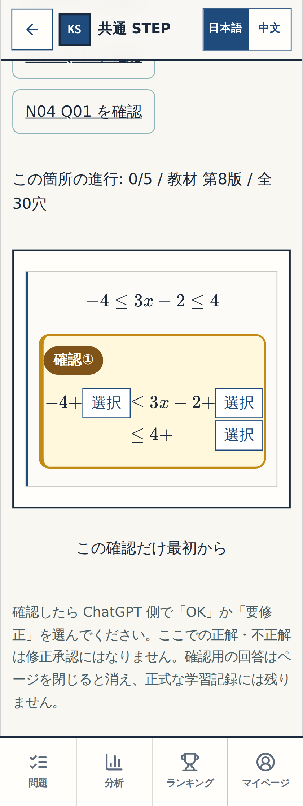

**review-wrong**

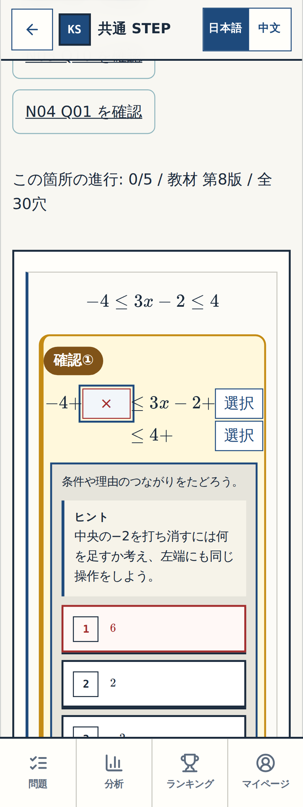

**review-bounds**

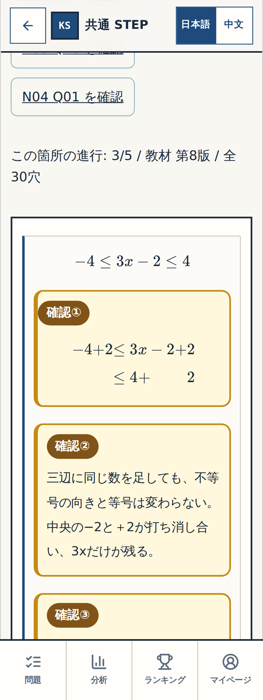

**normal-before**

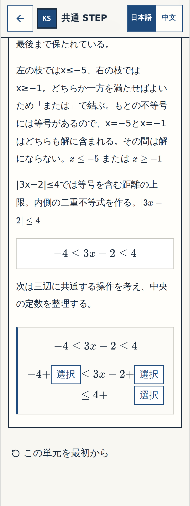

**normal-bounds**

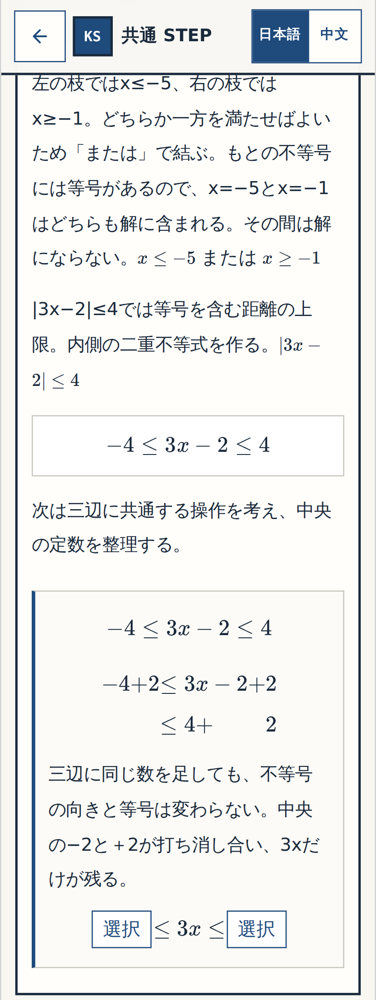

## 390px

**review-before**

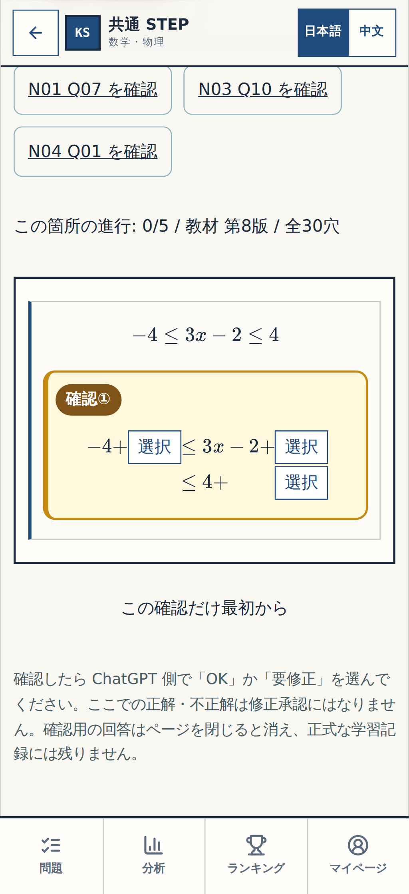

**review-wrong**

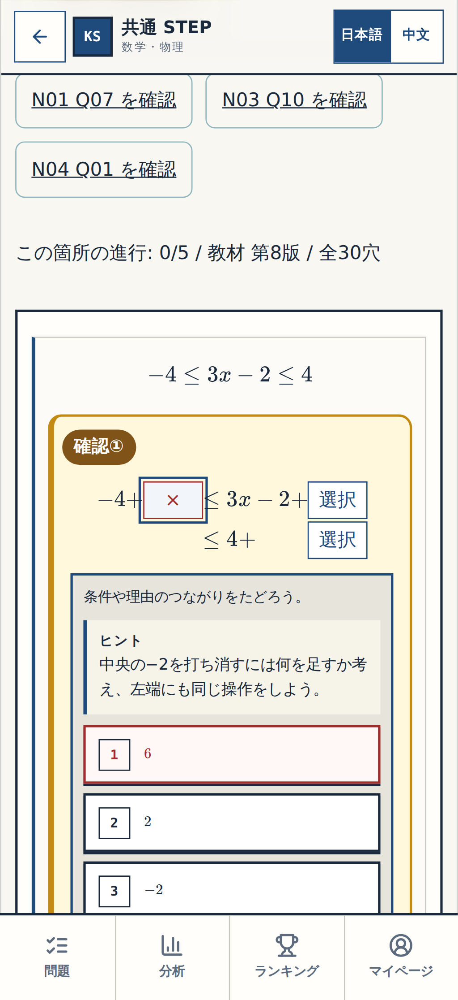

**review-bounds**

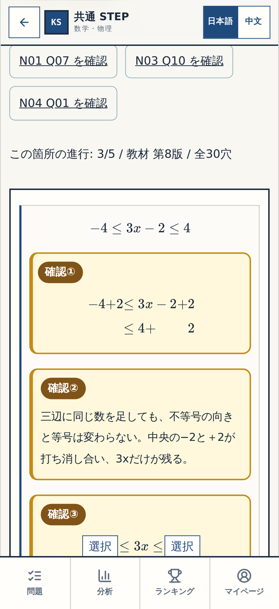

**normal-before**

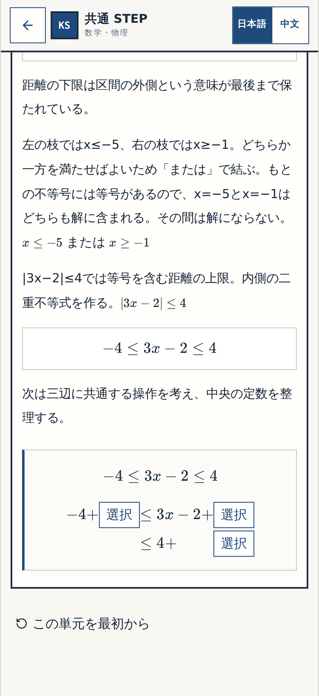

**normal-bounds**

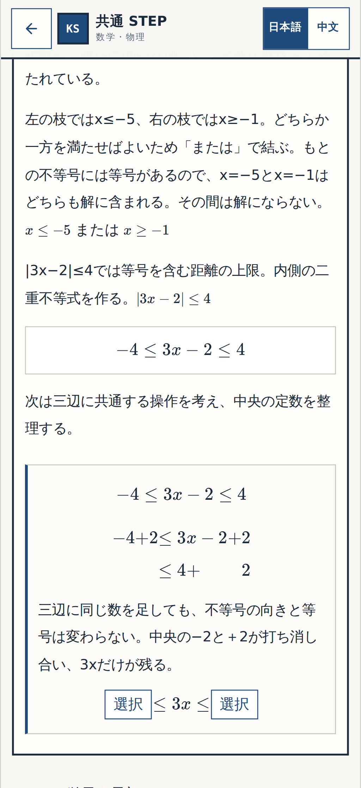

## 1440px

**review-before**

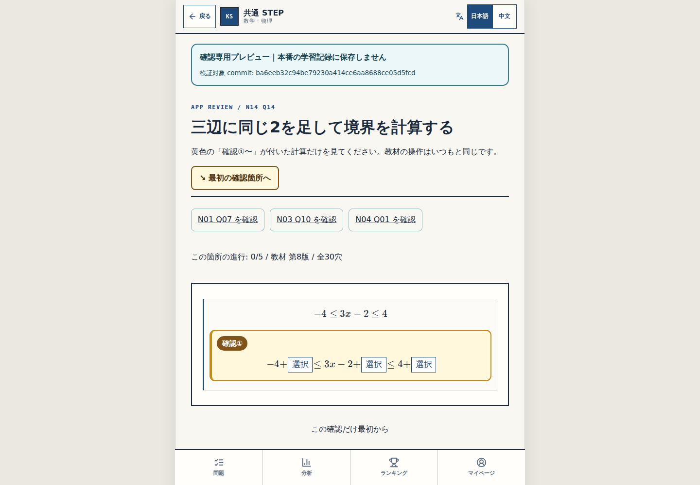

**review-wrong**

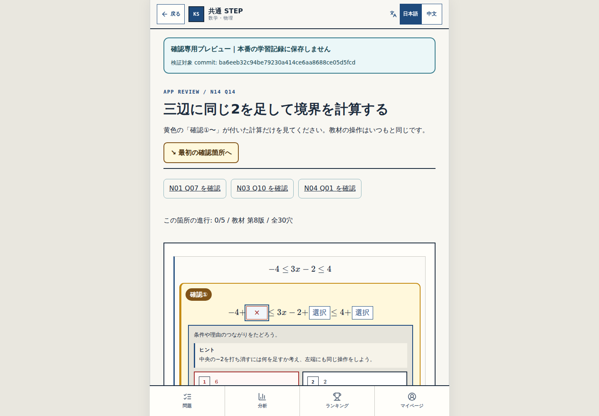

**review-bounds**

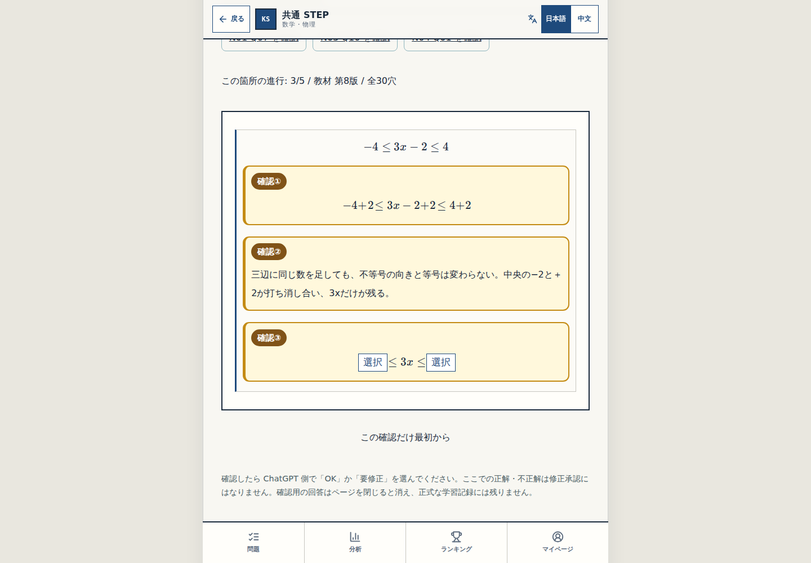

**normal-before**

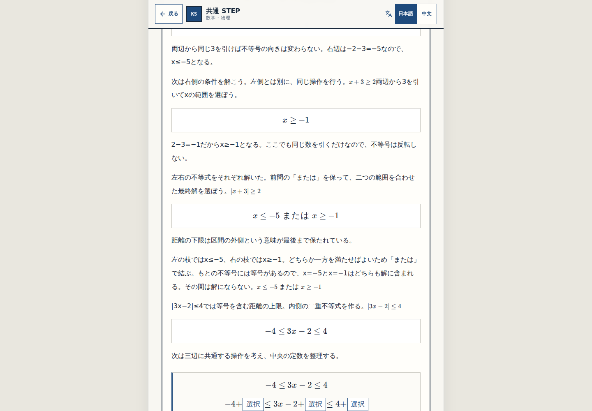

**normal-bounds**

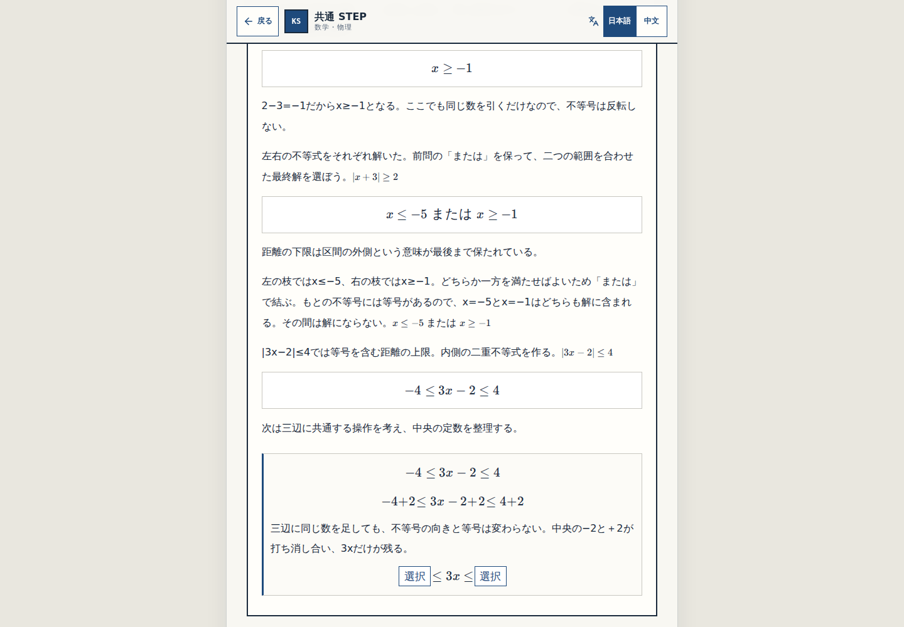

User requested only concise math layout in the ChatGPT conversation; retain actual images as reproducible technical proof.
