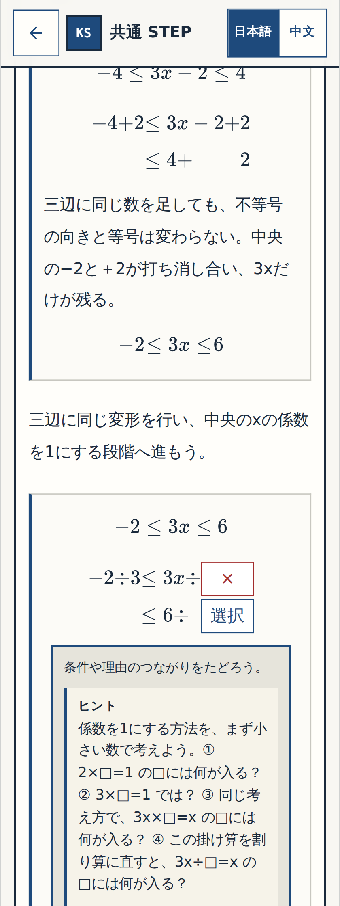
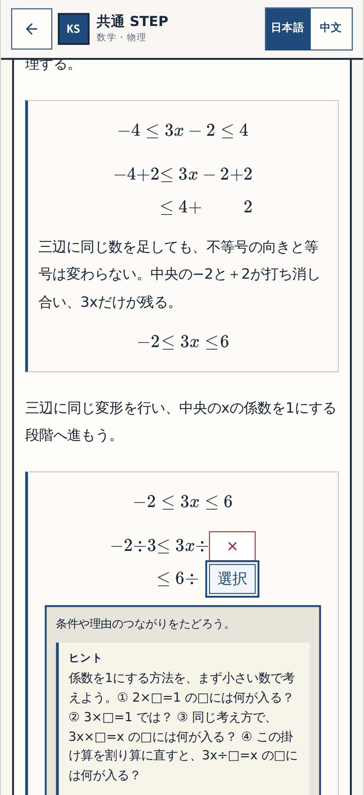
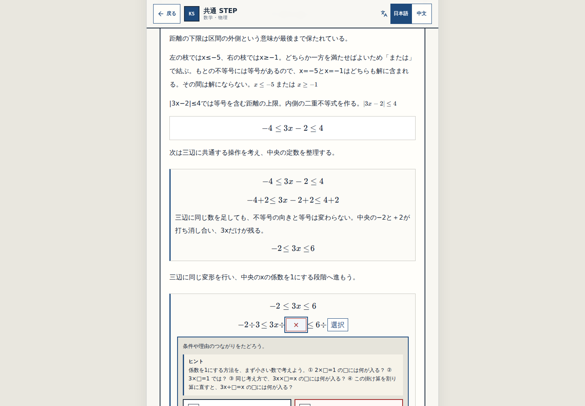

# W-MATH-021 — real after-wrong Q15 center hint (not the accepted math review)

**Real operated app code SHA:** 0718c4fcb06740ee52a5fdb8ac321f77c32ded2c

P-003 four-step hint: 係数を1にする方法を、まず小さい数で考えよう。① 2×□=1 の□には何が入る？ ② 3×□=1 では？ ③ 同じ考え方で、3x×□=x の□には何が入る？ ④ この掛け算を割り算に直すと、3x÷□=x の□には何が入る？

Original Q15 mathematical Gate① acceptance and answer/progress keys remain unchanged. These images only show the revised wrong-hint state, captured by Playwright in the actual app. User visual approval of changed hint remains separate; Gate② overall/③ pending.

## 320px

## 390px

## 1440px

