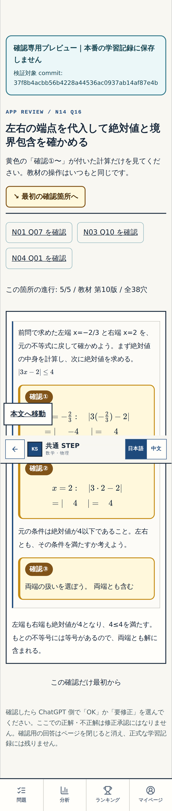

# N14 Q16 — GitHub 実画面・細部確認票（W-GOV-008/P-003）

Review: W-MATH-022 / exact approved P-001
Status: BLOCK-CHECK-PENDING（ユーザー細部確認待ち）
Block: N14-Q16; q16-chain; stable IDs `n14-wm022-q16-left-inner`, `n14-wm022-q16-left-abs`, `n14-wm022-q16-right-inner`, `n14-wm022-q16-right-abs`, `n14-16`.
**現在表示される実画像の正確な撮影SHA:** `81d9f2f9234f471261f6197498100c77db6d703d`
**全CIが成功した教材コードSHA:** `e64fd99b18ba167364c2dd6b108a6f7fef76f439`（撮影SHAとの差分は記録文書・画像のみ。教材コードは同一）。
Initial evidence bot commit: `f5b15694740325b56077fe64d740c7a7dc8fb22e`; later **recapture** after documentation-only commit generated images now on this branch (image provenance source `81d9f2f9234f471261f6197498100c77db6d703d`). Frozen learner source is unchanged; do not confuse the image capture with the earlier initial run.
Source: Teacher-original Word N14 Q16 (handoff ZIP 2026-10-22); app `src/data/textbook/math/numbers/n14Lesson.ts` revision10.
Route: review-only `/#/review/n14-q16` under GitHub Actions preview build; not a public playable URL.
Unchanged: Q10/Q14/Q15 previously accepted math/choices; Q15 P-003 four-question wrong hint; N14 original figure; 16 original source questions; other modes.
Current visible image capture: GitHub Actions [#39766059734](https://github.com/rrikunagasige-dot/kyotsu-step-web/actions/runs/39766059734), **SUCCESS**, exact image-source SHA `81d9f2f9234f471261f6197498100c77db6d703d`, 320/390/1440 real Chromium. Original source QA: [#39752264290](https://github.com/rrikunagasige-dot/kyotsu-step-web/actions/runs/39752264290), **SUCCESS** at `e64fd99b18ba167364c2dd6b108a6f7fef76f439`.
Review history: [WORK](./WORK.md), [ACTION_LOG](./ACTION_LOG.md), [VERIFICATION](./VERIFICATION.md).

## ユーザーに見せる部分

**今回ここだけ確認：N14 Q16**。左端・右端をそれぞれ代入し、絶対値の計算と、両端を含むかの判断を一続きにしました。

- **確認①（左端）** 左端を代入し、中身と絶対値を別々の選択で埋められる。
- **確認②（右端）** 同じ順で右端を計算でき、320pxでも代入式とボタンが欠けずに見える。
- **確認③（結論）** 二つの結果を比べ、最後に「両端とも含む」を自分で判断できる。

[320px の誤答後ヒント実画像](evidence/gate1/q16-review-wrong-320.png) ／ [320px 学習途中](evidence/gate1/q16-normal-before-320.png) ／ [1440px 完成](evidence/gate1/q16-review-complete-1440.png)

**返信：** `細部OK` または `要修正：確認②の〇〇`。

`細部OK` はGate①の視覚確認のみです。横断Gate②・アプリ全体Gate③の `総チェックOK`、main統合・公開・課金許可にはなりません。

## Agent-only readiness

- [x] Source authority, math, five item IDs/answers and Q15 prerequisites recorded.
- [x] Authentic 15 screenshots re-captured by GitHub 320/390/1440 browser check at stated **image capture SHA 81d9f2**; initial Q16 code SHA e64fd99 passed full CI independently.
- [x] GitHub images exist; e64fd99→81d9 source compare includes documentation/evidence-only changes, not learner code.
- [x] Previously accepted marks Q10/Q14/Q15 remain hidden, Q16 has 3 numbered change markers.
- [x] Reviewer sees just 3 concise visual decisions and unchanged boundaries.
- [ ] User exact visual acceptance, response time, confirmed SHA and screenshot path to record.
- [ ] Gate② independent entire affected cross-audit.
- [ ] Gate③ verified executable entire-app SHA URL and explicit end-to-end user acceptance.
