# N14 Q16 実アプリレビュー・確認①〜③

実際に操作した教材コード SHA: e64fd99b18ba167364c2dd6b108a6f7fef76f439

実Chrome 320/390/1440px、通常学習とレビュー確認、誤答後ヒント・再回答。模造画面ではありません。

## 320px

**review-before**

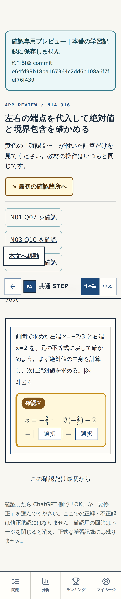

**review-wrong**

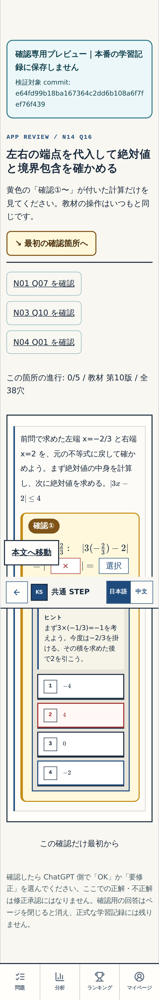

**review-complete**

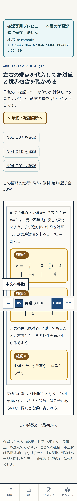

**normal-before**

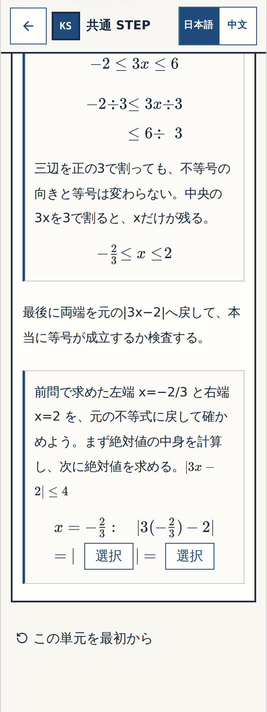

**normal-complete**

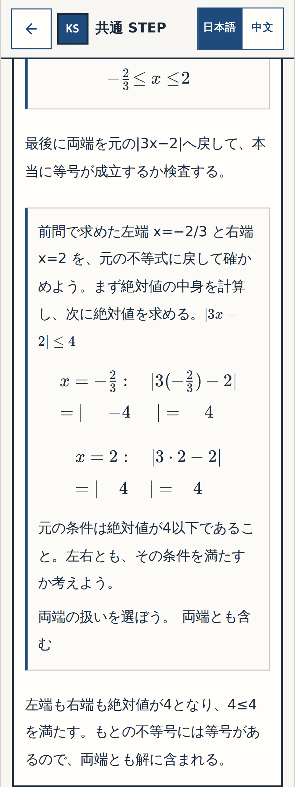

## 390px

**review-before**

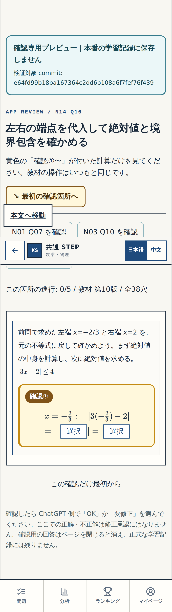

**review-wrong**

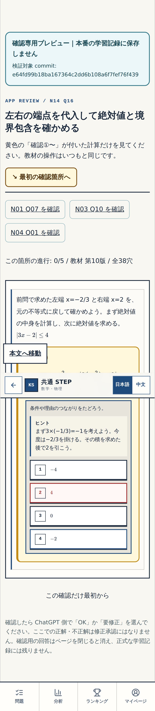

**review-complete**

**normal-before**

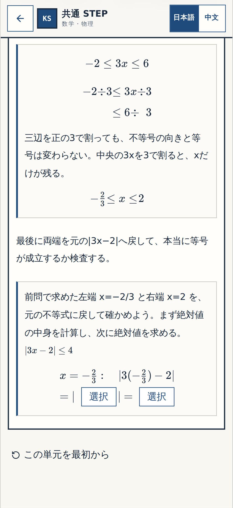

**normal-complete**

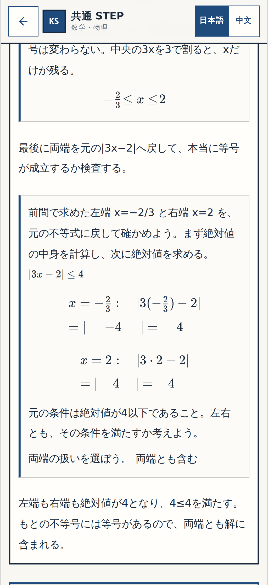

## 1440px

**review-before**

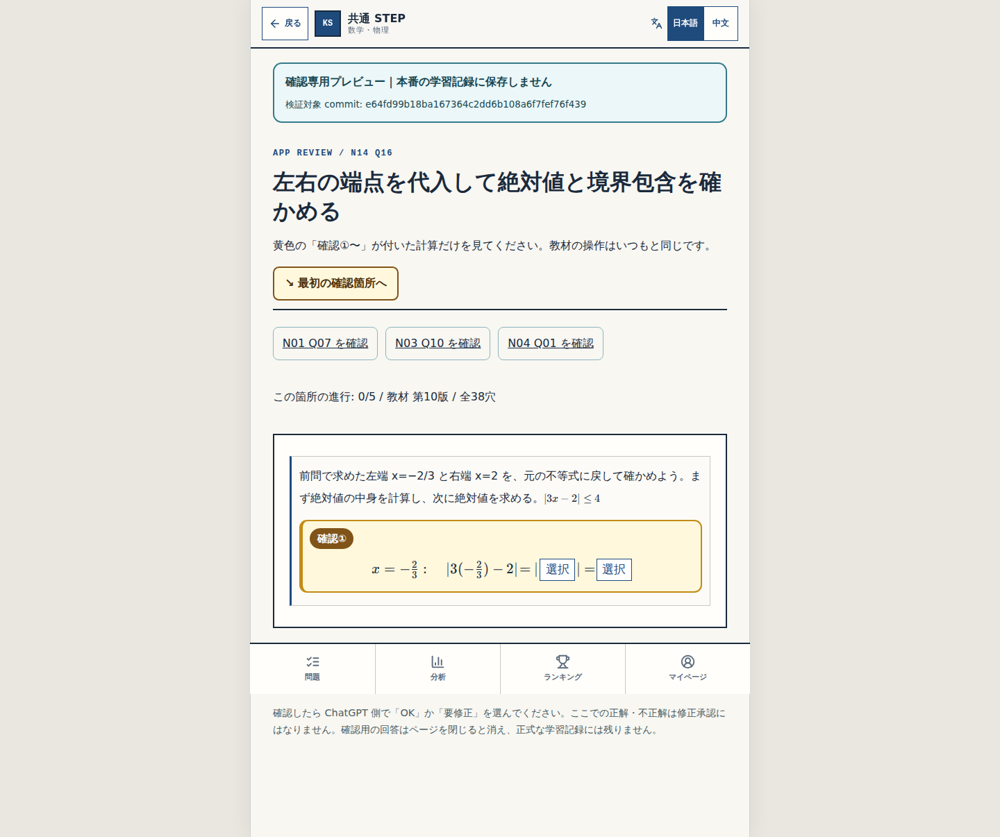

**review-wrong**

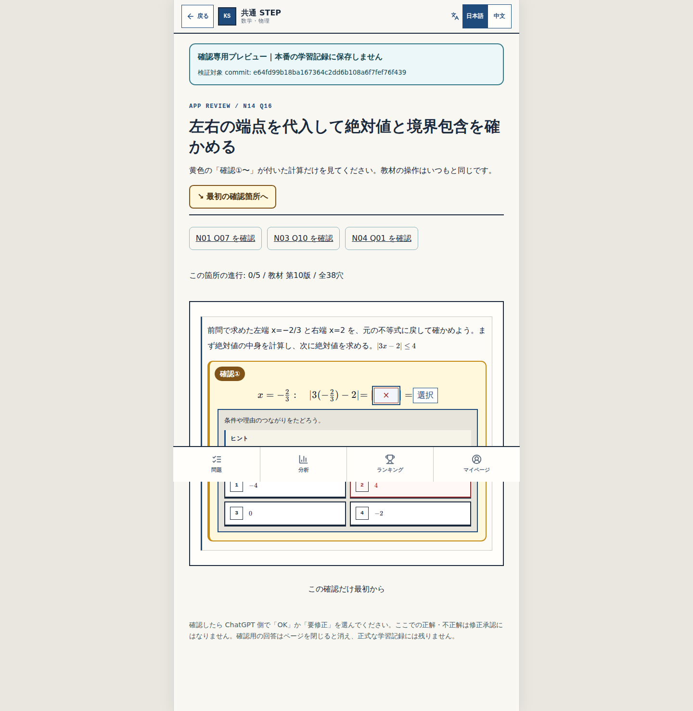

**review-complete**

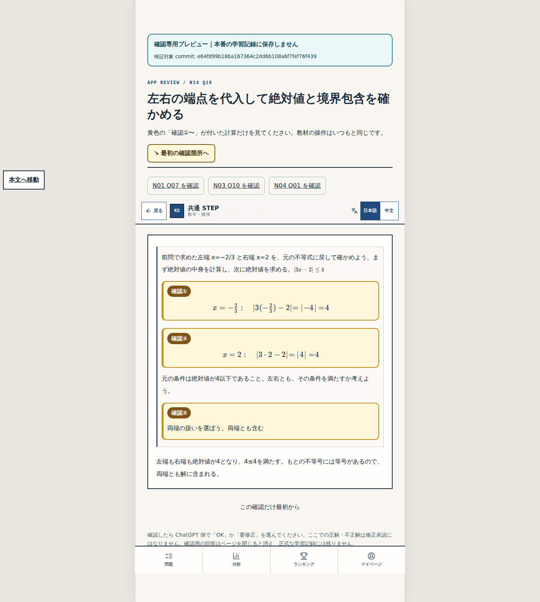

**normal-before**

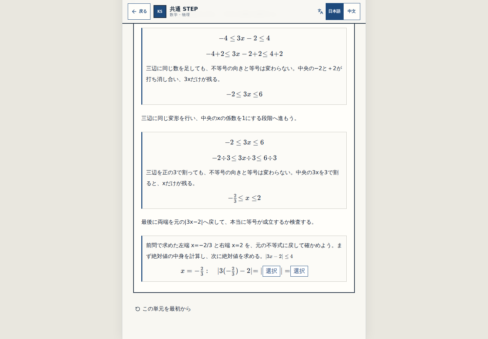

**normal-complete**

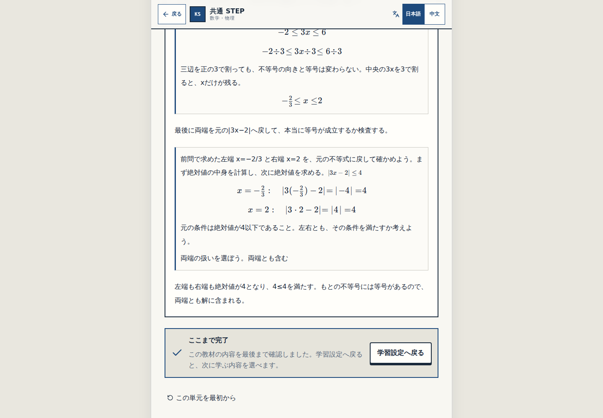

細部確認はユーザー待ち。Gate②とGate③、main統合・公開は別の未完了作業。
