# Reconciled accepted Q16 — native viewport evidence
Status: VERIFYING
Real operated source SHA: fc27e7f5fbdc28345917276d43602ea4787537bd
Source PR: https://github.com/rrikunagasige-dot/kyotsu-step-web/pull/119

These are15 unmodified native Chromium PNGs, not mockups. All five items including Q16 were already accepted; no repeat human Gate① requested. Source and image branch are separate so evidence storage does not cancel the frozen source's running full regression.

Native Review run39905633261 SUCCESS: review check41 tests passed; Q16 capture job120256818263 six browser cases passed/six project-width matrix skips. The six cases are normal/review at320/390/1440. Each preview case verifies wrong→hint→retry, all five decisions, zero accepted markers, zero KaTeX errors and unchanged learner localStorage. Normal cases solve all38 decisions and check completion. Artifact12480756171 ZIP SHA256 d1014c0c375740a65eea504eef2a7d4eba786aedb43125b54faa3c7fe83f0e73 matched local download. Math practice pilot39905633309 SUCCESS. Governance39905633270 SUCCESS. Full Math39905633260 RUNNING at image archival; not a claimed PASS.

Direct visual inspection: q16-review-wrong-320, q16-review-complete-390 and q16-normal-complete-1440. Japanese readable, Q16 math and wrong-state hint present, accepted markers absent. The390 complete viewport shows both endpoint substitutions, absolute values and inclusion together without the old full-page fixed-header overlay. The320 wrong viewport intentionally scrolls in the long choice panel; it is not evidence that every choice fits simultaneously. Original accepted full-page evidence remains unchanged on its original commit.

| File | SHA256 |
|---|---|
| [q16-review-before-320.png](q16-review-before-320.png) | d0b82489667869357e145ebac54b24e6fbe6d54a61e5e48b1590c465d616957c |
| [q16-review-wrong-390.png](q16-review-wrong-390.png) | bafa2c213b788ab2ba5ffee511e1e8fa5e40342bb3b683e2324e7596097c92a6 |
| [q16-normal-before-320.png](q16-normal-before-320.png) | 92e22e16b32498cc2f85c8f87420b27f121ff07a0c5fb2a7153f7c3dd9387f4a |
| [q16-normal-complete-390.png](q16-normal-complete-390.png) | 7b61b0c4d6c358fb99cb523f8e8f2aee2f3f23b855da983810d0d2d385f9bb89 |
| [q16-review-complete-390.png](q16-review-complete-390.png) | 97523811cc95926d64d926d2a98691b3ae42966f148d30595f34ae924425a1b8 |
| [q16-normal-before-390.png](q16-normal-before-390.png) | 4f46d6e45ed8d61cb35b801731ddbba559fbd07279a02cb9d027e1530e573502 |
| [q16-normal-before-1440.png](q16-normal-before-1440.png) | c42afbf7e6137115216805cd7038c542fc9ac9fbeeb464039f659e9d58fa73c3 |
| [q16-review-complete-320.png](q16-review-complete-320.png) | 7941f77128bf6508cee7d3c589935f63c3029102b9535336118836d191fdb44a |
| [q16-review-before-1440.png](q16-review-before-1440.png) | ea1d3175d7cda711d1173f1bd177fa2282913cb8816d58adb8a7ea46c4d77542 |
| [q16-normal-complete-1440.png](q16-normal-complete-1440.png) | 2a0dfebc9017ba7015f3f1d7f100689e829532e56e7a2dfafe1e8351054b652b |
| [q16-normal-complete-320.png](q16-normal-complete-320.png) | cd8056ae36852f385275a1452f4849e149a0ac03e3e0c987fe95cc7b7cf0e5b5 |
| [q16-review-wrong-320.png](q16-review-wrong-320.png) | 78309af5b9eede8977e16abdf21c494590b90d815eb3b3fc7c68aebd3753ae08 |
| [q16-review-complete-1440.png](q16-review-complete-1440.png) | 3b58ed0b7d2e1f6f9f1eca7d03a3c7acc4941beb86c338461323f642d120a9d3 |
| [q16-review-before-390.png](q16-review-before-390.png) | da51c8b57300b7e024e550f3b18e856b63c6382037c7b89701e00ea254c00a05 |
| [q16-review-wrong-1440.png](q16-review-wrong-1440.png) | 665bca651cd83937adb4a15667b26b3f702d0d8d58c96aac26eee14c1391472d |

## Width gallery
### 320px

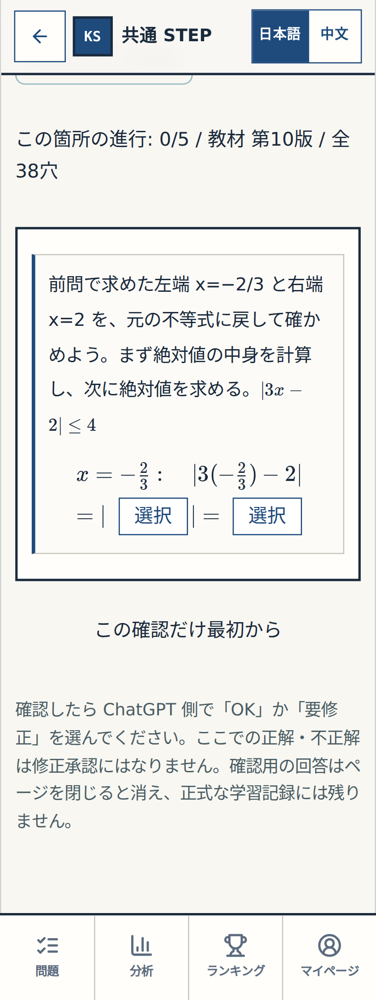

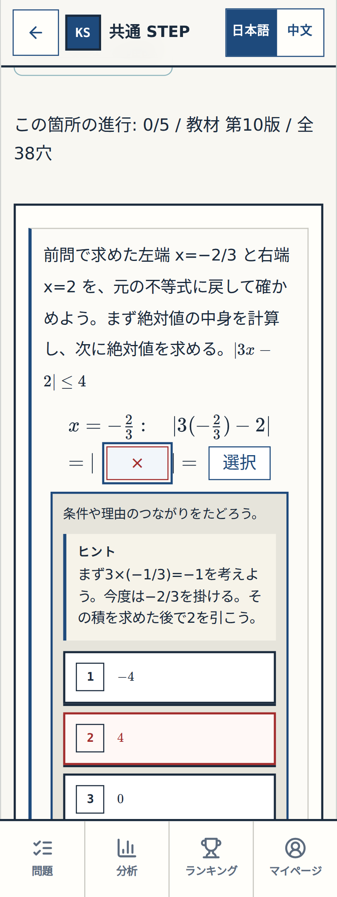

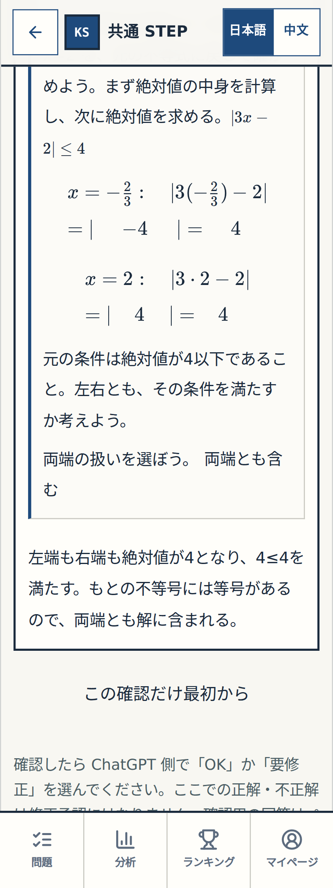

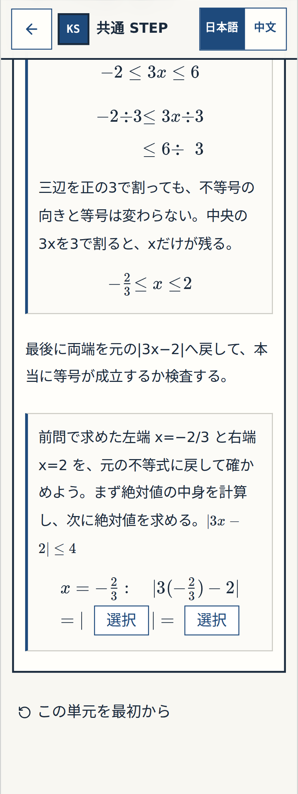

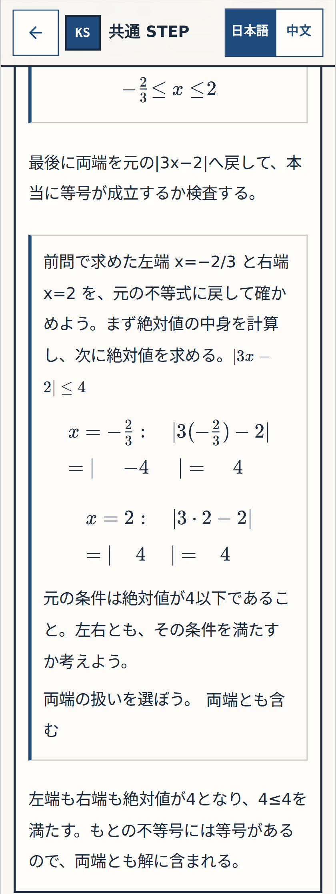

### 390px

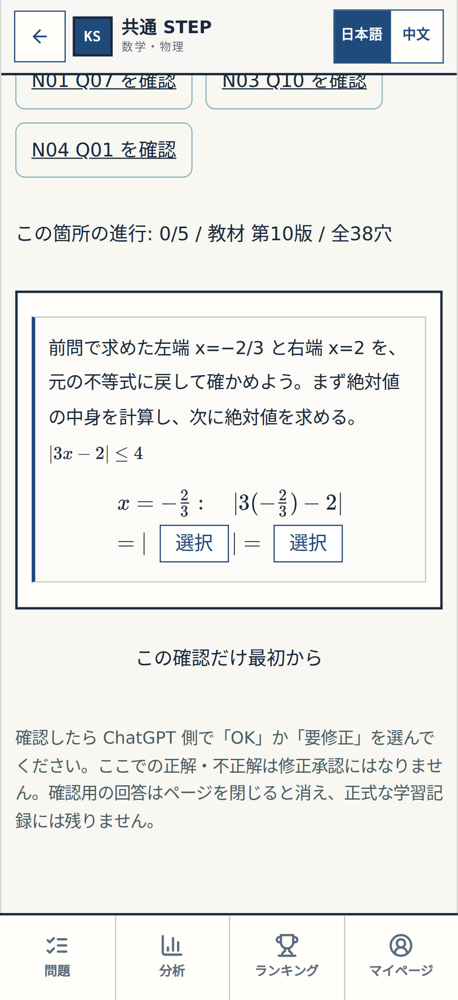

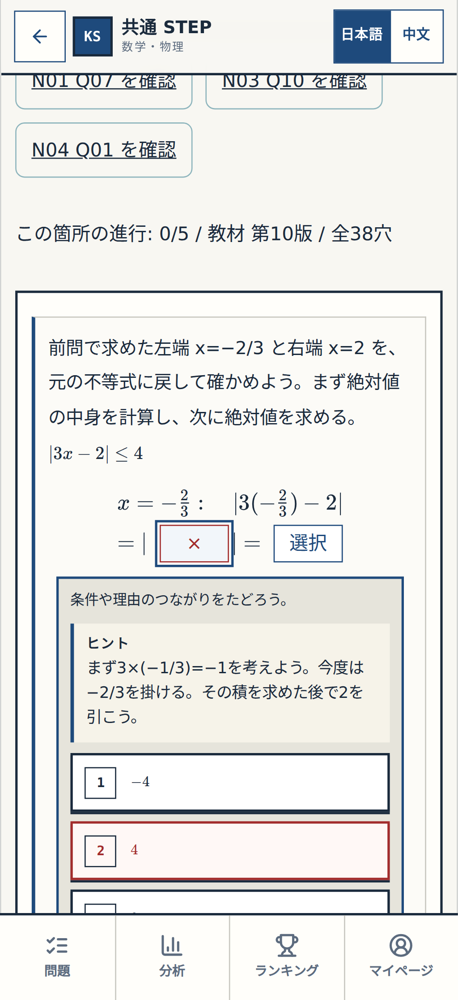

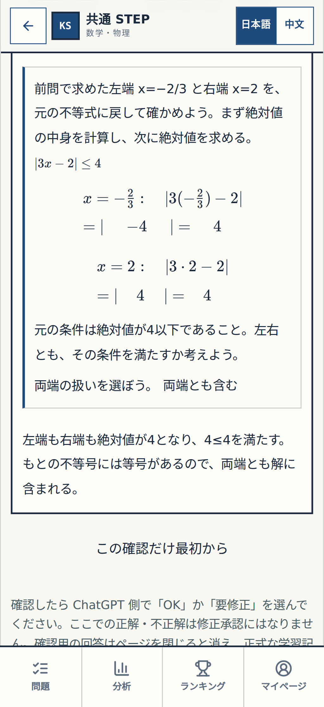

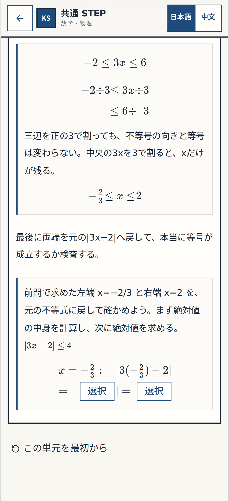

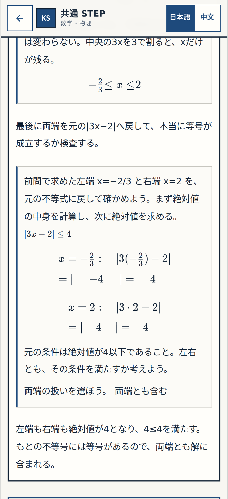

### 1440px

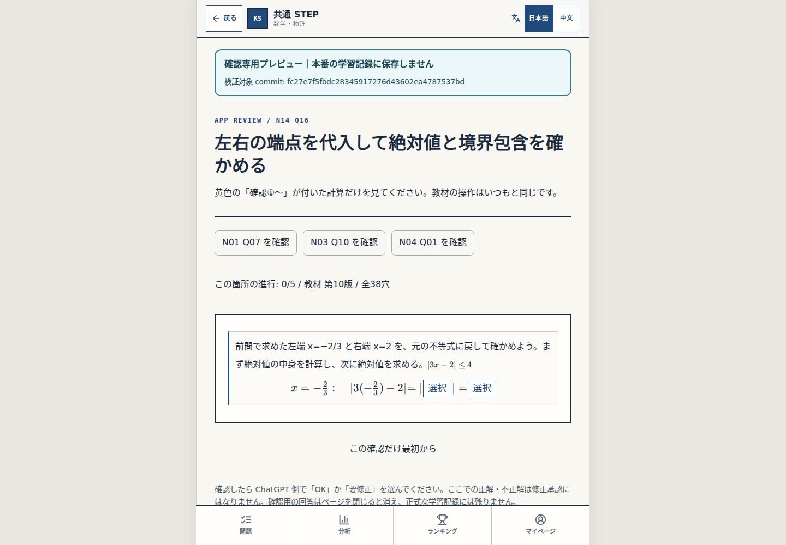

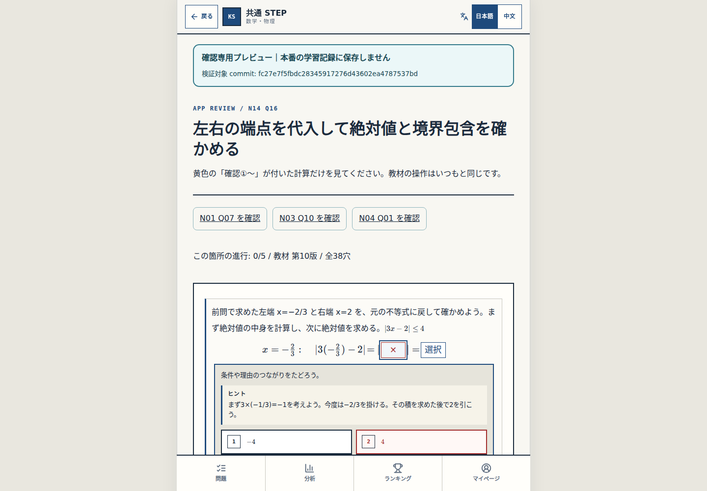

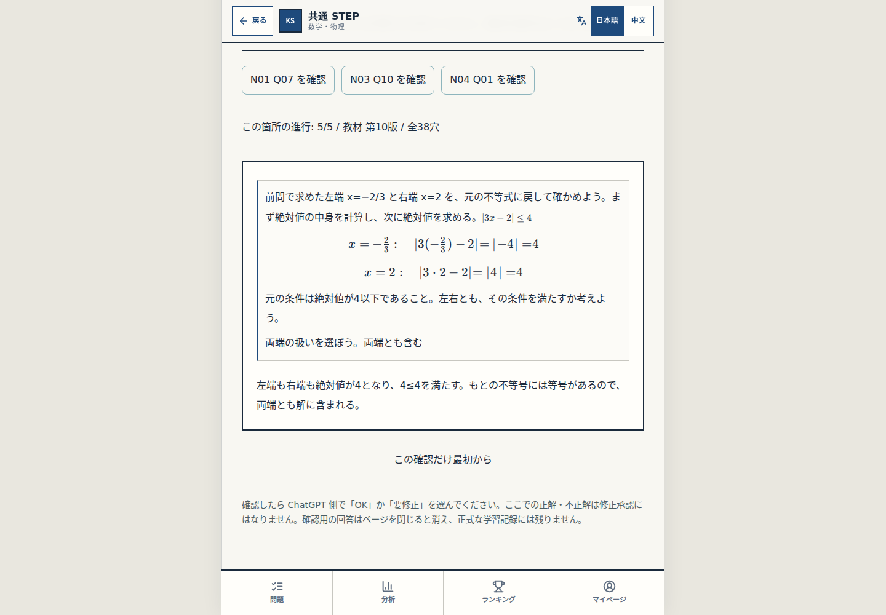

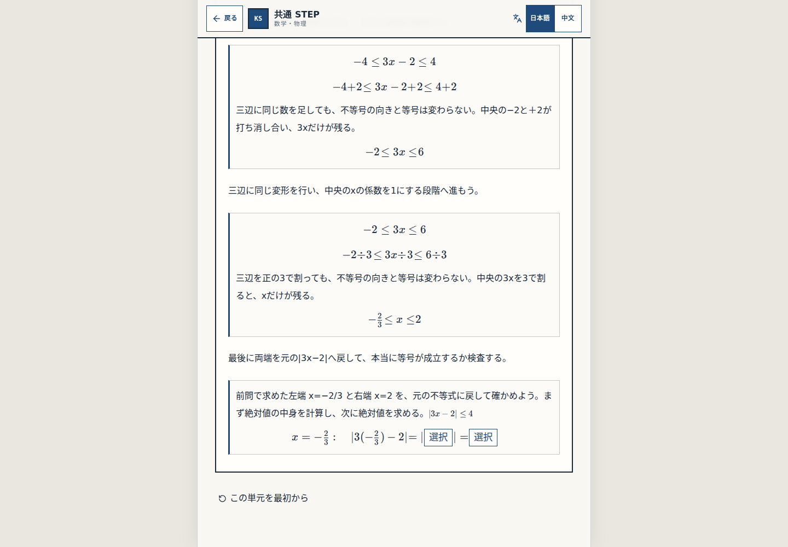

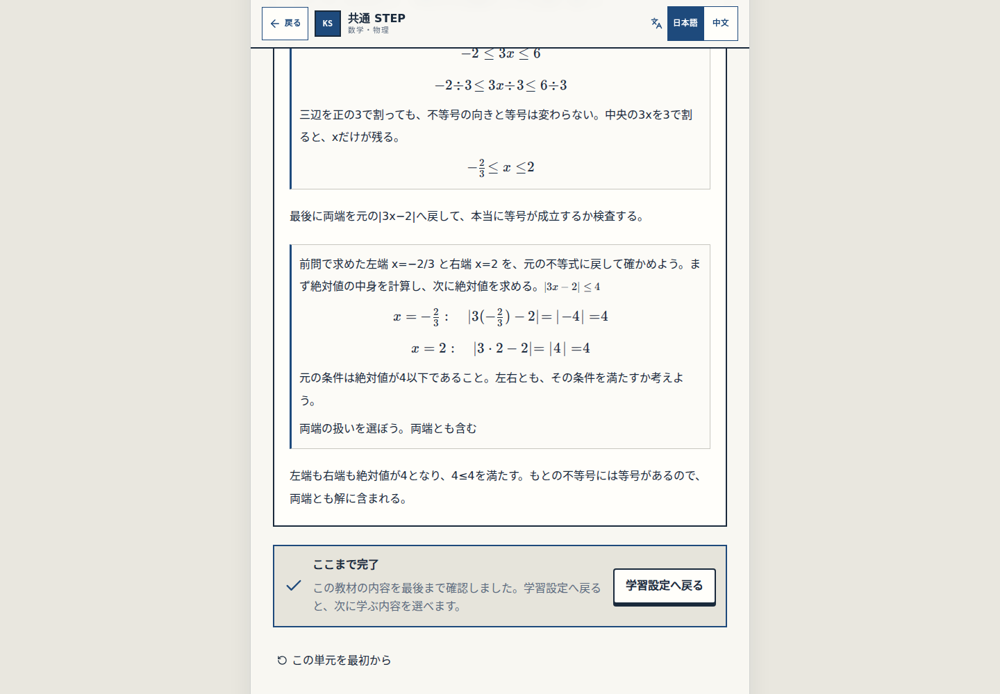
