# N13 Q08 actual native Gate① images (not yet human approved)

Real operated source SHA: `f5c0b2934ae1682a63f36401386d4bb24084c06a`

Font coverage: Noto CJK JP verified

Q08 Stage B: 320/390/1440 real Chromium normal and numbered, three new decisions; accepted Q05 protected.

## 320px

**review-before**

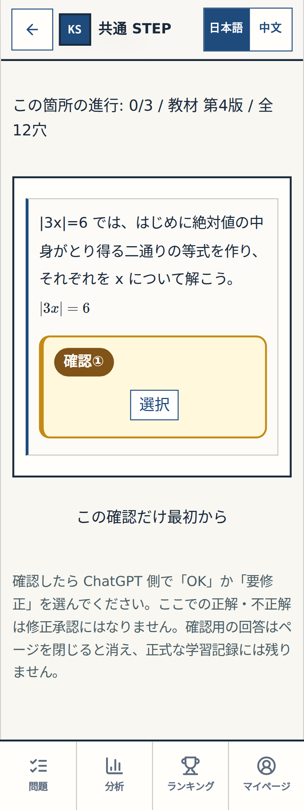

**review-wrong**

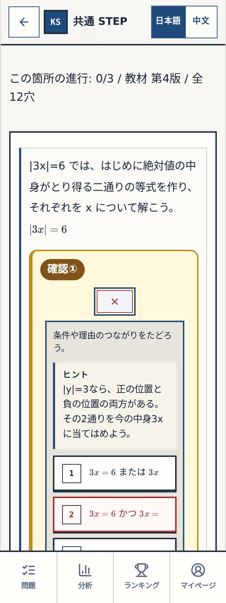

**review-complete**

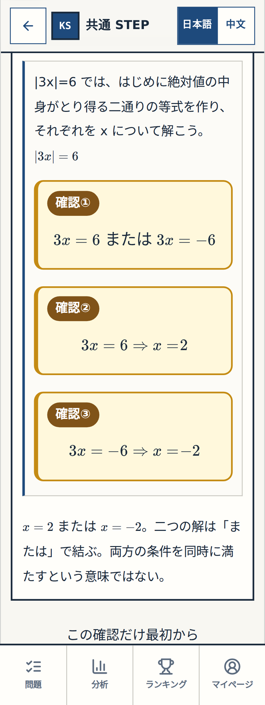

**normal-before**

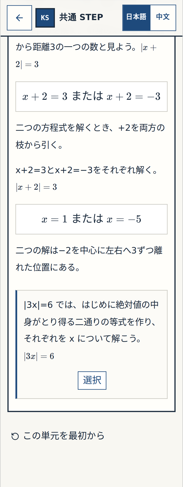

**normal-complete**

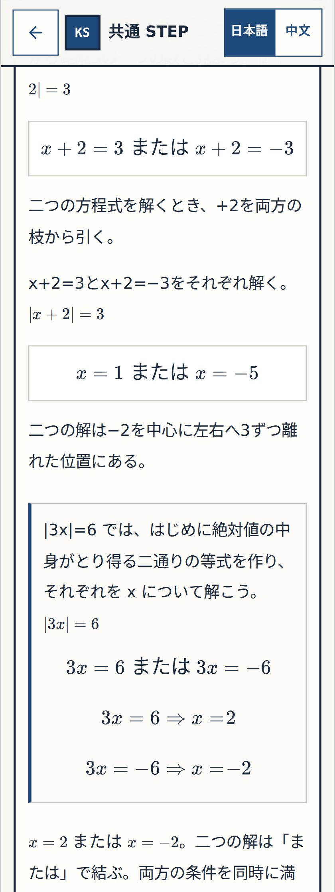

## 390px

**review-before**

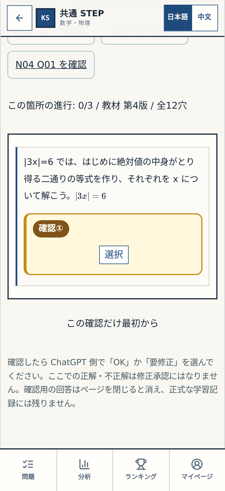

**review-wrong**

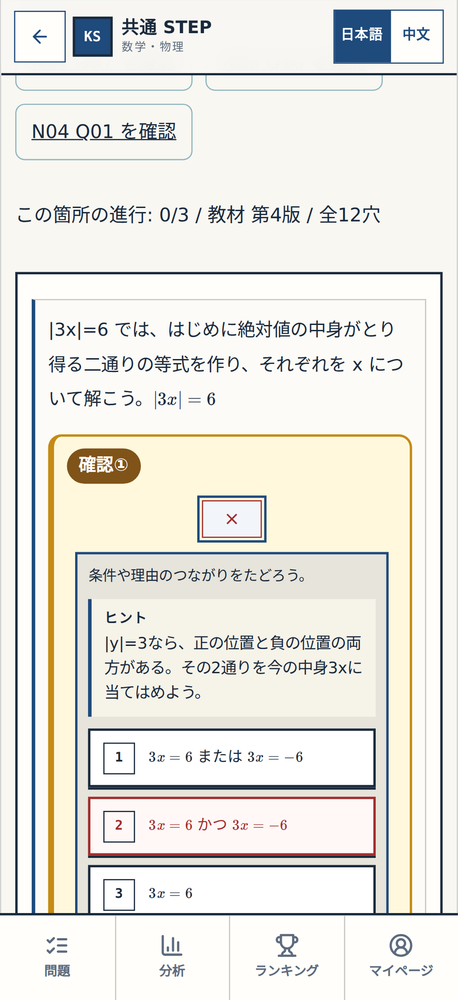

**review-complete**

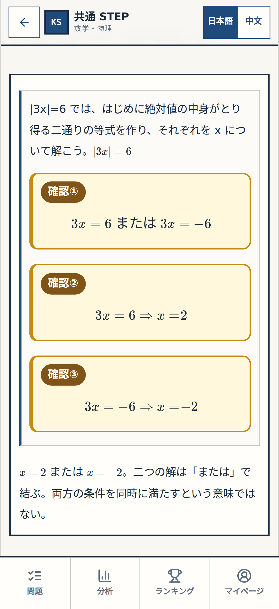

**normal-before**

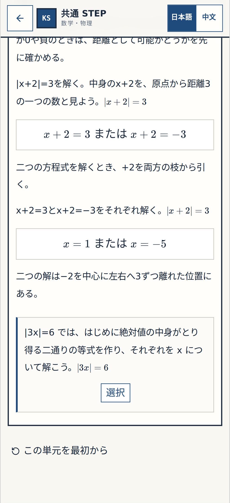

**normal-complete**

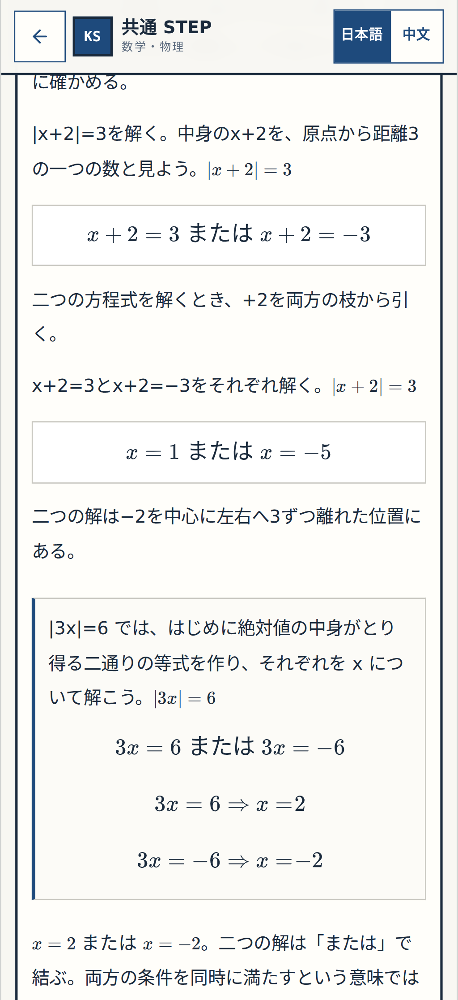

## 1440px

**review-before**

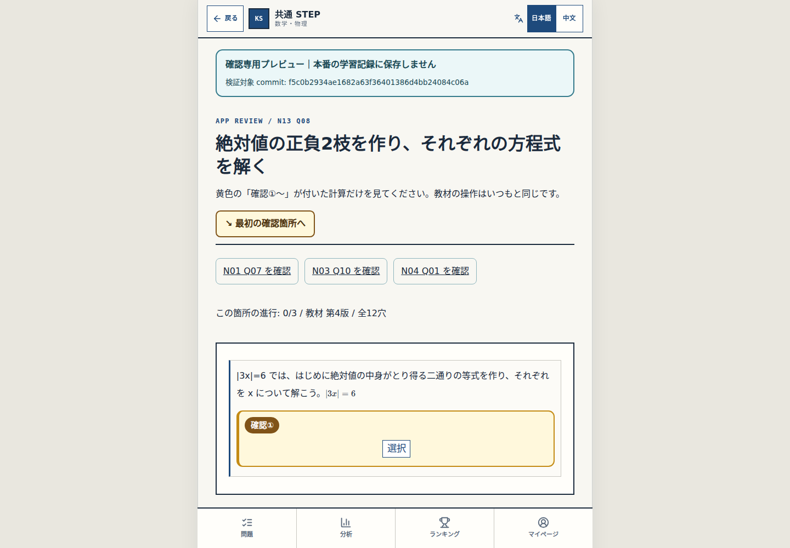

**review-wrong**

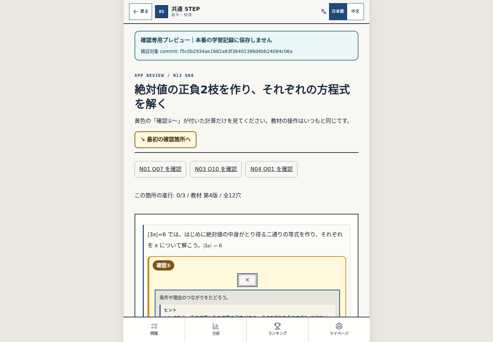

**review-complete**

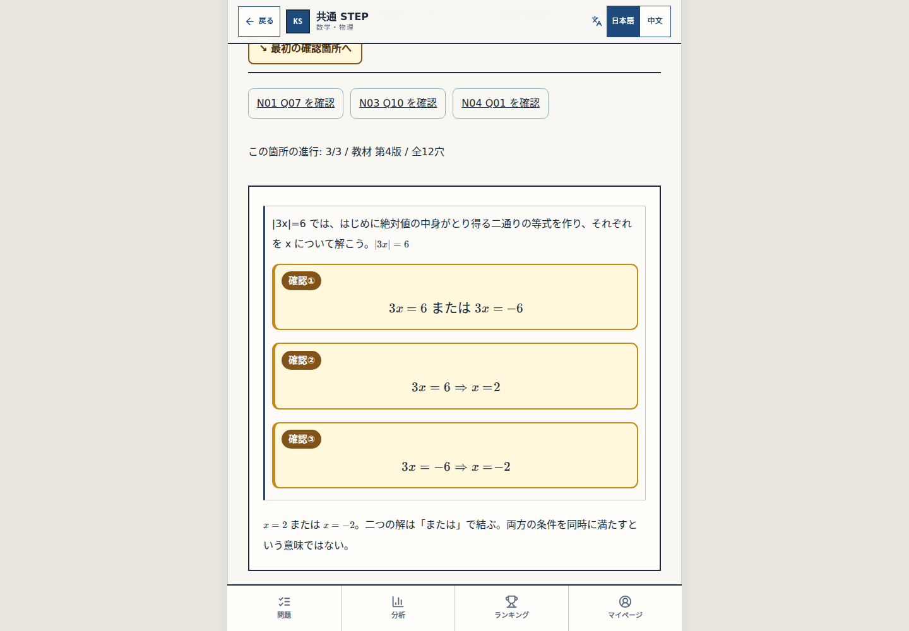

**normal-before**

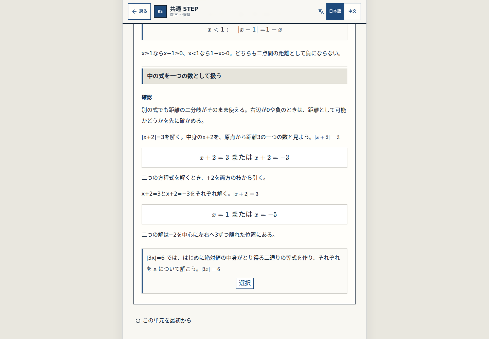

**normal-complete**

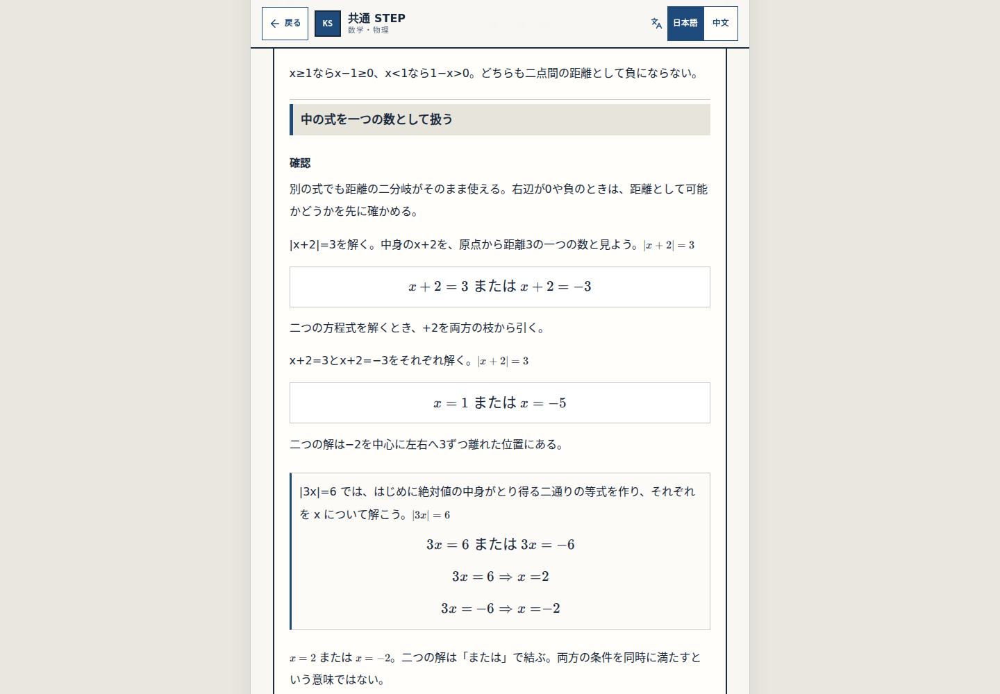

Gate① Q08 user 細部OK still required. Q05 is approved; no merge, public host or release.
