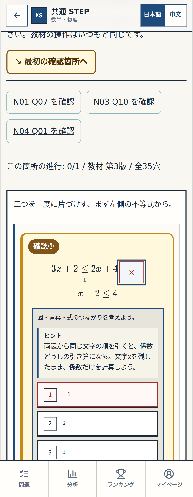
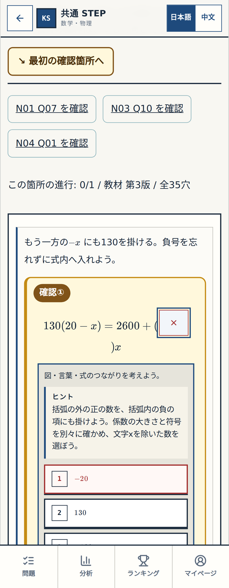

# P015目視検証 — 不合格、受入依頼なし

Source944dcbdf5687a52789ae5baf55b1193537267837,原画像79d4c0b542a3f69968d760d919ec9058e3c50ff3。横超過0pxと機能テストはPASSだが、数式のまとまりはFAIL。係数欄がどのxに掛かるか読みにくいため、この画面を完成版として承認させない。

## 1. Q06 /390px

穴と後ろのxが別行。新たな表示修正としてP016でまとまりを保護する。

## 2. Q12 /390px

閉じ括弧)xだけが次行へ離れる。P016では右辺の括弧と係数欄を一体に保つ。

[次のexact修正案P016](./PROPOSAL_P016.md) / [全原画像・計測・テスト結果](./evidence/gate1-p015/README.md)。前7ヒントの受入は維持、今回2表示は未受入。
