# N05 Q11 actual numbered Gate1 images — user acceptance pending

Real operated source SHA: 45eba9bf88075df7786f6e55a5d520a628f8f324

Noto CJK JP installed. Authentic Chromium 320/390/1440, review and normal lesson, wrong hint, retry; no new answer keys.

## 320px

**review-before**

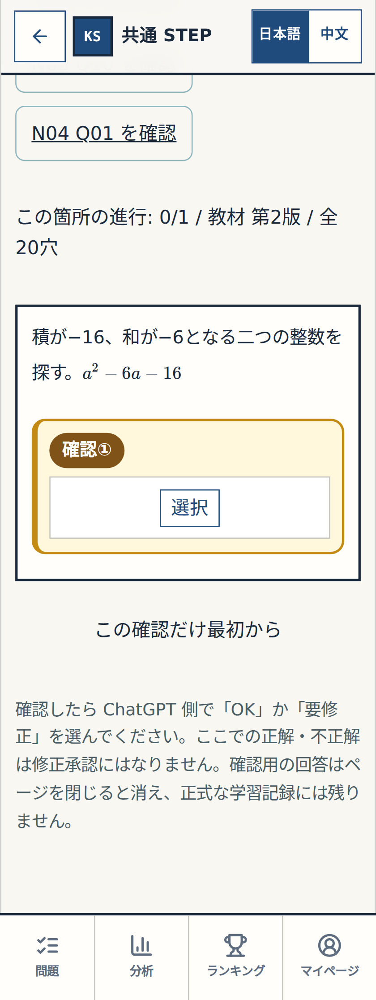

**review-wrong**

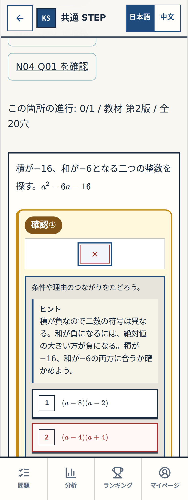

**review-complete**

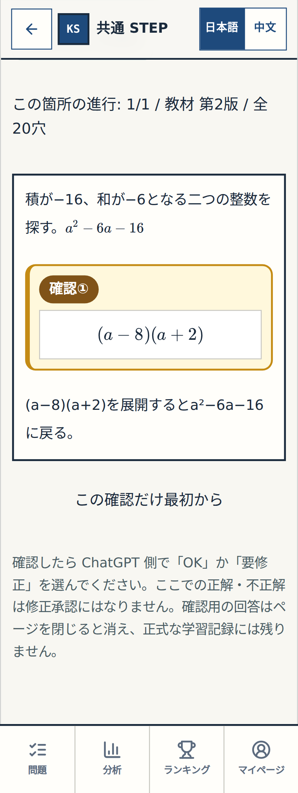

**normal-before**

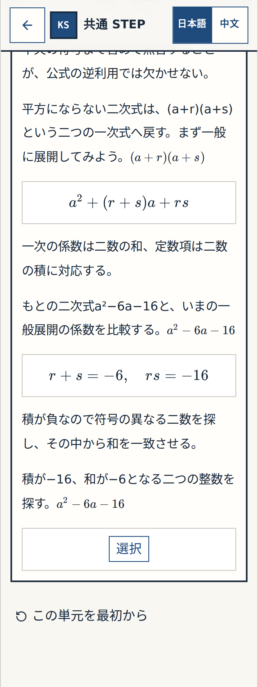

**normal-wrong**

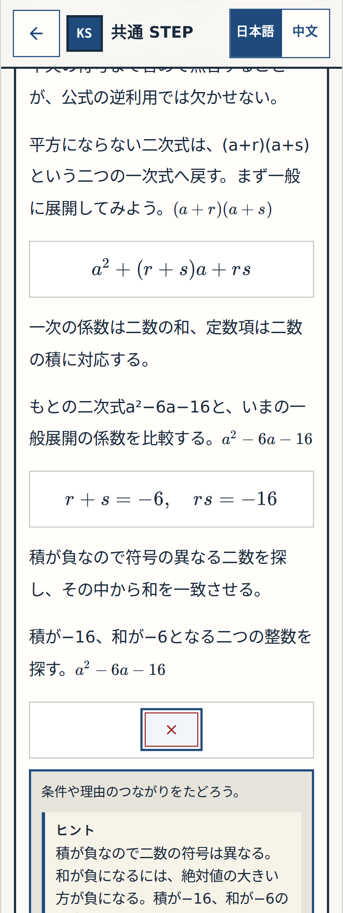

**normal-complete**

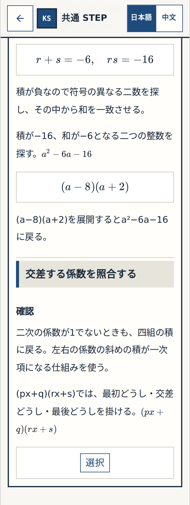

## 390px

**review-before**

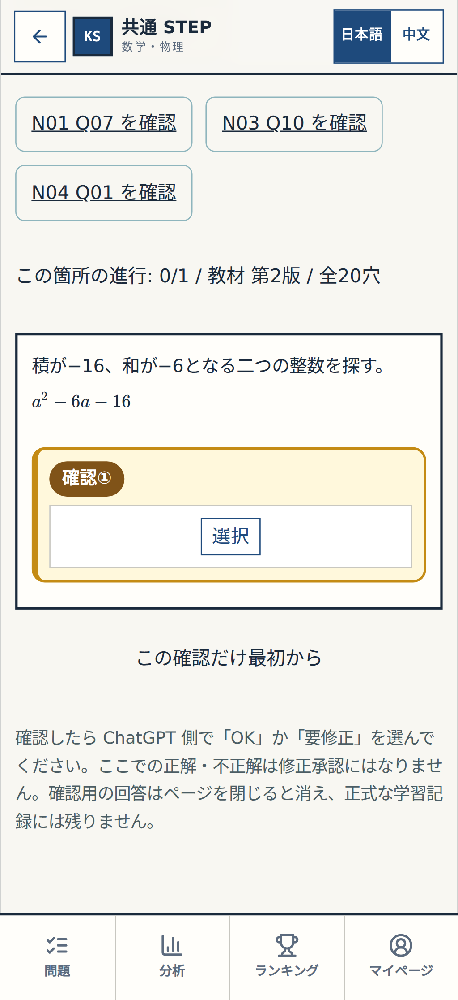

**review-wrong**

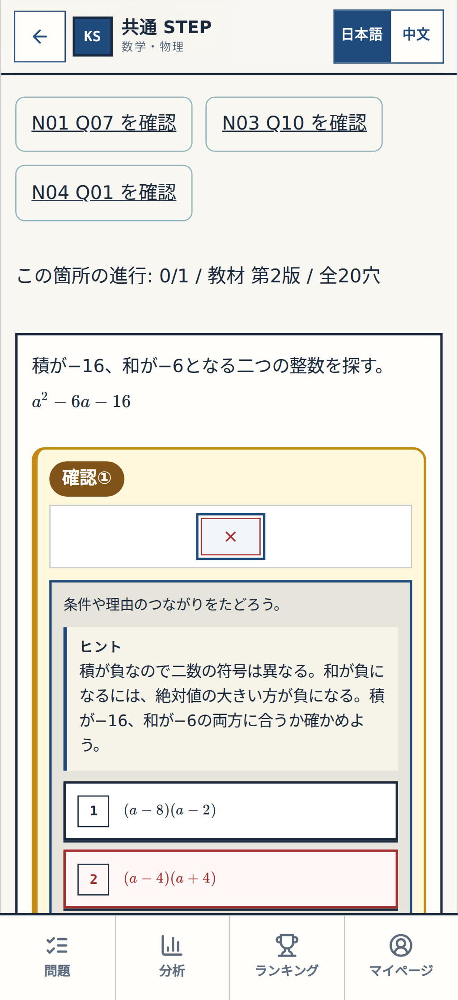

**review-complete**

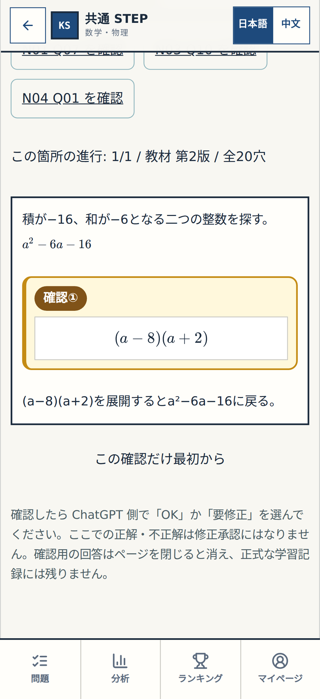

**normal-before**

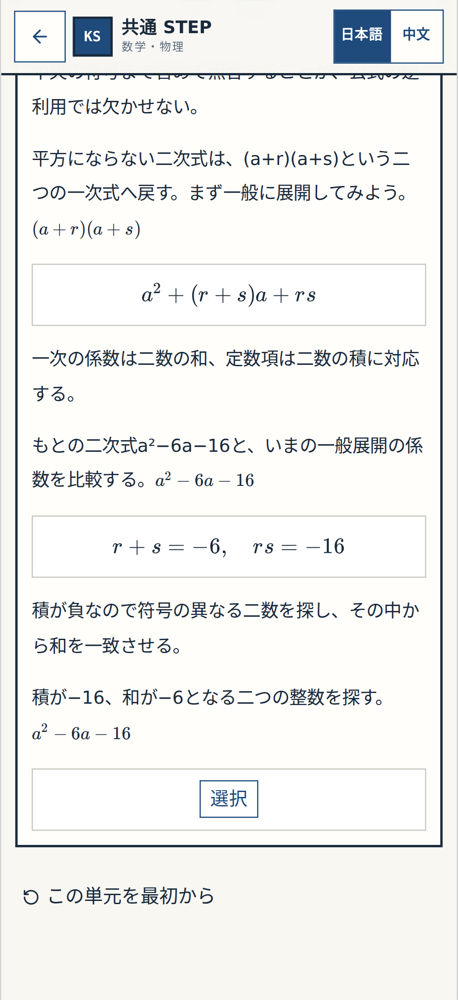

**normal-wrong**

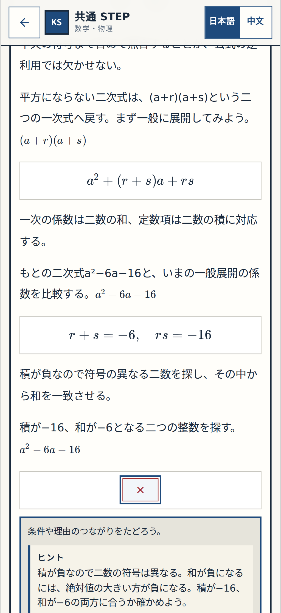

**normal-complete**

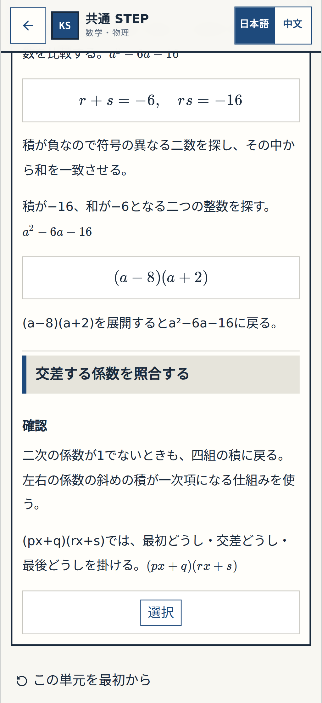

## 1440px

**review-before**

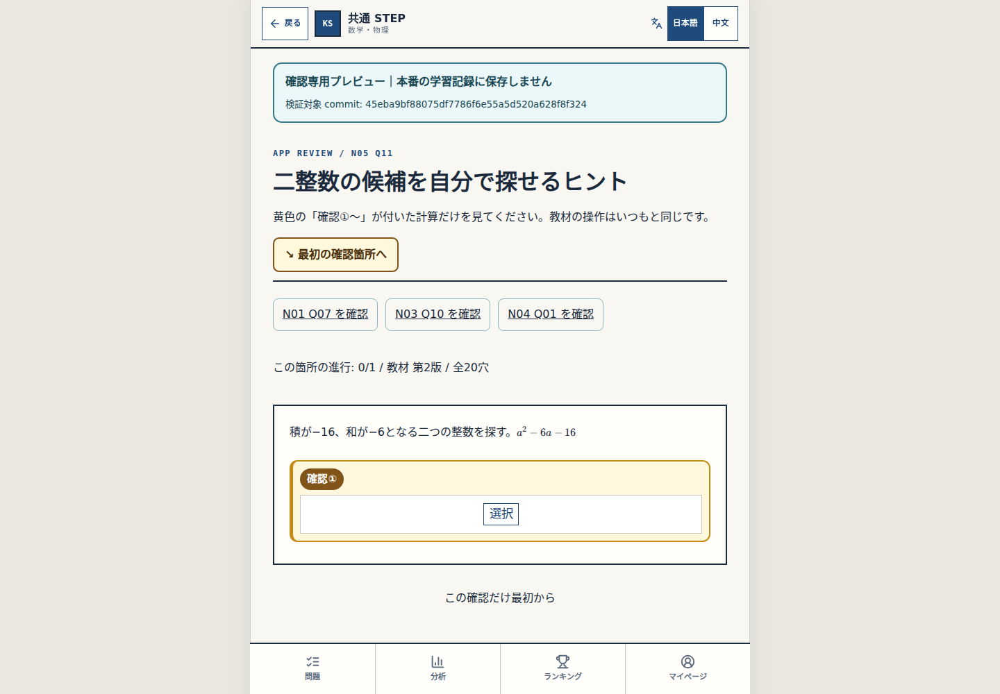

**review-wrong**

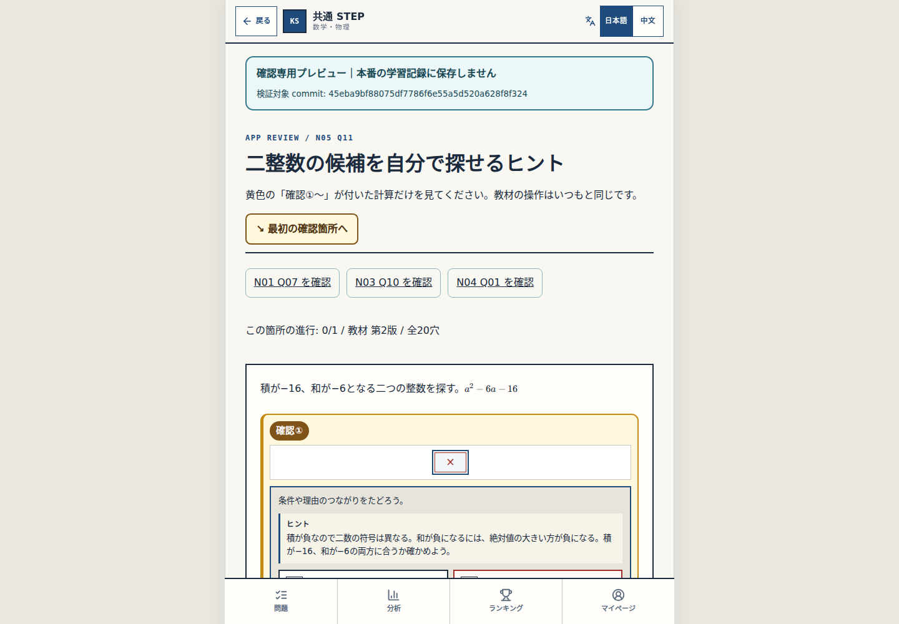

**review-complete**

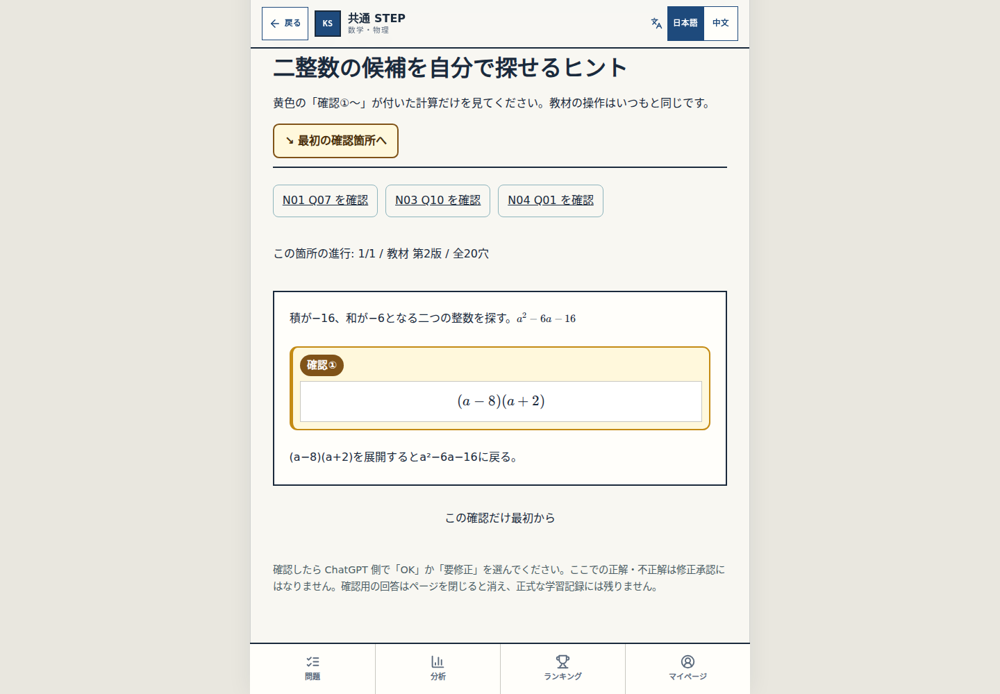

**normal-before**

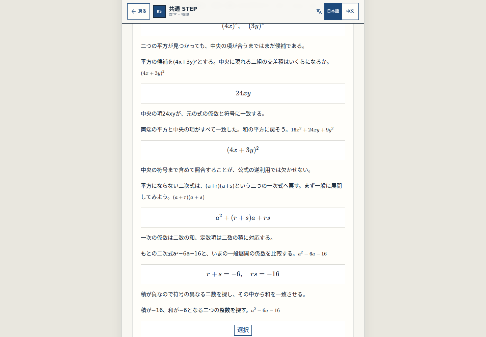

**normal-wrong**

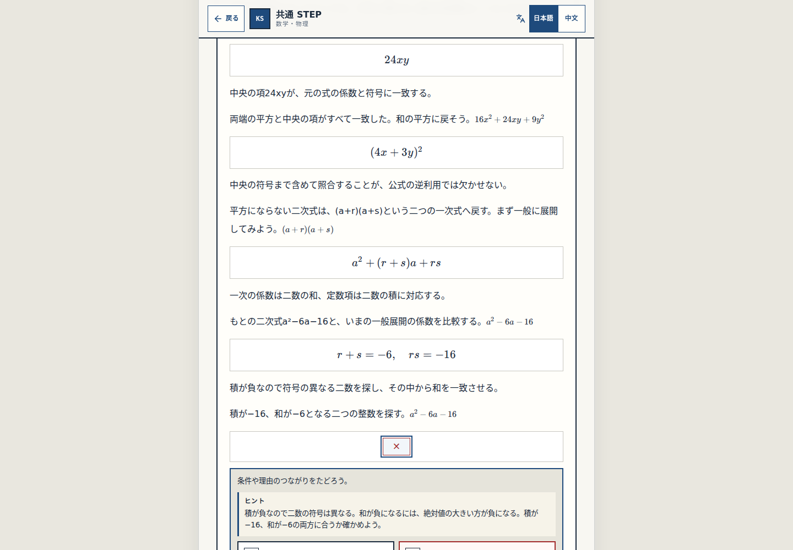

**normal-complete**

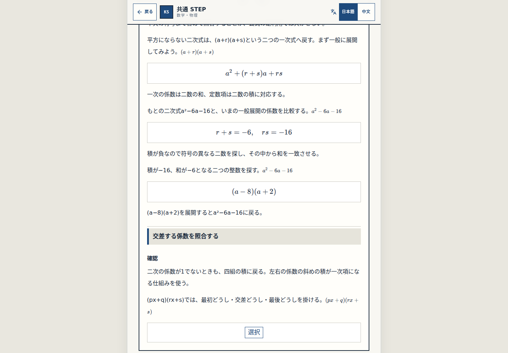

Human Gate1 Q11 remains BLOCK-CHECK-PENDING; no main merge or host/deploy.
