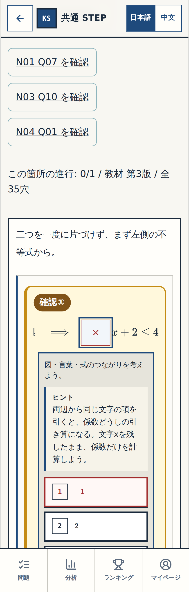
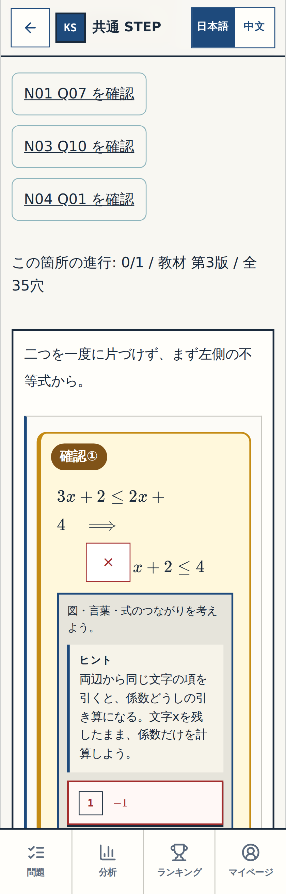
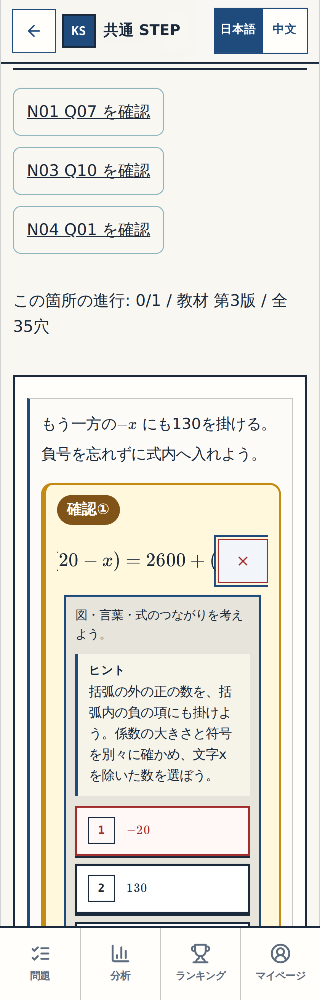
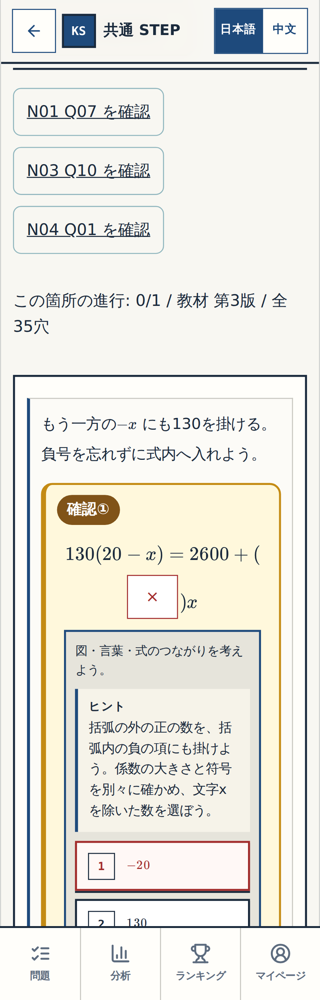

# N12抜粋画面の表示診断 — 実測証拠

Status: DIAGNOSIS COMPLETE / P015 PROPOSED,not implemented.
実操作ソース2bc979a20ea914e895f351a97b5129a763da5fed;教材/renderer/CSSは22ccf559a70d758689b958c77d19f4c9cdd43b7eと同一。追加は診断test/workflowと受入記録のみ。GitHub Actions39914505047/job120284878293 SUCCESS。Review39914505142/Governance39914505041 SUCCESS。

実ブラウザ診断: source2bc979a20ea914e895f351a97b5129a763da5fed（教材コードは22ccと同一）、run39914505047/job120284878293 SUCCESS。2件×320/390/1440＝6実ケースPASS/6明示matrix skip。通常ではN12classあり、両確認抜粋ではなし、再読込後も同じ。CSSclassのみを一時適用する診断実験で、Q06の横超過は320px146px/390px76px→0px、Q12は320px68px→0px。Q12の390pxと両問1440pxはもともと横超過0px。320pxで穴へ移動後のscrollLeftはQ06 138px/Q12 42px、scrollLeftを0へ戻すと左側は戻る代わりに右側が画面外となる。欠落データではなく、N12専用表示が外れたことによる横スクロール。通常側の測定横超過は全6ケース0px。

この一時class実験はCSS機序の診断で、提案後の完成画面ではない。Q06のJSX上の矢印分割はclass追加だけでは再構成されず、320pxの実験画像では式が途中で分かれる。unitIdを使う実装後にJSXの分割も含めて改めて確認する。CSSclassの一時実験を最終UIの承認画像として扱わない。前後18原PNG＋6計測JSONのartifact12484555949/sha25624c5de021c860a5914290abc1a5c0518b4e86ee369f78251c64ae089c6063b62を原ZIPのまま保存。

## 原ファイル

[全18PNG＋6JSONの原ZIP](./native-original.zip) / [全原ファイルSHA256](./SHA256SUMS.txt) / [source上の全29確認対象走査](./source-impact.json)

## 原因確認用画像 — 完成画面ではない

黄色マーカーは診断baselineで保持した歴史的な七件レビューsourceのもの。すでに受入済み7ヒントの再確認依頼ではない。右/次の画像はDOMへclassのみ一時追加した実験で、アプリsourceの修正・完成画面ではない。

### Q06 / 320px

通常の確認画面:

CSSclass一時適用だけの診断実験（JSXの矢印分割は未変更）:

### Q12 / 320px

通常の確認画面:

CSSclass一時適用だけの診断実験:

## 保存と失敗履歴

Original artifact12484555949:3776264 bytes,sha25624c5de021c860a5914290abc1a5c0518b4e86ee369f78251c64ae089c6063b62。原ZIP検証後、画像/計測は加工せず保存。再読込で一時classは失われ、review操作で通常localStorageは不変。

初回b460fb113ee1e28eaf1cf2061eecb1cf93f8d590/run39914197299/job120283897539 FAILED:診断testから全科目registryをimportし、Node側TypeScriptへ物理rawimportまで持ち込んだ。対象N12のみのimportに限定して診断testを修正。教材データ不足やアプリbuild欠陥ではない。ローカル集計もruntime-units.jsonのunit wrapperを取り違え一度失敗、実形式へ修正後に全29対象を走査。最終のSUCCESSだけを成功証拠とする。
