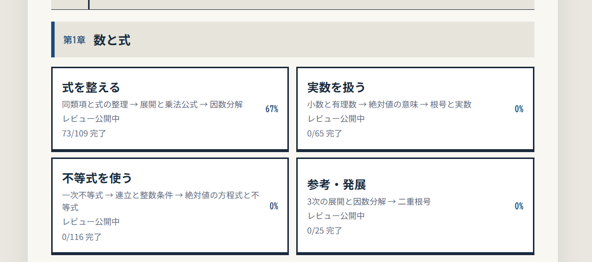
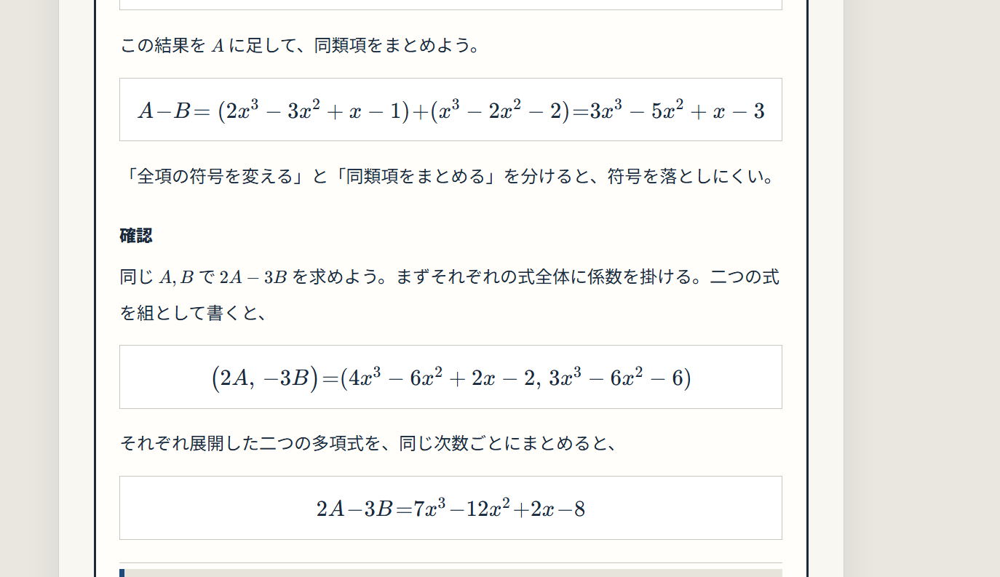
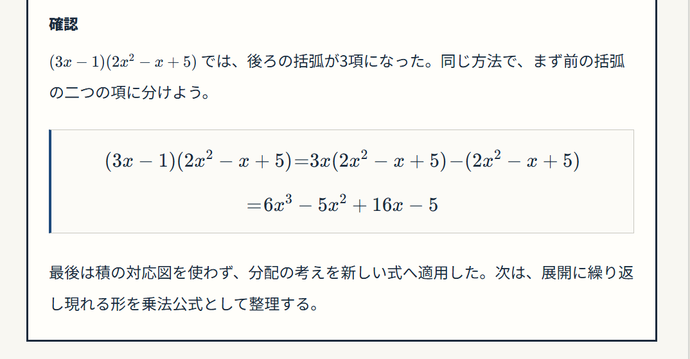
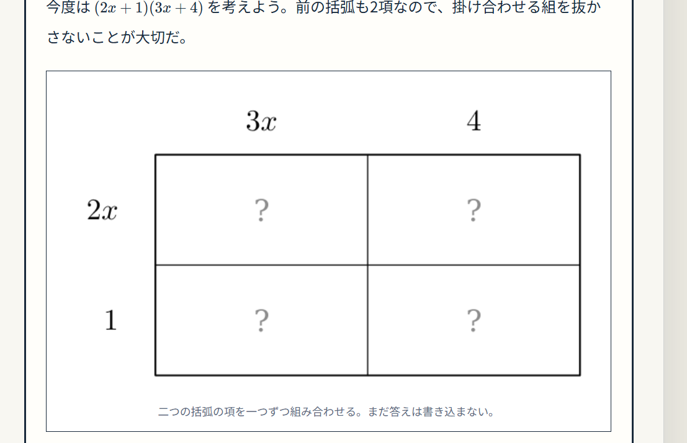
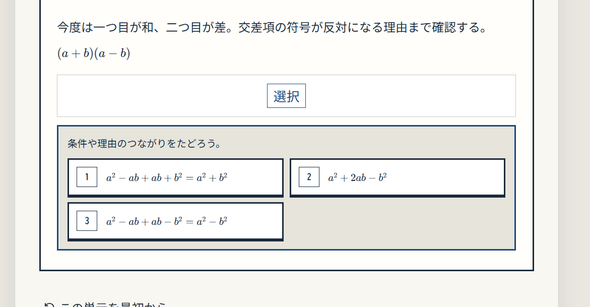
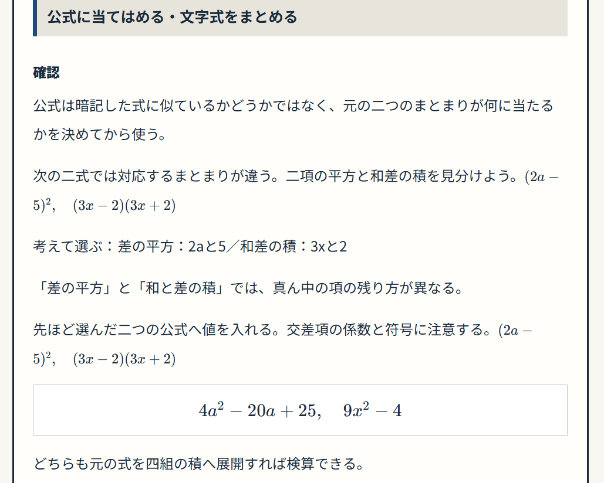
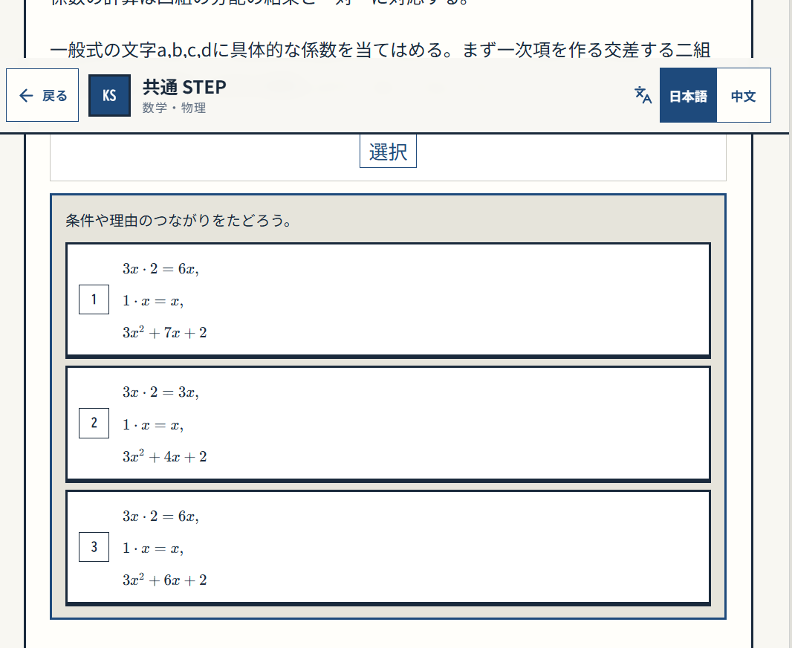
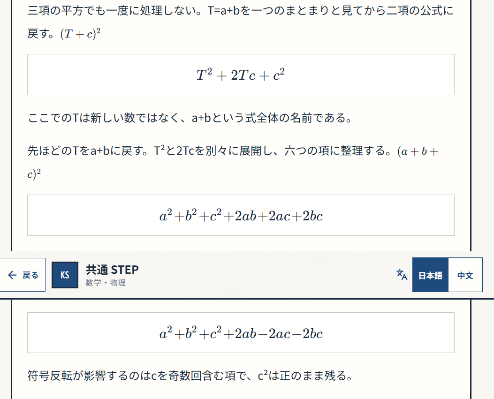
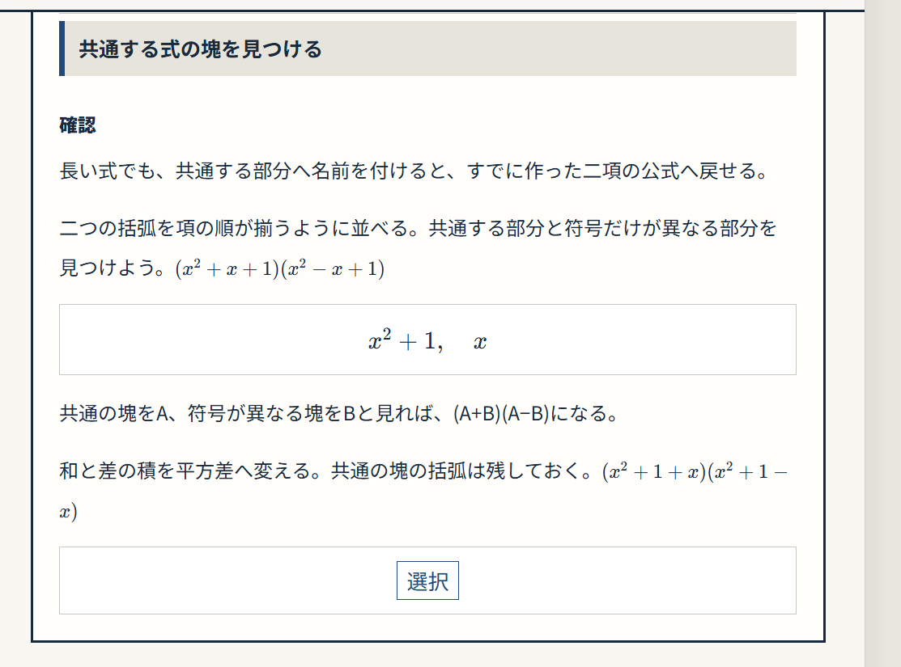
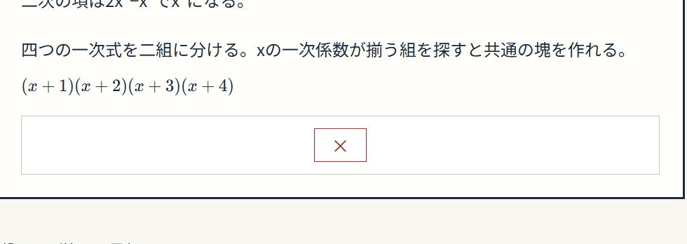

# 画像指摘10件と3テーマ横断監査

Work: W-MATH-027
対象: 公開ソース171c04781f32c1286a0762905891b582714834f9
教材データ: 基準3055と同一。16単元・233原問・315操作・999選択肢。
状態: ソース監査で確定した不具合と、さらに画面確認が必要なリスクを分ける。未実装。

## 根拠とQAの修正

既存規則は不足していなかった。MASTER_APP_LESSONS §§7–12の一段で学べる穴・学習行為・途中式と穴の区別・導出のまとまり、§§49–50の見出しと本文の一致に反している。

ERROR-QA: 過去の構文・正答計算・幅・クリック・保存の成功を、本文を読んで推論を進められることの十分な証拠として扱っていた。大きな複合選択肢を正しく押せても、学習者が複数の途中操作を自分で行ったことにはならない。旧テスト結果を削除せず、今回の教材設計検査はFAIL/未完として追加する。

### 原因の分類

- IA：内部分類をそのまま同格の大見出しに増設。
- STEP：複数の展開・符号・係数計算・整理を一つの完成式選択にまとめる。
- ORDER：計算に必要な途中式を答えた後に初めて見せる。
- FIGURE：表の何と何を掛け、どの順に読み、式のどこへ戻すかを説明しない。
- PROSE：短い命令→穴→短い結果説明が並び、目的・根拠・次の必要性を本文でつながない。
- CHOICE：誤答の数学的成立性だけを検査し、選択肢が一つの判断になっているかを検査しない。

## ユーザー画像の番号対応

| 画像 | 元ファイル | 対象 | 確認された問題 | 修正で必要なこと |
|---|---|---|---|---|
| ① | image(20261023-124842).png | 章入口 | 3テーマの承認に反して「参考・発展」を第四カードへ追加 | P-001の3テーマへ内容を統合。内容削除で解消しない |
| ② | 2f71412bbca300caf02cd626d0f8ffe3.png | N02 Q08–Q10 | 2Aと−3Bの各項への分配、同類項の並べ直し、係数計算を大きな完成式だけで通過 | 係数を掛ける式→各項の積→同類項の組→係数計算→完成式を一続きに置く |
| ③ | c4aaddf891cee0cd0b75cb684c26ae7a.png | N03 Q12–Q13 | 二項×三項を二つへ分けた直後に整理済み6x³−5x²+16x−5へ飛ぶ | 六つの積、負号の分配、−3x²−2x²と15x+xの整理を先に見せる |
| ④ | 1b6aced6c1b08932666aa4959891786c.png | N03 n03-f01・Q09–Q11 | 四マスの表が置かれるが、行/列の意味、交点の積、四マスを足す理由が説明されない | 既存原図を保ち、上の3x/4は後ろの括弧、左の2x/1は前の括弧と紹介。一マスを読み、対応する式へ戻す。回答前に全部の答えを図へ書かない |
| ⑤ | aa1606feed6c8ee4235ea5217b476ef9.png | N04 Q08 | 四積と相殺後の結論を一つの等式選択で同時に要求 | a(a−b)+b(a−b)→a²−ab+ab−b²→中央項の相殺→a²−b²を分ける |
| ⑥ | e2d5f34a773d76aea66291fed53d57ef.png | N04 Q09–Q10 | 公式と対応の組を選んだ直後、二つの別式の最終答えを一括で選ばせる。何の練習かが本文から薄い | 一方の式ずつ、公式のどこへ2a/5や3x/2を入れたかを明示。代入→積/平方→整理を通してから次の式へ |
| ⑦ | 60a9565eeab50324e92693b071035163.png | N04 Q13 | 交差積二つと最終多項式を三行の候補に一括。同じ途中積が合っていても最後だけ異なる候補が混在し、一つの選択が何を測るか不明 | 3x×2、1×x、6x+x、完成式を連続する局所操作へ分ける。巨大な複合候補の改行だけでは修正しない |
| ⑧ | 37e9eb01b96d979ad588de68214898a7.png | N04 Q14–Q16 | Tをa+bへ戻す代入式、二項平方、2(a+b)cの分配を飛ばして六項の完成式へ移る | (a+b)²+2(a+b)c+c²→各展開→並べ直しを明示。差の場合はc→−cを実際の式に入れる |
| ⑨ | 4692901d03721c7c75f6e9a00ea44b7a.png | N04 Q17–Q19 | 共通部分と違う部分を見つける目的、A/Bへの置換、元へ戻す役割が短い指示の羅列 | 二つの括弧で変わらないx²+1をそろえる理由から説明し、A+B/A−B→A²−B²→(x²+1)²−x²へ本文と式を接続 |
| ⑩ | 3e329f12f62bd142c5d0334084c44b38.png | N04 Q20–Q22 | 四因子の組分けを探し、二つの積を展開し、共通の一次係数を得る計算を一つの候補に詰める | 組分け候補→一次係数の和→選んだ二組の展開→Tの定義→Tで計算→元へ戻す。完成した二次式の積をいきなり見抜かせない |

画像はevidence/user-01.png〜user-10.pngへ原画像のまま保存。受領ファイル名と番号の対応は上表で固定し、加工・再生成した画像で代用しない。

## 追加で確認できた箇所 — 第1テーマ

| 対象 | 判定 | ソース上の証拠・必要な補足 |
|---|---|---|
| N02 Q06、Q11 | 同種の省略を確認 | 次数別の足し算の計算式、3A−4B−A+B→(3−1)A+(−4+1)Bが表示されず完成式の候補へ。途中式の可視化対象 |
| N03 Q05–Q06 | 同種の複数計算を確認 | (−2)³、(x³)³、(y²)³をそれぞれ計算する行がなく、−8x⁹y⁶の一括選択。表示する途中式と意味のある穴を再設計 |
| N04 Q22 | 同種の省略を確認 | (x²+5x)²と10(x²+5x)を展開する行、および25x²+10x²の整理が飛ぶ |
| N05 Q12–Q14 | 同種の複合選択を確認 | 四つの積→一般係数の整理を一度で求め、候補A/B/Cの交差積の計算も8/7/13の三つ組一択。たすき掛けの表の読み方と個別の照合が必要 |
| N06 Q02 | 同種の省略を確認 | (X+1)(X−2)−4からX²−X−6の前にX²−2X+X−2−4がない |
| N06 Q06 | 同種の複合操作を確認 | T²−5T+4の因数分解とT=x²の復元が一つの回答。少なくともTの積→復元の別行が必要 |
| NE01 Q07 | 表示順の欠陥を確認 | x³−3x²·2+3x·2²−2³を、正答した後のne01-result-07-1に置いている。計算の足場が必要な時点で見えない |
| NE01 Q11・Q13 | 同種の省略・複合回答を確認 | b→−bの二因子への代入を省略。Q13は別々の二式の因数分解を一つの候補へまとめる |

これらは写真の箇所だけを直すと残る同型の問題。N01の係数計算を分けた局所穴など、既に適切に分解された部分まで同じ理由で作り直すものではない。

## 残る二テーマも同じ原因で横断

| テーマ | 対象 | 判定・証拠 |
|---|---|---|
| 実数を扱う | N07 Q09 | 倍率を選ぶ問いに、100倍・100xの式・引き算の結果99x=69まで含む選択肢。別の判断/操作を一括する同根の問題 |
| 実数を扱う | N07 Q12 | 分母の素因数の条件を与え、2〜20から七つの分母を完成集合で選ばせる。各分母を調べる過程や、2と5だけなら10の累乗へ拡張できる理由が表示されない |
| 実数を扱う | N09 Q14 | 正負それぞれの整数部分・小数部分（計四結果）をまとめた一つの回答。正負ごとに残りx−nを作る計算を分ける対象 |
| 実数を扱う | N10 Q20–Q21 | 因子選び・分子分母への乗法・分母の計算を一括。次に分子の平方から7−4√3へ進み、4−4√3+3が表示されない |
| 実数を扱う | NE02 Q11 | a+b=6、ab=5、二数の決定、根号を外した結論を一つの選択肢にまとめる。画像⑦と同根 |
| 実数を扱う | NE02 Q12 | 既出の商へ戻す→分子分母に√2を掛ける→分配/整理の途中式が答え後にのみ出る。ORDERとSTEP |
| 不等式を使う | N13 Q04、Q07 | 二本の方程式を同時に解く最終値を一つの選択肢にまとめる。Q08では既に二枝を別々の局所穴へ分けており、その修正と不揃い |
| 不等式を使う | N12 Q15 | T(11)、T(12)の二つの積と和の計算を一括した回答。代入式自体は先にあるが、2650+550、2650+600の計算行がない |

## 再調査中のリスクと、今回の理由で壊さない箇所

- N08は根号の意味を正式に導入するN09より先に√5と3の平方比較を使う。初期既習条件との照合が必要であり、現時点で一律の順序誤りと断定しない。
- 第三テーマのN11の一般証明、N14 Q07/Q08の順逆、Q10/Q14/Q15の三辺操作、Q16の端点代入は局所操作・中間説明が既にある。今回の写真と同じ「一つの完成選択だけ」という指摘を機械的に当てはめない。受入済みの修正を保持する。
- 局所見出し数はN02/N04/N05/N06が各4、N09/NE01が各5。ただし数だけで章入口の大見出しと同じ違反だと判定しない。見た目の階層・前後の本文との役割を確認し、上位3テーマと同格に積み重なる部分、文章へ戻すべき部分を内容修正時に絞る。
- 本文・数式は読了監査したが、すべての新しい選択肢を再設計したわけではない。正答/誤答の計算監査は旧検査を参照できるが、学習価値の合格と同一視しない。

## 次の本文修正で守る具体的な基準

1. 先に一つの完全な導出を作り、式の間に「何を、なぜ次に行うか」を説明する本文を置く。その後、意味のある計算・判断だけを局所穴にする。
2. 途中式を増やすことと、穴を増やすことを混同しない。全ての数を穴にしてクリックを増やすだけの修正はしない。
3. 一続きの導出は一つの視覚的まとまりにする。各行を独立カードで分断しない。
4. 分配・符号・同類項整理など、独立した未習/初回操作を一つの完成候補へ束ねない。既習計算も、必要な代入式が答え後まで隠れていてよいことにはならない。
5. 問題の式を表示する。「考えて選ぶ」だけの空の式欄で、説明と数式を切り離さない。
6. 図は、目的→行/列/点の意味→具体的な一箇所の読み方→数式への対応→次の利用、まで本文でつなぐ。原図の無断描き直しはしない。
7. 原問の数学的な答えと出典対応は保持。複合回答を分割して採点値や意味が変わるitemは、revisionと旧回答の保存/アーカイブをexact案で指定し、過去の合格値を別問題の正答として読み替えない。

今回の範囲の検査台帳をPASSに戻すには、各確定箇所の修正案・承認・実装・本来の教材設計を含む検証・影響する実画像確認が必要。新しい画面幅テストだけで閉じない。

## 受領した原画像

画像1

画像2

画像3

画像4

画像5

画像6

画像7

画像8

画像9

画像10

