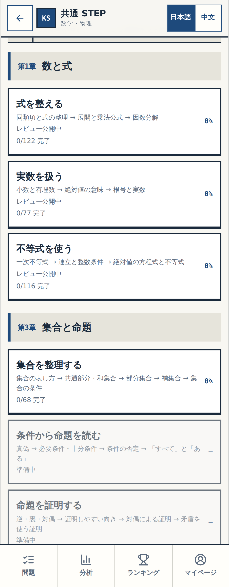
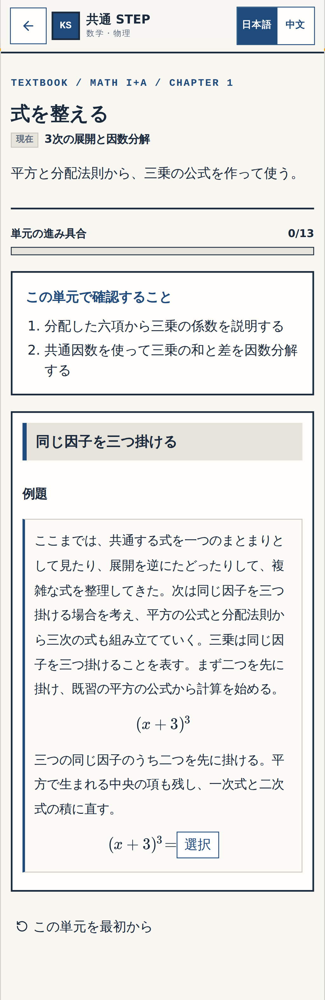
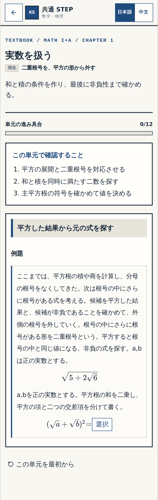

# 確認① — 第1章「数と式」の三見出しへの統合

Work: W-MATH-027 / Proposal: P-001-R1 / Block: CHAPTER1-STRUCTURE

対象アプリの完全SHA: `f3c69618d5f97cf235d2f0d0d9256f33056e9525`

状態: BLOCK-CHECK-PENDING。陸君の細部確認はまだ記録していません。

今回見ていただくのは次の三点です。画像は対象コミットを起動して撮影した原PNGで、再描画・文字の差し替え・切り抜きはしていません。

1. 大見出しが「式を整える」「実数を扱う」「不等式を使う」の三つになっていること。
2. 「3次の展開と因数分解」が「式を整える」に入り、既習内容から進む理由を導入文で説明していること。
3. 「二重根号を、平方の形から外す」が「実数を扱う」に入り、平方根の計算から進む理由を導入文で説明していること。

確認後は、このチャットで「確認①：細部OK」または「確認①：要修正（箇所）」と返してください。

## 確認①-A　三つの大見出し

スマートフォン390px。各カードの総操作数は122・77・116です。

## 確認①-B　式の整理から三次へ

冒頭の「ここまでは…次は…」が今回の追加箇所です。既存の説明はその後に保持しています。

## 確認①-C　平方根から二重根号へ

冒頭の「ここまでは…次は…」が今回の追加箇所です。

## 他の画面幅と検証の根拠

| 画面幅 | 大見出し | NE01接続文 | NE02接続文 |
|---|---|---|---|
| 320px | [画像](evidence/gate1-p001-r1/catalog-320.png) | [画像](evidence/gate1-p001-r1/ne01-bridge-320.png) | [画像](evidence/gate1-p001-r1/ne02-bridge-320.png) |
| 1440px | [画像](evidence/gate1-p001-r1/catalog-1440.png) | [画像](evidence/gate1-p001-r1/ne01-bridge-1440.png) | [画像](evidence/gate1-p001-r1/ne02-bridge-1440.png) |

[専用CI](https://github.com/rrikunagasige-dot/kyotsu-step-web/actions/runs/39986137882)で原データ照合・型検査・33単体テスト・11ブラウザテストが合格しました。3件は端末条件による意図的な除外です。16単元・233原問・315操作、回答履歴・途中再開・直リンク・次単元への遷移を検査しています。[画像ハッシュと出所](evidence/gate1-p001-r1/MANIFEST.json)。

この確認は見出しと二つの接続文の細部確認です。以前の画像10件に含まれる推導の飛躍、図の役割、選択肢、文章の流れ等は[AUDIT_FINDINGS.md](AUDIT_FINDINGS.md)に保持しています。残りの本文まで合格・完了とはしていません。

既存の[WORK_SYSTEM.md §12A](../../../governance/WORK_SYSTEM.md)に従い、細部確認の後に横断監査、実働アプリでの総チェックへ進みます。教材はmainへ未統合・未公開です。
