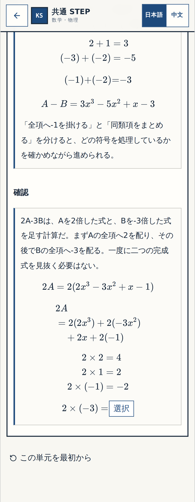
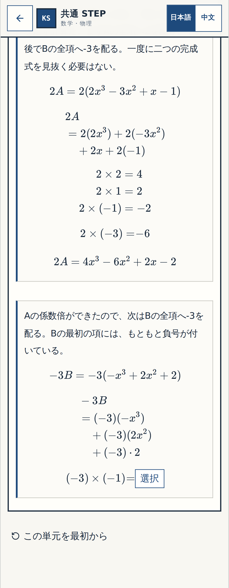
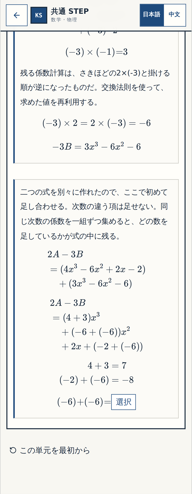
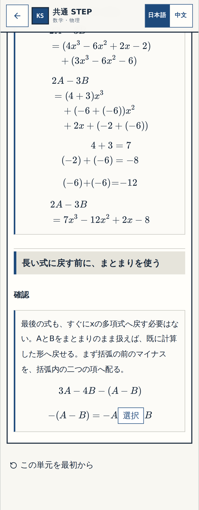

# 確認① — N02 Q06〜Q12

ブロックID: `N02-Q06-Q12` / 提案: `P-002-N02-R1`

対象アプリSHA: `59aeba91056e954ccc65e51a02c7227e642a2c3a`。以下はそのSHAをコンパイルして操作した実画像。画像の加工・再作画なし。公開版への反映ではない。

確認する箇所は次の三点です。

1. 2Aと−3Bを別々に分配し、係数の一計算ずつを答える流れになっているか。
2. 同類項を集める理由と途中式を読んでから、係数を求められるか。
3. 括弧前のマイナスを局所的に判断でき、途中式の右端も読めるか。

## 2Aの分配

## −3Bの分配

## 同類項を集める

## 括弧前の符号

| 表示 | 320px | 1440px |
|---|---|---|
| 2A | [実画像](evidence/gate1/two-a-320.png) | [実画像](evidence/gate1/two-a-1440.png) |
| −3B | [実画像](evidence/gate1/minus-three-b-320.png) | [実画像](evidence/gate1/minus-three-b-1440.png) |
| 同類項 | [実画像](evidence/gate1/collect-320.png) | [実画像](evidence/gate1/collect-1440.png) |
| 括弧 | [実画像](evidence/gate1/bracket-sign-320.png) | [実画像](evidence/gate1/bracket-sign-1440.png) |

旧履歴は版1の記録として保持し、答えの意味が変わった箇所だけ解き直す。原233問・16単元を維持し、操作数は318。三テーマの集計は125/77/116。

専用検査: 型・ビルド、299単体テスト、画面18件合格（対象外6件skip）。新しい途中式はページ全幅だけでなく、数式そのものが親枠内に収まることも検査した。技術合格を教材全体の承認にはしない。

この確認はN02の細部だけです。N03は[次の具体案](../p003-n03/PROPOSAL.md)、他の未修正箇所は[指摘全件の現在地](../ALL_USER_FINDINGS_RECHECK.md)に保持しています。

返答は、このブロックについて「細部OK」または「要修正」としてください。修正箇所があれば画像名か内容を添えてください。
