# 機能火柴図（GENERATED）

台帳HEAD: `94a5ec052a938ba2de45c6e31c28cd06311991d820513f374dd79d06c8d21935`

# R01_CAPTURE@n07（GENERATED）

台帳HEAD: `94a5ec052a938ba2de45c6e31c28cd06311991d820513f374dd79d06c8d21935`

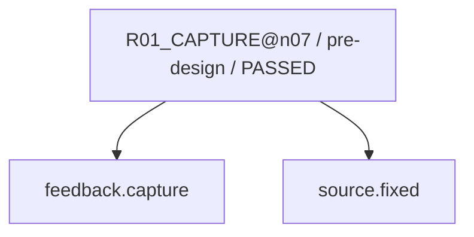

現在: R02_CAUSE@n07 / BLOCKED

# R02_CAUSE@n07（GENERATED）

台帳HEAD: `94a5ec052a938ba2de45c6e31c28cd06311991d820513f374dd79d06c8d21935`

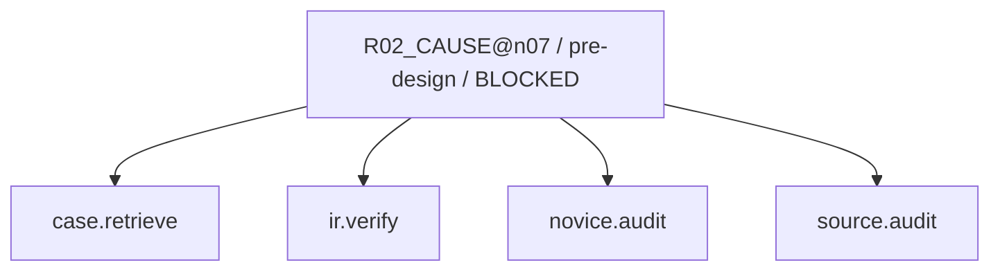

現在: R02_CAUSE@n07 / BLOCKED

# R03_IMPACT@n07（GENERATED）

台帳HEAD: `94a5ec052a938ba2de45c6e31c28cd06311991d820513f374dd79d06c8d21935`

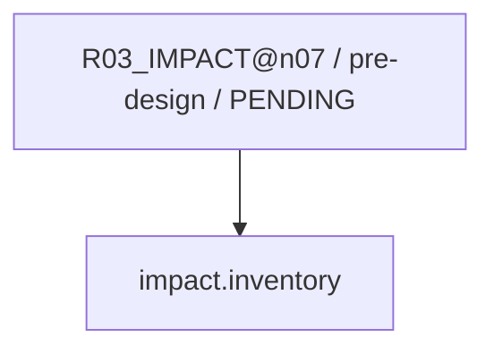

現在: R02_CAUSE@n07 / BLOCKED

# R04_PROPOSAL@n07（GENERATED）

台帳HEAD: `94a5ec052a938ba2de45c6e31c28cd06311991d820513f374dd79d06c8d21935`

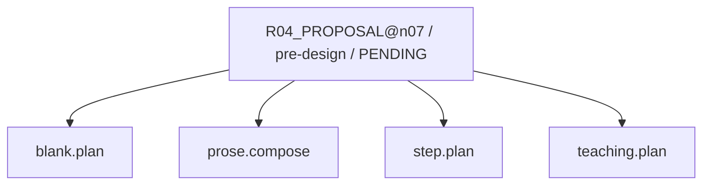

現在: R02_CAUSE@n07 / BLOCKED

# R04_PROPOSAL@n07（GENERATED）

台帳HEAD: `94a5ec052a938ba2de45c6e31c28cd06311991d820513f374dd79d06c8d21935`

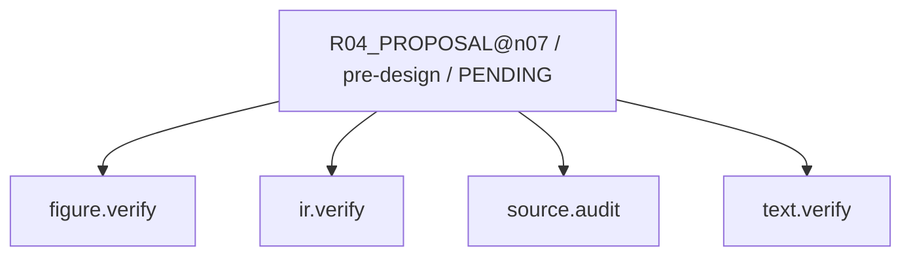

現在: R02_CAUSE@n07 / BLOCKED

# R04_PROPOSAL@n07（GENERATED）

台帳HEAD: `94a5ec052a938ba2de45c6e31c28cd06311991d820513f374dd79d06c8d21935`

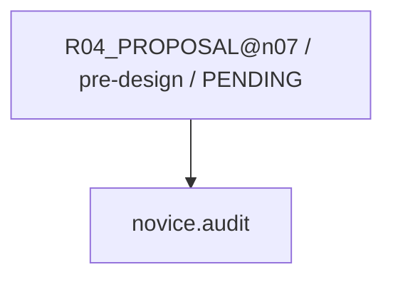

現在: R02_CAUSE@n07 / BLOCKED

# R06_PATCH@n07（GENERATED）

台帳HEAD: `94a5ec052a938ba2de45c6e31c28cd06311991d820513f374dd79d06c8d21935`

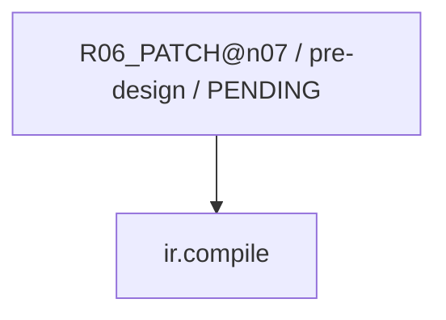

現在: R02_CAUSE@n07 / BLOCKED

# R07_VERIFY@n07（GENERATED）

台帳HEAD: `94a5ec052a938ba2de45c6e31c28cd06311991d820513f374dd79d06c8d21935`

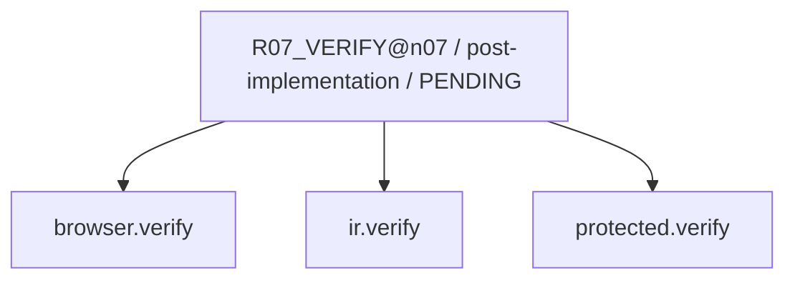

現在: R02_CAUSE@n07 / BLOCKED

# R07_SEMANTIC@n07（GENERATED）

台帳HEAD: `94a5ec052a938ba2de45c6e31c28cd06311991d820513f374dd79d06c8d21935`

現在: R02_CAUSE@n07 / BLOCKED

# G2_AUDIT@n07（GENERATED）

台帳HEAD: `94a5ec052a938ba2de45c6e31c28cd06311991d820513f374dd79d06c8d21935`

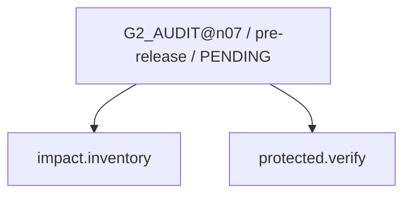

現在: R02_CAUSE@n07 / BLOCKED

# G3_HOST@n07（GENERATED）

台帳HEAD: `94a5ec052a938ba2de45c6e31c28cd06311991d820513f374dd79d06c8d21935`

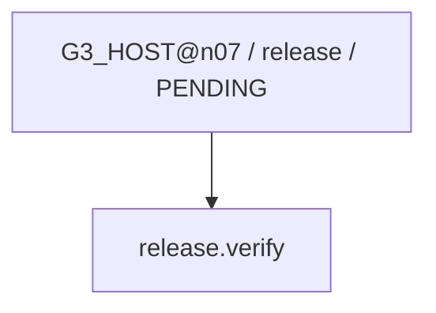

現在: R02_CAUSE@n07 / BLOCKED

# R03_IMPACT_SWEEP@n07（GENERATED）

台帳HEAD: `94a5ec052a938ba2de45c6e31c28cd06311991d820513f374dd79d06c8d21935`

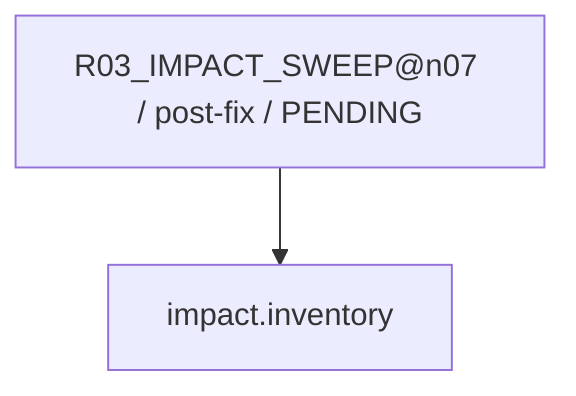

現在: R02_CAUSE@n07 / BLOCKED

# R08_CAPTURE_LEARNING@n07（GENERATED）

台帳HEAD: `94a5ec052a938ba2de45c6e31c28cd06311991d820513f374dd79d06c8d21935`

現在: R02_CAUSE@n07 / BLOCKED

# L01_LEARNING@n07（GENERATED）

台帳HEAD: `94a5ec052a938ba2de45c6e31c28cd06311991d820513f374dd79d06c8d21935`

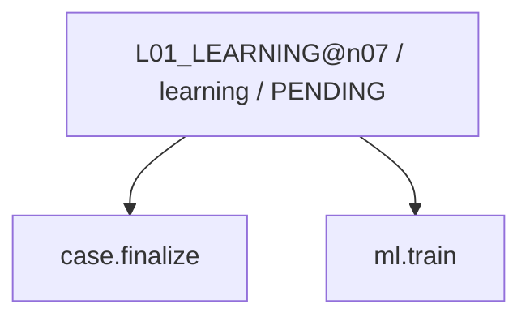

現在: R02_CAUSE@n07 / BLOCKED

code実行receiptはsnapshot.jsonのcapability_receiptsを参照。AIの意味審査は別記録。
