# 機能火柴図（GENERATED）

台帳HEAD: `0d104d0b2bef18d1f51d65851951b1959bf25d8601dcb5d16ab6a08a5f66eadf`

# R01_CAPTURE@n07（GENERATED）

台帳HEAD: `0d104d0b2bef18d1f51d65851951b1959bf25d8601dcb5d16ab6a08a5f66eadf`

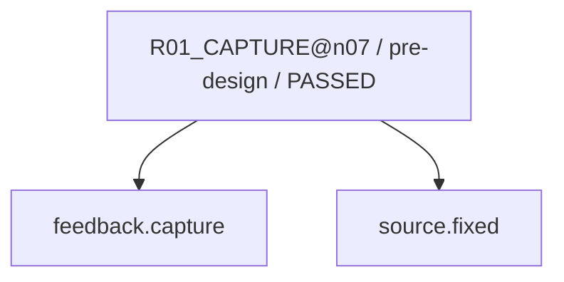

現在: — / DONE

# R02_CAUSE@n07（GENERATED）

台帳HEAD: `0d104d0b2bef18d1f51d65851951b1959bf25d8601dcb5d16ab6a08a5f66eadf`

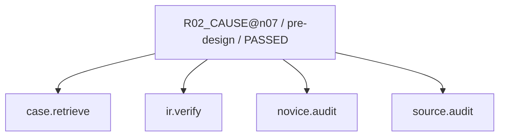

現在: — / DONE

# R03_IMPACT@n07（GENERATED）

台帳HEAD: `0d104d0b2bef18d1f51d65851951b1959bf25d8601dcb5d16ab6a08a5f66eadf`

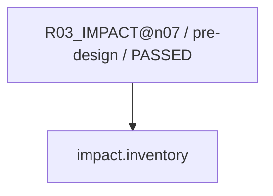

現在: — / DONE

# R04_PROPOSAL@n07（GENERATED）

台帳HEAD: `0d104d0b2bef18d1f51d65851951b1959bf25d8601dcb5d16ab6a08a5f66eadf`

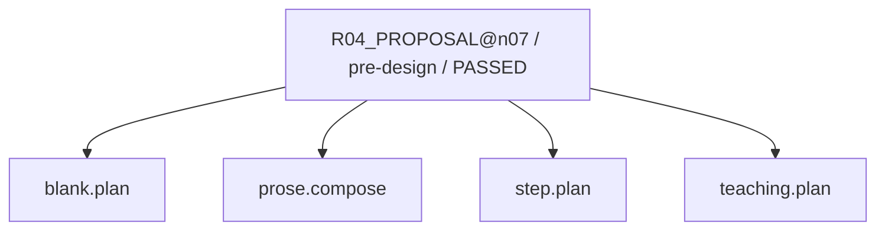

現在: — / DONE

# R04_PROPOSAL@n07（GENERATED）

台帳HEAD: `0d104d0b2bef18d1f51d65851951b1959bf25d8601dcb5d16ab6a08a5f66eadf`

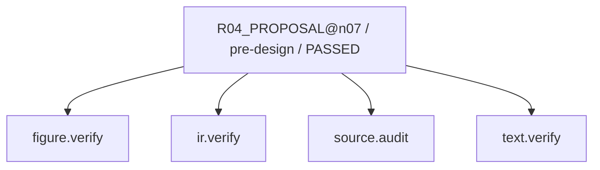

現在: — / DONE

# R04_PROPOSAL@n07（GENERATED）

台帳HEAD: `0d104d0b2bef18d1f51d65851951b1959bf25d8601dcb5d16ab6a08a5f66eadf`

現在: — / DONE

# R06_PATCH@n07（GENERATED）

台帳HEAD: `0d104d0b2bef18d1f51d65851951b1959bf25d8601dcb5d16ab6a08a5f66eadf`

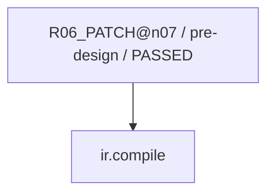

現在: — / DONE

# R07_VERIFY@n07（GENERATED）

台帳HEAD: `0d104d0b2bef18d1f51d65851951b1959bf25d8601dcb5d16ab6a08a5f66eadf`

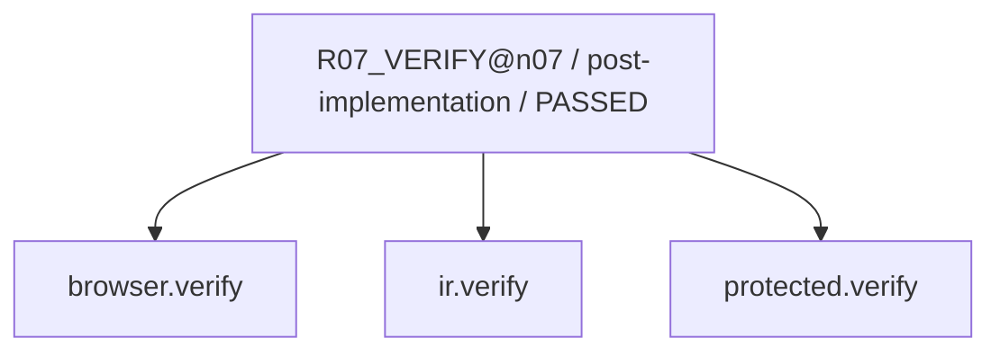

現在: — / DONE

# R07_SEMANTIC@n07（GENERATED）

台帳HEAD: `0d104d0b2bef18d1f51d65851951b1959bf25d8601dcb5d16ab6a08a5f66eadf`

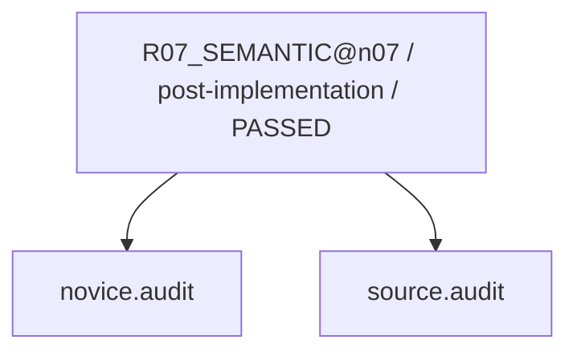

現在: — / DONE

# G2_AUDIT@n07（GENERATED）

台帳HEAD: `0d104d0b2bef18d1f51d65851951b1959bf25d8601dcb5d16ab6a08a5f66eadf`

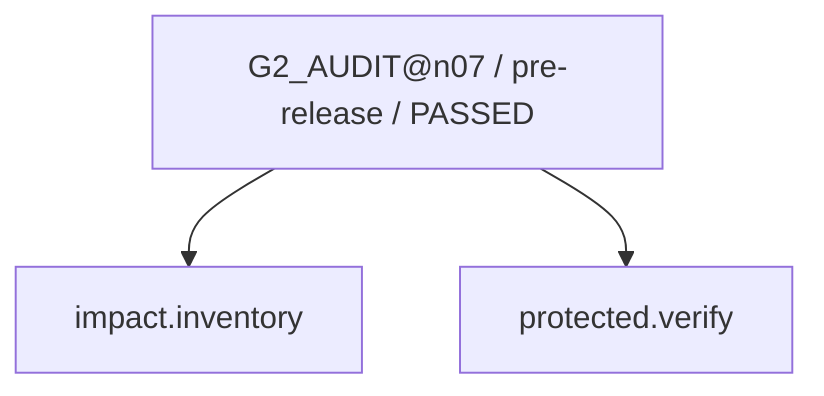

現在: — / DONE

# G3_HOST@n07（GENERATED）

台帳HEAD: `0d104d0b2bef18d1f51d65851951b1959bf25d8601dcb5d16ab6a08a5f66eadf`

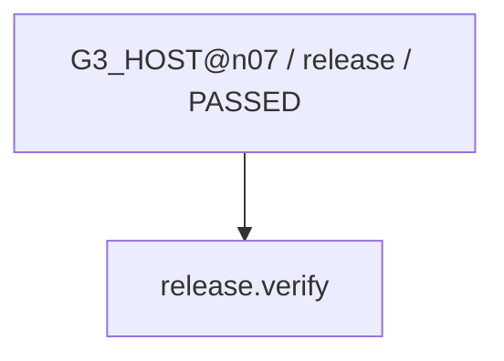

現在: — / DONE

# R03_IMPACT_SWEEP@n07（GENERATED）

台帳HEAD: `0d104d0b2bef18d1f51d65851951b1959bf25d8601dcb5d16ab6a08a5f66eadf`

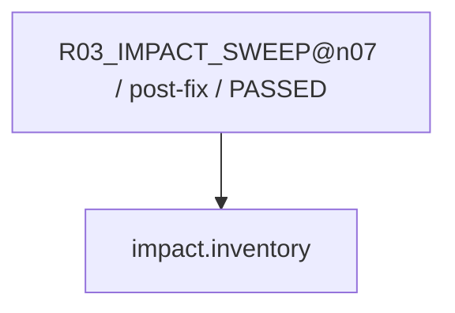

現在: — / DONE

# R08_CAPTURE_LEARNING@n07（GENERATED）

台帳HEAD: `0d104d0b2bef18d1f51d65851951b1959bf25d8601dcb5d16ab6a08a5f66eadf`

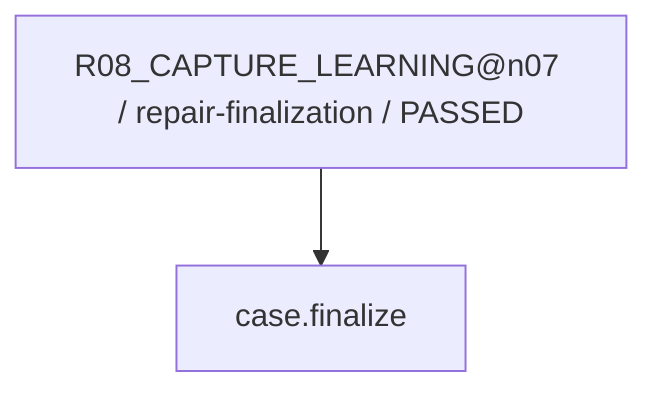

現在: — / DONE

# L01_LEARNING@n07（GENERATED）

台帳HEAD: `0d104d0b2bef18d1f51d65851951b1959bf25d8601dcb5d16ab6a08a5f66eadf`

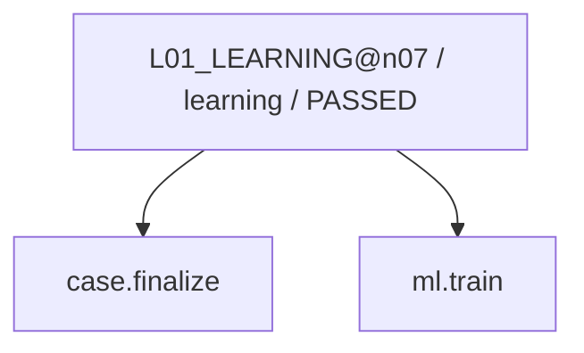

現在: — / DONE

code実行receiptはsnapshot.jsonのcapability_receiptsを参照。AIの意味審査は別記録。
