# 機能火柴図（GENERATED）

台帳HEAD: `8e97767feb584e39604aff63bf75c9174f36cecf31cdc1d4b85ac1342af203d5`

# R01_CAPTURE@n09（GENERATED）

台帳HEAD: `8e97767feb584e39604aff63bf75c9174f36cecf31cdc1d4b85ac1342af203d5`

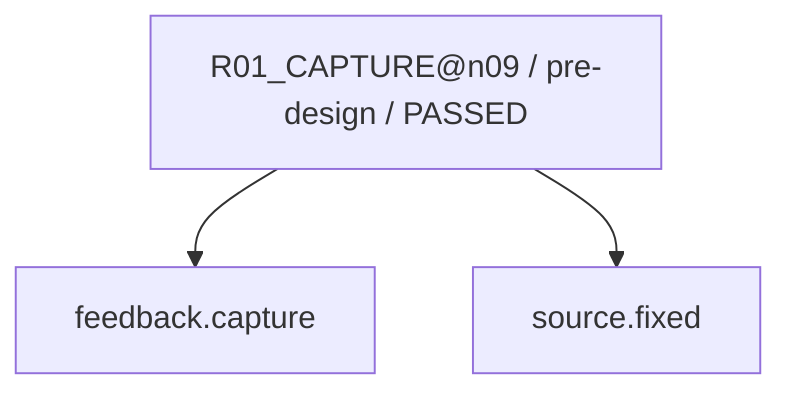

現在: G3_FINAL@n09 / WAITING

# R02_CAUSE@n09（GENERATED）

台帳HEAD: `8e97767feb584e39604aff63bf75c9174f36cecf31cdc1d4b85ac1342af203d5`

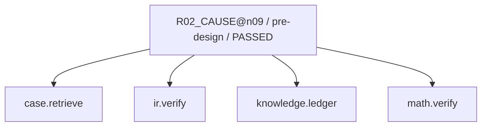

現在: G3_FINAL@n09 / WAITING

# R02_CAUSE@n09（GENERATED）

台帳HEAD: `8e97767feb584e39604aff63bf75c9174f36cecf31cdc1d4b85ac1342af203d5`


現在: G3_FINAL@n09 / WAITING

# R03_IMPACT@n09（GENERATED）

台帳HEAD: `8e97767feb584e39604aff63bf75c9174f36cecf31cdc1d4b85ac1342af203d5`

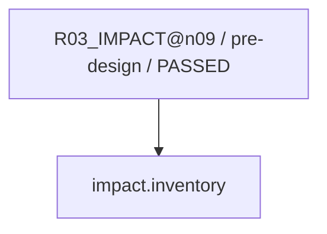

現在: G3_FINAL@n09 / WAITING

# R04_PROPOSAL@n09（GENERATED）

台帳HEAD: `8e97767feb584e39604aff63bf75c9174f36cecf31cdc1d4b85ac1342af203d5`

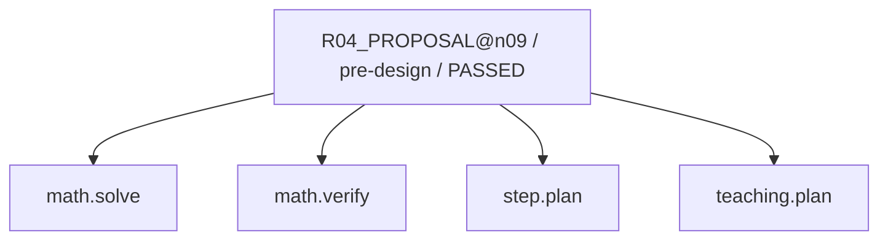

現在: G3_FINAL@n09 / WAITING

# R04_PROPOSAL@n09（GENERATED）

台帳HEAD: `8e97767feb584e39604aff63bf75c9174f36cecf31cdc1d4b85ac1342af203d5`

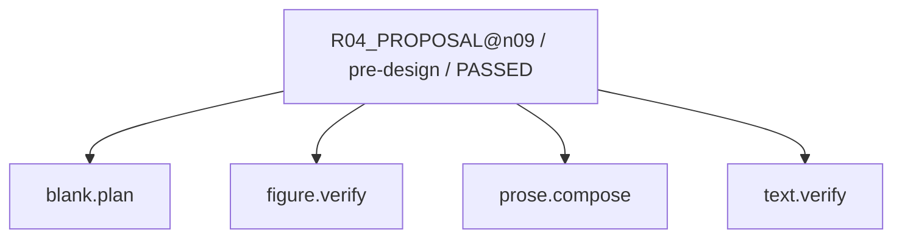

現在: G3_FINAL@n09 / WAITING

# R04_PROPOSAL@n09（GENERATED）

台帳HEAD: `8e97767feb584e39604aff63bf75c9174f36cecf31cdc1d4b85ac1342af203d5`

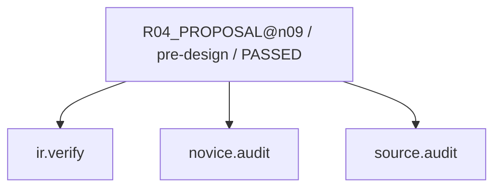

現在: G3_FINAL@n09 / WAITING

# R06_PATCH@n09（GENERATED）

台帳HEAD: `8e97767feb584e39604aff63bf75c9174f36cecf31cdc1d4b85ac1342af203d5`

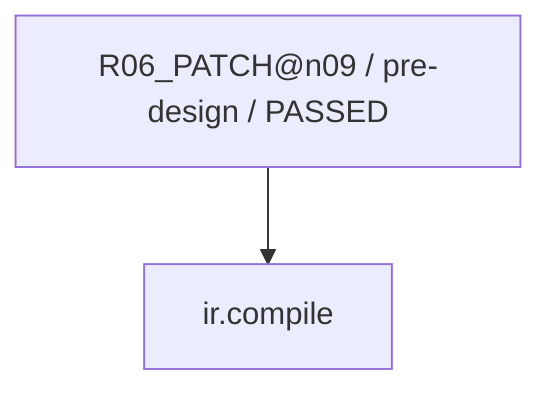

現在: G3_FINAL@n09 / WAITING

# R07_VERIFY@n09（GENERATED）

台帳HEAD: `8e97767feb584e39604aff63bf75c9174f36cecf31cdc1d4b85ac1342af203d5`

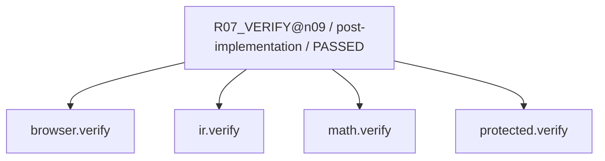

現在: G3_FINAL@n09 / WAITING

# R07_SEMANTIC@n09（GENERATED）

台帳HEAD: `8e97767feb584e39604aff63bf75c9174f36cecf31cdc1d4b85ac1342af203d5`

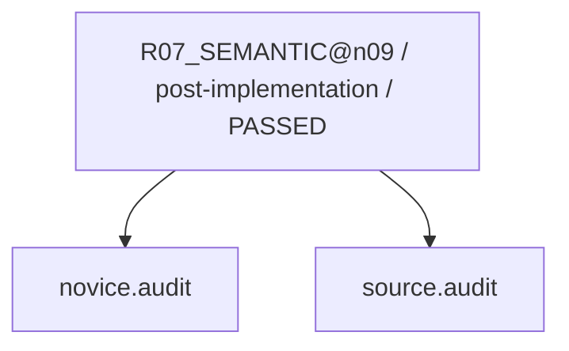

現在: G3_FINAL@n09 / WAITING

# R01_CAPTURE@n10（GENERATED）

台帳HEAD: `8e97767feb584e39604aff63bf75c9174f36cecf31cdc1d4b85ac1342af203d5`


現在: G3_FINAL@n09 / WAITING

# R02_CAUSE@n10（GENERATED）

台帳HEAD: `8e97767feb584e39604aff63bf75c9174f36cecf31cdc1d4b85ac1342af203d5`


現在: G3_FINAL@n09 / WAITING

# R02_CAUSE@n10（GENERATED）

台帳HEAD: `8e97767feb584e39604aff63bf75c9174f36cecf31cdc1d4b85ac1342af203d5`

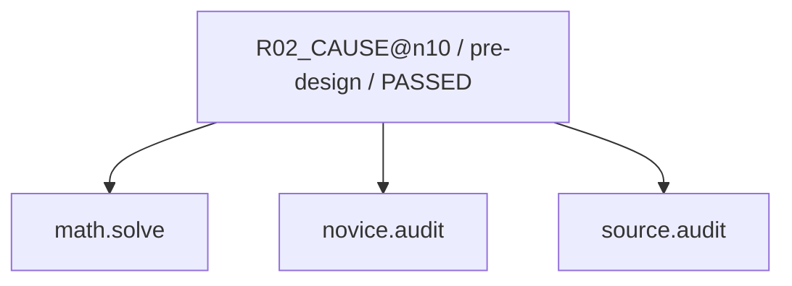

現在: G3_FINAL@n09 / WAITING

# R03_IMPACT@n10（GENERATED）

台帳HEAD: `8e97767feb584e39604aff63bf75c9174f36cecf31cdc1d4b85ac1342af203d5`

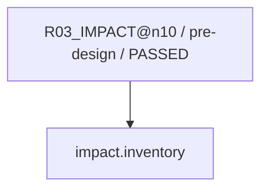

現在: G3_FINAL@n09 / WAITING

# R04_PROPOSAL@n10（GENERATED）

台帳HEAD: `8e97767feb584e39604aff63bf75c9174f36cecf31cdc1d4b85ac1342af203d5`


現在: G3_FINAL@n09 / WAITING

# R04_PROPOSAL@n10（GENERATED）

台帳HEAD: `8e97767feb584e39604aff63bf75c9174f36cecf31cdc1d4b85ac1342af203d5`


現在: G3_FINAL@n09 / WAITING

# R04_PROPOSAL@n10（GENERATED）

台帳HEAD: `8e97767feb584e39604aff63bf75c9174f36cecf31cdc1d4b85ac1342af203d5`


現在: G3_FINAL@n09 / WAITING

# R06_PATCH@n10（GENERATED）

台帳HEAD: `8e97767feb584e39604aff63bf75c9174f36cecf31cdc1d4b85ac1342af203d5`

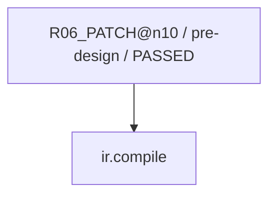

現在: G3_FINAL@n09 / WAITING

# R07_VERIFY@n10（GENERATED）

台帳HEAD: `8e97767feb584e39604aff63bf75c9174f36cecf31cdc1d4b85ac1342af203d5`


現在: G3_FINAL@n09 / WAITING

# R07_SEMANTIC@n10（GENERATED）

台帳HEAD: `8e97767feb584e39604aff63bf75c9174f36cecf31cdc1d4b85ac1342af203d5`

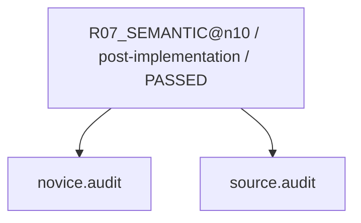

現在: G3_FINAL@n09 / WAITING

# G2_AUDIT@n09（GENERATED）

台帳HEAD: `8e97767feb584e39604aff63bf75c9174f36cecf31cdc1d4b85ac1342af203d5`

```mermaid
flowchart TD
  N0["G2_AUDIT@n09 / pre-release / PASSED"]
  N1["protected.verify"]
  N2["impact.inventory"]
  N0 --> N2
  N0 --> N1
```

現在: G3_FINAL@n09 / WAITING

# G3_HOST@n09（GENERATED）

台帳HEAD: `8e97767feb584e39604aff63bf75c9174f36cecf31cdc1d4b85ac1342af203d5`

```mermaid
flowchart TD
  N0["G3_HOST@n09 / release / PASSED"]
  N1["release.verify"]
  N0 --> N1
```

現在: G3_FINAL@n09 / WAITING

# R03_IMPACT_SWEEP@n09（GENERATED）

台帳HEAD: `8e97767feb584e39604aff63bf75c9174f36cecf31cdc1d4b85ac1342af203d5`

```mermaid
flowchart TD
  N0["R03_IMPACT_SWEEP@n09 / post-fix / PENDING"]
  N1["impact.inventory"]
  N0 --> N1
```

現在: G3_FINAL@n09 / WAITING

# R08_CAPTURE_LEARNING@n09（GENERATED）

台帳HEAD: `8e97767feb584e39604aff63bf75c9174f36cecf31cdc1d4b85ac1342af203d5`

```mermaid
flowchart TD
  N0["R08_CAPTURE_LEARNING@n09 / repair-finalization / PENDING"]
  N1["case.finalize"]
  N0 --> N1
```

現在: G3_FINAL@n09 / WAITING

# L01_LEARNING@n09（GENERATED）

台帳HEAD: `8e97767feb584e39604aff63bf75c9174f36cecf31cdc1d4b85ac1342af203d5`

```mermaid
flowchart TD
  N0["L01_LEARNING@n09 / learning / PENDING"]
  N1["case.finalize"]
  N2["ml.train"]
  N0 --> N1
  N0 --> N2
```

現在: G3_FINAL@n09 / WAITING

# G2_AUDIT@n10（GENERATED）

台帳HEAD: `8e97767feb584e39604aff63bf75c9174f36cecf31cdc1d4b85ac1342af203d5`

```mermaid
flowchart TD
  N0["G2_AUDIT@n10 / pre-release / PASSED"]
  N1["protected.verify"]
  N2["impact.inventory"]
  N0 --> N2
  N0 --> N1
```

現在: G3_FINAL@n09 / WAITING

# G3_HOST@n10（GENERATED）

台帳HEAD: `8e97767feb584e39604aff63bf75c9174f36cecf31cdc1d4b85ac1342af203d5`

```mermaid
flowchart TD
  N0["G3_HOST@n10 / release / PASSED"]
  N1["release.verify"]
  N0 --> N1
```

現在: G3_FINAL@n09 / WAITING

# R03_IMPACT_SWEEP@n10（GENERATED）

台帳HEAD: `8e97767feb584e39604aff63bf75c9174f36cecf31cdc1d4b85ac1342af203d5`

```mermaid
flowchart TD
  N0["R03_IMPACT_SWEEP@n10 / post-fix / PENDING"]
  N1["impact.inventory"]
  N0 --> N1
```

現在: G3_FINAL@n09 / WAITING

# R08_CAPTURE_LEARNING@n10（GENERATED）

台帳HEAD: `8e97767feb584e39604aff63bf75c9174f36cecf31cdc1d4b85ac1342af203d5`

```mermaid
flowchart TD
  N0["R08_CAPTURE_LEARNING@n10 / repair-finalization / PENDING"]
  N1["case.finalize"]
  N0 --> N1
```

現在: G3_FINAL@n09 / WAITING

# L01_LEARNING@n10（GENERATED）

台帳HEAD: `8e97767feb584e39604aff63bf75c9174f36cecf31cdc1d4b85ac1342af203d5`

```mermaid
flowchart TD
  N0["L01_LEARNING@n10 / learning / PENDING"]
  N1["case.finalize"]
  N2["ml.train"]
  N0 --> N1
  N0 --> N2
```

現在: G3_FINAL@n09 / WAITING

code実行receiptはsnapshot.jsonのcapability_receiptsを参照。AIの意味審査は別記録。
