# 機能火柴図（GENERATED）

台帳HEAD: `d5f61447a68048293425464e5c7460291d84922c880da39b2744b98e260609f0`

# R01_CAPTURE@ne02（GENERATED）

台帳HEAD: `d5f61447a68048293425464e5c7460291d84922c880da39b2744b98e260609f0`

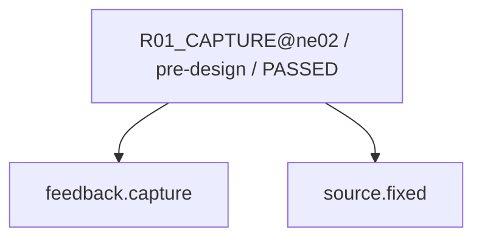

現在: R07_VERIFY@ne02 / READY

# R02_CAUSE@ne02（GENERATED）

台帳HEAD: `d5f61447a68048293425464e5c7460291d84922c880da39b2744b98e260609f0`


現在: R07_VERIFY@ne02 / READY

# R02_CAUSE@ne02（GENERATED）

台帳HEAD: `d5f61447a68048293425464e5c7460291d84922c880da39b2744b98e260609f0`


現在: R07_VERIFY@ne02 / READY

# R03_IMPACT@ne02（GENERATED）

台帳HEAD: `d5f61447a68048293425464e5c7460291d84922c880da39b2744b98e260609f0`

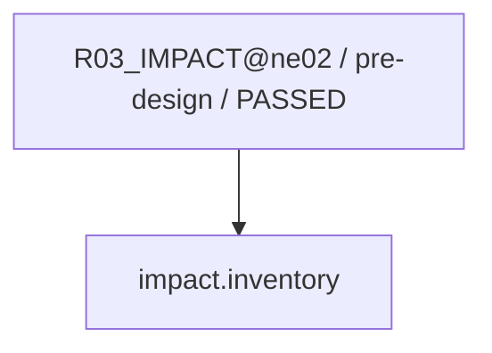

現在: R07_VERIFY@ne02 / READY

# R04_PROPOSAL@ne02（GENERATED）

台帳HEAD: `d5f61447a68048293425464e5c7460291d84922c880da39b2744b98e260609f0`

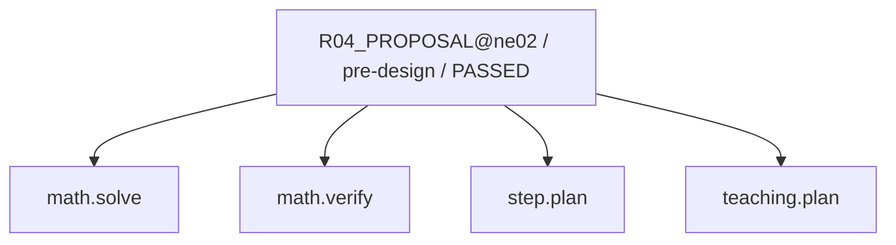

現在: R07_VERIFY@ne02 / READY

# R04_PROPOSAL@ne02（GENERATED）

台帳HEAD: `d5f61447a68048293425464e5c7460291d84922c880da39b2744b98e260609f0`


現在: R07_VERIFY@ne02 / READY

# R04_PROPOSAL@ne02（GENERATED）

台帳HEAD: `d5f61447a68048293425464e5c7460291d84922c880da39b2744b98e260609f0`


現在: R07_VERIFY@ne02 / READY

# R06_PATCH@ne02（GENERATED）

台帳HEAD: `d5f61447a68048293425464e5c7460291d84922c880da39b2744b98e260609f0`

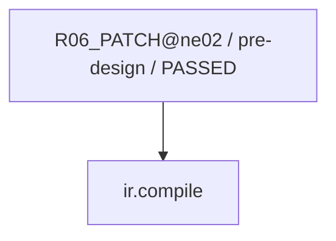

現在: R07_VERIFY@ne02 / READY

# R07_VERIFY@ne02（GENERATED）

台帳HEAD: `d5f61447a68048293425464e5c7460291d84922c880da39b2744b98e260609f0`

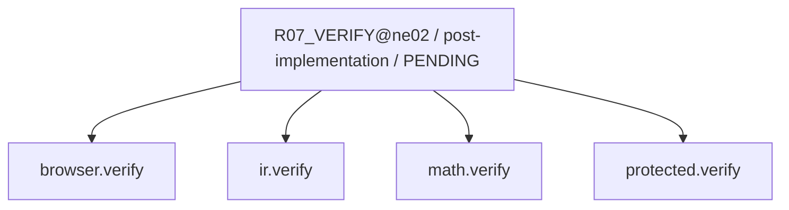

現在: R07_VERIFY@ne02 / READY

# R07_SEMANTIC@ne02（GENERATED）

台帳HEAD: `d5f61447a68048293425464e5c7460291d84922c880da39b2744b98e260609f0`

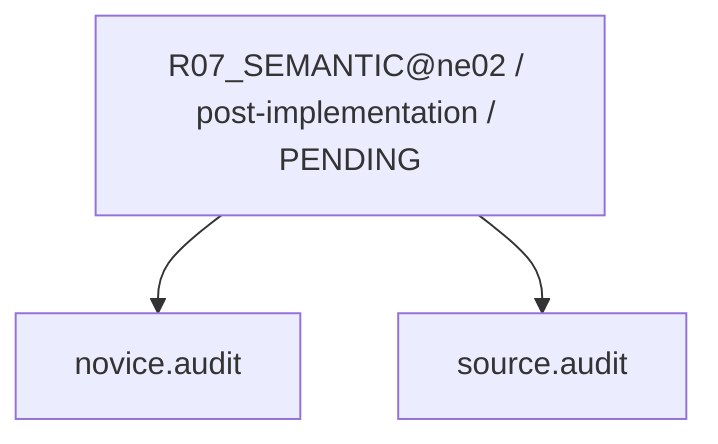

現在: R07_VERIFY@ne02 / READY

# R01_CAPTURE@n11（GENERATED）

台帳HEAD: `d5f61447a68048293425464e5c7460291d84922c880da39b2744b98e260609f0`

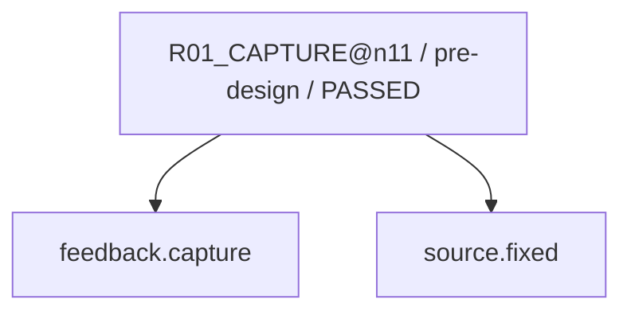

現在: R07_VERIFY@ne02 / READY

# R02_CAUSE@n11（GENERATED）

台帳HEAD: `d5f61447a68048293425464e5c7460291d84922c880da39b2744b98e260609f0`

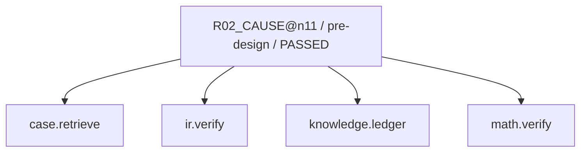

現在: R07_VERIFY@ne02 / READY

# R02_CAUSE@n11（GENERATED）

台帳HEAD: `d5f61447a68048293425464e5c7460291d84922c880da39b2744b98e260609f0`

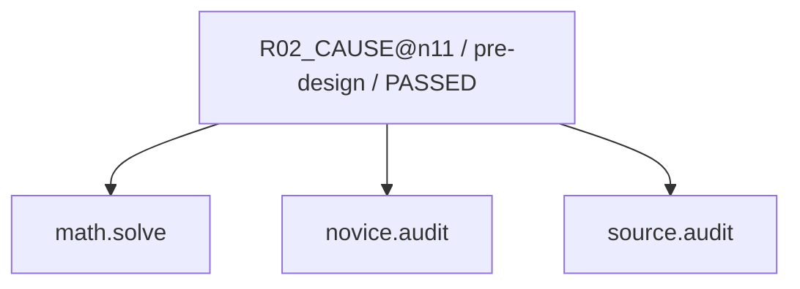

現在: R07_VERIFY@ne02 / READY

# R03_IMPACT@n11（GENERATED）

台帳HEAD: `d5f61447a68048293425464e5c7460291d84922c880da39b2744b98e260609f0`

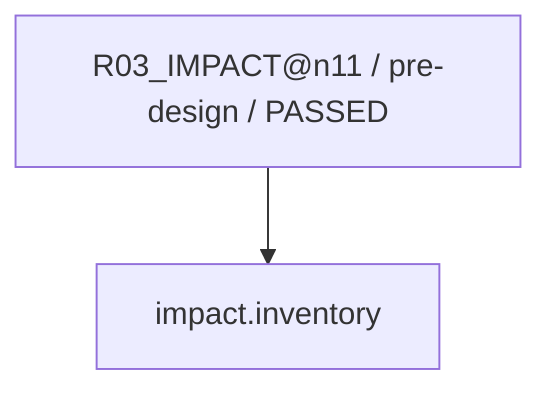

現在: R07_VERIFY@ne02 / READY

# R04_PROPOSAL@n11（GENERATED）

台帳HEAD: `d5f61447a68048293425464e5c7460291d84922c880da39b2744b98e260609f0`

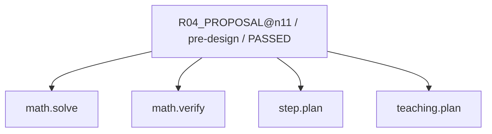

現在: R07_VERIFY@ne02 / READY

# R04_PROPOSAL@n11（GENERATED）

台帳HEAD: `d5f61447a68048293425464e5c7460291d84922c880da39b2744b98e260609f0`

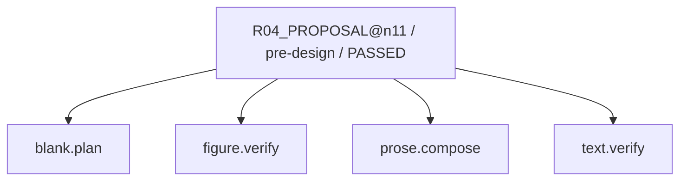

現在: R07_VERIFY@ne02 / READY

# R04_PROPOSAL@n11（GENERATED）

台帳HEAD: `d5f61447a68048293425464e5c7460291d84922c880da39b2744b98e260609f0`

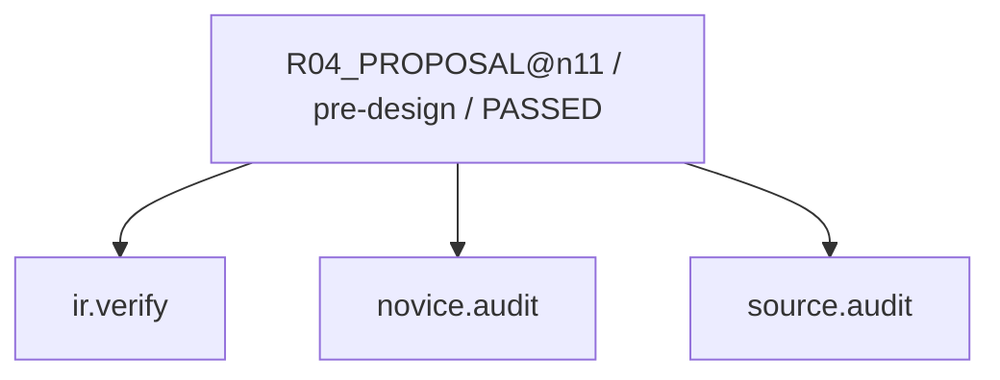

現在: R07_VERIFY@ne02 / READY

# R06_PATCH@n11（GENERATED）

台帳HEAD: `d5f61447a68048293425464e5c7460291d84922c880da39b2744b98e260609f0`

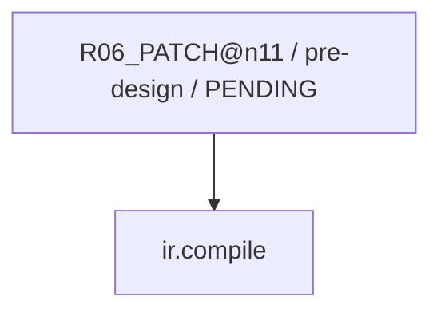

現在: R07_VERIFY@ne02 / READY

# R07_VERIFY@n11（GENERATED）

台帳HEAD: `d5f61447a68048293425464e5c7460291d84922c880da39b2744b98e260609f0`


現在: R07_VERIFY@ne02 / READY

# R07_SEMANTIC@n11（GENERATED）

台帳HEAD: `d5f61447a68048293425464e5c7460291d84922c880da39b2744b98e260609f0`

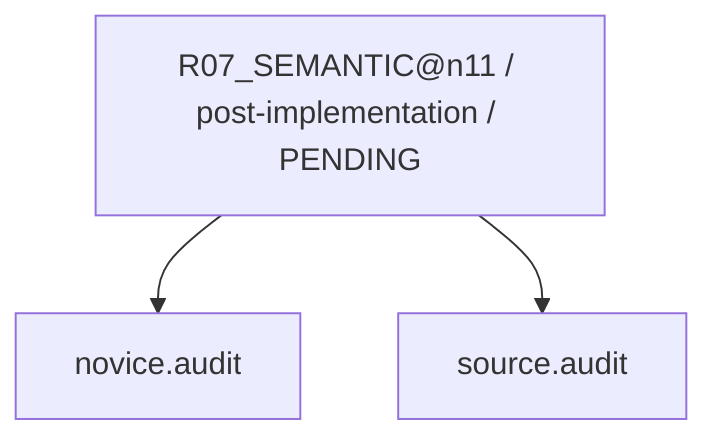

現在: R07_VERIFY@ne02 / READY

# R01_CAPTURE@n12（GENERATED）

台帳HEAD: `d5f61447a68048293425464e5c7460291d84922c880da39b2744b98e260609f0`

```mermaid
flowchart TD
  N0["R01_CAPTURE@n12 / pre-design / PASSED"]
  N1["source.fixed"]
  N2["feedback.capture"]
  N0 --> N2
  N0 --> N1
```

現在: R07_VERIFY@ne02 / READY

# R02_CAUSE@n12（GENERATED）

台帳HEAD: `d5f61447a68048293425464e5c7460291d84922c880da39b2744b98e260609f0`

```mermaid
flowchart TD
  N0["R02_CAUSE@n12 / pre-design / PASSED"]
  N1["case.retrieve"]
  N2["knowledge.ledger"]
  N3["math.verify"]
  N4["ir.verify"]
  N0 --> N1
  N0 --> N4
  N0 --> N2
  N0 --> N3
```

現在: R07_VERIFY@ne02 / READY

# R02_CAUSE@n12（GENERATED）

台帳HEAD: `d5f61447a68048293425464e5c7460291d84922c880da39b2744b98e260609f0`

```mermaid
flowchart TD
  N0["R02_CAUSE@n12 / pre-design / PASSED"]
  N1["source.audit"]
  N2["novice.audit"]
  N3["math.solve"]
  N0 --> N3
  N0 --> N2
  N0 --> N1
```

現在: R07_VERIFY@ne02 / READY

# R03_IMPACT@n12（GENERATED）

台帳HEAD: `d5f61447a68048293425464e5c7460291d84922c880da39b2744b98e260609f0`

```mermaid
flowchart TD
  N0["R03_IMPACT@n12 / pre-design / PASSED"]
  N1["impact.inventory"]
  N0 --> N1
```

現在: R07_VERIFY@ne02 / READY

# R04_PROPOSAL@n12（GENERATED）

台帳HEAD: `d5f61447a68048293425464e5c7460291d84922c880da39b2744b98e260609f0`

```mermaid
flowchart TD
  N0["R04_PROPOSAL@n12 / pre-design / PASSED"]
  N1["math.solve"]
  N2["math.verify"]
  N3["teaching.plan"]
  N4["step.plan"]
  N0 --> N1
  N0 --> N2
  N0 --> N4
  N0 --> N3
```

現在: R07_VERIFY@ne02 / READY

# R04_PROPOSAL@n12（GENERATED）

台帳HEAD: `d5f61447a68048293425464e5c7460291d84922c880da39b2744b98e260609f0`

```mermaid
flowchart TD
  N0["R04_PROPOSAL@n12 / pre-design / PASSED"]
  N1["blank.plan"]
  N2["prose.compose"]
  N3["text.verify"]
  N4["figure.verify"]
  N0 --> N1
  N0 --> N4
  N0 --> N2
  N0 --> N3
```

現在: R07_VERIFY@ne02 / READY

# R04_PROPOSAL@n12（GENERATED）

台帳HEAD: `d5f61447a68048293425464e5c7460291d84922c880da39b2744b98e260609f0`

```mermaid
flowchart TD
  N0["R04_PROPOSAL@n12 / pre-design / PASSED"]
  N1["ir.verify"]
  N2["source.audit"]
  N3["novice.audit"]
  N0 --> N1
  N0 --> N3
  N0 --> N2
```

現在: R07_VERIFY@ne02 / READY

# R06_PATCH@n12（GENERATED）

台帳HEAD: `d5f61447a68048293425464e5c7460291d84922c880da39b2744b98e260609f0`

```mermaid
flowchart TD
  N0["R06_PATCH@n12 / pre-design / PENDING"]
  N1["ir.compile"]
  N0 --> N1
```

現在: R07_VERIFY@ne02 / READY

# R07_VERIFY@n12（GENERATED）

台帳HEAD: `d5f61447a68048293425464e5c7460291d84922c880da39b2744b98e260609f0`

```mermaid
flowchart TD
  N0["R07_VERIFY@n12 / post-implementation / PENDING"]
  N1["math.verify"]
  N2["ir.verify"]
  N3["browser.verify"]
  N4["protected.verify"]
  N0 --> N3
  N0 --> N2
  N0 --> N1
  N0 --> N4
```

現在: R07_VERIFY@ne02 / READY

# R07_SEMANTIC@n12（GENERATED）

台帳HEAD: `d5f61447a68048293425464e5c7460291d84922c880da39b2744b98e260609f0`

```mermaid
flowchart TD
  N0["R07_SEMANTIC@n12 / post-implementation / PENDING"]
  N1["source.audit"]
  N2["novice.audit"]
  N0 --> N2
  N0 --> N1
```

現在: R07_VERIFY@ne02 / READY

# G2_AUDIT@ne02（GENERATED）

台帳HEAD: `d5f61447a68048293425464e5c7460291d84922c880da39b2744b98e260609f0`

```mermaid
flowchart TD
  N0["G2_AUDIT@ne02 / pre-release / PENDING"]
  N1["protected.verify"]
  N2["impact.inventory"]
  N0 --> N2
  N0 --> N1
```

現在: R07_VERIFY@ne02 / READY

# G3_HOST@ne02（GENERATED）

台帳HEAD: `d5f61447a68048293425464e5c7460291d84922c880da39b2744b98e260609f0`

```mermaid
flowchart TD
  N0["G3_HOST@ne02 / release / PENDING"]
  N1["release.verify"]
  N0 --> N1
```

現在: R07_VERIFY@ne02 / READY

# R03_IMPACT_SWEEP@ne02（GENERATED）

台帳HEAD: `d5f61447a68048293425464e5c7460291d84922c880da39b2744b98e260609f0`

```mermaid
flowchart TD
  N0["R03_IMPACT_SWEEP@ne02 / post-fix / PENDING"]
  N1["impact.inventory"]
  N0 --> N1
```

現在: R07_VERIFY@ne02 / READY

# R08_CAPTURE_LEARNING@ne02（GENERATED）

台帳HEAD: `d5f61447a68048293425464e5c7460291d84922c880da39b2744b98e260609f0`

```mermaid
flowchart TD
  N0["R08_CAPTURE_LEARNING@ne02 / repair-finalization / PENDING"]
  N1["case.finalize"]
  N0 --> N1
```

現在: R07_VERIFY@ne02 / READY

# L01_LEARNING@ne02（GENERATED）

台帳HEAD: `d5f61447a68048293425464e5c7460291d84922c880da39b2744b98e260609f0`

```mermaid
flowchart TD
  N0["L01_LEARNING@ne02 / learning / PENDING"]
  N1["case.finalize"]
  N2["ml.train"]
  N0 --> N1
  N0 --> N2
```

現在: R07_VERIFY@ne02 / READY

# G2_AUDIT@n11（GENERATED）

台帳HEAD: `d5f61447a68048293425464e5c7460291d84922c880da39b2744b98e260609f0`

```mermaid
flowchart TD
  N0["G2_AUDIT@n11 / pre-release / PENDING"]
  N1["protected.verify"]
  N2["impact.inventory"]
  N0 --> N2
  N0 --> N1
```

現在: R07_VERIFY@ne02 / READY

# G3_HOST@n11（GENERATED）

台帳HEAD: `d5f61447a68048293425464e5c7460291d84922c880da39b2744b98e260609f0`

```mermaid
flowchart TD
  N0["G3_HOST@n11 / release / PENDING"]
  N1["release.verify"]
  N0 --> N1
```

現在: R07_VERIFY@ne02 / READY

# R03_IMPACT_SWEEP@n11（GENERATED）

台帳HEAD: `d5f61447a68048293425464e5c7460291d84922c880da39b2744b98e260609f0`

```mermaid
flowchart TD
  N0["R03_IMPACT_SWEEP@n11 / post-fix / PENDING"]
  N1["impact.inventory"]
  N0 --> N1
```

現在: R07_VERIFY@ne02 / READY

# R08_CAPTURE_LEARNING@n11（GENERATED）

台帳HEAD: `d5f61447a68048293425464e5c7460291d84922c880da39b2744b98e260609f0`

```mermaid
flowchart TD
  N0["R08_CAPTURE_LEARNING@n11 / repair-finalization / PENDING"]
  N1["case.finalize"]
  N0 --> N1
```

現在: R07_VERIFY@ne02 / READY

# L01_LEARNING@n11（GENERATED）

台帳HEAD: `d5f61447a68048293425464e5c7460291d84922c880da39b2744b98e260609f0`

```mermaid
flowchart TD
  N0["L01_LEARNING@n11 / learning / PENDING"]
  N1["case.finalize"]
  N2["ml.train"]
  N0 --> N1
  N0 --> N2
```

現在: R07_VERIFY@ne02 / READY

# G2_AUDIT@n12（GENERATED）

台帳HEAD: `d5f61447a68048293425464e5c7460291d84922c880da39b2744b98e260609f0`

```mermaid
flowchart TD
  N0["G2_AUDIT@n12 / pre-release / PENDING"]
  N1["protected.verify"]
  N2["impact.inventory"]
  N0 --> N2
  N0 --> N1
```

現在: R07_VERIFY@ne02 / READY

# G3_HOST@n12（GENERATED）

台帳HEAD: `d5f61447a68048293425464e5c7460291d84922c880da39b2744b98e260609f0`

```mermaid
flowchart TD
  N0["G3_HOST@n12 / release / PENDING"]
  N1["release.verify"]
  N0 --> N1
```

現在: R07_VERIFY@ne02 / READY

# R03_IMPACT_SWEEP@n12（GENERATED）

台帳HEAD: `d5f61447a68048293425464e5c7460291d84922c880da39b2744b98e260609f0`

```mermaid
flowchart TD
  N0["R03_IMPACT_SWEEP@n12 / post-fix / PENDING"]
  N1["impact.inventory"]
  N0 --> N1
```

現在: R07_VERIFY@ne02 / READY

# R08_CAPTURE_LEARNING@n12（GENERATED）

台帳HEAD: `d5f61447a68048293425464e5c7460291d84922c880da39b2744b98e260609f0`

```mermaid
flowchart TD
  N0["R08_CAPTURE_LEARNING@n12 / repair-finalization / PENDING"]
  N1["case.finalize"]
  N0 --> N1
```

現在: R07_VERIFY@ne02 / READY

# L01_LEARNING@n12（GENERATED）

台帳HEAD: `d5f61447a68048293425464e5c7460291d84922c880da39b2744b98e260609f0`

```mermaid
flowchart TD
  N0["L01_LEARNING@n12 / learning / PENDING"]
  N1["case.finalize"]
  N2["ml.train"]
  N0 --> N1
  N0 --> N2
```

現在: R07_VERIFY@ne02 / READY

code実行receiptはsnapshot.jsonのcapability_receiptsを参照。AIの意味審査は別記録。
