# 機能火柴図（GENERATED）

台帳HEAD: `0188dbd617a3329d2c586629c334964049de84fa6c94b9ad7e5ca72ad80036c8`

# R01_CAPTURE@n08（GENERATED）

台帳HEAD: `0188dbd617a3329d2c586629c334964049de84fa6c94b9ad7e5ca72ad80036c8`

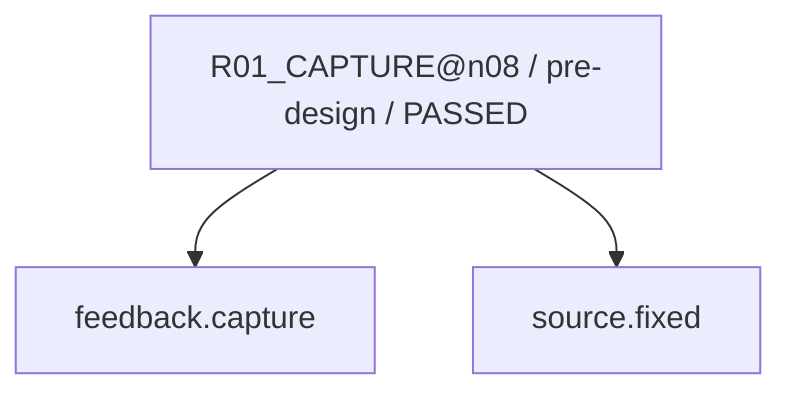

現在: R07_VERIFY@n08 / READY

# R02_CAUSE@n08（GENERATED）

台帳HEAD: `0188dbd617a3329d2c586629c334964049de84fa6c94b9ad7e5ca72ad80036c8`

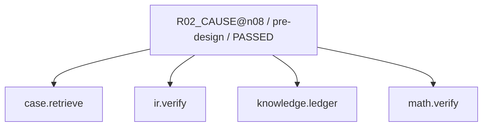

現在: R07_VERIFY@n08 / READY

# R02_CAUSE@n08（GENERATED）

台帳HEAD: `0188dbd617a3329d2c586629c334964049de84fa6c94b9ad7e5ca72ad80036c8`

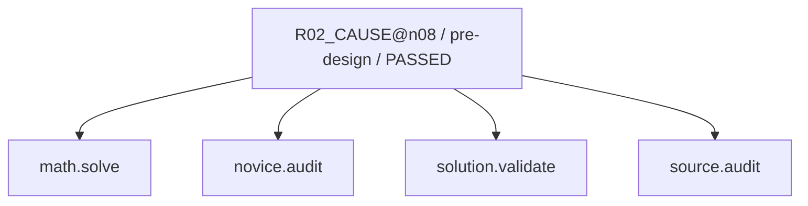

現在: R07_VERIFY@n08 / READY

# R03_IMPACT@n08（GENERATED）

台帳HEAD: `0188dbd617a3329d2c586629c334964049de84fa6c94b9ad7e5ca72ad80036c8`

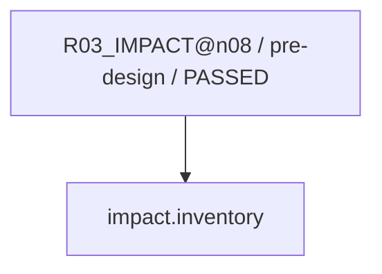

現在: R07_VERIFY@n08 / READY

# R04_PROPOSAL@n08（GENERATED）

台帳HEAD: `0188dbd617a3329d2c586629c334964049de84fa6c94b9ad7e5ca72ad80036c8`

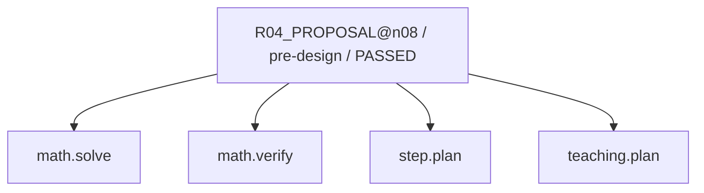

現在: R07_VERIFY@n08 / READY

# R04_PROPOSAL@n08（GENERATED）

台帳HEAD: `0188dbd617a3329d2c586629c334964049de84fa6c94b9ad7e5ca72ad80036c8`

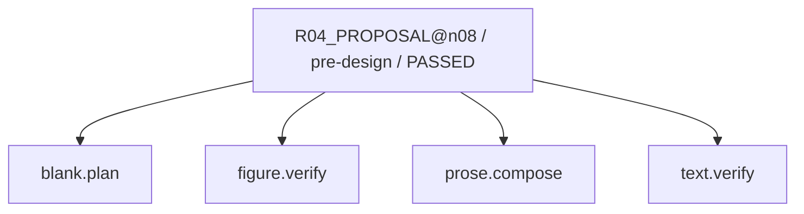

現在: R07_VERIFY@n08 / READY

# R04_PROPOSAL@n08（GENERATED）

台帳HEAD: `0188dbd617a3329d2c586629c334964049de84fa6c94b9ad7e5ca72ad80036c8`

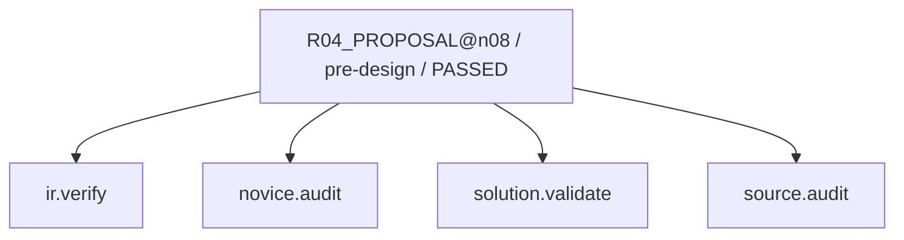

現在: R07_VERIFY@n08 / READY

# R04_PROPOSAL@n08（GENERATED）

台帳HEAD: `0188dbd617a3329d2c586629c334964049de84fa6c94b9ad7e5ca72ad80036c8`

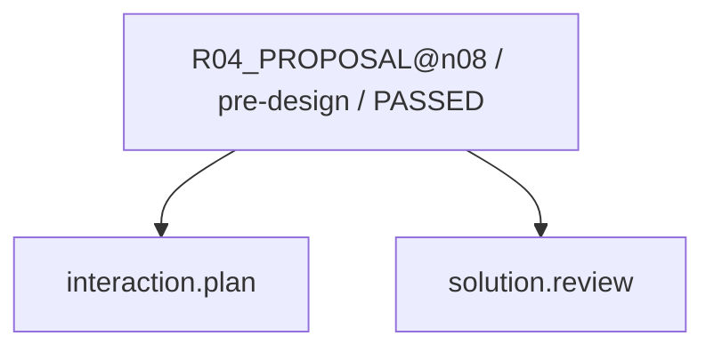

現在: R07_VERIFY@n08 / READY

# R06_PATCH@n08（GENERATED）

台帳HEAD: `0188dbd617a3329d2c586629c334964049de84fa6c94b9ad7e5ca72ad80036c8`

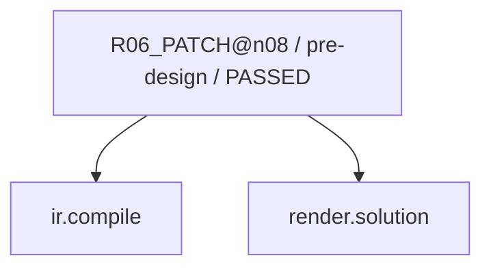

現在: R07_VERIFY@n08 / READY

# R07_VERIFY@n08（GENERATED）

台帳HEAD: `0188dbd617a3329d2c586629c334964049de84fa6c94b9ad7e5ca72ad80036c8`

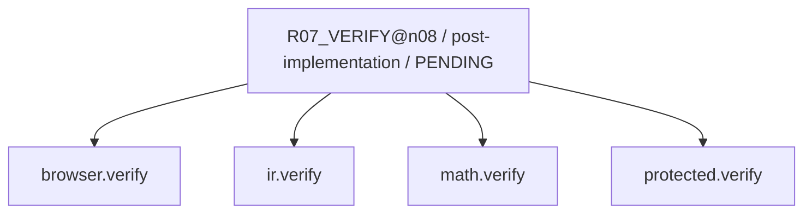

現在: R07_VERIFY@n08 / READY

# R07_VERIFY@n08（GENERATED）

台帳HEAD: `0188dbd617a3329d2c586629c334964049de84fa6c94b9ad7e5ca72ad80036c8`

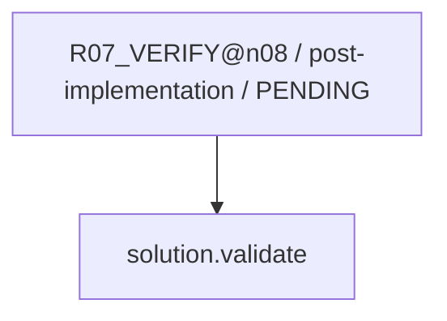

現在: R07_VERIFY@n08 / READY

# R07_SEMANTIC@n08（GENERATED）

台帳HEAD: `0188dbd617a3329d2c586629c334964049de84fa6c94b9ad7e5ca72ad80036c8`

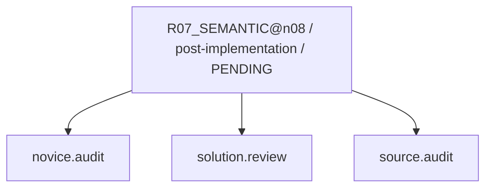

現在: R07_VERIFY@n08 / READY

# G2_AUDIT@n08（GENERATED）

台帳HEAD: `0188dbd617a3329d2c586629c334964049de84fa6c94b9ad7e5ca72ad80036c8`

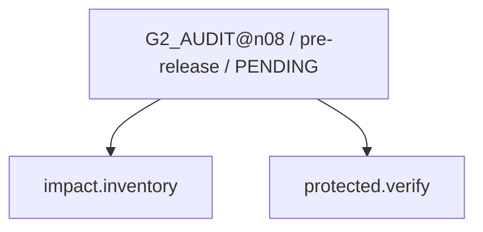

現在: R07_VERIFY@n08 / READY

# G3_HOST@n08（GENERATED）

台帳HEAD: `0188dbd617a3329d2c586629c334964049de84fa6c94b9ad7e5ca72ad80036c8`

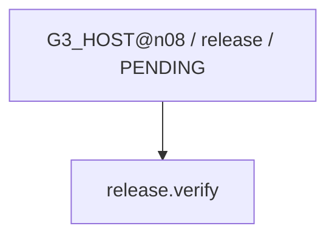

現在: R07_VERIFY@n08 / READY

# R03_IMPACT_SWEEP@n08（GENERATED）

台帳HEAD: `0188dbd617a3329d2c586629c334964049de84fa6c94b9ad7e5ca72ad80036c8`

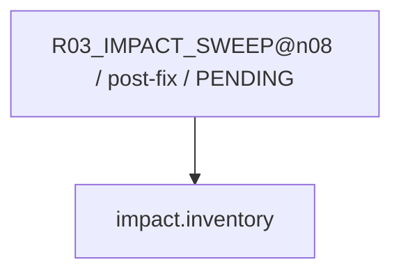

現在: R07_VERIFY@n08 / READY

# R08_CAPTURE_LEARNING@n08（GENERATED）

台帳HEAD: `0188dbd617a3329d2c586629c334964049de84fa6c94b9ad7e5ca72ad80036c8`

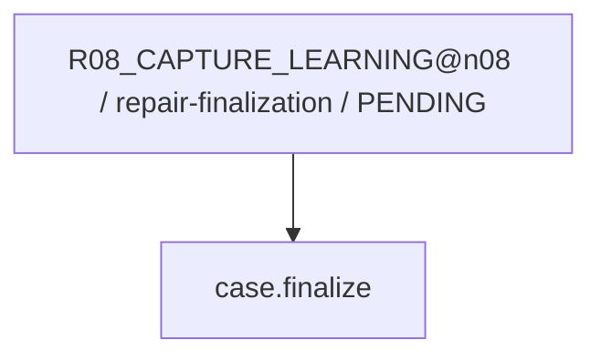

現在: R07_VERIFY@n08 / READY

# L01_LEARNING@n08（GENERATED）

台帳HEAD: `0188dbd617a3329d2c586629c334964049de84fa6c94b9ad7e5ca72ad80036c8`

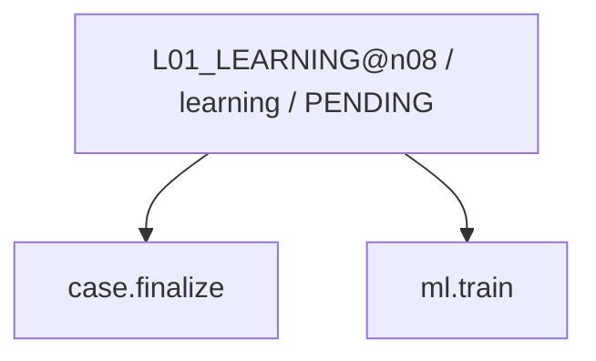

現在: R07_VERIFY@n08 / READY

code実行receiptはsnapshot.jsonのcapability_receiptsを参照。AIの意味審査は別記録。
