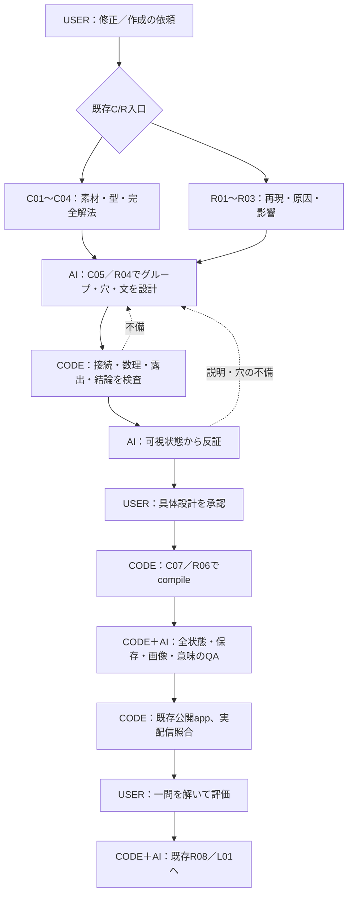

# 通常の数式変形を、一続きの解答として教えるための改修提案書

**W-MATH-038 / P-001 — PROPOSED・実装承認待ち**  
作成日：2026年10月26日。対象：数学・教科書／学習モード。  
今回の成果物は設計書のみ。教材・本番コード・公開設定・保存履歴・学習モデルは変更していない。

## 1. 今回決めること

通常の数式変形について、内部には省略のない小段階を保持し、学習画面ではそれらを関連した一つの式列へまとめる。式列の必要な箇所に穴と短い説明を置き、最後の行で解答が完結する場合は同じ答えを別枠で繰り返さない。

ユーザーの補足は「以前の分け方は誤りではない。概念形成や通常の式変形ではない内容では意味がある」というもの。したがって、全教材へ同じ圧縮を適用しない。既存の定義・性質・証明・場合分け・図の読み取りの構成を尊重する。

### 変更前 → 変更後

| 項目 | 現在の傾向／実装 | 提案 |
|---|---|---|
| 内部の小段階 | node/stepごとに数学・穴・説明を持つ | 保持する。数学的な段階は削らない |
| 学習画面 | nodeごとに説明・式・見出し・番号を出しやすい | 普通の変形だけ複数nodeを一つの表示グループへ投影 |
| 穴 | state/node単位の適格性・共有slotを検査 | 何を判断する穴か、前後で漏れていないか、同じ判断を重ねていないかを追加検査 |
| 説明 | 各stepにpurpose/reason/afterTextがある | 文の役割ごとに、式列の前・行間・操作の根拠・回答後へ配置 |
| 最終結論 | 個々の完成式、まとめ、前結果に重複し得る | 答えの行・解釈・場合の合流・参照用の記録を区別する |
| 組版 | 等式中心の既存rendererとnode番号 | 関係記号付きの行モデルとグループ番号を追加 |
| 自動化 | 数理検証／候補抽出／可視AIレビュー／実操作QA | 同じC/R工程へ「型・表示グループ・穴・結論」の契約を追加 |

**採用の単位は「学習上の一まとまり」。穴の数、行数、カード数の一律削減は目標にしない。**

## 2. 現在地と調査根拠

### 2.1 正本と公開版

- GitHub正規対象：`rrikunagasige-dot/kyotsu-step-web`、repository ID `1391122224`。
- 調査時live main：`5142b5989df34926997125307062bd159733cfb9`。
- mainは公開用workflowで、実教材sourceを `1e8d2ae4ea21b3ad5c4e2582fb806f56e86ce19c` に固定している。
- 調査用実装・記録基点：`1d543b43e0b7bf5b05eae20d2a159c339facbdc8`。
- N08 r5公開・旧r4保持はW-MATH-037に属する。本提案は、その旧版を削除したり、N08全体の受入を宣言したりしない。
- 旧上流 `paulfields83` は今回の書込先ではない。

`SOURCE_AUDIT.json` に、確認した現行ファイル・hash・対応する不足を記録する。以下の「ある／ない」はこの調査基点に限定する。

### 2.2 既存コードで使えるものと不足

| 現行ファイル／関数 | 既にしていること | 今回足すこと |
|---|---|---|
| `tools/textbook/solution/graph.mjs` / `validateGraph` | 状態・操作・既習依存・到達・循環／未対応合流の検査 | graphは数学の正本として保持。表示グループをgraphの代わりにしない |
| `tools/textbook/solver/solution.py` / `transition` | 有理数係数の式、同じ両辺操作、符号反転、解集合等を限定検査 | グループ各行と検算済みstateの一致、指定操作と単なる同値性の区別を接続 |
| `tools/textbook/solution/bundle.mjs` / `solver/bundle.py` | N08用の限定された絶対値・根号・π・条件付きsegment・case-join | 条件の境界を表示側でも保持。一般の分岐graphに対応済みとは呼ばない |
| `tools/textbook/interaction/plan.mjs` | state/segmentの前提、穴の役割、候補採否、同じ回答への複数slot | 穴の型、判断の重複、表示グループ内の露出、行への復帰先を検査 |
| `tools/textbook/ir/index.mjs` | v1のrelationChain、before/after、source対応、共有slot | 原IRを保ち、別の表示計画を併せてcompileする入口 |
| `tools/textbook/ir/v2.mjs` | 全問stateからmasked/completed、番号、slot、可視snapshotを生成 | atomと表示グループを分離。v2の既存必須文を勝手に消さない |
| `src/components/textbook/SolutionReadingFlow.tsx` | 一問の問題・条件・小段階・選択肢・完成後まとめ | 通常変形だけグループ表示へ振り分ける。現在は各stepが独立section |
| `src/components/textbook/N08SolutionReadingFlow.tsx` | 原問の保持、過去式、既習参照、旧版リンク、共有二枠 | 今回は保護対象。将来の局所候補は§15に列挙するだけ |
| `src/components/textbook/GuidedMathReadingFlow.tsx` | N09/N10/NE02/N11/N12の段階・履歴・参照・選択肢 | 初回はN11の指定範囲だけ、任意の表示計画を使う分岐を追加 |
| `src/components/textbook/typesetRows.ts` | 等号での行分割、因子を壊さない折返し | 比較記号を持つtyped rowの経路。現在の分割器は主に`=`を扱う |
| `src/components/textbook/TypesetFormula.tsx` | 実font／ボタン寸法の測定、共有列幅、slotのReact描画 | 新経路では関係記号を行データから表示。既存equation行の`=`固定を流用しない |
| `src/components/textbook/NumberedEquation.tsx` | 番号を式の幅から独立、衝突時は番号だけ下段 | グループに一つの番号を渡す。既存番号の参照先を解決する |
| `tools/textbook/ai/solution-review.mjs` | 可視入力、要求hash、phase、事例消化、正答metadataの排除 | 通常変形用の審査項目を追加。原則を全概念教材へ強制しない |
| `workflow/capabilities.py` / `operations.mjs` | C/R内で既存capabilityを実行、同じStoreにreceipt | 新検査を同じcapabilityの内部へ接続。第三の作業入口は作らない |
| `tools/textbook/corpus/solution_context.py` と既存ML | 可視文脈・原評価・観点別学習可否・棄権 | 将来、分断や冗長な結論の評価を扱う。今回の提案許可を品質labelにしない |

`SolutionReadingFlow`は既存fixture用のopt-in readerでもある。現在の本番N08やN11がすべてIR v2 readerへ置換済み、とは扱わない。

### 2.3 実物のsourceから確認した点

1. `GuidedMathReadingFlow.renderNode` と `N08SolutionReadingFlow.renderNode` はnodeごとにcaptionとbefore/afterを描く。小段階を保つには有効だが、通常変形を連続した式列へ束ねる独立した計画がない。
2. `compileIRV2` は各stepのformulaにnumberを付ける。複数stepへ同じnumberIdを安易に付けると、現行のID一意性検査と衝突する。表示グループ専用IDが必要。
3. `SolutionReadingFlow`は完成時のsummaryでinitialと全completed式を再掲する。必要な再読機能ではあるが、通常表示の末尾での単純再掲と分けて設計する必要がある。
4. N11の `n11-05` のafterには「次は両辺を正の3で割ります。」があり、その次の `n11-q06-operation` は割る数を選ぶ問題である。これはAIによる追加発見であり、ユーザーの否定labelではない。新グループ適用時には前後を合わせて露出監査する。
5. 表示を圧縮するためだけに、既存の別々の解答IDを一つへ統合すると履歴を壊す。新規の共有二枠と、既存二問の保存保護は別問題。

## 3. 参考資料と、今回への使い方

確認範囲とURLは `REFERENCE_NOTES.md`。外部教材の文章や問題を教材bankへ大量転載しない。

| 根拠 | 読んだ箇所・確認内容 | 取り入れること／取り入れないこと |
|---|---|---|
| Google mathsteps | 公式Wikiと`lib/node/Status.js`、`lib/equation/Status.js`の実コード。before/after・changeType・substeps、局所変更を式全体へ戻す構造 | 内部の細かい操作と上位のまとまりを分ける構造を参考にする。既存ASTへ適合させ、丸ごと依存導入しない |
| mathstepsの維持状態 | 所有者によるarchive表示とGitHub metadataを確認。ライセンスはApache-2.0 | 現役の包括的な不等式エンジンとして採用しない。コードを転用する場合は固定commit・ライセンス／NOTICEを別記録 |
| KaTeX公式 | supported functionsのaligned／alignedat・番号・改行 | 静的な式列の参考。対話slotは既存React部品を使い、KaTeX生成HTMLへボタンを注入しない |
| MathLive公式fill-in-the-blank | 読取専用の式の中に識別子付きpromptを置く仕組み | 穴のIDと数式の配置を分離する参考。現段階で入力エンジンやキーボードを置換しない |
| SymPy公式 | 一変数の不等式、解集合、未対応の制限 | 操作の正しさと解集合保存を検算。CASの同値判定だけで教える順や穴の価値を合格にしない |
| Renklらの一次研究報告 | 著者名付き研究報告の要旨。完成例から徐々に不完全な例へ移る方法、少なくとも近転移での結果 | 完成解法を正本にし、支援と穴の選び方を別に設計する根拠。穴の最適個数、全員への最適順序、本appの効果が証明されたとは言わない |
| 日本語の実際の解説 | 前の調査で確認した一次不等式の複数行解答と、必要な箇所で説明を挟む例 | 式列と文章を役割で配置する参考。すべての説明を消す規則にはしない |

提案固有の分類・判定閾値・UI寸法・初回適用先は、上の文献に書かれた結論そのものではなく、今回の設計判断である。

## 4. 三つの単位を分離する

| 単位 | 役割 | 例 | 保存・検算 |
|---|---|---|---|
| 数学の小段階 atom | どの条件で、何をどう変えたか | 両辺から2を引く／右辺を計算する | 個別に全件検算する |
| 生徒の判断 interaction | 何を自分で決めさせるか | 引く数2を選ぶ。二枠に同時反映 | 一つの判断につき一つのattempt |
| 表示グループ | 何を一続きに見せるか | 元の不等式から`x≤1`までの式列 | 複数atom・複数interactionを含められる |

「一つの表示グループ」にしたことを理由に、interactionを一つへ減らさない。「詳しいatomが五つある」ことを理由に、カードや見出しを五つ作らない。

概念を導く一段階の中に短い通常変形が入る場合は、その短い部分だけをグループにできる。概念説明全体を計算問題へ分類し直さない。

## 5. 型の振り分けとグループの境界

### 5.1 AIとCODEによる判定順

1. CODEが、既存のrole、problemId、条件、変形の接続、operation、図のgateから候補を抽出する。
2. AIが「この場面で学ぶものは何か」を読み、`ordinary-transformation / concept / proof / case / interpretation / independent-comparison / mixed`を選ぶ。
3. CODEが採用候補の同一問題・同一条件・到達順序・source対応を検証する。
4. 条件や問題が変わる境界は自動結合を拒否する。AIが説明しただけで数学の接続不備をPASSにしない。
5. AIが最終的な表示のまとまりと、途中に必要な説明を決める。

数式に等号がある、変数が一つ、文字数が短い、といった見た目だけで分類しない。

### 5.2 パターン表

| ID | 場面 | 主な表示 | 穴の候補 | 明示的な境界・注意 | 初回対応 |
|---|---|---|---|---|---|
| T01 | 同類項の整理 | 一つの式＋等号による変形列 | 対象項、係数、和 | 独立した二式の比較と混ぜない | 有理数係数多項式 |
| T02 | 分配法則・括弧の展開 | 積→各項への積→整理 | 分配対象、符号、係数 | 因子全体・冪の対象を保持 | 同上 |
| T03 | 一次方程式 | 完全な等式を縦に並べる | 両辺操作、係数を1にする数、結果 | 式そのものの恒等変形とは別型 | 一変数・数値係数 |
| T04 | 正の数で割る一次不等式 | 完全な不等式を縦に並べる | 操作、対象、結果 | 不等号の厳密／非厳密を保持 | 初回の中心 |
| T05 | 負の数で割る一次不等式 | 同じ式列の中で向きの判断を局所強調 | 割る数と向きは別の判断候補 | 向きと商の符号を混ぜない | 数値の負係数 |
| T06 | 分数を含む一次式・不等式 | 分母を払う→分配→整理→除算 | 共通の倍率、全項への作用 | 一部の項だけ倍率を掛けない | 数値の分母 |
| T07 | 連立不等式 | 各式の変形を別グループ、共通範囲を結論 | 各式の操作、共通部分、端点 | 共通部分は新しい判断なので省略しない | binary解集合の組合せを明示 |
| T08 | 三連不等式 | 隣接する二条件の同時保持を前提に表示 | 三辺の同じ操作、端点 | 現ASTがbinary中心。文字列一つを未検算で扱わない | 初回UI自動適用から除外 |
| T09 | 絶対値 | 符号判断を区切り、その後の計算だけ式列 | 条件に合う規則、括弧全体、分配 | 条件の異なる場合を一列に結ばない | 既存N08の限定検算範囲 |
| T10 | 根号・有理化 | 中身全体の変形、分子分母全体の操作 | 因子、共役、非負性の確認 | 同値でも目的の形に未到達な候補を区別 | 一般根号はUNSUPPORTEDを維持 |
| T11 | 平方完成 | 二次項の係数→括弧内→補正定数 | 半分にする係数、補正の符号 | 補正計算はatomで検算し省略しない | 有理数係数の恒等変形 |
| T12 | 代入・検算・意味への復帰 | 代入計算は一列、最後の判断は文章 | 代入先、括弧、適否 | 元の不等式を満たすかは別の判断 | 有理数の代入 |
| T13 | 定義・一般的性質・証明 | 従来の概念／証明の構成を保持 | 既習から導ける部分だけ | 新しい名称を穴で当てさせない | 新しい通常変形規則を強制しない |

T07/T08の一般分岐graphの構築までを今回の基盤対応と呼ばない。現行のstraight graphと限定bundleの境界を維持する。未対応なら型と不足を返して、AIの説明で通過させない。

### 5.3 結合できる条件

同じproblemId、同じ有効な仮定・変数の役割、連続したfrom/to、同じ局所目標、根拠の出所が追える、各atomが検算済み、必要な説明の置き場がある。この条件をすべて満たす範囲を候補にする。

### 5.4 結合しない境界

新しい定義、別の元問題、仮定の変更、場合分け、場合の合流、図を根拠にした新しい判断、独立な左右比較、補助計算から本式への復帰、変数を動かす／固定する役割の変更。式が隣にあるだけでは結合しない。

## 6. 基本例：3x+2≤5の、完成形と解いている途中

これはユーザーの例を使う自作設計fixture。既存N11の原問をこの数値へ交換する案ではない。

### 6.1 制作者が保持する完全な状態

| state | 完全な式 | atom | 役割 |
|---|---|---|---|
| S0 | `3x+2≤5` | 与えられた式 | 問題 |
| S1 | `3x+2-2≤5-2` | 両辺から同じ2を引く | 操作の構成 |
| S2 | `3x≤3` | 左右を計算する | 整理 |
| S3 | `(3x)/3≤3/3` | 両辺を同じ正の3で割る | 係数を1へ |
| S4 | `x≤1` | 商を計算する | 解の完成 |

S0→S4全体を一つの表示グループG01にできる。S1やS3を省いた短い完成表示を採用する場合も、検算用atomは残す。初回fixtureでは五状態をすべて表示し、省略表示の判断と混同しない。

### 6.2 穴の候補と初回の採否

| 候補 | 生徒が考えること | 表示・結合 | 初回の扱い |
|---|---|---|---|
| A | +2をなくすために引く数 | S1の左右二枠に同じA | 採用。1interaction・2slot |
| B | 5−2の値 | S2右辺 | 候補として記録。初回は手本表示。Aの直後に小計算をすべて質問にしない |
| C | 3xの係数を1にする除数 | S3の左右二枠に同じC | 採用。Aとは別の判断 |
| D | 最後の商 | S4右辺 | 初回はC回答後の手本。計算練習目的の別variantでは採用可能 |

穴を増減するvariantは全候補の採否理由を持つ。同じgraphを共有し、別々に数学を作り直さない。初回はAとCを考えさせる二つの判断で一問を進める。これを全教材の最適穴数とはしない。

### 6.3 実際の表示順

**未回答A**：元の式と目的「左辺の定数項をなくすため、両辺から同じ数を引きます。」、S1の二枠Aだけを見せる。引く数の答え2を文章で言わない。S2〜S4はDOM、読み上げ、history、閉じたsummaryへも入れない。

**A誤答**：同じ位置の式と選択肢を保持。「その数を引いたあと、左辺の定数部分が0になるか」を促す。正答例のS1完成式と未来のS4は出さない。二枠でもattemptは一つ。

**A正答**：S1の同じ行を完成値へ置換する。新しい完成カードを足さない。S2の手本行を同じ式列へ追加する。短い接続「次は、左辺をxだけにします。」とS3の二枠Cを追加する。

**C誤答**：係数3を選んだ数で割った結果が1になるかに注意を向ける。誤答は同じ行に残し、未来を開かない。

**C正答**：S3を完成値へ置換し、S4を同じ列の末尾へ追加する。正の数で割ったことと不等号の向きが保たれたことを、必要なら短い行間説明で結ぶ。

**完成**：五行を一つの解答として読める。「したがって x≤1」を別の式カードへ再掲しない。解の意味を教える場合は「1以下の実数全体が解です。」という意味の説明を付けられるが、全例へ強制しない。

### 6.4 選択肢

- A：2 / −2 / 3。問いは「引く数」。2を足す操作と2を引く操作を裸の数値だけで混同させない。
- C：3 / −3 / 0。0除算は明示的な誤答根拠を持つ。
- 「2を引く」と「−2を足す」を、単に別文字列だから片方だけ誤答にしない。同じ目的を満たす同じ操作なら重複正答として検出する。
- 数学的同値性、選んだ操作、指定された表現形式を別に検査する。現在の選択式操作は保持し、スマホへ式の手入力を強制しない。

## 7. 穴を開ける位置の契約

### 7.1 穴の型

| 型 | 判断の対象 | 例 | CODEの最低検査 |
|---|---|---|---|
| operation | 加減乗除のどれをするか | 定数項をなくす操作 | ruleとoperandを合わせて一意に目的を満たすか |
| operand | 操作する数 | 両辺から引く2 | 両辺／同時対象へ同じ値が作用するか |
| target | 操作する範囲 | 括弧全体、分母全体、一次項 | AST pathが存在し、因子の一部になっていないか |
| expression | 次の式を作る | `-(3-π)` | 正しい対象・括弧・条件で式を作れたか |
| calculation | 演算の結果 | `5−2` | 厳密な値と必要な表現形 |
| relation | 関係記号 | 負の数で割ると`≥` | beforeの向きと操作の符号、等号を含むか |
| justification | 使う根拠 | 同じ数を加える性質 | 既習／与条件のref、適用条件 |
| interpretation | 得た式の意味 | 境界を含むか、可能な個数 | 元問題とdomainへの復帰 |

現行のlearningActionのenumを無理に置換しない。新しい`blankRole`を表示計画側の属性にして、既存actionとの対応表を持つ。

### 7.2 必須属性

各候補に`candidateId / stepRef / targetPath / blankRole / learnerDecision / availableFactRefs / withheldDecision / nextUseRef / taskContract / bindings / prerequisiteInteractionIds`を持たせる。採用しない候補にも理由を記録する。

採用条件：その時点の可視情報と既習から決められる、未知の名前を当てる穴ではない、答えを文章で既に教えていない、後続に用途がある、他の穴と同じ判断を無意味に繰り返していない。

### 7.3 密度と難度

「各行一つ」「最低何個」といった穴数ルールを作らない。不可欠な操作選択・条件判断・式生成を覆い、単純計算を全行で質問にするかは学習目的で決める。

新規教材の同じ両辺操作は二枠一回答。異なる判断（操作と不等号の向き等）は別回答にできる。既存の別々の二回答は、表示改修を理由に自動で一つへ統合しない。

完成例→部分完成→自力のvariantを制作者が選べるようにする。ただし今回、自動習熟判定や一回正答しただけでの支援削除は実装しない。新しい適応モデルも導入しない。

## 8. 説明文と結論をどこへ置くか

### 8.1 文の役割を指定する

| placement | 使う内容 | 表示 |
|---|---|---|
| group-lead | 何を求めるか、何を先に変えるか | 式列の前に一回 |
| row-note | 直前→次の一行に必要な根拠 | 当該行の近く。スマホでは行の直後／次行の前 |
| decision-prompt | 今本人が決める対象 | 現在の穴・選択肢に付ける。答えは言わない |
| after-decision | 回答した操作の理由・意味 | 正答後に同じ位置へ表示 |
| detail | 補助計算、復習、長い根拠 | 必要な時点で開ける。未回答を解く必須情報を既定で隠さない |
| group-interpretation | 式の結果を元の目的へ戻す | グループの後 |

長い根拠文は横注に押し込まない。文中の数式はmath part、初出概念は黒字太字termを継承する。すべてを一つのLaTeX文字列へ変換しない。

### 8.2 結論の型

- `terminal-in-flow`：末尾がそのまま答え。追加の同じ答えカードは生成しない。
- `interpretation`：数の範囲を個数・長さ等へ読み替える。新しい意味があるので文章を置く。
- `join`：複数条件の共通部分や複数の場合をまとめる。必要な結論として残す。
- `reference`：次の段階の前結果として参照する。条件付きの独立した参照欄で扱う。
- `restate-with-reason`：あえて再掲する事情がある場合。理由、対象画面、sourceを明示する。

「したがって」という語を一律に禁止しない。直前と同じscopeの同じ答えを繰り返すだけか、新たな判断を結んでいるかを判定する。

CODEは同じstate参照の二重な終端出力を検出できる。数式が同値という理由だけで自動削除しない。指定形の変更や別条件への復帰があり得るため、曖昧なものはAIへ返す。

## 9. 新しく追加するデータモデル

### 9.1 原IRは保持し、表示計画を別に持つ

新規の`transformation-plan/1`を、検算済みIRと結び付けるsidecarとして追加する。v1/v2のstrict schemaへ未宣言fieldを混ぜない。既存IRは既存compileへ、表示計画のある範囲だけ新しいcompile facadeへ渡す。

```json
{
  "schemaVersion": "transformation-plan/1",
  "unitId": "example-linear",
  "baseIRHash": "exact-canonical-IR-hash",
  "patternId": "T04",
  "scope": {"problemId": "p01", "assumptionRefs": ["x-real"]},
  "groups": [{
    "id": "display-p01-solve",
    "kind": "relation-sequence",
    "stepRefs": ["a01", "a02", "a03", "a04"],
    "initialStateRef": "S0",
    "rowStateRefs": ["S0", "S1", "S2", "S3", "S4"],
    "boundaryReason": "same-problem-and-assumptions",
    "numbering": {"id": "display-number-p01", "mode": "group-end"},
    "conclusion": {"kind": "terminal-in-flow", "stateRef": "S4"}
  }]
}
```

上はフィールドの説明用。完全な非実行設計例は`DESIGN_EXAMPLE.json`。実装時にschemaで必須項目、相互参照、一意性を検証する。

### 9.2 グループの三つのkind

1. `expression-chain`：同じ値の式の変形。等号を継続できる。
2. `relation-sequence`：各行が完全な方程式／不等式。縦の行同士に等号を挿入しない。
3. `independent-comparison`：比較のための独立した計算を原問順に並べる。左右の二乗を等号で結ばない。

`3x+2≤5 = 3x≤3 = x≤1`は生成禁止。行内の関係記号と、行同士の操作を混同しない。

### 9.3 行の構造

行は`rowId / statementRef / stepRefs / sourceRefs / lhsParts / relation / rhsParts / assumptionRefs / visibleAfter / activeInteractionRef`を持つ。expression-chainの継続行のみ左辺を省略できる。relation-sequenceの行は左右を省略しない。

数式は検算済みASTまたは明示的に対応付けた原式から生成する。v1のLaTeXを正規表現だけで推測して数学的同値と認定しない。既存v1の対応が曖昧なら`NEEDS_MAPPING`を返し、その箇所の数学対応をAIが作ってから検算する。

### 9.4 旧v1の接続

source node/block/semantic partのrefと、全体stateの対応表を持つ。元の各blockに、`main-row / auxiliary / prose / condition / reference / superseded-display`のどの表示用途を与えたかを全件記録する。

`superseded-display`はsourceの削除ではない。同じ式をグループの同じstateとして一度描画するための対応であり、置換先rowIdと理由が必須。以前の文章を隠す場合も、どこへ移すか／同じ内容の何を重複と判断したかを具体案に含める。

### 9.5 hashと承認の結合

`baseIRHash / planHash / learnerCopyHash / compiledPresentationHash / sourceHash / implementationHash`を区別する。IRの内容が同じでも、穴・説明・結論・表示グループが変わったらplanの再承認対象となり得る。

既存の`compiled.irHash`検査は残す。blockへ`presentation_design_hash`を追加し、R06/C07で両方を照合する。bundleの承認対象hashはIR・表示計画・可視本文の束を覆う。表示のhashを無理にirHashと同じ値にしない。

## 10. CODEが強制する検査

| Rule ID | 検出対象 | 失敗時 |
|---|---|---|
| TG01_SCOPE | 異なるproblem/条件/変数役割の混在 | FAIL |
| TG02_SEQUENCE | from/toの断絶、未検算atom、順序変更 | FAIL |
| TG03_COVERAGE | atom・本文・sourceの欠落／理由のない二重投影 | FAIL |
| TG04_RELATION | 不等式行を等号で結ぶ、比較記号の取り違え | FAIL |
| TG05_CONDITION | 分母、符号、非負性等の未成立な操作 | FAILまたはUNSUPPORTED |
| TG06_BINDING | 同じ判断のslot不一致、二枠の二重attempt | FAIL |
| TG07_ANSWER_CONTRACT | 同値選択肢の重複、指定操作／形の不適合 | FAILまたは要AI確認 |
| TG08_VISIBILITY | 未来の式・答え・閉じたhint・未開放summaryの露出 | FAIL |
| TG09_TERMINAL | 同じstateを同じ役割で二重に終端表示 | FAIL。解釈差のある候補は要AI確認 |
| TG10_NUMBER | 番号の再計算、重複、参照先不明 | FAIL |
| TG11_STABLE_SAVE | item ID／採点キー／attempt／旧履歴の変更 | FAIL。別移行案へ戻す |
| TG12_HASH | 旧IR・旧plan・別phaseのreceiptを流用 | FAIL |

数理の検査は二層：①指定した同じ操作を実行したか、②必要な場合に解集合・定義域を保ったか。最終解が偶然同じでも、途中の指定操作が違えば別の問題として検出する。

特に：負の数で割るときの不等号、`≤`と`<`、0除算、和全体への負号、両辺の片側だけの操作、分母を払うときの全項、平方での余分な解を否定試験にする。未解決な`ConditionSet`やCAS例外をPASSへ変換しない。

## 11. rendererと状態管理

### 11.1 表示責任

新規`TransformationReadingGroup`を、既存readerの指定範囲から呼ぶ。同じ実装をcurrent・前結果・履歴・再読・まとめへ使う。旧readerの全renderNodeを一括置換しない。

- グループ見出しは原則一つ。atomの内部IDや「導出」badgeを全行へ付けない。
- 既存の概念・定義・証明labelは元の境界に残す。
- 全体を中央配置し、その中で比較記号の列を揃える。
- text・math・term・slotは既存の意味部品を保持する。
- 各rowに元node/step/sourceのrefを残し、見出しがなくなっても追跡できる。

### 11.2 数式の描画

KaTeXの`aligned`は静的な完成例に使える。対話中は既存と同様、ReactのslotボタンとKaTeXの式の断片をtypedな列で構成する。生成済みKaTeX HTMLを文字列置換してslotへ変えない。

新しい行描画ではrelationをデータから取る。現在の`TypesetFormula`のequation行にある`math="="`を、不等式へそのまま使わない。旧の等式parserは保持し、新しいtyped-relation経路をopt-inで追加する。

折返し後も「一つの数学的行」と「画面上の複数行」を分ける。括弧・分数・根号・因子全体を壊さない。長い説明は行下へ。式の共通列幅の測定scopeにはグループを追加し、別問題／履歴の幅を混ぜない。

### 11.3 番号

atomのnumberIdはsource参照として保持。表示グループに別の番号IDを作り、番号は原則グループ末尾へ一つ。表示中のDOM件数から番号を計算しない。

途中の式を参照する必要がある場合は`groupId + rowId`で指す。旧番号を参照する本文があればalias対応が必要。番号を消して参照だけ残すことを禁止する。既存の番号衝突測定を再利用する。

### 11.4 frontierと回答

`visible = completed rows + current masked row + available context`を純粋関数で生成する。未来行をCSSで隠して残さない。選択肢・hintも開いた状態だけをsnapshotへ含める。

正答時はmasked rowを同じrowIdのcompleted rowへ置換し、次の解放行を追加する。誤答・hint・resize・再読だけでattemptを増やさない。二枠のクリック先が違っても同じinteractionのpanelと保存処理を使う。

### 11.5 保存・再開

表示グループIDを進捗の採点キーにしない。既存のitem IDを保持。画面の再開位置にはstage ID／group ID／source step IDの対応を使い、単純な見出しの配列番号だけに依存しない。

初回N11では既存stage IDと採点revision11を保つ。表示計画に独立したpresentationVersionを付ける。採点契約を変えない表示追加のために、unit revisionを12へ上げて既存完了を無効化しない。後に問題や正答を変える場合は別の移行設計が必要。

## 12. AIの仕事と、CODEに任せない部分

AIは次を具体的な可視箇所を引用して判断する。

1. ここで学ぶのは概念か、普通の変形か。その根拠。
2. 一つの式列へまとめたときに、なぜその操作をするか分かるか。
3. 穴が要求する判断と、既に教えた情報が食い違っていないか。
4. 説明を前／行間／回答後／補助へ置く理由。
5. 同じ答えの再掲か、意味・条件・場合の合流なのか。
6. 別の表示案と比べて、何を読みやすくし、何を失うか。
7. 低支援variantでも必要な根拠が残るか。

通常変形profileのAI responseへ`patternDecision / groupBoundaryReview / blankDecisionReview / prosePlacementReview / terminalRoleReview / visibleProgressionReview / findings`を追加する。既存profileへ新必須fieldを一律に増やさない。

第一passは可視状態のみ。作成者の採用理由や正答キーを合格理由として渡さない。その後、完全解法とのsource/数理照合を別のpassで行う。同じassistantによる別passを独立した別AIと呼ばない。

CODEがPASSでも文章の自然さ・教育価値の合格とはしない。AIが良いと書いても数学・露出・保存のFAILを解除しない。

## 13. 既存C/Rのどこへ入れるか

入口は従来の「修正」「作成」の二つ。本提案のための第三の入口や独自の承認フローは作らない。

| 既存工程 | CODEの追加 | AIの追加 | USER |
|---|---|---|---|
| C01／R01 | 元資料・現表示・hash・既存itemを固定 | 原問題と現症状を読む | 素材・困り方を伝える |
| C03／R02 | 型候補・既存事例・参考実装を検索 | 通常変形か、例外か、旧構成が意味を持つか | — |
| C04／R02・R04 | 省略のないatomとstate、既存数理adapter | 何のために何を変えるかを設計 | — |
| C05／R04 前半 | グループ候補の接続、対象行、blank候補 | グループ境界・穴の採否・文章位置 | — |
| C05／R04 後半 | 型・数理・対応・露出・結論・番号を検査 | 可視状態で反証、具体案を確定 | — |
| C06／R05 | IRと表示計画と可視本文のhashを結ぶ | 既承認範囲を確認 | この具体案を一度承認 |
| C07／R06 | 同じIR＋表示計画からcompile | sourceと生成物の意味を照合 | — |
| C08／R07_VERIFY | 全状態・全候補・4幅・保存・旧版の実操作 | — | — |
| C09／R07_SEMANTIC・G2 | 実画像・code receipt・影響範囲 | 原症状が解消したか、教える流れが保たれたか | — |
| G3_HOST | 既存Pagesへ公開、実配信source/route確認 | — | 同じ公開の再許可は求めない |
| G3_FINAL | — | 評価対象・scopeを正確に記録 | アプリで確認・評価 |
| R08／L01 | 回帰、事例、評価可能性、必要時の学習 | 指摘の意味と適用範囲を整理 | 原評価 |



実行の状態と火柴図は既存の共有Runtimeから生成する。上は役割の設計図であり、新しい工程のPASS記録ではない。

## 14. 実装ファイルとAPI

以下は予定。今回はファイルを実装した・テストしたという意味ではない。

| 予定ファイル／変更箇所 | 実装する責任 | 入力→出力 |
|---|---|---|
| 新規 `tools/textbook/transformation/schema.mjs` | sidecarと対応refのZod schema | plan→parsed plan／schema error |
| 新規 `tools/textbook/transformation/patterns.mjs` | T01〜T13の条件・境界・対応範囲 | checked atoms→候補と除外理由 |
| 新規 `tools/textbook/transformation/plan.mjs` | グループ／穴候補と採否の対応 | IR＋候補＋AI採否→検査済み計画 |
| 新規 `tools/textbook/transformation/validate.mjs` | TG01〜TG12、scope・接続・coverage・終端 | IR＋plan→findingsと各hash |
| 新規 `tools/textbook/transformation/compile.mjs` | typed rowsとfragment配置を生成 | checked IR＋plan→presentation |
| 新規 `tools/textbook/transformation/visible.mjs` | 全表示面の可視projection | presentation＋answers＋view state→visible-only |
| 変更 `tools/textbook/interaction/plan.mjs` | 新profileのblankRole／taskContract／group対応 | 既存入力は従来の出力を維持 |
| 変更 `tools/textbook/operations.mjs` | 既存capability内部からfacade呼出 | 旧IRのみ／新IR＋planの双方 |
| 変更 `tools/textbook/ai/solution-review.mjs` | 新profileの要求・回答項目とhash検査 | 可視reviewをphase別に受理 |
| 変更 `workflow/integration.py` | IR hashに加えて表示計画のhashを承認対象へ照合 | 既存compile検査＋追加検査 |
| 必要な場合のみ変更 `workflow/runner.py` | 新profileのpayloadと実browser receiptの検査 | 実行証拠と入力版を結合 |
| 新規 `src/domain/transformationReading.ts` | ブラウザ側schema、可視行・frontier | plan＋進捗→表示用state |
| 新規 `src/components/textbook/TransformationReadingGroup.tsx` | 一グループのReact表示 | 可視行→式列・穴・説明 |
| 新規 `src/components/textbook/transformation-reading.css` | 新部品内だけの余白・列・注・選択肢 | opt-inのclassだけ |
| 変更 `TypesetFormula.tsx`／新typed row helper | 比較記号付きの列、実寸計測 | typed relation row→正しい行内関係 |
| 必要な場合のみ変更 `typesetRows.ts` | 旧等式経路を壊さず折返しを再利用 | 因子／関係を保つlayout |
| 変更 `NumberedEquation.tsx` | 現測定を継承しグループ末尾をanchor | 既存利用者の見た目は保持 |
| 変更 `SolutionReadingFlow.tsx` | 新planがある範囲だけ新部品へ | 旧profileは旧section表示 |
| 変更 `GuidedMathReadingFlow.tsx` | 初回N11の明示範囲に新部品を挿入 | 未指定nodeは従来のrenderNode |
| 変更 `TextbookUnitPage.tsx` | N11のplan選択と旧表示比較 | 任意propsで渡す。下位の単体テストへRouterを強制しない |
| 新規 N11用表示planと登録adapter | §15のsource/行/文章対応 | 旧n11Authoredのitemは保持 |
| 文書 `tools/textbook/SOLUTION_PIPELINE.md` | 正式対応範囲とC/R接続 | 実装・検証できた範囲だけ更新 |
| 回帰テスト・既存CI | 表示・穴・数理・保存・公開 | §17のfixtureと実app証拠 |

Facadeの予定interface：`validateTransformationPlan(ir, plan)`、`compileTransformationPresentation(ir, plan)`、`projectTransformationView(presentation, progress, view)`。採用判断を行うAI出力と、検算／描画を行う純粋関数を分離する。

capability名やC/R nodeを増やすことを既定としない。既存の`teaching.plan / interaction.plan / ir.verify / render.solution / novice.audit / solution.review / browser.verify`の内部から呼ぶ。必要な新payloadはschemaVersionで区別する。

## 15. 初回の実装範囲と教材への具体的な適用

### 15.1 順序

1. 基盤と自作fixtureで、三単位の分離・穴・可視状態・組版・保存を確認する。
2. 原問を変えず、既存N11の例題 `3x−2<5` のstage05〜06を最初の本番適用にする。
3. stage07の境界検算は意味のある別判断として残す。定義・符号の性質を扱うstage01〜04は変えない。
4. 完成したN11一単元を内部QA後に既存appへ公開し、新表示と旧表示を直接比べられるリンクを渡す。
5. その後の別単元・別パターンへの展開は、それぞれの具体的なnode対応を示して進める。一括自動更新しない。

### 15.2 N11の対応表

| 元node ID | 現在の役割 | 新表示での位置 | 穴・保存・本文の扱い |
|---|---|---|---|
| `n11-solve-problem` | 元問と目的 | 問題欄とグループ前 | 元問`3x−2<5`を保持。継続時に問題を途中目標へ置き換えない |
| `n11-wm017-q05-operation` | `−2+□=0`で打ち消す数 | 現在行の前に小さい操作の根拠欄 | 既存ID・答え2を保持。完成後は根拠欄へ。主式列の別大カードにはしない |
| `n11-wm017-q05-balance` | 右辺へ同じ数を足す | 主式列 `3x−2+2<5+□` | 既存ID・答え2を保持。前の別回答と自動統合しない |
| `n11-05` | `3x<□` | 主式列の次行 | 既存ID・答え7を保持 |
| `n11-q06-operation` | `3÷□=1` | 同じグループ内の次の操作の根拠欄 | 既存ID・答え3を保持。割る数を決める前の露出を修正 |
| `n11-06` | `x<□` | 主式列の終端 | 既存ID・答え7/3を保持。この行を解の完成とする |
| `n11-q07-substitution` | 境界を元式へ代入 | 別グループ「境界を確かめる」 | 既存計算と解答を保持。単純な再掲として削らない |
| `n11-07` | 境界を含むか | 境界計算後の意味の判断 | 既存IDを保持。条件との対応を説明する |

主式列の完成形：

\[
\begin{aligned}
3x-2&<5\\
3x-2+2&<5+2\\
3x&<7\\
\frac{3x}{3}&<\frac73\\
x&<\frac73.
\end{aligned}
\]

二つの補助計算`−2+2=0`、`3÷3=1`は根拠として残す。主式列へ等号で直結しない。途中で作った表示用の除算行は原sourceと数理atomへのrefを付けて検算し、新しい採点itemにはしない。

### 15.3 当該範囲の表示文案

| 元node／位置 | 新しい可視文案 |
|---|---|
| 導入 | 「不等式を変形して、条件を満たすすべての実数の範囲を求めます。まず、左辺の定数項をなくします。」 |
| q05-operation前 | 「左辺の定数部分を0にする数を、次の式で確かめます。」 |
| q05-operation後 | 「左辺で定数を打ち消す数が決まりました。同じ数を右辺にも加えます。」 |
| q05-balance前 | 「両辺に同じ数を加えると、大小関係は保たれます。右辺にも同じ操作を入れます。」 |
| q05-balance後 | 「左辺の定数部分が0になりました。右辺の和を計算します。」 |
| n11-05前 | 「左右を整理して、不等式を次の行へ進めます。」 |
| n11-05後 | 「次は、左辺の係数を1にします。」 |
| q06-operation前 | 「係数3を何で割れば1になるか、次の式で確かめます。」 |
| q06-operation後 | 「決めた数は正なので、両辺をその数で割っても不等号の向きは変わりません。」 |
| n11-06前 | 「両辺へ同じ除算を行い、右辺の商を入れます。」 |
| n11-06後 | 「この不等式で表される実数全体が解です。次に、境界が含まれるかを元の式で確かめます。」 |

各文の本文中の数はtyped mathとして扱う。初回はこの範囲の説明に限定する。旧source文章は保持し、表示planに置換先を記録する。n11-05後の「正の3で割る」を、割る数の穴より前へ出す現状態は新表示では採用しない。

### 15.4 旧表示と途中保存

新表示planはN11だけで有効化し、`?layout=original`で旧表示を比較できる経路を用意する。切替は表示方針だけで、答え・試行回数・完了記録を変更しない。N08の`?version=4`とは別のキーとして扱う。

新旧を切り替えたときは既存のstage IDから対応するグループと現在のinteractionへ復帰する。stage05と06のページ境界は残せるが、同じproblem/groupの前の行を一つの式列の中へ再投影する。「前結果」の全カードと同じ式列を同じ場所へ二重表示しない。

### 15.5 今回触らないもの

N08のr4/r5、第一タイトル、N07/N09/N10/NE02/N12の教材データ、N11の他の例題・原図・元の39採点契約、物理、普通練習、母Word、既存storage namespace、実学習済みモデル、憲法・指示辞書・レビュー方針。

共有部品への変更はopt-inに限定し、他単元の出力等価性を確認する。N11以外の通常変形候補を発見しても、自動で教材を改修しない。

### 15.6 N08で将来検討できる箇所

- stage06：両辺操作→差の整理は通常変形の局所候補。
- stage07：`n08-q07-bracket / n08-q07-distribute / n08-07`は数値の絶対値を外したあとの局所変形候補。一般規則を選ぶ`n08-q07-rule`との境界は残す。
- stage09：`n08-q09-bracket / n08-q09-distribute / n08-09`も同様。
- stage05の左右二乗・比較は独立計算。stage11/12の条件別証明は場合をまとめる意味がある。全体を普通の一本の等式へ変えない。

これは影響範囲の分析であり、今回のN08再改修の承認を求めるものではない。

## 16. 機械学習は何に使うか

先に決定的な規則・検算・表示生成を実装する。モデルの学習で今回の不備を自動修正させる設計にはしない。

| 領域 | CODE／規則 | AI | 学習モデルの将来用途 |
|---|---|---|---|
| 数式の正しさ | 厳密検算と対応範囲 | 仮定・原式の意味照合 | 合否をモデルへ委ねない |
| 条件境界／露出／保存 | hard rule | 意味上の例外を説明 | hard ruleを上書きしない |
| グループの読みやすさ | 余白・重複・行・操作数等の特徴を抽出 | まとまりと説明の自然さを評価 | 類似事例の検索、監査候補の順位付け |
| 穴の価値 | 前提とtargetの適格性 | 本人に何を考えさせるか | 原評価付きデータが集まった観点だけ補助順位付け |
| 結論の重複 | 同一state／同一roleを検出 | 解釈・合流・参照の役割を判断 | 曖昧な候補の再審査支援 |

新観点候補：`transformation_fragmentation / redundant_terminal / blank_decision_mismatch / explanation_placement`。名称は既存dimensionとの重複を照合してから登録する。既存`solution_flow_broken`等と意味が同じなら別headを増やさない。

保存する学習入力は「原問・条件・見えている途中式・現在の穴・実際に開いた選択肢・説明の位置」。未来の正答、作成者の合格理由、品質labelを入力へ混ぜない。group/episode/familyで分割し、同じ例の行をtrain/testへ分散させない。

現行のmultilingual-e5-smallと観点別headを再利用する候補とする。新しいモデルを導入済み・学習済みとは言わない。肯定／否定の原評価が足りなければOFFLINE_ONLY・ABSTAINを維持する。

今回の発言は「通常変形の表示は一続きがよい」という範囲付き設計要望として保存する。N08全体・未作成UI・すべての個別観点の肯定labelへ変えない。A/B表示への実評価が得られれば、その表示・版・観点へ結び付ける。単に続行や実装を許可しただけでは品質labelにしない。

## 17. 検証計画と合格条件

### 17.1 制作用fixture

| Fixture | 内容 | 見ること |
|---|---|---|
| F01 | `3x+2≤5` | A/C二判断、五状態、一つの式列、終端重複なし |
| F02 | `−2x+3≤5` | 負の数で割る向きと商を区別 |
| F03 | `3(2x+3)≥10x−17` | 分配→同類項→負除算。factorを壊さない |
| F04 | `(x−2)/3≤2x+1` | 分母払いが全項へ作用するか |
| F05 | 有理数係数の平方完成 | 恒等式・補正定数・目的の形 |
| F06 | 二つの一次不等式の共通範囲 | 各式の列と合流結論を区別 |
| F07 | 絶対値の条件付き数値例 | 符号判断とその後の変形の境界 |
| F08 | 二つの数の二乗と比較 | 独立計算を偽の等式へ連結しない |
| F09 | 定義・条件別証明 | 新profile非適用時に旧構成を保持 |
| F10 | 長い式と長い選択肢 | 320px・完成値・番号・因子のgeometry |
| F11 | 同値だが指定形と異なる候補 | 数学の真偽とtaskへの適合を分ける |
| F12 | 符号未確定の文字による除算／一般根号 | 未対応を拒否し、AIで合格にしない |

### 17.2 先に失敗させるべき反証

行の欠落、同一行の二重表示、別問題の混入、条件だけ変わる行、負除算の向き忘れ、`≤`の脱落、0除算、片辺だけの操作、括弧外への符号不足、分母の一部への操作、未来の答えが前の文に出る、閉じたhistoryに未来式が残る、操作上同じ二候補を一正一誤にする、二枠で二attempt、同じ最終stateの再カード化、意味のある共通範囲の結論を削る、displayVersionで既存学習をresetする、番号の参照先をなくす、古いplan/phase/receiptを受理する。

### 17.3 実操作

- 幅320/390/430/1440、通常fontとfont確定後、resize、長い完成値。
- 未回答・全誤答候補・正答・hint各段階・再試行・完成・前結果・履歴・まとめ・再読込。
- 同じ二枠のどちらからでも同じpanelを開き、1選択1attemptで同時反映する。
- masked→completedの置換で同じ行を二重生成しない。
- 未解放の末尾解、future row、閉じたhintをDOMとアクセシビリティ情報へ入れない。
- 正しい比較記号の実glyph、分母の内容、括弧全体、行の関係を確認する。KaTeX parse成功とoverflowゼロだけで合格にしない。
- current/history/referenceの各グループで整列scopeを分け、番号を含めた衝突を測る。
- N11全39回答を最後まで操作し、改修範囲の外も回帰確認。
- 既存N11 v1〜v11の実形式の保存を読み、従来の移行結果を保つ。新しい表示だけで既存正答・firstValue・回数・時刻・完了を消さない。
- `?layout=original`との切替、旧cursor、途中保存からの復帰を確認。
- N08 r4/r5とN09/N10の受入済み表示・第一タイトル・他モードの該当回帰を確認。

### 17.4 リリース

既存で成功しているCIのPython依存（SymPy、numpy、scikit-learn、lxml、pandoc）とNode/pnpm設定を再利用する。試験を増やして環境だけを用意し忘れることを避け、依存宣言を照合する。

承認範囲の実装→内部QA→build→既存Pagesへ正確なsourceを固定して公開→release manifestと実URLでsource/IR/表示plan/namespaceを照合→公開環境で再プレイ→直接リンク。

`?v=...`はキャッシュ回避であり、昔のsourceを固定する仕組みではない。実配信manifestと単元ごとのhashを照合する。N08等の未評価Workの状態を、新N11の公開を理由に受入済みへ変えない。旧N08リンクとr4 hashもmanifestに保持する。

新表示の切り戻しはN11のplan有効化を外し、旧rendererを同じnamespaceで公開する。採点JSONや回答履歴を削除しない。mainへfeature branch全体をmergeする方法を既定にしない。

## 18. 実装タスクと完了条件

| タスク | 作業 | 完了条件 |
|---|---|---|
| I01 | 承認内容・正本・原状態・scopeを固定 | 文書/入力hashと保護対象が一致 |
| I02 | schemaと原IR対応adapter | v1/v2、atom/row/source/条件の参照を検査 |
| I03 | 型候補と境界 | T01〜T13に適用・除外理由があり、未対応を止める |
| I04 | blankRole／taskContract／共有binding | 各候補の採否が全件あり、重複正答と露出を検出 |
| I05 | 文の配置／終端の役割 | 単純再掲を止め、意味のある合流は残す |
| I06 | compile・visible projection | 同じ正本から全表示面を生成し、未来を除外 |
| I07 | typed relation renderer・番号 | 比較記号・因子・列・番号を実測し、旧等式を保護 |
| I08 | C/R capabilityと承認hash接続 | 既存nodeでreceiptが出る。単独の偽PASS台帳なし |
| I09 | 自作fixtureと反証 | §17の対応範囲で成功／失敗／未対応が正しく分かれる |
| I10 | N11指定範囲のplan・旧表示比較 | §15の本文・行・ID・保存を満たす |
| I11 | 全状態・回帰・実画像・公開確認 | 内部QAと実配信sourceが一致 |
| I12 | 実評価・回帰・既存事例への統合 | USER評価を対象版へ記録。学習可能性不足なら棄権 |

I01〜I11は今回のP001が承認された場合の実装対象。I12の品質評価はユーザーの実発言が必要で、実装完了をもって代行しない。別単元の本文改修や一般的な不等式エンジンへの拡張はこの承認に含めない。

## 19. リスクと対策

| リスク | 対策 |
|---|---|
| まとめすぎて理由が分からない | atomと必要な文を残す。AIが可視状態で反証 |
| 詳細を残した結果、画面がまた細切れになる | 表示グループと小段階を分離し、全行captionを既定にしない |
| 穴の直前／前段階で答えを言う | グループ全体・参照・historyまで含めた可視監査 |
| 旧二問を共有一問へ統合して履歴破損 | 初回N11は既存IDと採点契約をそのまま保持 |
| CSSだけで数式を結び、意味が変わる | typed rowsと検算済みstate refで生成 |
| 関係記号や分数が違うのに見た目検査だけPASS | glyphとsemantic sourceを別に照合 |
| 全単元へ不用意に広がる | 明示planのある範囲だけopt-in。非適用の出力等価性を回帰 |
| 学習済みという誤説明 | 実fit記録、原label、評価可能性を別記。提案や承認をlabelにしない |
| 実装後に許可を繰り返す | 具体設計承認は一回。既存公開appで確認する現方針を維持 |

## 20. 承認の対象と、現在の状態

承認対象：このP001の通常変形用基盤、fixture、C/R接続、N11 stage05〜06の具体的な表示・説明変更とstage07との接続、保存保護、旧表示比較、内部QA、既存公開appへの反映。

対象外：以前の概念構成の否定、N08の再改修、全単元の自動変換、新規モデルの導入、全観点のGold化、一般分岐／文字係数／根号問題の包括的自動解法。

- Status：PROPOSED。
- Implementation approved：NO。
- Learner code/data modified：NO。
- Public app modified：NO。
- New machine-learning fit：NO。
- Native R04/R05/R06 passed for this proposal：NO。設計書を作成したことと工程完了を区別する。

P001にmaterialな変更を加える場合は旧版を保存しP002として提示する。本提案の確認中に本番修正へ進まない。
