# 機能火柴図（GENERATED）

台帳HEAD: `3f1b1e013943031788fc917c014c703fb4e5c6893f9694af189483165b454043`

# R01_CAPTURE@n11（GENERATED）

台帳HEAD: `3f1b1e013943031788fc917c014c703fb4e5c6893f9694af189483165b454043`

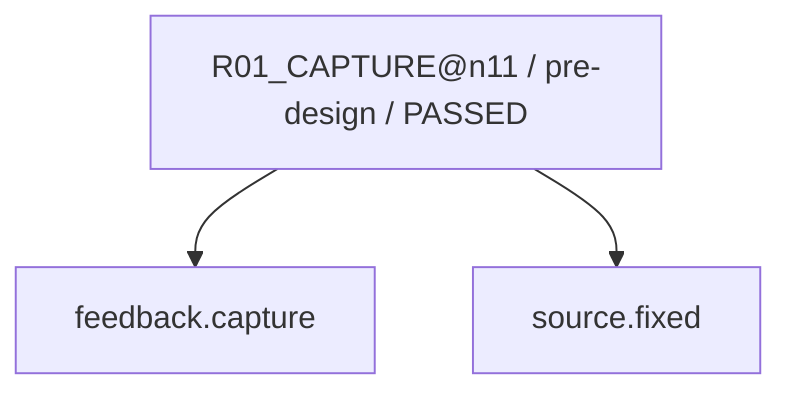

現在: G3_FINAL@n11 / WAITING

# R02_CAUSE@n11（GENERATED）

台帳HEAD: `3f1b1e013943031788fc917c014c703fb4e5c6893f9694af189483165b454043`

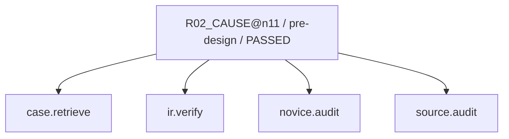

現在: G3_FINAL@n11 / WAITING

# R02_CAUSE@n11（GENERATED）

台帳HEAD: `3f1b1e013943031788fc917c014c703fb4e5c6893f9694af189483165b454043`

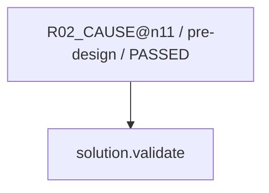

現在: G3_FINAL@n11 / WAITING

# R03_IMPACT@n11（GENERATED）

台帳HEAD: `3f1b1e013943031788fc917c014c703fb4e5c6893f9694af189483165b454043`

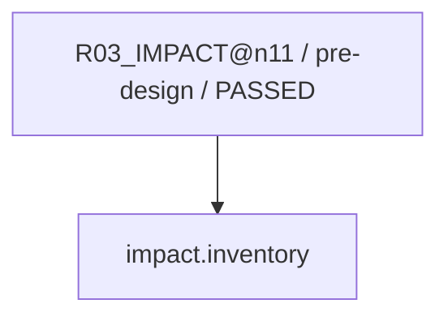

現在: G3_FINAL@n11 / WAITING

# R04_PROPOSAL@n11（GENERATED）

台帳HEAD: `3f1b1e013943031788fc917c014c703fb4e5c6893f9694af189483165b454043`

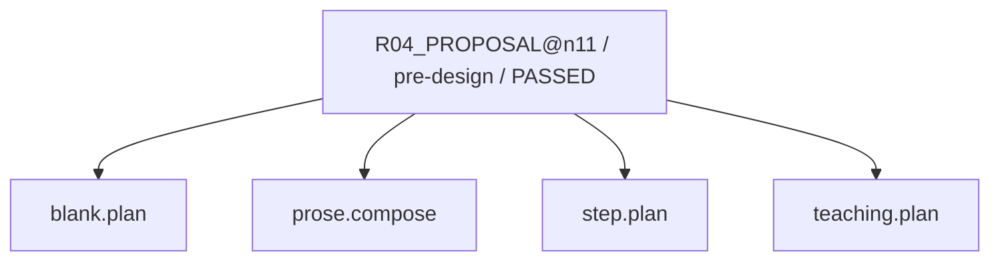

現在: G3_FINAL@n11 / WAITING

# R04_PROPOSAL@n11（GENERATED）

台帳HEAD: `3f1b1e013943031788fc917c014c703fb4e5c6893f9694af189483165b454043`

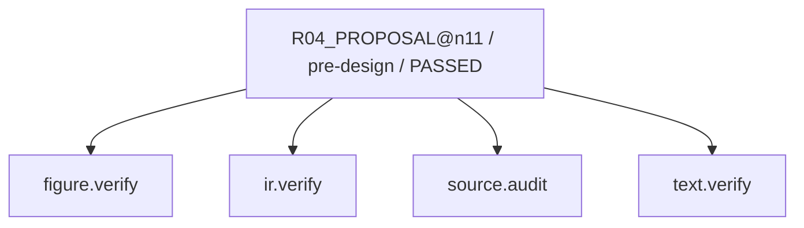

現在: G3_FINAL@n11 / WAITING

# R04_PROPOSAL@n11（GENERATED）

台帳HEAD: `3f1b1e013943031788fc917c014c703fb4e5c6893f9694af189483165b454043`

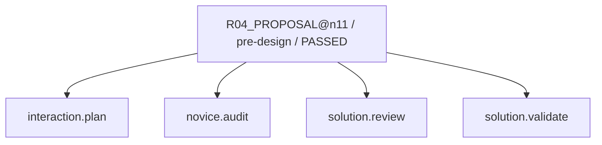

現在: G3_FINAL@n11 / WAITING

# R06_PATCH@n11（GENERATED）

台帳HEAD: `3f1b1e013943031788fc917c014c703fb4e5c6893f9694af189483165b454043`

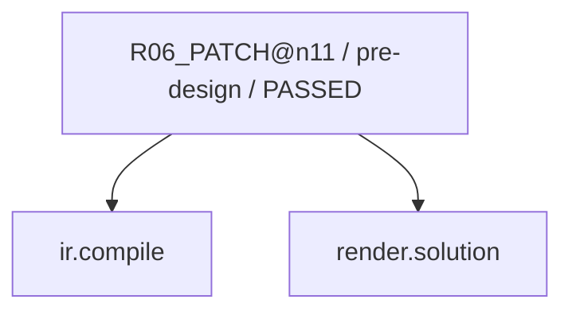

現在: G3_FINAL@n11 / WAITING

# R07_VERIFY@n11（GENERATED）

台帳HEAD: `3f1b1e013943031788fc917c014c703fb4e5c6893f9694af189483165b454043`

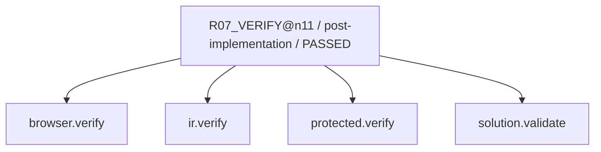

現在: G3_FINAL@n11 / WAITING

# R07_SEMANTIC@n11（GENERATED）

台帳HEAD: `3f1b1e013943031788fc917c014c703fb4e5c6893f9694af189483165b454043`

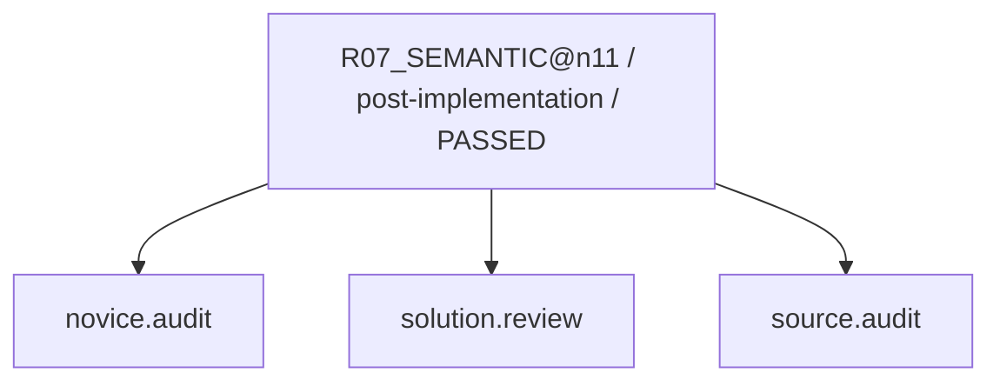

現在: G3_FINAL@n11 / WAITING

# G2_AUDIT@n11（GENERATED）

台帳HEAD: `3f1b1e013943031788fc917c014c703fb4e5c6893f9694af189483165b454043`

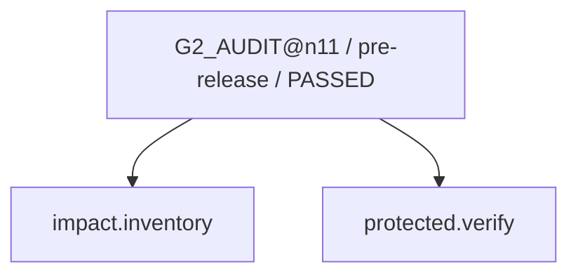

現在: G3_FINAL@n11 / WAITING

# G3_HOST@n11（GENERATED）

台帳HEAD: `3f1b1e013943031788fc917c014c703fb4e5c6893f9694af189483165b454043`

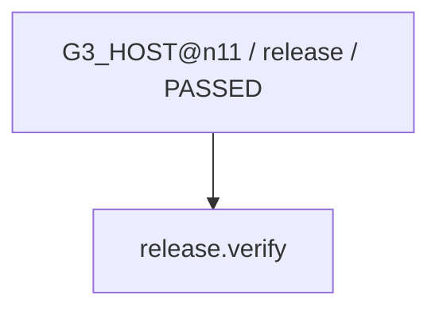

現在: G3_FINAL@n11 / WAITING

# R03_IMPACT_SWEEP@n11（GENERATED）

台帳HEAD: `3f1b1e013943031788fc917c014c703fb4e5c6893f9694af189483165b454043`

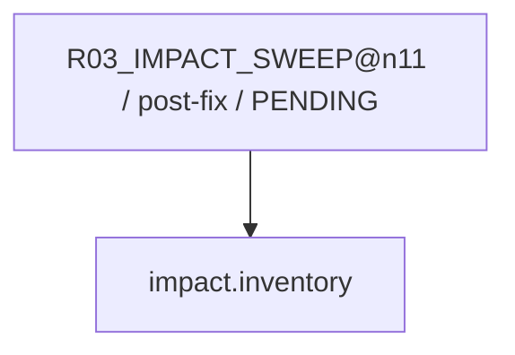

現在: G3_FINAL@n11 / WAITING

# R08_CAPTURE_LEARNING@n11（GENERATED）

台帳HEAD: `3f1b1e013943031788fc917c014c703fb4e5c6893f9694af189483165b454043`

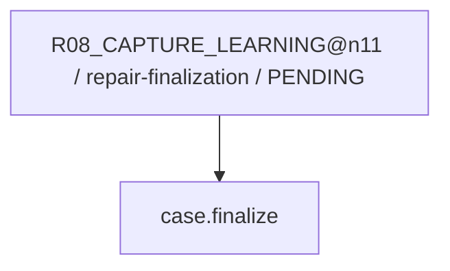

現在: G3_FINAL@n11 / WAITING

# L01_LEARNING@n11（GENERATED）

台帳HEAD: `3f1b1e013943031788fc917c014c703fb4e5c6893f9694af189483165b454043`

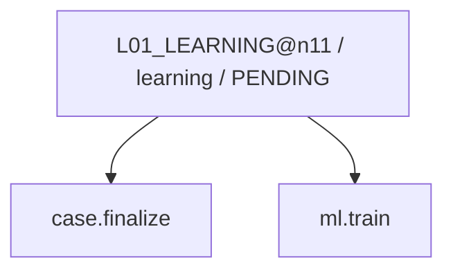

現在: G3_FINAL@n11 / WAITING

code実行receiptはsnapshot.jsonのcapability_receiptsを参照。AIの意味審査は別記録。
