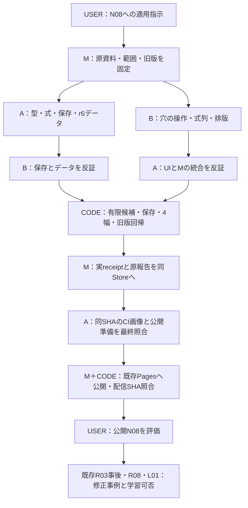

# W040 実装での担当と工程

入口は既存「修正」。production/2＋team/1＋construction-layout/1。MだけがStore/Gitを操作した。3人が同一表示を共著して独立監査とする方式ではない。Aの自身の数学コードはBが審査し、表示担当B/Mの表示はAが審査した。旧packetは実装hashの更新でSTALEとして保管し、現在packetを取り直した。具体案と公開への同じ許可を聞き直していない。

事前設計は承認済み。今回の実装準備後に正式receipt・作者登録を捕捉した事実は履歴へ記録し、登録を事前に遡らせていない。将来のWorkでは準備着手前の登録を優先する。図は担当説明であり、詳細の実行状態は共有Runtimeのevent/receiptが正本。本人の実物評価はAIが代行しない。
